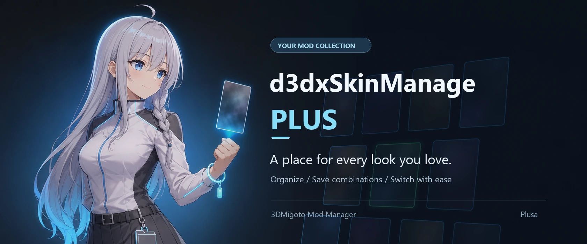
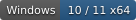
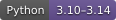
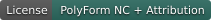
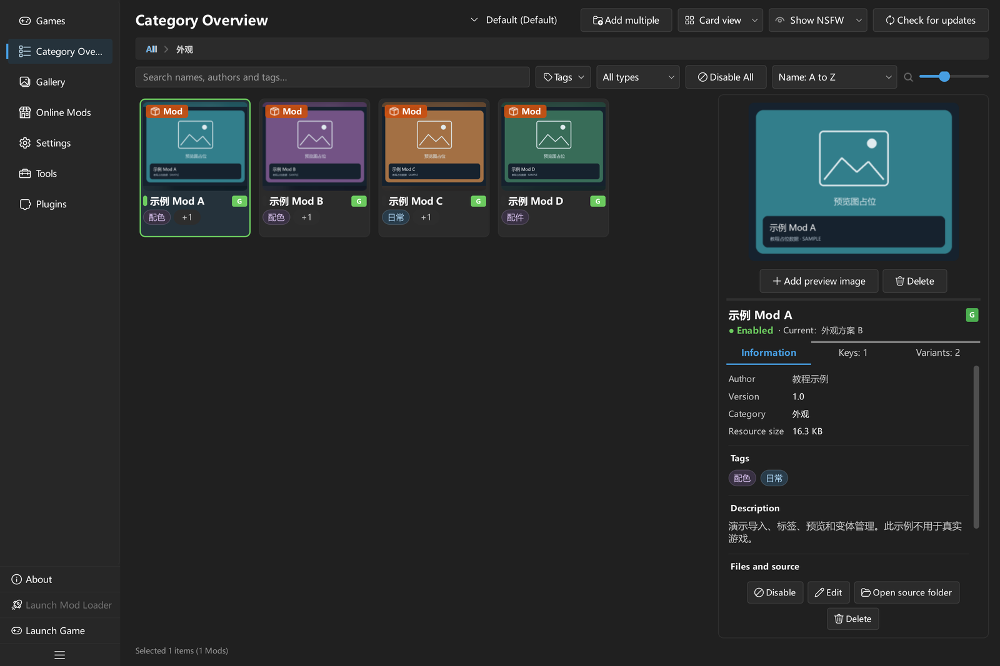
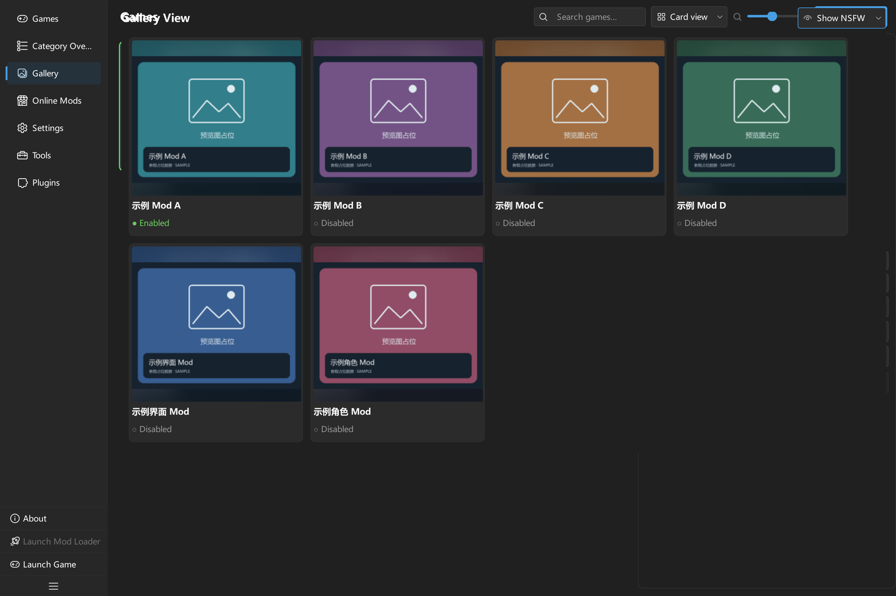
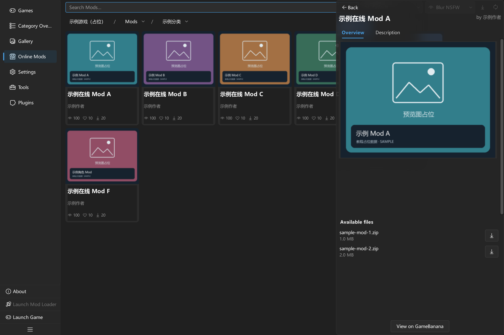
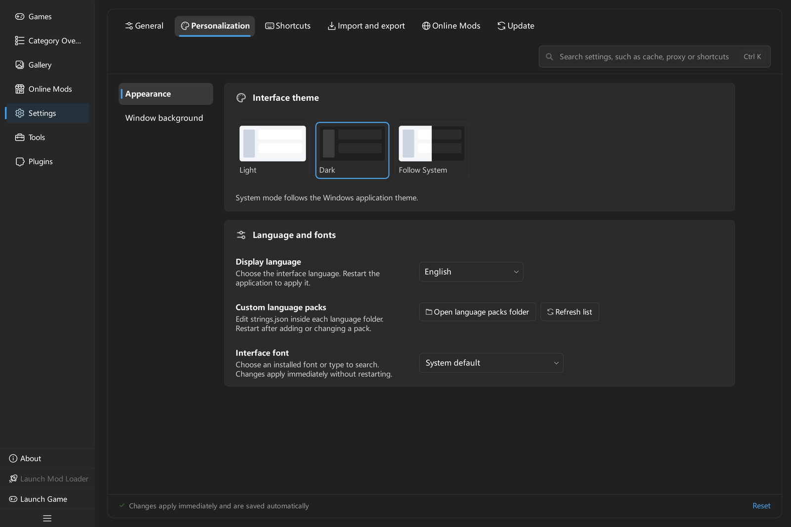
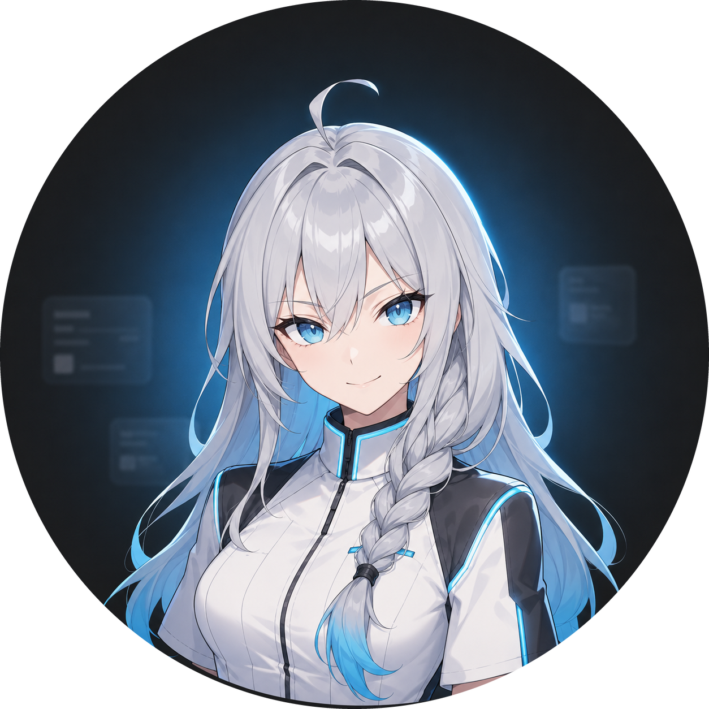
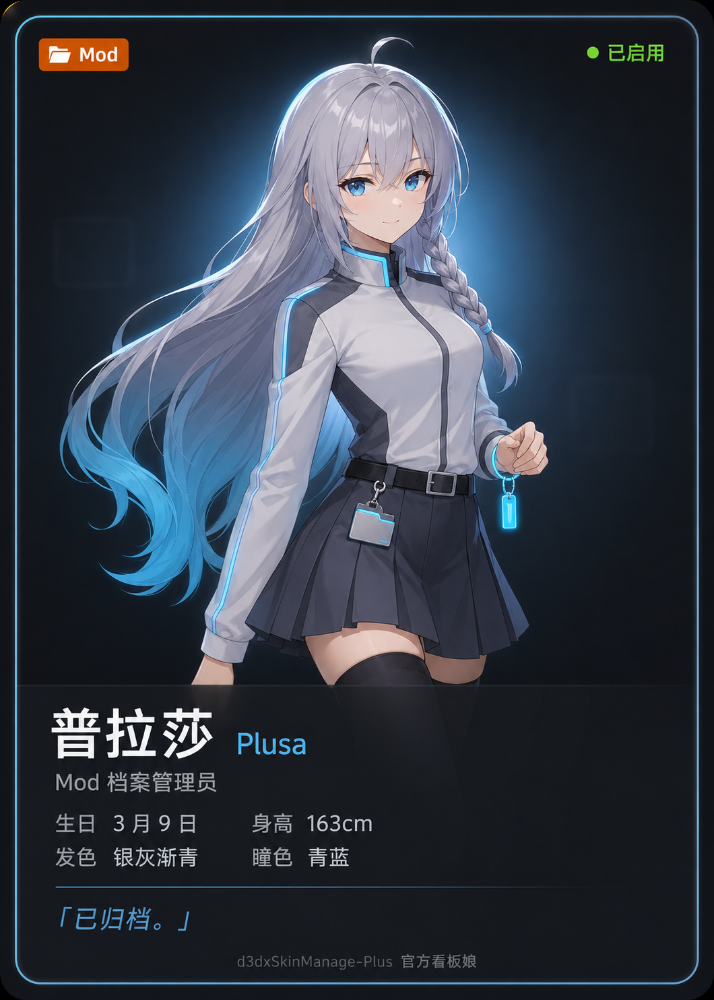

<a id="top"></a>

<p align="center">
  
</p>

<h1 align="center">d3dxSkinManage-Plus</h1>

<p align="center">
  <a href="README.md">简体中文</a> · <b>English</b>
</p>

<p align="center">
  <b>A tidy Mod wardrobe for your favorite characters.</b><br>
  Organize your collection, save your combinations, and make the next change easy.
</p>

<p align="center">
  <a href="#quick-start"></a>
  <a href="#source"></a>
  <a href="https://github.com/CHN-HelloWorld/d3dxSkinManage-Plus/releases/latest"></a>
  <a href="https://github.com/CHN-HelloWorld/d3dxSkinManage-Plus/releases"></a>
  <a href="LICENSE"></a>
</p>

<p align="center">
  <a href="https://github.com/CHN-HelloWorld/d3dxSkinManage-Plus/releases/latest"><b>Download the latest release · Windows x64</b></a> ·
  <a href="https://github.com/CHN-HelloWorld/d3dxSkinManage-Plus">Repository</a> ·
  <a href="https://github.com/CHN-HelloWorld/d3dxSkinManage-Plus/issues">Report an issue</a> ·
  <a href="https://qm.qq.com/q/Ajc0z0K6Kk">QQ community</a>
</p>

<p align="center">
  <a href="#preview">Preview</a> ·
  <a href="#features">Features</a> ·
  <a href="#quick-start">Get started</a> ·
  <a href="#guides">Guides</a> ·
  <a href="#faq">FAQ</a> ·
  <a href="#development">Development</a>
</p>

**d3dxSkinManage-Plus** is a Windows desktop Mod manager built with PySide6 for the 3DMigoto workflow.
Manage multiple games, organize collections, save Mod presets and appearance variants, and download Mods in one interface.
From importing your first archive to preparing several looks for the games you play most, your collection stays in one place.

> **Getting started**
>
> The complete Windows release package is [ready to use after extraction](#quick-start); no separate Python installation is needed.
> You can also [run from source](#source). For your first setup, follow the [quick start](docs/tutorials/en/Quickstart.en.md).

<a id="preview"></a>

## 🖼️ A look inside your Mod wardrobe

Browse your collection by category, with previews, tags, and enable status in the details panel on the right.

<p align="center">
  <a href="docs/tutorials/images/final-en/04-Mod信息.webp">
    
  </a>
</p>

<table>
  <tr>
    <td width="50%" align="center">
      <a href="docs/tutorials/images/final-en/21-画廊.webp"></a>
      <br><b>Browse your collection like a photo album</b><br><sub>Gallery and cover previews</sub>
    </td>
    <td width="50%" align="center">
      <a href="docs/tutorials/images/final-en/29-在线详情.webp"></a>
      <br><b>Find new looks and keep your collection current</b><br><sub>GameBanana browsing, downloads, and updates</sub>
    </td>
  </tr>
</table>

<details>
<summary>🎨 Explore personalization</summary>

Choose a dark or light theme, follow the system theme, or customize fonts, language, and backgrounds.
Full-window backgrounds support images, videos, and Wallpaper Engine scenes; WE scenes require a local Wallpaper Engine installation.

[](docs/tutorials/images/final-en/12-设置个性化.webp)

See the [personalization and background guide](docs/tutorials/chapters/en/ch6-settings.md) for setup instructions.

</details>

<p align="center">
  <sub>These are screenshots of the actual application. Game names, Mod names, and preview images are demonstration placeholders. Click an image to view the original.</sub>
</p>

<a id="features"></a>

## ✨ From collecting to creating a look

<table>
  <tr>
    <td width="50%" valign="top">
      <h3>🗂️ Keep a growing collection organized</h3>
      <p>Import ZIP, 7z, RAR, or folders. Organize resources with categories, tags, search, and preview images, and switch between card and list views.</p>
    </td>
    <td width="50%" valign="top">
      <h3>🎀 Save the combinations you love</h3>
      <p>Use Mod presets to manage an entire selection of Mods. For supported Mods, save named appearance variants for colors, accessories, and other persistent settings.</p>
    </td>
  </tr>
  <tr>
    <td width="50%" valign="top">
      <h3>🎮 Give each game its own space</h3>
      <p>Configure libraries, deployment folders, loaders, and game paths separately. Switch the active game to work with its categories, Mods, and presets.</p>
    </td>
    <td width="50%" valign="top">
      <h3>🌐 Discover, download, and check for updates</h3>
      <p>Browse GameBanana, view details, download Mods, and check existing resources for updates. Online content is matched using the configured English game name.</p>
    </td>
  </tr>
  <tr>
    <td width="50%" valign="top">
      <h3>🎨 Make the interface your own</h3>
      <p>Choose themes, static or animated backgrounds, fonts, language packs, and custom shortcuts. Simplified Chinese and English are included.</p>
    </td>
    <td width="50%" valign="top">
      <h3>🧩 Make everyday management easier</h3>
      <p>Extend commands, pages, and actions with Python plugins. Maintain your library with folder monitoring, file verification, index rebuilding, and operation recovery tools.</p>
    </td>
  </tr>
</table>

<a id="quick-start"></a>

##  Start with your first Mod

### What you need

| Requirement | Details |
| --- | --- |
| Windows 10 / 11 x64 | The supported desktop platform |
| A working 3DMigoto setup | Use the loader and configuration appropriate for your target game |
| A Mod archive or folder | ZIP, 7z, and RAR imports are supported |
| Python 3.11–3.14 | Required only when running from source; the complete Windows release includes its runtime |

**Local import, categorization, deployment, and preset management work offline.** Browsing GameBanana, downloading files, and checking for updates require a network connection.
The manager organizes and deploys resources; 3DMigoto handles loading them in the game.

Download the complete Windows ZIP from [the latest GitHub release](https://github.com/CHN-HelloWorld/d3dxSkinManage-Plus/releases/latest),
extract it to a writable folder, keep the included files, and run `d3dxSkinManage-Plus.exe`.

<a id="source"></a>

### Run from source

After obtaining the project source, open PowerShell in the project root:

```powershell
python -m venv .venv
.venv\Scripts\python.exe -m pip install -e .
.venv\Scripts\python.exe run_app.py
```

Dependency versions and platform requirements are defined in [pyproject.toml](pyproject.toml); `requirements.txt` points to the same installation configuration.
You can also start the application with `python -m src.main` in this virtual environment.

### Six steps to enable your first Mod

**Moving from d3dxSkinManage?** Enable the bundled **Legacy data migration** plugin on the Plugins page, then open
**Migrate from the legacy app** in Tools. Preview and copy your Mods, categories, metadata, and previews while preserving
the old files. See the [migration plugin README](plugins/official.legacy-migration/README.md).

1. **Add a game:** On the Games page, enter its name, English name, loader path, and **Mod folder**.
2. **Activate the game:** Double-click the game card and check that the **Current** badge appears.
3. **Create a category:** Open Category Overview, create a category, then double-click to enter it. A regular **Category** allows multiple enabled Mods; **Character/object** is suitable for mutually exclusive appearances.
4. **Import a Mod:** Drag an archive or folder into the category, or press <kbd>Ctrl</kbd> + <kbd>I</kbd>. Confirm and wait for the import to finish.
5. **Enable the Mod:** Double-click its card, or click **Enable** in the details panel. Wait for deployment to finish.
6. **Check it in the game:** Start the loader and game. If the game is already running, reload using the loader's configured shortcut.

> **Deployment folder setup**
>
> **Mod folder** must point to **the deployment folder specified in `d3dx.ini`**, commonly the loader's `Mods` folder.
> Keep the library of original Mods separate from the deployment folder read by the game. The application does not fill in the deployment folder automatically from the loader path.

Prefer illustrated instructions? **[Follow the 5-minute quick start →](docs/tutorials/en/Quickstart.en.md)**

<a id="guides"></a>

## 📚 Plusa's user guides

Start with the quick start, then use the complete manual to explore individual features.

| What you want to do | English | 简体中文 |
| --- | --- | --- |
| Import and enable your first Mod | [Quick start](docs/tutorials/en/Quickstart.en.md) | [5 分钟快速上手](docs/tutorials/zh/5分钟快速上手.md) |
| Explore categories, presets, variants, online updates, and settings | [User manual](docs/tutorials/en/Manual.en.md) | [完整功能手册](docs/tutorials/zh/完整功能手册.md) |
| Write, package, and validate plugins | [Plugin guide](docs/tutorials/en/PluginGuide.en.md) | [插件开发指南](docs/tutorials/zh/插件开发指南.md) |

Jump to: [Categories and Mods](docs/tutorials/chapters/en/ch3-categories-and-mods.md) ·
[Presets and variants](docs/tutorials/chapters/en/ch4-presets-deployment-and-keys.md) ·
[Online downloads and updates](docs/tutorials/chapters/en/ch5-online-mods-and-updates.md) ·
[Backup and troubleshooting](docs/tutorials/chapters/en/ch8-data-backup-and-troubleshooting.md).

**Read the guides offline, too.** Complete release packages include HTML user and plugin guides in `docs/`; double-click a file to open it.
Each file embeds its images and both languages, with language switching, a searchable table of contents, and expandable images.
Start with `d3dxSkinManage-Plus User Guide.html` or `d3dxSkinManage-Plus Plugin Development Guide.html` for English.
See the [tutorial index](docs/tutorials/README.md) for file details and maintenance information (in Chinese).

<a id="faq"></a>

##  Frequently asked questions

<details>
<summary><b>Which games are supported? Why are there no games on first launch?</b></summary>

The application does not include predefined games. Add and activate your own game configuration.
Whether a Mod works in the game depends on the game's 3DMigoto setup and the Mod's compatibility.
The online page uses the English game name to look for a matching game on GameBanana. The match is stored locally and checked again when you change that name.

</details>

<details>
<summary><b>How do Mod presets, appearance variants, and category presets differ?</b></summary>

| Type | What it saves |
| --- | --- |
| Mod preset | A selection of Mods and references to the named variants used by each Mod |
| Appearance variant | Persistent values within one Mod, such as colors or accessories; the Mod must support them |
| Category preset | A category tree, names, node types, and optional category images; no Mod files |

A new Mod preset starts empty. To adjust an existing combination, duplicate its preset, then apply and edit the copy.

</details>

<details>
<summary><b>A Mod says Enabled, but nothing changes in the game. What should I check?</b></summary>

Check that the deployment folder matches `d3dx.ini`, the loader is running, and the Mod supports the current game version. Then reload the loader.
The default 3DMigoto reload key is usually <kbd>F10</kbd>; use your actual configuration if you changed it.
See the [quick start troubleshooting section](docs/tutorials/en/Quickstart.en.md) for more symptoms and fixes.

</details>

<details>
<summary><b>Do I need WinRAR to import RAR files?</b></summary>

ZIP, 7z, and RAR imports use the project's declared extraction dependencies. A separate WinRAR installation is only required to **create RAR archives**.
If you run from source, install the full set of project dependencies first.

</details>

<details>
<summary><b>Where are my collection and settings stored? How do I move them to another computer?</b></summary>

The application creates `config/`, `data/`, `cache/`, and `logs/` at runtime.
Back up your configuration, data, and any separately configured external libraries.
Keep each Mod's entire container so that metadata, previews, key bindings, and named variants are included.
See [data backup and troubleshooting](docs/tutorials/chapters/en/ch8-data-backup-and-troubleshooting.md) for the steps.

</details>

<a id="community"></a>

## 🤝 Join the conversation

<p align="center">
  <a href="https://qm.qq.com/q/Ajc0z0K6Kk"></a><br>
  <a href="https://qm.qq.com/q/Ajc0z0K6Kk"><b>Join the QQ group ↗</b></a>
</p>

Share tips, discuss Mod combinations, or suggest improvements. For issues that need ongoing tracking, use [GitHub Issues](https://github.com/CHN-HelloWorld/d3dxSkinManage-Plus/issues).

<a id="development"></a>

## 🛠️ Development and extensions

Contributions to features, language packs, documentation, and everyday workflow plugins are welcome.
Read the [contribution guide](CONTRIBUTING.md) before starting (in Chinese).

<details>
<summary><b>Set up a development environment and run local checks</b></summary>

Install development dependencies in your virtual environment and run the relevant checks locally:

```powershell
.venv\Scripts\python.exe -m pip install -e ".[dev]"
.venv\Scripts\python.exe -m ruff check .
.venv\Scripts\python.exe -m ruff format --check .
.venv\Scripts\python.exe scripts/quality/check_repository.py
.venv\Scripts\python.exe scripts/i18n/i18n_catalog.py --check
.venv\Scripts\python.exe -m pytest
```

For tests and performance validation, see the [testing notes](tests/README.md) (in Chinese). For default language maintenance, see the [language pack guide](docs/tutorials/en/LanguagePackGuide.en.md).

</details>

<details>
<summary><b>Build a Windows release package</b></summary>

The main application uses Nuitka; the native updater uses the Visual Studio 2022 C++17 toolchain.
Build the updater using its [build instructions](updater/README.md), and prepare the separate video asset as described in the [project film notes](resources/about/story/README.md), then run:

```powershell
.venv\Scripts\python.exe scripts/release/build.py --install-deps --with-updater --zip
```

You can also double-click `构建工具.bat` in the project root. Output is written to `build/`.
The [build guide](docs/构建指南.md) covers build options, manual GitHub release workflows, and update sources.
These build documents are currently in Chinese.

</details>

<details>
<summary><b>Write your first plugin</b></summary>

```powershell
.venv\Scripts\python.exe scripts/plugins/new_plugin.py com.example.mod-summary --name "Mod Summary"
.venv\Scripts\python.exe scripts/plugins/plugin_tool.py check plugins/com.example.mod-summary
```

Plugins load from `plugins/` in the application root. First-time activation asks you to confirm trust and permissions.
SDK 2.0 supports packages with multiple files, activation on demand, version dependencies, cancellable background tasks, disposable resources, and observable configuration.
The scaffold creates a runnable plugin package. See the [plugin development guide](docs/tutorials/en/PluginGuide.en.md) for APIs and packaging steps.

Included examples: [Mod inventory export](plugins/example.mod-inventory/README.md) ·
[Preset audit](plugins/example.preset-audit/README.md) ·
[Preset cycle](plugins/example.preset-cycle/README.md). The example READMEs are in Chinese.

</details>

<details>
<summary><b>Project directory guide</b></summary>

| Path | Purpose |
| --- | --- |
| `src/core/`, `src/models/` | Resource management, persistence, operation transactions, and data models |
| `src/services/` | Archives, images, networking, and update services |
| `src/ui/` | PySide6 interface, background tasks, and interactive components |
| `src/plugin_sdk/`, `src/plugins/` | Public plugin APIs and the host runtime |
| `resources/` | Themes, icons, attributed assets, and the project film |
| `config/languages/` | Default Chinese and English language packs and JSON Schema |
| `plugins/` | Included plugin examples and local plugin installation directory |
| [`scripts/`](scripts/README.md) | Maintenance tools for builds, local quality checks, languages, plugins, and assets |
| `updater/` | Native C++ updater and its tests |
| `tests/` | Automated tests and manual verification notes |
| `docs/` | User tutorials, development documents, and README images |

</details>

When [reporting an issue](https://github.com/CHN-HelloWorld/d3dxSkinManage-Plus/issues), include the application version, steps to reproduce, expected behavior, and actual behavior.
Relevant logs are available under **Tools → View Logs**. Feedback on usability, documentation, and translations is welcome too.

<a id="license"></a>

## 💙 Acknowledgments and license

Thank you to [numLinka](https://github.com/numlinka) for the early exploration and continued contributions to the d3dxSkinManage series and the Mod management community.
**d3dxSkinManage-Plus is an independently developed project**, with no code reference, derivation, or affiliation with the original d3dxSkinManage. This acknowledgment recognizes numLinka's community contributions.
Thanks also to this project's developers, collaborators, testers, and everyone who shares thoughtful feedback.

This project uses the **PolyForm Noncommercial License 1.0.0 together with the Attribution Integrity Addendum**.
Noncommercial use, modification, and distribution must comply with [LICENSE](LICENSE), including its attribution requirements.
This is a **source-available license, not an OSI-approved open-source license**.
Third-party components and assets retain their own licenses; see [third-party notices](THIRD_PARTY_NOTICES.md).

---

<p align="center">
  <a href="docs/readme/plusa/character-card.png"></a><br>
  <b>Collection ready. Let's go.</b><br><br>
  <a href="#top">Back to top ↑</a>
</p>
