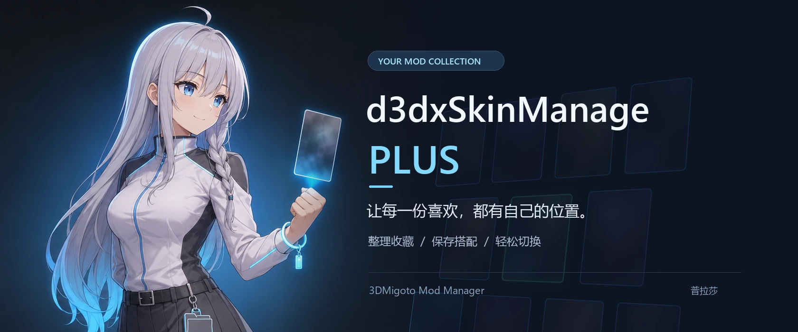
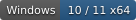
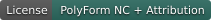
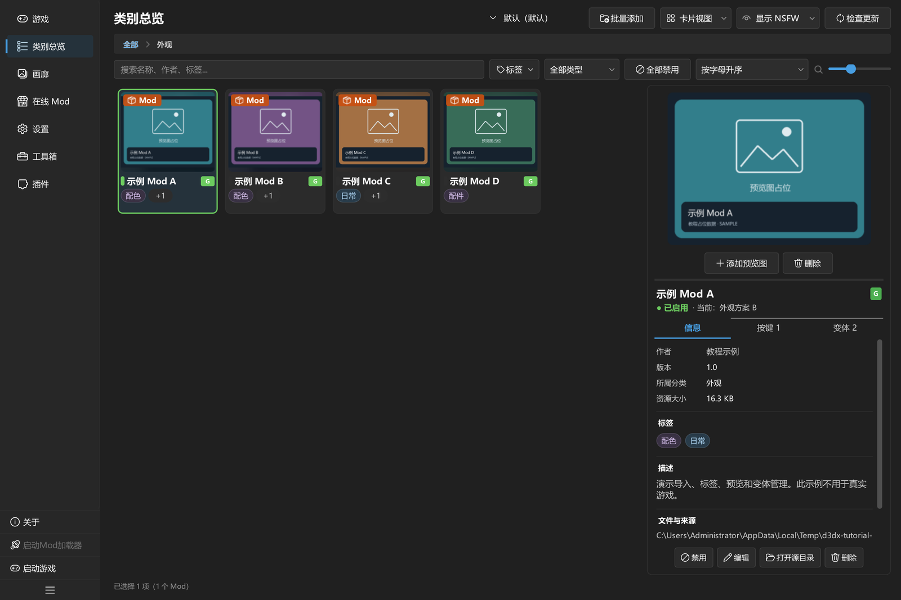
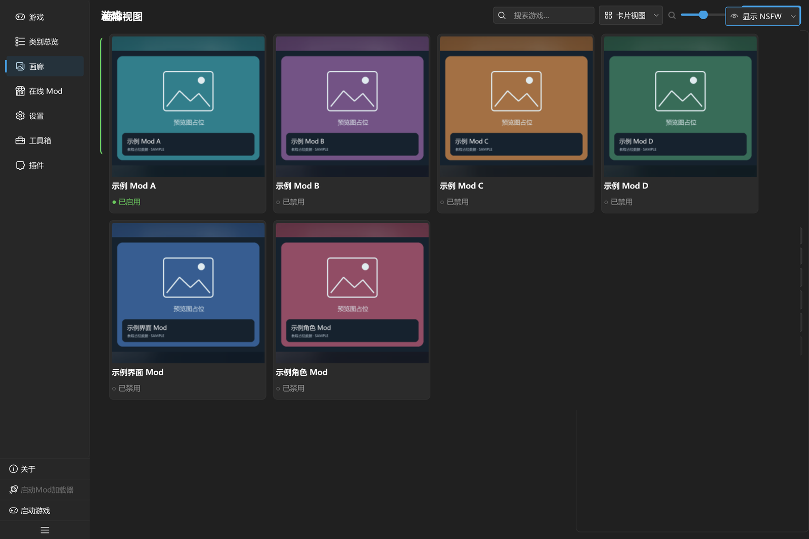
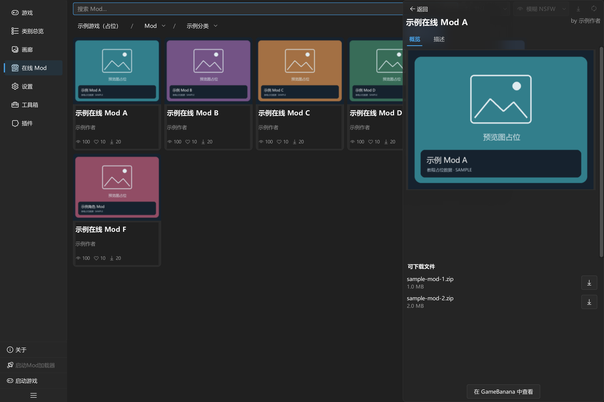
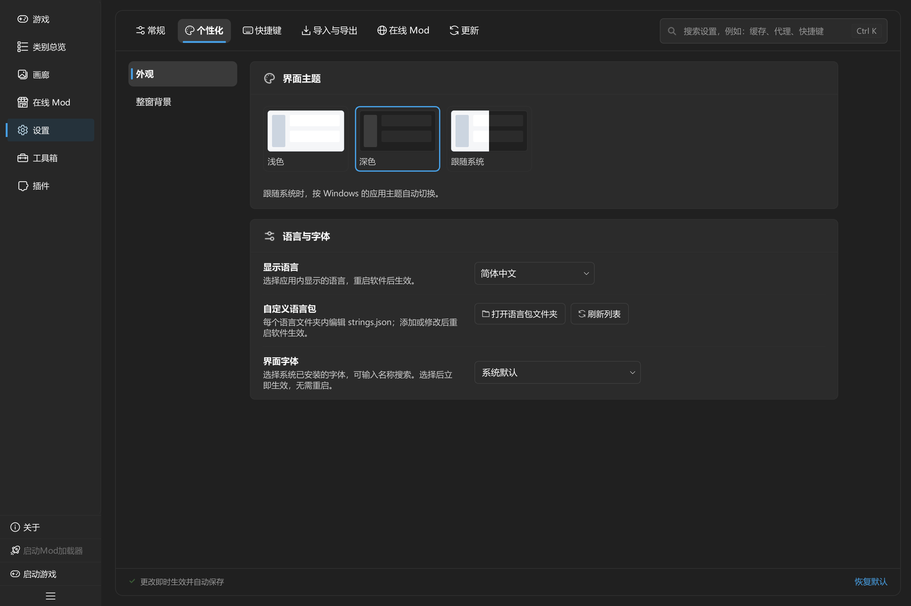
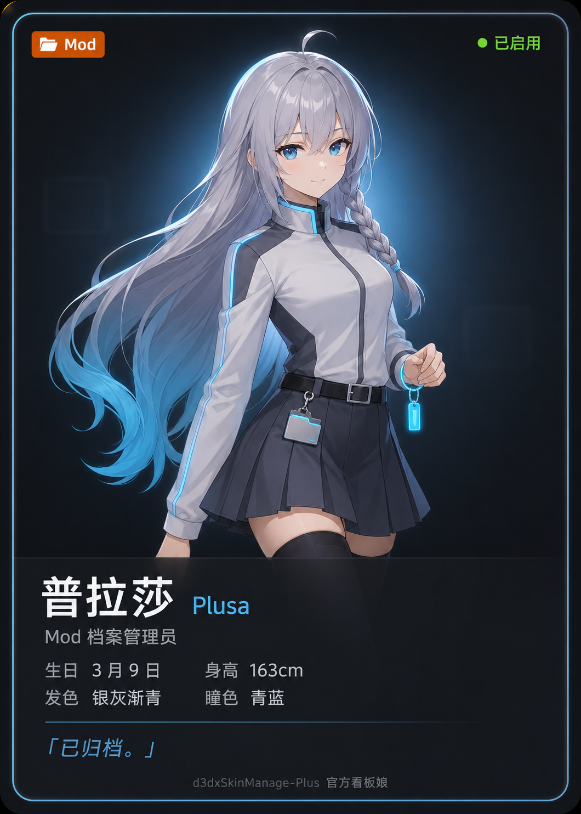

<a id="top"></a>

<p align="center">
  
</p>

<h1 align="center">d3dxSkinManage-Plus</h1>

<p align="center">
  <b>简体中文</b> · <a href="README.en.md">English</a>
</p>

<p align="center">
  <b>给喜欢的角色，一个井井有条的 Mod 衣橱。</b><br>
  整理收藏，保存搭配，让下一次换装轻松一点。
</p>

<p align="center">
  <a href="#quick-start"></a>
  <a href="#source"></a>
  <a href="https://github.com/CHN-HelloWorld/d3dxSkinManage-Plus/releases/latest"></a>
  <a href="https://github.com/CHN-HelloWorld/d3dxSkinManage-Plus/releases"></a>
  <a href="LICENSE"></a>
</p>

<p align="center">
  <a href="https://github.com/CHN-HelloWorld/d3dxSkinManage-Plus/releases/latest"><b>下载最新版本 · Windows x64</b></a> ·
  <a href="https://github.com/CHN-HelloWorld/d3dxSkinManage-Plus">项目仓库</a> ·
  <a href="https://github.com/CHN-HelloWorld/d3dxSkinManage-Plus/issues">问题反馈</a> ·
  <a href="https://qm.qq.com/q/Ajc0z0K6Kk">QQ 交流群</a>
</p>

<p align="center">
  <a href="#preview">界面预览</a> ·
  <a href="#features">功能亮点</a> ·
  <a href="#quick-start">开始使用</a> ·
  <a href="#guides">使用指南</a> ·
  <a href="#faq">常见问题</a> ·
  <a href="#development">开发与扩展</a>
</p>

**d3dxSkinManage-Plus** 是一款基于 PySide6 的 Windows 桌面 Mod 管理器，围绕 3DMigoto 的使用流程，
把多游戏管理、分类收藏、组合预设、外观变体和在线下载放进同一个界面。
从整理第一个压缩包，到为常玩的游戏准备几套搭配，都可以在这里完成。

> **使用提示**
>
> 完整 Windows 构建包可[直接解压使用](#quick-start)，无需另装 Python。
> 也可以[从源码运行](#source)；首次使用请参阅[快速上手](docs/tutorials/zh/5分钟快速上手.md)。

<a id="preview"></a>

## 🖼️ 先看看，你的 Mod 衣橱

按类别浏览收藏，在右侧查看预览、标签和启用状态。

<p align="center">
  <a href="docs/tutorials/images/final/04-Mod信息.webp">
    
  </a>
</p>

<table>
  <tr>
    <td width="50%" align="center">
      <a href="docs/tutorials/images/final/21-画廊.webp"></a>
      <br><b>像翻相册一样，浏览你的收藏</b><br><sub>画廊与封面预览</sub>
    </td>
    <td width="50%" align="center">
      <a href="docs/tutorials/images/final/29-在线详情.webp"></a>
      <br><b>发现新外观，也照顾已有收藏</b><br><sub>GameBanana 浏览、下载与更新</sub>
    </td>
  </tr>
</table>

<details>
<summary>🎨 再看看个性化设置</summary>

深色、浅色或跟随系统，也可以选择字体、语言与自定义背景。
整窗背景支持图片、视频和 Wallpaper Engine 场景；WE 场景需要本机安装 Wallpaper Engine。

[](docs/tutorials/images/final/12-设置个性化.webp)

设置方法见[个性化与背景说明](docs/tutorials/chapters/zh/ch6-设置详解.md)。

</details>

<p align="center">
  <sub>以上均为实际程序截图，游戏、Mod 名称与预览图使用演示占位数据。点击配图可查看原始大图。</sub>
</p>

<a id="features"></a>

## ✨ 从收藏到搭配，都照顾好

<table>
  <tr>
    <td width="50%" valign="top">
      <h3>🗂️ 收藏再多，也有条理</h3>
      <p>导入 ZIP、7z、RAR 或文件夹，用分类、标签、搜索和预览图整理资源。卡片与列表视图按习惯切换。</p>
    </td>
    <td width="50%" valign="top">
      <h3>🎀 喜欢的搭配，随时换上</h3>
      <p>用组合预设管理一整套 Mod 选择；为支持的 Mod 保存配色、配件等命名变体，让常用搭配各就各位。</p>
    </td>
  </tr>
  <tr>
    <td width="50%" valign="top">
      <h3>🎮 每个游戏，独立一份</h3>
      <p>分别配置资源库、部署目录、加载器与游戏路径。切换当前游戏后，在对应的分类、Mod 与预设中继续整理。</p>
    </td>
    <td width="50%" valign="top">
      <h3>🌐 发现、下载、检查更新</h3>
      <p>在程序内浏览 GameBanana、查看详情并下载 Mod，检查已有资源的更新。在线内容按配置的游戏英文名匹配。</p>
    </td>
  </tr>
  <tr>
    <td width="50%" valign="top">
      <h3>🎨 让界面也有你的风格</h3>
      <p>深浅主题、图片与动态背景、字体、语言包和自定义快捷键。内置简体中文与英文，按自己的习惯使用。</p>
    </td>
    <td width="50%" valign="top">
      <h3>🧩 日常管理，还能再顺手些</h3>
      <p>通过 Python 插件扩展命令、页面与操作；使用目录监控、文件校验、索引重建和操作恢复工具维护资源库。</p>
    </td>
  </tr>
</table>

<a id="quick-start"></a>

##  从第一件收藏开始

### 准备好这些

| 需要什么 | 说明 |
| --- | --- |
| Windows 10 / 11 x64 | 当前支持的桌面平台 |
| 可正常工作的 3DMigoto 环境 | 使用与你的目标游戏匹配的加载器与配置 |
| 一个 Mod 压缩包或文件夹 | ZIP、7z、RAR 均可导入 |
| Python 3.11–3.14 | 从源码运行时需要；完整 Windows 构建包无需另装 Python |

**本地导入、分类、部署和预设管理可以离线使用。** 浏览 GameBanana、下载与检查更新时需要网络。
管理器负责整理和部署资源，游戏内的实际加载由 3DMigoto 完成。

从 [GitHub Releases 下载最新版本](https://github.com/CHN-HelloWorld/d3dxSkinManage-Plus/releases/latest)的完整 Windows ZIP，
解压到可写目录，保留随包文件，运行 `d3dxSkinManage-Plus.exe`。

<a id="source"></a>

### 从源码运行

取得项目源码后，在项目根目录打开 PowerShell：

```powershell
python -m venv .venv
.venv\Scripts\python.exe -m pip install -e .
.venv\Scripts\python.exe run_app.py
```

依赖版本与平台条件统一定义于 [pyproject.toml](pyproject.toml)，`requirements.txt` 也指向同一安装配置。
也可在该虚拟环境中通过 `python -m src.main` 启动。

### 六步，把第一个 Mod 用起来

**从旧版 d3dxSkinManage 迁移：** 在「插件」页启用随包的「旧版数据迁移」，再从工具箱打开「从旧版迁移」。
扫描旧版目录后可预览并复制 Mod、分类、元数据与预览图，保留旧版文件。详见[迁移插件说明](plugins/official.legacy-migration/README.md)。

1. **添加游戏**：在「游戏」页填写名称、英文名称、加载器路径和「Mod 文件夹」。
2. **激活游戏**：双击游戏卡片，确认出现「当前」标记。
3. **建立类别**：进入「类别总览」，新建类别，再双击进入。普通「类别」允许同时启用多个 Mod；「角色/对象」适合互斥外观。
4. **导入收藏**：把压缩包或文件夹拖进类别，或按 <kbd>Ctrl</kbd> + <kbd>I</kbd>，确认后等待导入完成。
5. **启用 Mod**：双击 Mod 卡片，或点击详情栏中的「启用」，等待部署完成。
6. **进游戏看看**：启动加载器和游戏；游戏已在运行时，按加载器配置执行重载。

> **部署目录设置**
>
> 「Mod 文件夹」应指向 **`d3dx.ini` 指定的部署目录**，常见位置是加载器下的 `Mods`。
> 保存原始收藏的资源库与游戏读取的部署目录需要分开；程序不会根据加载器路径自动填写部署目录。

跟着配图操作更直观：**[5 分钟快速上手 →](docs/tutorials/zh/5分钟快速上手.md)**

<a id="guides"></a>

## 📚 普拉莎的使用手册

第一次使用，跟着快速上手走一遍；想研究某个功能，再打开完整手册。

| 想了解什么 | 简体中文 | English |
| --- | --- | --- |
| 导入并启用第一个 Mod | [5 分钟快速上手](docs/tutorials/zh/5分钟快速上手.md) | [Quick start](docs/tutorials/en/Quickstart.en.md) |
| 分类、预设、变体、在线更新与设置 | [完整功能手册](docs/tutorials/zh/完整功能手册.md) | [User manual](docs/tutorials/en/Manual.en.md) |
| 编写、打包与验证插件 | [插件开发指南](docs/tutorials/zh/插件开发指南.md) | [Plugin guide](docs/tutorials/en/PluginGuide.en.md) |

也可以直接翻到：[分类与 Mod 管理](docs/tutorials/chapters/zh/ch3-类别总览与Mod管理.md) ·
[组合与变体](docs/tutorials/chapters/zh/ch4-预设部署与按键.md) ·
[在线下载与更新](docs/tutorials/chapters/zh/ch5-在线Mod与更新.md) ·
[备份与排障](docs/tutorials/chapters/zh/ch8-数据备份与排障.md)。

**离线也能看教程。** 完整构建包的 `docs/` 内附有使用教程和插件开发指南 HTML，双击即可阅读。
每份文件内嵌图片和中英文正文，支持切换语言、筛选目录和放大配图。更多说明见[教程入口](docs/tutorials/README.md)。

<a id="faq"></a>

##  你可能还想知道

<details>
<summary><b>支持哪些游戏？第一次打开为什么没有游戏？</b></summary>

程序不预置游戏，需要手动添加并激活游戏配置。能否在游戏中生效，取决于目标游戏的 3DMigoto 环境与 Mod 本身的适配情况。
填写游戏英文名称后，在线页面会尝试匹配 GameBanana 上的游戏；匹配结果保存在本地，修改英文名后会重新匹配。

</details>

<details>
<summary><b>组合预设、外观变体和分类预设，有什么区别？</b></summary>

| 名称 | 保存的内容 |
| --- | --- |
| 组合预设 | 一组 Mod 选择，以及各 Mod 使用的命名变体引用 |
| 外观变体 | 单个 Mod 中可持久化的配色、配件等数值配置，需要 Mod 本身支持 |
| 分类预设 | 分类树、名称、节点类型和可选目录图片，不包含 Mod 本体 |

新建组合是空组合。想在当前搭配上稍作修改，可以先复制已有组合，再应用并调整。

</details>

<details>
<summary><b>显示「已启用」，游戏里却没有变化？</b></summary>

依次核对部署目录是否与 `d3dx.ini` 一致、加载器是否运行、Mod 是否适配当前游戏版本，然后执行加载器重载。
默认配置的 3DMigoto 通常使用 <kbd>F10</kbd>；修改过按键时，以实际配置为准。
更多现象与处理方法见[快速上手中的排障说明](docs/tutorials/zh/5分钟快速上手.md)。

</details>

<details>
<summary><b>导入 RAR 需要安装 WinRAR 吗？</b></summary>

导入 ZIP、7z、RAR 使用项目声明的解压依赖，**创建 RAR 压缩包**时才需要另装 WinRAR。
若使用源码环境，请先完整安装项目依赖。

</details>

<details>
<summary><b>收藏和配置放在哪里？换电脑时怎么带走？</b></summary>

运行时会创建 `config/`、`data/`、`cache/` 和 `logs/`。备份时保留配置、数据以及另行设置的外部资源库；
单个 Mod 应保留整个容器，避免遗漏元数据、预览图、改键与命名变体。
具体步骤见[数据备份与排障](docs/tutorials/chapters/zh/ch8-数据备份与排障.md)。

</details>

<a id="community"></a>

## 🤝 一起交流

<p align="center">
  <a href="https://qm.qq.com/q/Ajc0z0K6Kk"></a><br>
  <a href="https://qm.qq.com/q/Ajc0z0K6Kk"><b>加入 QQ 交流群 ↗</b></a>
</p>

欢迎分享使用心得、交流搭配或反馈建议。需要持续跟踪的问题，也可以提交到 [GitHub Issues](https://github.com/CHN-HelloWorld/d3dxSkinManage-Plus/issues)。

<a id="development"></a>

## 🛠️ 开发与扩展

欢迎一起完善功能、补充语言包、改进文档，或编写让日常管理更方便的小插件。
开始前请阅读[贡献指南](CONTRIBUTING.md)。

<details>
<summary><b>搭建开发环境与运行本地检查</b></summary>

在已创建的虚拟环境中安装开发依赖，并按修改范围在本机运行以下检查：

```powershell
.venv\Scripts\python.exe -m pip install -e ".[dev]"
.venv\Scripts\python.exe -m ruff check .
.venv\Scripts\python.exe -m ruff format --check .
.venv\Scripts\python.exe scripts/quality/check_repository.py
.venv\Scripts\python.exe scripts/i18n/i18n_catalog.py --check
.venv\Scripts\python.exe -m pytest
```

测试与性能验证见[测试说明](tests/README.md)，默认语言包的维护方法见[语言包指南](docs/tutorials/zh/语言包指南.md)。

</details>

<details>
<summary><b>构建 Windows 发行包</b></summary>

主程序使用 Nuitka，原生更新器使用 Visual Studio 2022 的 C++17 工具链。
先按[更新器说明](updater/README.md)构建更新器，并按[短片资源说明](resources/about/story/README.md)准备独立视频资源，再执行：

```powershell
.venv\Scripts\python.exe scripts/release/build.py --install-deps --with-updater --zip
```

也可双击根目录的 `构建工具.bat`。产物位于 `build/`。
详细构建选项、云端发布步骤和更新源配置见[构建指南](docs/构建指南.md)。

</details>

<details>
<summary><b>编写第一个插件</b></summary>

```powershell
.venv\Scripts\python.exe scripts/plugins/new_plugin.py com.example.mod-summary --name "Mod 统计助手"
.venv\Scripts\python.exe scripts/plugins/plugin_tool.py check plugins/com.example.mod-summary
```

插件从应用根目录的 `plugins/` 加载，首次启用时需确认信任和权限。
SDK 2.0 支持多文件包、按需激活、版本依赖、可取消后台任务、可释放资源和可观察配置。
脚手架生成可直接运行的多文件插件，接口与打包步骤见[插件开发指南](docs/tutorials/zh/插件开发指南.md)。

随包示例：[Mod 清单导出](plugins/example.mod-inventory/README.md) ·
[预设检查](plugins/example.preset-audit/README.md) ·
[预设轮换](plugins/example.preset-cycle/README.md)。

</details>

<details>
<summary><b>项目目录导览</b></summary>

| 路径 | 用途 |
| --- | --- |
| `src/core/`、`src/models/` | 资源管理、持久化、操作事务与数据模型 |
| `src/services/` | 压缩、图像、网络和更新服务 |
| `src/ui/` | PySide6 界面、后台任务与交互组件 |
| `src/plugin_sdk/`、`src/plugins/` | 插件公开接口与宿主运行时 |
| `resources/` | 主题、图标、署名素材与项目短片 |
| `config/languages/` | 默认中文、英文语言包及 JSON Schema |
| `plugins/` | 随包插件示例与本地安装位置 |
| [`scripts/`](scripts/README.md) | 构建、质量检查、语言包、插件与资源等维护工具 |
| `updater/` | 原生 C++ 更新器及其测试 |
| `tests/` | 自动化测试与人工验证说明 |
| `docs/` | 用户教程、开发文档与 README 配图 |

</details>

[反馈问题](https://github.com/CHN-HelloWorld/d3dxSkinManage-Plus/issues)时，附上软件版本、复现步骤、预期结果与实际结果；相关日志可从「工具箱 → 查看日志」获取。
使用体验、文档勘误和翻译建议，同样欢迎。

<a id="license"></a>

## 💙 致谢与许可

感谢 [numLinka](https://github.com/numlinka) 为 d3dxSkinManage 系列与 Mod 管理社区做出的早期探索和长期贡献。
**d3dxSkinManage-Plus 是独立开发的项目**，与原 d3dxSkinManage 无代码引用、衍生或隶属关系；此处致谢表彰其社区贡献。
也感谢本项目的开发者、协作者、测试者，以及每一位认真分享建议的使用者。

本项目采用 **PolyForm Noncommercial License 1.0.0 与署名完整性附加条款**。
非商业使用、修改和分发须遵守 [LICENSE](LICENSE)，并保留要求的署名。
这是**源码可用许可，不属于 OSI 认可的开源许可证**。第三方组件与资源保留各自许可，见[第三方声明](THIRD_PARTY_NOTICES.md)。

---

<p align="center">
  <a href="docs/readme/plusa/character-card.png"></a><br>
  <b>整理好收藏，再一起出发。</b><br><br>
  <a href="#top">回到顶部 ↑</a>
</p>
