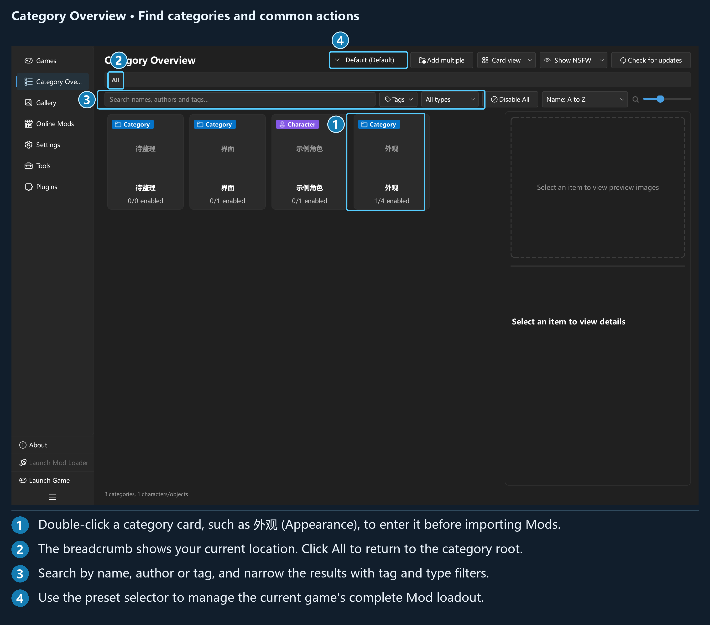

## Chapter 1: Interface and navigation

### 1.1 Startup and version

Extract the entire release package before starting the application. No games are preconfigured on first use; add your own on the **Games** page. On later launches, the application restores the last active game if it is still valid.

Local imports, categories, deployment, and preset management work offline. GameBanana and application updates connect to the network when needed.

Find the version number under **Settings → Update → Application updates**. Game names and resources in the illustrations are demonstration data; select your own games and files when following the instructions.

### 1.2 Main window and navigation

*The left navigation switches pages, and the current page appears on the right. In the overview, you can drag the divider between the content area and the details panel.*

| Navigation entry | Purpose |
| --- | --- |
| **Games** | Add, edit, and activate games |
| **Category Overview** | Manage categories, Mods, tags, preview images, and Mod presets |
| **Gallery** | Browse the current game's Mods using large images |
| **Online Mods** | Browse GameBanana and manage downloads |
| **Settings** | General, Personalization, Shortcuts, Import and export, Online Mods, and Update |
| **Tools** | Category presets, index rebuilding, logs, and plugin tools |
| **Plugins** | Install, search for, enable, disable, configure, and uninstall plugins |

Below the list are **About**, **Launch Mod Loader**, **Launch Game**, and the button to collapse the navigation. A **Plugin Commands** entry appears when plugin commands are available; plugins can also add their own navigation pages.

The two launch buttons depend on the current game's path configuration. If they are unavailable, return to **Games** and check **Executable** and **3DMigoto**.

The navigation keeps its icons when collapsed; hover over them to see tooltips. The interface remembers various views, card sizes, and panel layouts. Window sizing and display behavior may vary by page.

### 1.3 Game activation state

**Category Overview**, **Gallery**, and **Online Mods** all depend on the current game. If none is active, these pages show **Activate a game environment first** and a button leading to the Games page.

On the **Games** page:

- Click a card or list row once to select it and view its configuration.
- Double-click a game that is not current to activate it and switch libraries.
- Double-click the current game to deactivate it.
- Click **Activate this game environment** in the details panel to activate the selected game.

You still need to activate a game after adding it. If you have unsaved configuration changes or a deployment task is running when you switch, handle the corresponding prompt first.

### 1.4 Task center and progress

Imports, folder discovery, and library refreshes appear in the task center at the bottom-right. Expand it to see individual item states, completion counts, and reasons for failures.

Imports started inside the application support pausing, resuming, and stopping. When stopping, you may see choices such as **Keep imported Mods**, **Cancel all imports**, and **Resume import**:

| Choice | Result |
| --- | --- |
| Keep completed items | Successfully imported items remain in the library; unfinished items stop |
| Cancel all | Attempts to roll back the completed imports from this operation; check the report for any recovery failures |
| Resume | Returns to the current task |

Tasks that add automatically discovered files to the library do not offer exactly the same controls as manual imports. Use the buttons available in the current task popup. A stop request may need to wait until the current file operation reaches a safe stopping point.

Export, batch deletion, Mod preset switching, and updates each have their own progress interface. Wait for tasks to finish before moving the affected folders to avoid overlapping operations on the same files.

Brief notifications also appear in the top-right, for example when a theme is applied or a variant is saved. To look up a specific error later, open **Tools → View Logs**.

