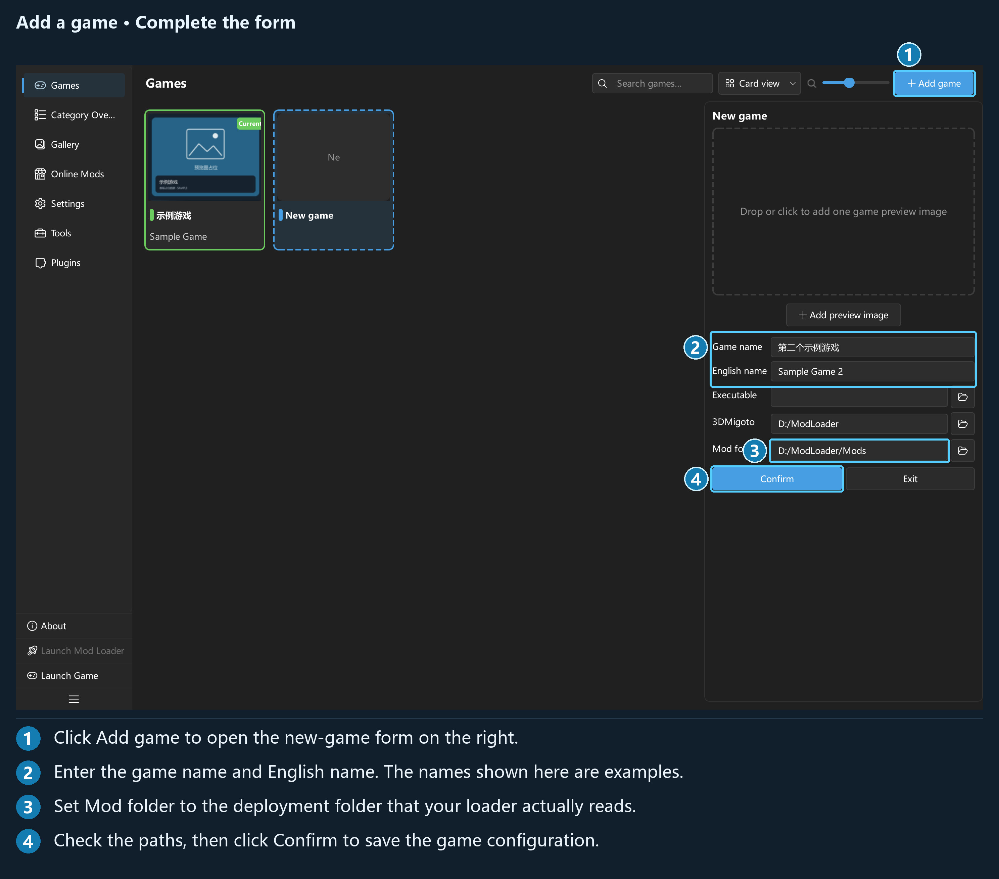

## Chapter 2: Games and initial setup

### 2.1 Adding a game and the five fields

Click **Games → Add game** to open a draft in the right panel. Fill it in and click **Confirm**. **Exit** discards the draft, with a confirmation if you have entered anything.

| Field | Purpose and requirements |
| --- | --- |
| **Game name** | Required; a name you can recognize, such as `示例游戏` (Sample Game) |
| **English name** | Used for GameBanana matching and to generate the game's resource folder name under `data/`; use the full English name used by the community |
| **Executable** | The game's exe file. Leaving it blank does not affect management, but disables **Launch Game** |
| **3DMigoto** | The loader's folder; used to launch the loader and locate `d3dx_user.ini` for capturing variants |
| **Mod folder** | The deployment folder for enabled Mods. It must match `d3dx.ini`; Mods cannot be deployed if it is blank |

If **English name** is blank, the resource folder name falls back to **Game name**. A different folder name is generated if the name is already taken. The application generates the internal game ID; you do not need to enter it.

The preview area lets you click, drop, or replace a single game image. Preview changes for an already saved game are persisted separately. If writing fails, a message appears and the change remains unsaved. Other fields require **Save**.

