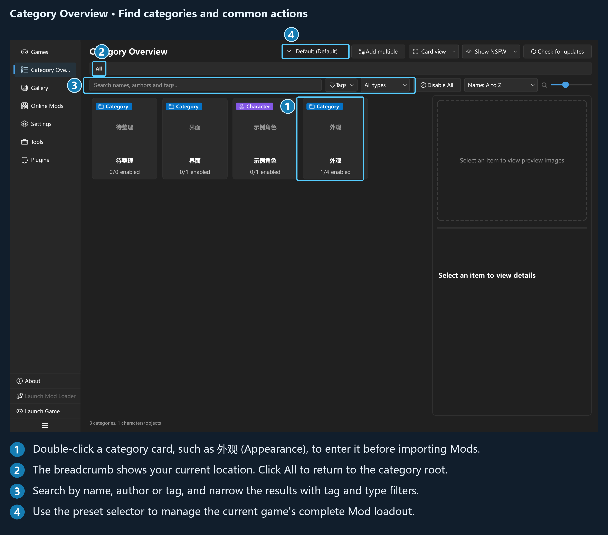

## Chapter 3: Category Overview and Mod management

### 3.1 Page structure

**Category Overview** handles categories, imports, enabling Mods, editing information, tags, preview images, and exports. The top toolbar provides Mod presets, batch category creation, views, NSFW display options, and update checks. The breadcrumb shows your current level.

*The illustration uses fictional categories; create your own folders when using the application.*

The search row provides searches by name, author, and tag; tag conditions; type and age-rating filters; Disable All; sorting; and card scaling. You can drag the divider between the content area and the details panel on the right. You can also adjust the heights of the image and text areas within the details panel.

Click once to select an item, double-click a category to enter it, and double-click a Mod to toggle its enabled state. Click **All** in the breadcrumb to return to the category root.

