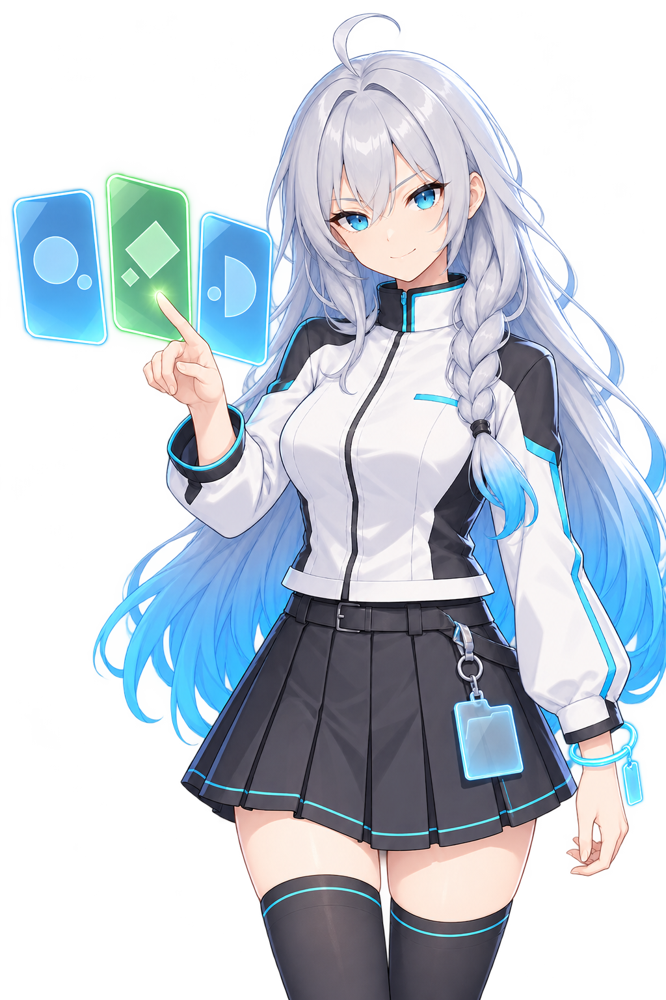

## Chapter 4: Presets, deployment, key bindings, and variants

### 4.1 Three different ways to save a setup

| Name | What it saves | Where to find it |
| --- | --- | --- |
| Mod preset | A selection of Mods for the current game, plus references to the named variant selected for each Mod | **Presets** in the overview toolbar |
| Individual Mod variant | Appearance values that a Mod supports saving, such as color schemes or accessory options | The **Variants** tab in Mod details |
| Category preset | The category tree, names, node types, and optional folder images; no Mod files | Category preset actions in Tools |

Create categories and import Mods first, then save frequently used combinations as Mod presets. If one Mod has several internal appearances, also save named variants for your presets to reference.

