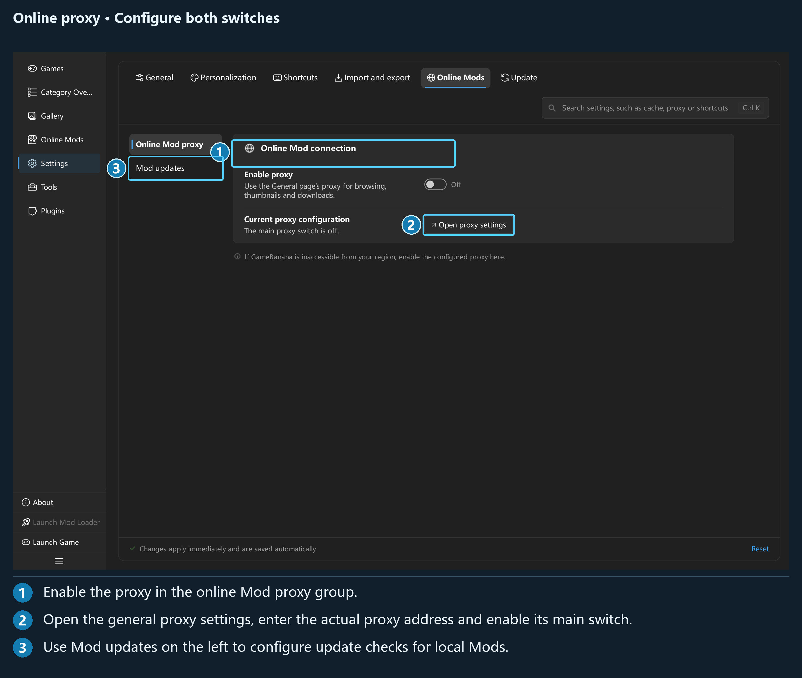

## Chapter 5: Online mods and updates

### 5.1 Connecting to GameBanana

Activate a game, then open **Online Mods**. The app uses the English name in the game's configuration to find a match on GameBanana and saves the result for that game. Changing the English name triggers a new match.

If you see **GameBanana has no entry for this game**, first check the English name on the Games page. You can also use the website search link provided on the page. A network failure and a game that is not listed have different causes: check the connection for the former, and check the game name and the site's listings for the latter.

Configure the proxy in two steps:

1. Under **Settings → General → Network proxy**, turn on the main switch, then use the system proxy or enter a manual address and port.
2. Under **Settings → Online Mods → Online Mod proxy**, turn on **Enable proxy**.

*Online browsing, images, downloads, and mod updates all use the Online Mods proxy policy.*

Local categories, importing, and deployment do not require a connection to GameBanana.

