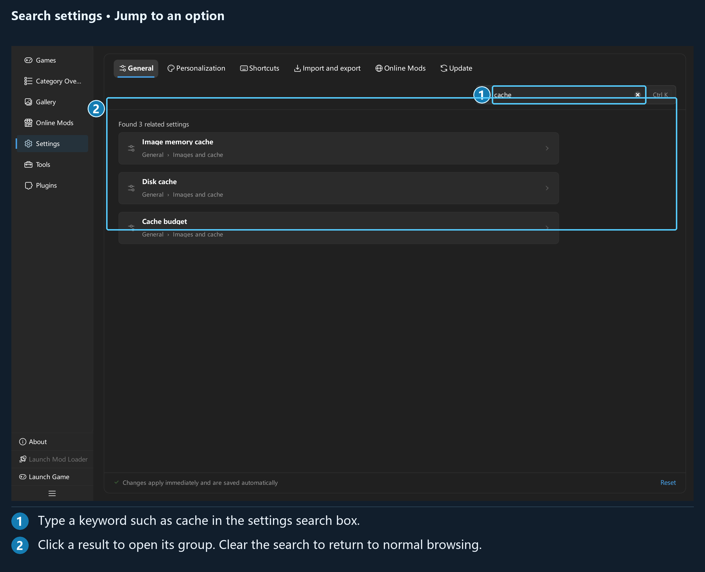

## Chapter 6: Settings

### 6.1 Sections, search, and saving

The Settings page has six sections across the top: **General**, **Personalization**, **Shortcuts**, **Import and export**, **Online Mods**, and **Update**. Each section also has subpages on the left.

Use the default `Ctrl+K` shortcut to open settings search, or type a setting name in the upper-right corner. Search results can take you across sections and locate the relevant control.

*Enter “cache” to find settings for image memory and disk caches.*

The page states **Changes apply immediately and are saved automatically**. Switches and selections usually save immediately, while text fields submit changes when editing finishes. Some sliders preview changes as you drag and save when you release them.

This chapter lists the default settings. Screenshots use example settings; check the values and switch positions shown on your device.

