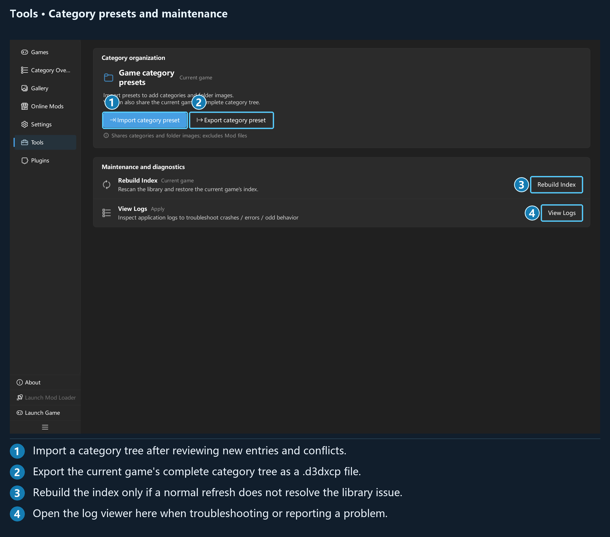
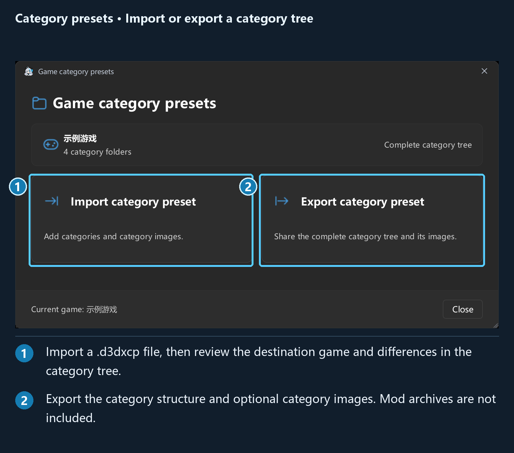
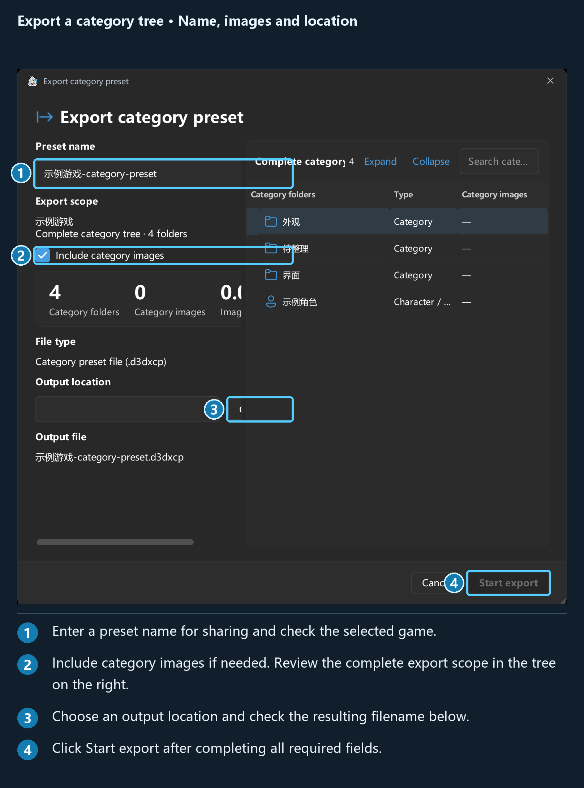
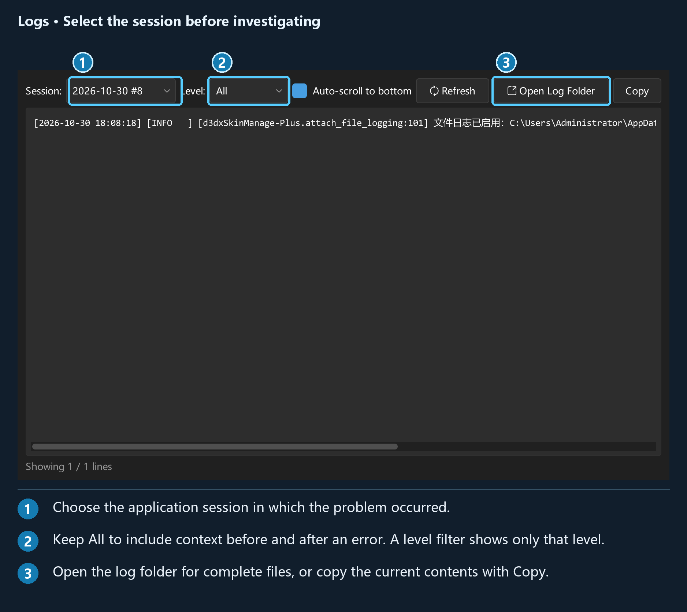
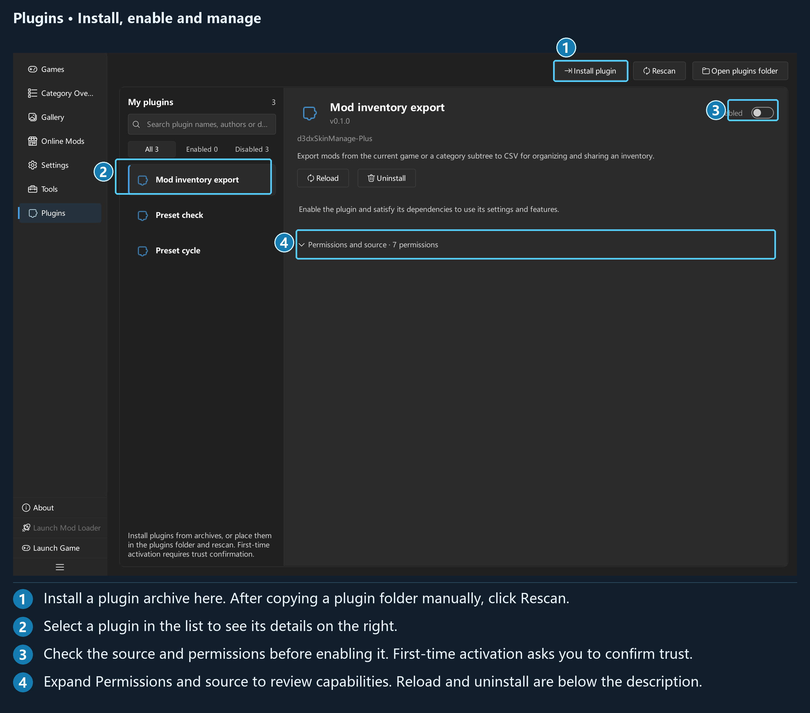
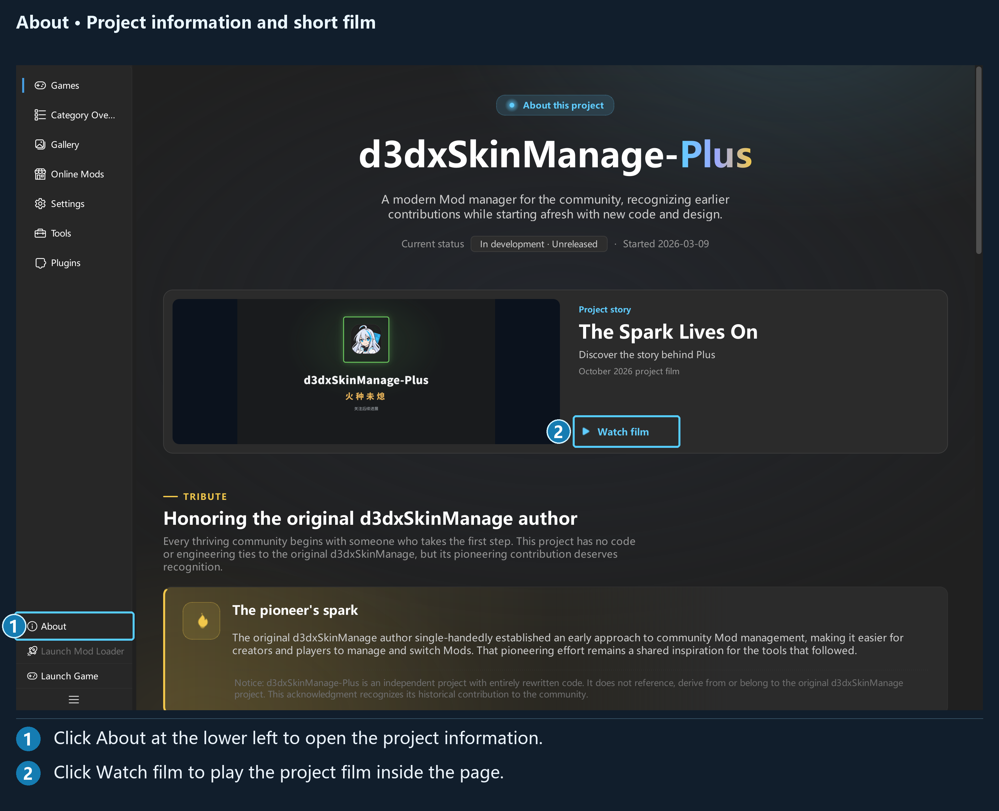

## Chapter 7: Tools, plugins and About

### 7.1 Tools

Tools primarily provides category organization, maintenance and troubleshooting. Plugins can explicitly contribute general-purpose tools when needed.

| Entry | Purpose |
| --- | --- |
| Import category preset | Adds categories and category images to the destination game |
| Export category preset | Shares the current game's complete category tree, optionally with images |
| Rebuild Index | Rescans the file library to restore the index |
| View Logs | Shows runtime records by startup session |
| Plugin tools (when available) | Runs general-purpose tools explicitly contributed by enabled plugins |

Cache cleanup is under **Settings → General → Images and cache**. Downloaded source package cleanup is under **General → Download data**. To export mods, select the items in Category Overview.
For Data Migration, Directory Permission Repair, Mod Inventory Export, or Preset Cycling, select the corresponding plugin on the **Plugins** page and use its **Action** section.

### 7.2 Importing a category preset

A category preset uses the **`.d3dxcp`** extension. It contains a category structure and optional category images, without mod contents or a complete preset of enabled mods.

Choose **Import category preset** in Tools, or **Start with a category preset** on an empty Category Overview page:

1. Select a `.d3dxcp` file.
2. Check the destination game and review the complete category tree.
3. Review the counts for new folders, existing folders, images to add, and path conflicts.
4. Locate and resolve any conflicts, then click **Compare again**.
5. After checking the result, click **Start import**, then **View categories** when it finishes.

If the game suggested by the file differs from the current game, the interface prompts you to check the destination. If every folder already exists and no images need adding, it explains that no import is needed.

Existing categories and category images are handled according to the comparison results. Importing a preset does not mean replacing the entire existing tree. Resolve path or type conflicts before importing.

Cancellation takes effect at a safe boundary. If the app reports that categories have been imported but cleanup is pending, keep the recovery records. Follow the prompt to retry, or restart and wait for cleanup to finish.

### 7.3 Exporting a category preset

Activate a game, then click **Export category preset** in Tools:

- Enter a preset name.
- Review the current game's complete category tree and counts.
- Select **Include category images** if needed.
- Repair unreadable images, or deselect those images using the available controls.
- Choose an output location, confirm the output file, and click **Start export**.

The export covers the current game's complete category tree, rather than a single selected mod. Recipients of this file still need to import their own mods.

### 7.4 Rebuilding the index

Use this when source files still exist but the categories or mod list no longer match the disk. First try refreshing with the default `F5` shortcut. Rebuild only when the index needs restoring.

Before starting, check that the resource drive is accessible and the correct game is selected, and finish related file tasks. After confirmation, the app scans the library, reads category and mod markers, and restores the index entries and associations it can recognize.

A normal rebuild mainly handles the current game. **If the app detects corruption of the entire index database at startup, recovery involves all configured games.** Connect each game's resource drive and follow the prompts.

The completion report lists registered entries, classification results, and problems such as invalid metadata. Unreadable files or files with conflicting identities may not be recoverable; keep the report and address the affected items. Rebuilding cannot recover permanently deleted archives and does not replace a backup.

### 7.5 Log Viewer

Click **View Logs** in Tools to access:

| Control | Purpose |
| --- | --- |
| Session | Selects a startup session by date and sequence, such as “2026-10-30 #1” |
| Level | All, or one of DEBUG, INFO, WARNING, ERROR, and CRITICAL |
| Auto-scroll to bottom | Moves to the newest entries after a refresh |
| Refresh | Rereads the selected file |
| Open Log Folder | Locates the actual log files |
| Copy | Copies the currently displayed content |

The level filter matches exactly: selecting WARNING does not also include ERROR. Use **All** when you need the context before and after an error.

The window reads only approximately the final 1 MiB of a log. Open the full file from the log folder if you need earlier content. Logs are saved by date and startup sequence and retained for 14 days by default, so save the relevant session promptly when reporting a problem.

Updater logs are also part of the logging system. Keep them alongside the application logs if an application update fails. Remove unrelated personal paths or sensitive information before submitting a report.

### 7.6 Installing and managing plugins

The Plugins page lists plugins on the left and shows details for the selected plugin on the right. Search by name, author, or description, or filter by **All**, **Enabled**, or **Disabled**.

There are two installation methods:

| Method | Steps |
| --- | --- |
| Install an archive | Click **Install plugin**, choose a ZIP, 7z, or RAR file, and follow the result message |
| Add a folder manually | Click **Open plugins folder**, add the complete plugin folder containing `plugin.json`, then click **Rescan** |

Plugins are discovered in `plugins/` under the application root by default. If that folder is not writable, the app uses its data-folder fallback; use the actual location shown by **Open plugins folder**. Bundled examples and plugins you install use the same folder and management rules.

After installation, check the plugin's status in the list. Select it to review its author, description, permissions, and source, then enable it as needed. The first trust prompt explains that the plugin runs code inside the app and lists its requested capabilities. Confirm only for sources you trust. New permissions discovered after an update or rescan require confirmation again.

**Ready** means the plugin is already available: its detail-page actions, menus, and shortcuts are registered, and it starts automatically when you first run a command or open the corresponding view. Declared settings in its details can also be edited and reset to defaults immediately.

If the status is **Dependency blocked**, expand the details and follow the instructions to install and enable dependency plugins with compatible versions. Confirm trust separately for each dependency. Dependencies are not installed or authorized automatically. After resolving the requirements, reload or enable the original plugin again.

Installing a new archive for the same plugin replaces its code folder and preserves private settings data. Before replacement, the installer checks the archive, manifest, version requirements, and code; a failed check keeps the original plugin. Check its status after updating, and confirm any additional permissions.

### 7.7 Plugin permissions, settings, and uninstallation

Expand **Permissions and source** in the details pane to review capabilities such as reading or modifying mods, storing settings, network access, files, processes, background tasks, views, and shortcuts, along with dependencies and activation information.

An enabled, trusted plugin whose dependencies are satisfied displays editable controls for any declared settings, including while its status is **Ready**. Settings are saved, and each can be reset to its default. Some plugins also provide dedicated options on their own pages.

Disabling removes the plugin's commands, pages, menus, shortcuts, and callbacks and cancels its tasks. Plugins that depend on it also stop, while retaining their enabled-state preference. Cancellation takes effect at safe boundaries and does not undo every completed operation; check the final task result.

Use **Reload** after editing plugin code. The app removes old commands and interfaces and cancels tasks, then reads the current code and restarts previously active plugins that depend on it, without restarting the whole app. Use **Rescan** when adding plugins or changing the folder layout.

**Uninstall** first disables the plugin and plugins that depend on it, then deletes its code folder. Check the name before confirming. The plugin's settings and private data are preserved for reuse when you reinstall the same plugin. Keep a separate backup of your own plugin source files.

If the status is **Error**, read the error description and logs. Parsing failures, permission mismatches, code checks, and runtime errors can all prevent activation. Permission declarations and checks do not determine whether a plugin's source is trustworthy for you.

Four optional plugins are bundled; enable each one before first use. Their contributions add the corresponding controls to Tools, Category Overview context menus, navigation pages, and shortcut settings:

- **Mod inventory export** exports a CSV inventory of the current game from Tools. From a category's context menu, it includes that category and its subcategories. Select **Export enabled mods only** in plugin details to limit the output. The inventory is generated in the background, with a notification on completion. It contains text metadata only, without mod files, and is not a restorable preset file.
- **Preset check** adds a navigation page with the same name for checking missing mod and appearance variant references. Return to the main interface to edit affected presets. Choose whether to include the default preset and click **Check again** to refresh. Results reflect references that can currently be resolved; a missing reference does not prove a resource is permanently lost.
- **Preset cycle** switches to the previous or next combination from Tools or **Plugin Commands**. The default shortcuts are `Ctrl+Alt+PgUp` and `Ctrl+Alt+PgDown`, effective only inside the app and adjustable in **Settings → Shortcuts**. The default preset is skipped unless you change the option in plugin details. The host task interface shows progress and failure reasons. Repeated clicks during an unfinished switch do not queue multiple switches.

These plugins' source code and usage instructions are in `plugins/`. To write your own plugin, read this tutorial's [Plugin development guide](../../en/PluginGuide.en.md). Start with the first working example, learn the current SDK's commands, settings, pages, background tasks, and dependencies, then complete testing and packaging.

### 7.7.1 Migrating from d3dxSkinManage

Enable the bundled **d3dxSkinManage Data Migration** plugin on the Plugins page, then open the same entry in Tools. First add and activate the destination game on the Games page; the wizard displays the selected target.

1. **Choose folder**: select the legacy app folder containing `home/` and `resources`. Choose the detected legacy game data and select **Review contents**. You can also paste a path and select that button directly.
2. **Review contents**: view the category tree with Mods, types, statuses, counts and sizes alongside item details. Excluded items and warnings also appear in the tree; select them to read the recorded diagnostics in item details. Wide windows use side-by-side panels; narrow windows stack them. Searching and selecting only affect viewing, not what gets migrated. Selecting a Mod shows **Original files (recommended)** and **Edited files** only when edits or recovery may be relevant.
3. Select **Start migration**. The wizard preserves names, authors, descriptions, ratings, tags and recognized previews. **Stop migration** stops subsequent work while keeping completed items.
4. **Results**: review imported, already present and unfinished counts. Use **Show migration details** or **Retry unfinished** as needed. After repairing source data, select **Start again**, then **Review contents** for a fresh scan. A TXT report still opens after each batch; **Open report** opens it again.

Scanning includes active indexes and disabled indexes with local original archives. Active metadata takes precedence over disabled metadata for the same SHA, with a warning; conflicting metadata within the same enabled/disabled state and ambiguous category assignments are still refused. Extensionless SHA archives are detected by their actual format and their original file SHA-1 is checked before import.

The wizard checks `work/Mods/<SHA>` and `work/Mods/disabled-<SHA>` caches in the selected legacy environment. Differences from the archive or an unreliable comparison produce a warning; recovering modifications is a user choice. Multiple possible caches are not chosen automatically. An active index with a valid cache but no archive can be recovered with an explicit incompleteness warning; disabled cache-only or remote-only entries remain excluded. A separate directory SHA-256 fingerprint is checked before and after preparation and keeps cache history distinct from archive history; changed sources require a new scan. Index-only and remote-only entries are not imported, and nothing is downloaded.

Previews come from SHA-named images and dedicated SHA directories in shared `resources/preview` and `resources/preview_screen`, plus recursively discovered `preview`-named images in active/disabled caches and images inside explicit `preview`/`preview_screen` subfolders. PNG, JPG, JPEG, BMP, GIF, and WebP are supported and deduplicated by image bytes; arbitrary texture images are not scanned. Category thumbnails use exact matches first, then the configured legacy `key-in only`, `similarity only`, `similarity threshold`, or `similarity/key-in` approximate mode. Approximate results carry a review warning; unknown modes fall back to exact matching with a warning.

Migration copies local resources and preserves legacy files. Imported Mods stay disabled; deployment folders, loader hotkeys, and legacy app settings are excluded. No standalone shortcut or loader configuration migration is provided, but selected cache files, including modified Mod INIs, are preserved naturally. Duplicate content keeps existing Plus metadata and previews, and reused categories retain their thumbnails. Stopping or closing the window cancels subsequent work while retaining completed imports.

The host creates a unique UTF-8 BOM `.txt` report in the system temporary folder, including duplicate-skip reasons, all outcomes, target identity, selected sources, and scan/copy diagnostics. **Open report** generates and opens another report after completion. If the default application cannot open it, the file remains and a notification shows its full path. Report creation failures do not undo successful imports. Generated reports survive window closure and plugin deactivation; the system may clean temporary files, so save a separate copy for long-term retention.

For ambiguous categories, conflicting index metadata, and unsupported path configurations, select the related tree row to read the diagnostic, check the legacy data, and scan again. See the [plugin README](../../../../plugins/official.legacy-migration/README.md) for compatibility details.

If another application locks an output file during cancellation, the host retries cleanup. Files that remain locked are preserved with a recovery receipt and a specific path diagnostic. Restarting or rebuilding the index will not treat them as ordinary Mods; the next import retries cleanup. If the commit outcome or file identity cannot be confirmed, keep the files and the receipts in `data/recovery/import-cleanup/` for inspection.

### 7.8 About and the project film

*Plusa is the project's original mascot and your companion throughout this guide.*

Open **About** near the bottom of the navigation to read the project introduction, tribute to the original author, project timeline, team and contributor information, and license details.

Watch the project film on the About page using its playback controls. Keep the supplied media folders when moving the application.

The project uses PolyForm Noncommercial 1.0.0 with additional attribution integrity terms. The bundled LICENSE defines the exact rights and conditions. Preserve the required attribution and third-party notices when modifying or distributing the project.

The manager's version and update controls are under **Settings → Update → Application updates**.
