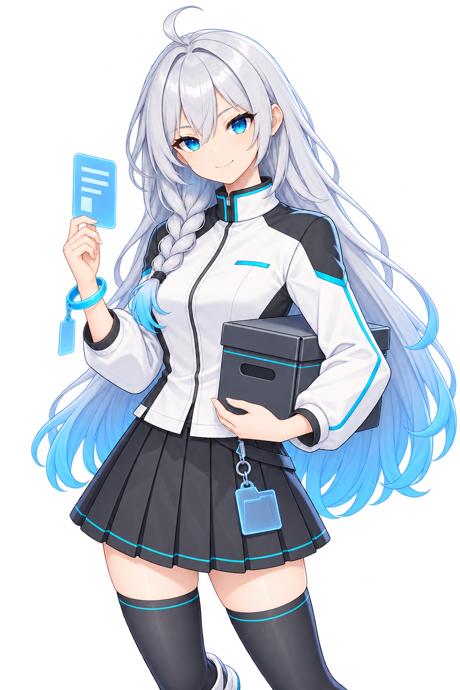

## Chapter 8: Data, backups and troubleshooting

### 8.1 Finding the actual data root



The application first tries to store personal data beside the application. If that folder is not writable, it uses the Windows user data directory, usually:

```text
%LOCALAPPDATA%/d3dxSkinManage-Plus/
```

Use **Open language packs folder**, **Open plugins folder**, or **Open Log Folder** to check the location currently in use, then identify `config/` and `data/` under the same data root.

A single-file release also includes folders for languages, plugins, tutorials, and media. Move the complete distribution instead of keeping only the executable.

### 8.2 Files to keep

| Location | Contents | Backup recommendation |
| --- | --- | --- |
| `config/settings.json` | Application preferences and shortcut overrides | Keep |
| `config/games.json` | Game list, paths, active game, current preset, and community site matches | Keep |
| `config/plugin_state.json` | Plugin activation, trust, and related state | Keep |
| `config/languages/` | Default and custom language files | Keep, especially your own changes |
| `data/mod_index.db` | Current resource and deployment index | Back up after closing the app |
| `data/presets.json` | Presets for all games | Keep |
| `data/<game-resource-folder>/mods/` | Category folders and complete mod containers | Essential |
| Preferences and other records in `data/<game-resource-folder>/` | State specific to the game, variant working state, previews, and other records | Back up the entire folder together |
| `data/downloads/` | Downloaded source packages and queue information | Keep if packages are awaiting installation or needed for an archive |
| `plugins/` and plugins' personal storage | Installed plugins and their data | Keep if you intend to continue using them |
| `cache/` | Caches that can be regenerated | Do not use as your only backup source |
| `logs/` | Troubleshooting logs | Keep relevant sessions when a problem occurs |
| External loaders and deployment folders | Loader configuration, managed deployments, and manually added resources | Back up separately if they contain custom or manual content |

The `.d3dxmod` and `.d3dxmeta/` entries inside a complete container are essential data. Keep the `.d3dxcategory` markers in category folders as well.

Named variants are stored in `.d3dxmeta/variants/`. Back up the complete mod containers together with `presets.json` to restore both presets and the appearance configurations they reference.

### 8.3 Recommended full backup procedure

1. Wait for import, export, deployment, update, and recovery tasks to finish.
2. Exit the application normally. If the game or loader is still writing configuration, finish those operations too.
3. Copy `config/`, `data/`, and `plugins/` from the actual data root, along with any external assets you need.
4. Save custom loader configuration and manually added resources in deployment folders separately.
5. Store the backup in a different location from the source data, and spot-check containers, metadata, and preset files.

While the application is running, the database may also use `-wal` and `-shm` files. Close the app normally before copying to avoid an inconsistent snapshot. Do not copy just one database file while it is being written.

To share an individual mod, export it from Category Overview and include metadata. To share a category structure, use `.d3dxcp`. Neither replaces a full backup of your data.

### 8.4 Moving to another folder, disk, or computer

To move the entire manager, first back up as described above and exit the app, then copy the complete distribution and personal data. After starting from the new location, check each of the following:

- Game executable and loader paths.
- The actual deployment location specified by **Mod folder**.
- External background images, videos, or WE scenes, and the WE application path.
- Availability of fonts you installed, language packs, and plugins.
- Whether the games' resource drives are connected.

Some paths managed by the app can be stored relative to the data root. Paths to external games, loaders, and media may still need to be entered again.

When changing the deployment location, prefer the migration confirmation provided on the **Games** page. Do not reimport an incomplete deployment folder as a new mod library, especially after discarding identity markers and while still using the old index.

### 8.5 File identity, verification, and recovery messages

The app checks managed source files, metadata, and deployment records before an operation. The following changes can block writes:

| Message type | First action |
| --- | --- |
| File missing or disk offline | Reconnect the disk and check the actual path |
| File in use | Close the relevant editor or preview, or finish related game operations, then retry |
| Source file or metadata changed | Select the item again, refresh, and check where the change came from |
| Identity mismatch or ownership cannot be determined | Keep the complete container and records; check whether only some files were copied or replaced |
| Verification mismatch | Keep the original package and error details; check whether the file is damaged or was modified |
| Unfinished transaction, rollback, or cleanup | Wait for recovery, or restart and retry as instructed |

These messages prevent operations from continuing on the wrong item. **Do not delete markers, the database, or transaction records to dismiss the message.** Those records may contain the file contents and path information needed for recovery.

