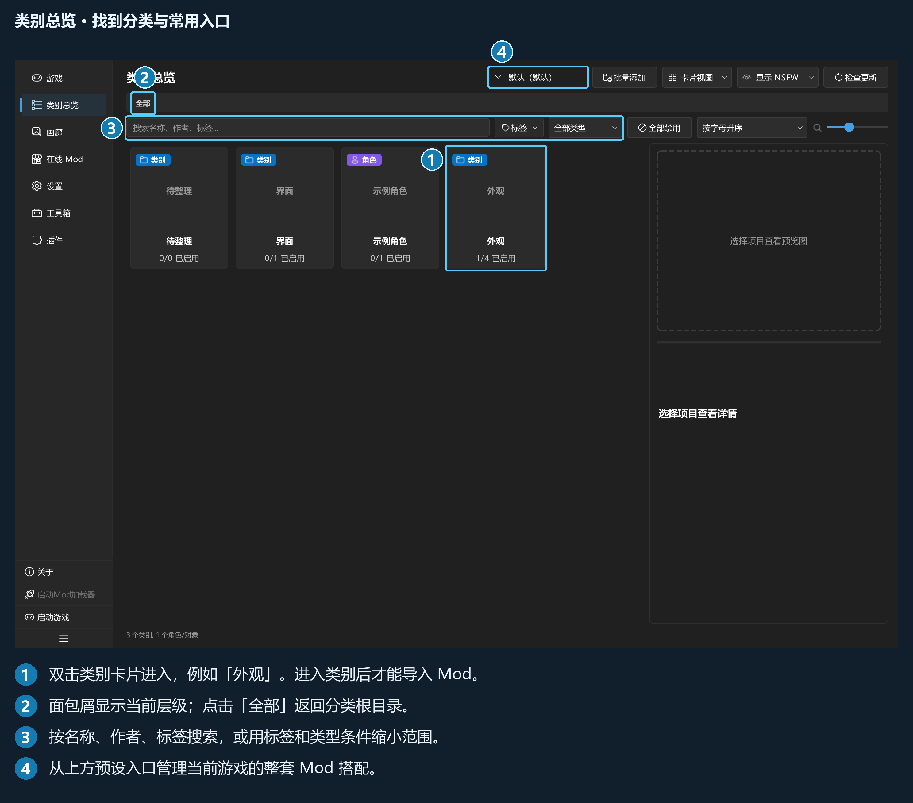

## 第 1 章 · 界面与导航

### 1.1 启动与版本

完整解压发行包后启动程序。首次使用时没有预置游戏，需要在「游戏」页自行添加；后续启动会恢复仍然有效的上次激活游戏。

本地导入、分类、部署和预设管理可离线使用；GameBanana 和程序更新功能分别在需要时联网。

版本号可在「设置 → 更新 → 程序更新」查看。配图中的游戏名称和资源均为演示数据，实际操作时请选择自己的游戏和文件。

### 1.2 主窗口与导航

*左侧导航切换页面，右侧为当前页面。总览页详情栏与内容区之间的分隔线可以拖动。*

| 导航入口 | 用途 |
| --- | --- |
| 「游戏」 | 添加、编辑、激活游戏 |
| 「类别总览」 | 管理分类、Mod、标签、预览图与组合预设 |
| 「画廊」 | 用大图浏览当前游戏的 Mod |
| 「在线 Mod」 | 浏览 GameBanana 和管理下载 |
| 「设置」 | 常规、个性化、快捷键、导入与导出、在线 Mod、更新 |
| 「工具箱」 | 分类预设、重建索引、查看日志及插件工具 |
| 「插件」 | 安装、搜索、启停、配置和卸载插件 |

列表下方还提供「关于」「启动Mod加载器」「启动游戏」及折叠导航按钮。有插件命令时会出现「插件命令」入口；插件也可增加自己的导航页。

两颗启动按钮依赖当前游戏的路径配置。按钮不可用时，回「游戏」页检查「可执行文件」和「3DMigoto」。

导航折叠后保留图标；鼠标悬停可查看提示。界面会记忆多种视图、卡片大小及分栏布局，个别窗口的尺寸和显示行为以对应页面为准。

### 1.3 游戏激活状态

「类别总览」「画廊」「在线 Mod」都依赖当前游戏。未激活时，页面会出现「请先激活一个游戏环境」和前往游戏页的按钮。

在「游戏」页：

- 单击卡片或列表行：选中并查看配置。
- 双击非当前游戏：激活并切换资源库。
- 双击当前游戏：取消激活。
- 详情栏「启用此游戏环境」：激活选中的游戏。

添加游戏后仍需激活。切换过程中若有未保存配置或正在执行的部署任务，先处理对应提示。

