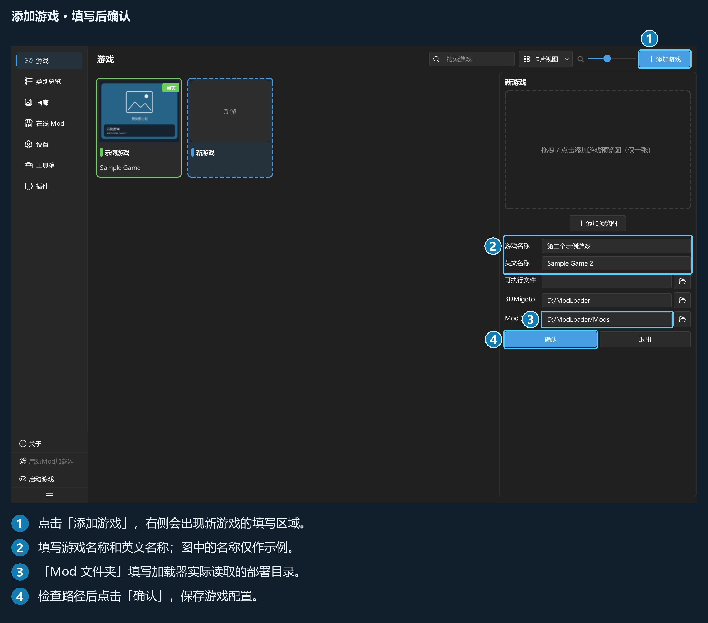

## 第 2 章 · 游戏与首次配置

### 2.1 添加游戏与五个字段

点「游戏 → 添加游戏」，右侧进入草稿状态。填写后点「确认」；「退出」会放弃草稿，有输入时会先确认。

| 字段 | 用途与要求 |
| --- | --- |
| 「游戏名称」 | 必填，供你识别，例如「示例游戏」 |
| 「英文名称」 | 用于 GameBanana 匹配，并生成 `data/` 下的游戏资源目录名；建议填写社区使用的完整英文名 |
| 「可执行文件」 | 游戏 exe。留空不影响管理，但不能使用「启动游戏」 |
| 「3DMigoto」 | 加载器所在目录；用于启动加载器，并定位变体采集所需的 `d3dx_user.ini` |
| 「Mod 文件夹」 | 已启用 Mod 的部署目录，须与 `d3dx.ini` 一致；留空时无法部署 Mod |

英文名称未填时，资源目录名会回落到游戏名称；重名时会生成不同目录。内部游戏标识由程序生成，无需手动填写。

预览图区支持点击、拖入或更换单张游戏图片。已保存游戏的预览图变更会单独持久化；若写入失败，会显示提示并保留未保存状态。其他字段以「保存」为准。

