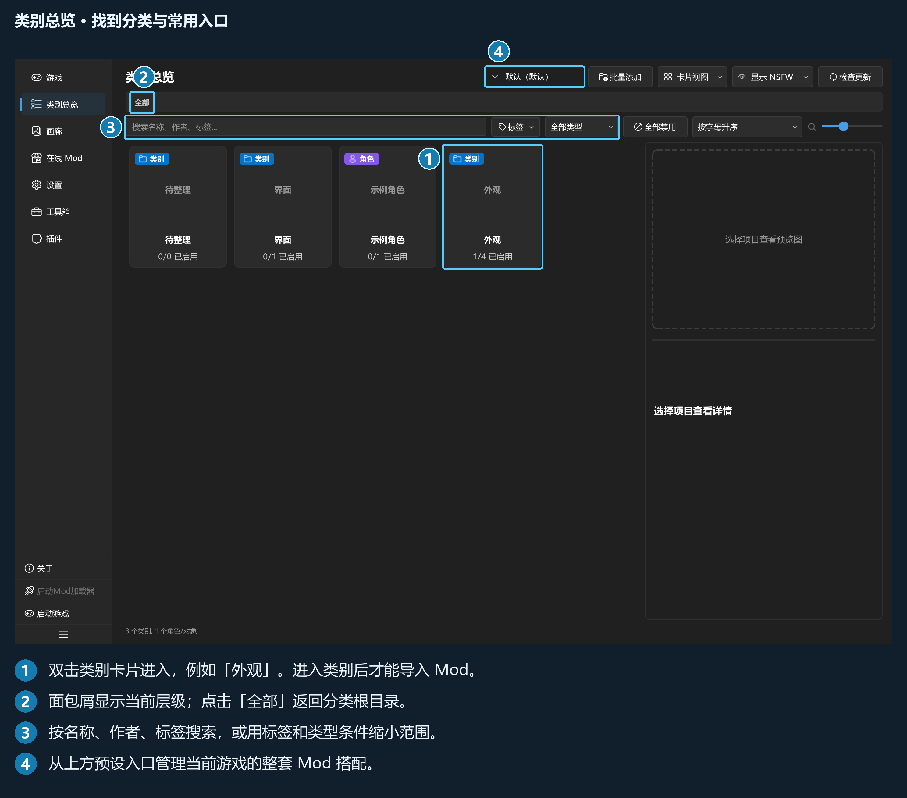
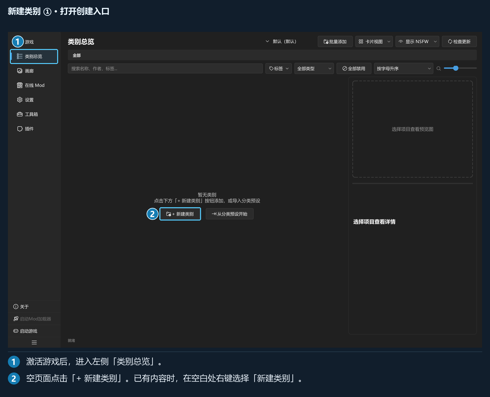
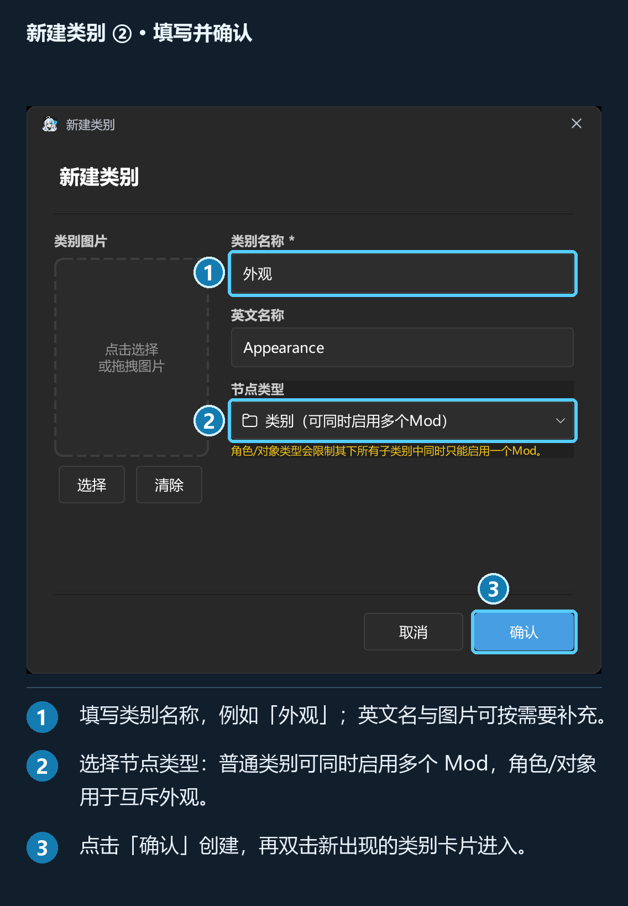
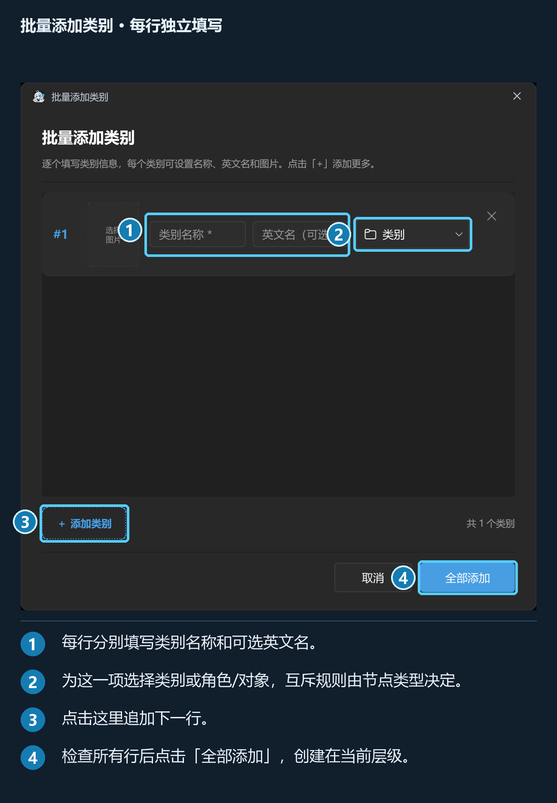
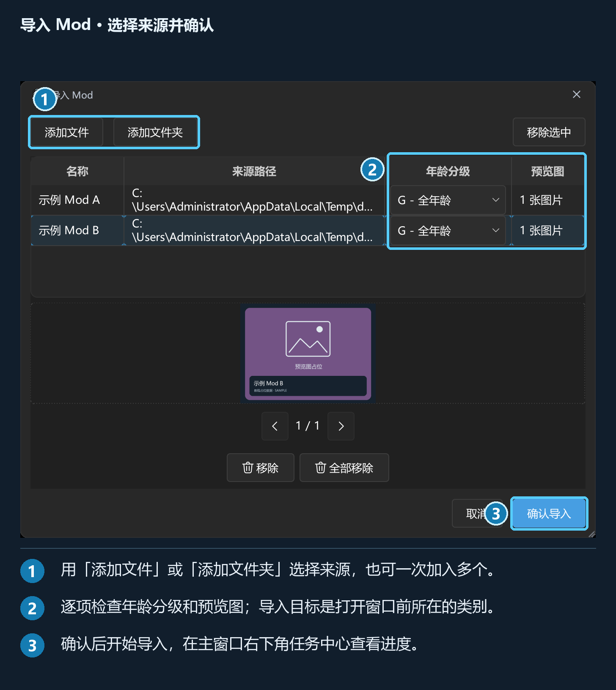

## 第 3 章 · 类别总览与 Mod 管理

### 3.1 页面结构

「类别总览」负责分类、导入、启用、信息编辑、标签、预览图和导出。上方工具栏提供组合预设、批量添加、视图、NSFW 显示方式和检查更新；面包屑显示所在层级。

*图中使用虚构分类；真实使用时由你自行建立目录。*

搜索行提供名称、作者、标签搜索，标签条件、类型与分级筛选、全部禁用、排序和卡片缩放。右侧详情栏与内容区之间可以拖动分隔线；详情栏内部的图片区与文字区也可调整高度。

单击选中，双击类别进入，双击 Mod 切换启用状态。点面包屑「全部」返回分类根级。

### 3.2 类别与角色/对象

| 类型 | 启用规则 | 适合的用途 |
| --- | --- | --- |
| 「类别」 | 可以同时启用多个 Mod | 界面、工具、可叠加的资源 |
| 「角色/对象」 | 该节点及全部子类别中，同时只允许启用一个 Mod | 互斥的角色外观或对象替换 |

新建时选择「节点类型」。角色约束会沿父级向下生效，不能通过再建子类别绕开。

根级主要用于分类导航。导入 Mod 前先进入目标类别，避免把未归类资源堆在根目录。

### 3.3 新建、编辑与批量添加类别

在内容区空白处右键选「新建类别」，或使用默认 `Ctrl+Shift+N`。空页面还有「+ 新建类别」或「+ 新建子类别」。

*① 进入「类别总览」。② 空页面中央的「+ 新建类别」会打开创建窗口。*

填写名称，可选英文名称与封面，再确认。英文名称用于在线查找和分类匹配。类别名称须符合 Windows 文件名规则，同级不能重名；角色/对象还会检查当前游戏内的名称冲突。

*① 填写名称。② 选择节点类型。③ 点「确认」，随后双击新类别卡片进入。*

工具栏「批量添加」支持一次建立多个类别：

*每一项分别填写名称、英文名、图片和节点类型，创建位置是当前所在层。*

批量创建也会使用各项选择的节点类型。已有分类可从右键「编辑」或详情栏「编辑」调整信息。

已有分类预设时，可从空页面的「从分类预设开始」或「工具箱 → 导入分类预设」建立分类树，详见第 7 章。分类预设与保存 Mod 开关的组合预设是两种文件内容。

### 3.4 导入压缩包或文件夹

先进入目标类别，然后任选一种入口：

| 入口 | 操作 |
| --- | --- |
| 拖放 | 把 ZIP、7z、RAR 或文件夹拖到内容区 |
| 右键菜单 | 空白处右键 →「导入 Mod」 |
| 快捷键 | 默认 `Ctrl+I` |
| 空类别按钮 | 点「导入 Mod」 |

导入窗口可以「添加文件」「添加文件夹」或「移除选中」，每个来源分别设置年龄分级、预览图。没有目标类别下拉框：目标由打开窗口前所在的位置确定。

表格中的来源名称用于识别本次候选；显示名称、作者、版本、来源网址和标签可在导入后编辑。

预览操作要区分“不使用”和“删除”：前者仅放弃选用，后者涉及图片文件。删除时按当前确认提示检查范围。

点「确认导入」后，通过右下角任务中心查看进度、重复项和失败项。导入通常会保留来源文件；从库目录直接发现的纳管则可能在原位置整理文件，不能把两种方式当成完全相同的复制流程。

