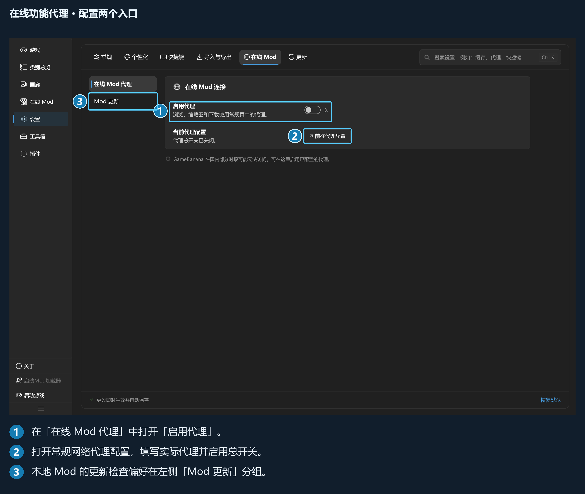
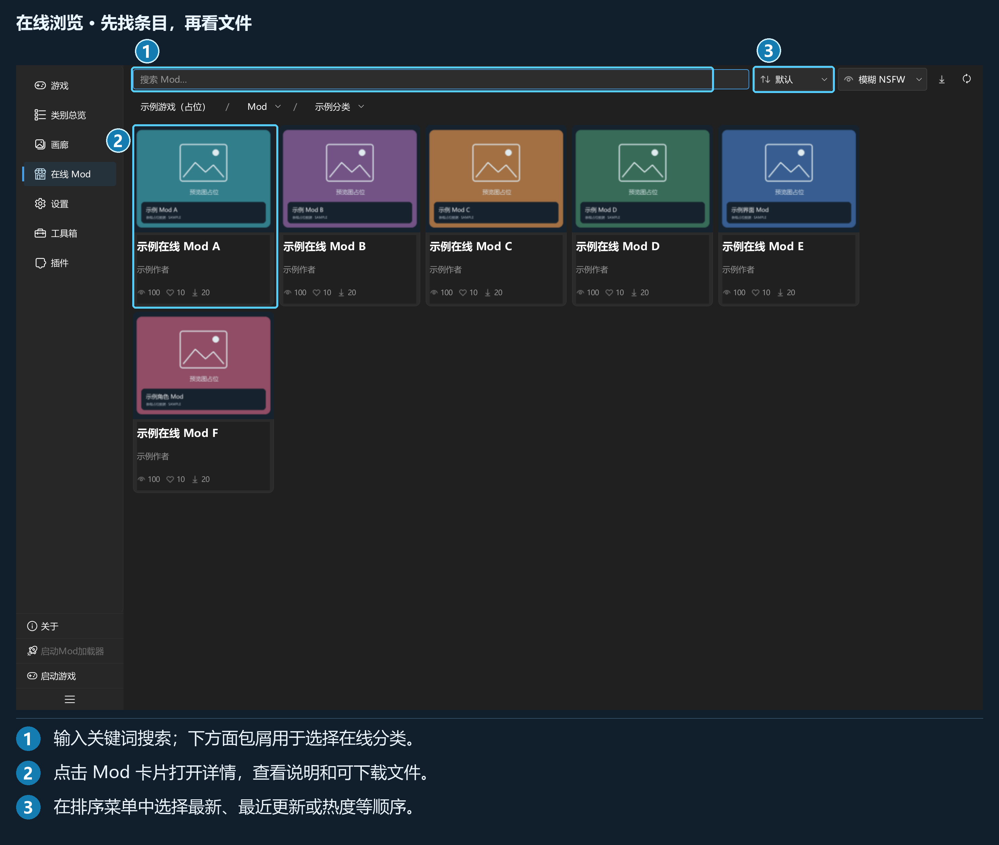
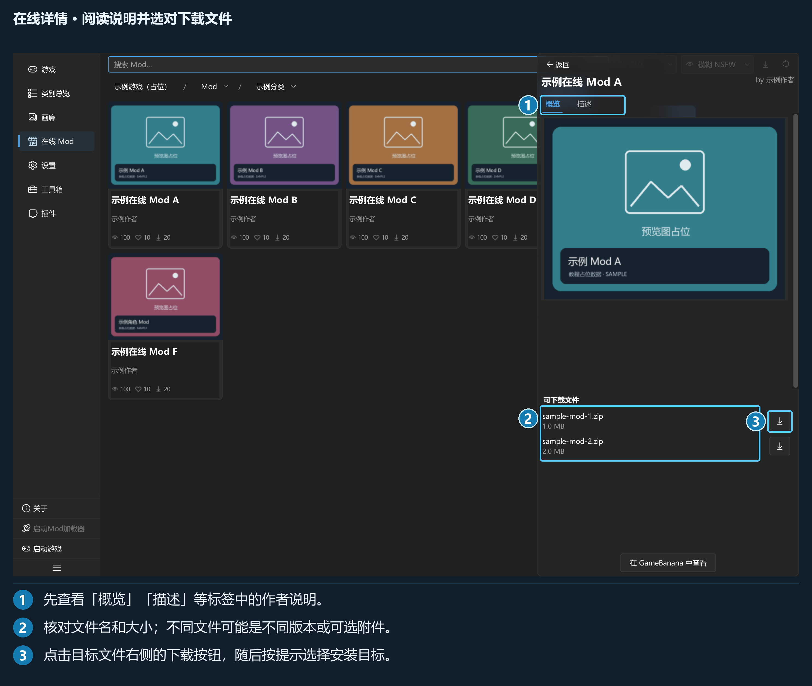

## 第 5 章 · 在线 Mod 与更新

### 5.1 连接 GameBanana

激活游戏后进入「在线 Mod」。程序使用游戏配置中的英文名称匹配 GameBanana，匹配结果按游戏保存。英文名称改变后会重新匹配。

出现「GameBanana 未收录此游戏」时，先到游戏页核对英文名称，也可使用页面提供的网站搜索入口。网络失败与未收录是不同原因：前者先检查连接，后者核对游戏名称和站点收录情况。

代理分两步配置：

1. 「设置 → 常规 → 网络代理」打开总开关，选择系统代理或填写手动地址、端口。
2. 「设置 → 在线 Mod → 在线 Mod 代理」打开「启用代理」。

*在线浏览、图片、下载和 Mod 更新共用在线 Mod 的代理策略。*

本地分类、导入和部署无需连接 GameBanana。

### 5.2 浏览、搜索与详情

在线页可按分类浏览、搜索 Mod、改变排序并刷新列表。排序包括默认、最新、最近更新、最多喜欢、下载最多、浏览最多。

*名称、封面、作者和统计均为教程占位数据，展示真实界面的浏览入口。*

「隐藏 NSFW」「模糊 NSFW」「显示 NSFW」控制在线内容预览，默认模糊。它与本地 X 级 Mod 的显示偏好分别保存。

点卡片进入详情，可查看图片、「概览」「描述」「更新」，以及「可下载文件」。多文件条目往往对应不同版本、可选内容或附件，应阅读作者说明后选择。

*此处文件名与大小也是占位示例。实际使用时逐个阅读文件说明。*

页面中的作者描述和下载文件来自外部站点；本教程统一用占位数据说明入口，实际条目以站点内容为准。

