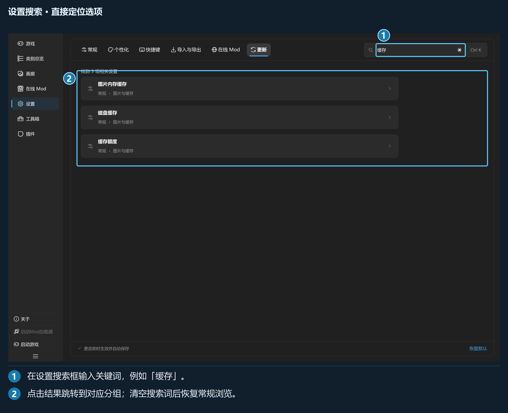
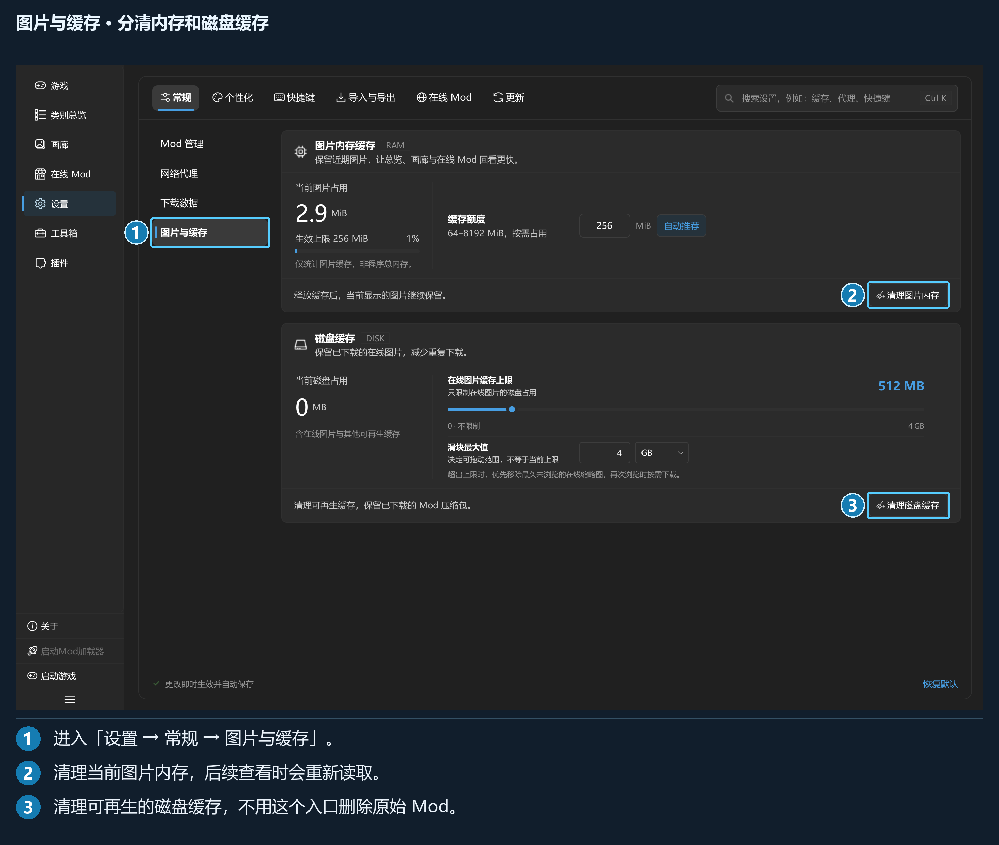

## 第 6 章 · 设置详解

### 6.1 分区、搜索与保存

设置页顶部为「常规」「个性化」「快捷键」「导入与导出」「在线 Mod」「更新」六个分区，各分区内部还有左侧子页。

用默认 `Ctrl+K` 打开设置搜索，或在右上角输入设置名称。搜索结果可以跨分区跳转并定位控件。

*输入「缓存」即可找到图片内存与磁盘缓存相关项。*

设置页显示「更改即时生效并自动保存」。开关和选择通常立即保存，文本框在编辑完成时提交；部分滑块先实时预览、松手后保存。

本章列出各项设置的默认值。截图使用示例设置，具体数值及开关状态请以本机显示为准。

### 6.2 常规 → Mod 管理

| 设置 | 默认 | 说明 |
| --- | --- | --- |
| 删除方式 | 直接删除（不可恢复） | 也可选放入回收站；只用于单独或批量删除 Mod |
| 并发数量 | 自动推荐 | 同时部署的任务数量，可手动设置 1–16 |

删除类别、删除游戏和清空部署目录有各自的范围确认，不会因选择 Mod 回收站模式而变为可恢复。

「自动推荐」保存的是自动模式，换设备后可重新按设备计算。手动修改数字则改用指定数量。并发越高不一定越快，机械硬盘、大型归档或内存紧张时可调低。

### 6.3 常规 → 网络代理

| 设置 | 默认 | 用法 |
| --- | --- | --- |
| 代理总开关 | 关闭 | 开启后，程序更新可使用这套代理 |
| 使用系统代理 | 开启 | 从 Windows 读取代理 |
| 协议 | HTTP | 手动模式可选 HTTP、HTTPS、SOCKS5 |
| 代理地址 / 端口 | 127.0.0.1 / 7890 | 示例默认值，须与实际代理软件一致 |
| 测试连接 | 手动操作 | 检查经代理访问外网的连通性与延迟 |

在线 Mod 还需在其分区单独打开「启用代理」。关闭总开关时，如在线 Mod 正在用代理，程序会询问是否一并停用。

使用系统代理但未检测到配置时，先检查 Windows 设置；手动模式则检查地址、端口以及代理程序是否运行。

### 6.4 常规 → 下载数据

此处显示安装包总占用、已安装及未安装部分，并提供：

| 控件 | 作用 |
| --- | --- |
| 安装后自动删除安装包 | 默认开启，成功入库后删除对应源安装包 |
| 清理已安装 | 确认后清理已入库的下载源包 |
| 打开目录 | 打开实际下载目录 |

尚未安装的下载应保留到安装或另行处理后。这里的源包与库中的受管本体分别存储，清理已安装源包可减少重复占用。

### 6.5 常规 → 图片与缓存

这里分为图片内存缓存和磁盘缓存，两者的额度与清理入口独立。

| 项目 | 默认或范围 | 说明 |
| --- | --- | --- |
| 图片内存缓存 | 自动推荐；手动 64–8192 MiB | 保留近期解码图片，改善返回浏览速度 |
| 当前图片占用 | 实时统计 | 仅统计图片缓存，不是整个程序的内存 |
| 清理图片内存 | 按钮 | 释放可释放的缓存，当前正在显示的图片继续保留 |
| 磁盘缓存上限 | 默认 512 MB；0 表示不限制 | 管理在线图片和其他可再生缓存 |
| 磁盘滑块量程 | 默认最大 4096 MB | 只决定滑块可选到多大，不等于实际生效上限 |
| 清理磁盘缓存 | 先确认 | 清理可再生缓存，保留已下载的 Mod 源包 |

自动推荐额度因设备和显示条件而异，请以本机显示为准。减少额度可能导致回看图片时重新解码，但不会删除 Mod 或其元数据。

磁盘缓存不是备份目录。不要手动把 `data/`、运行恢复记录或 `.d3dxmeta/` 当作缓存清空。

