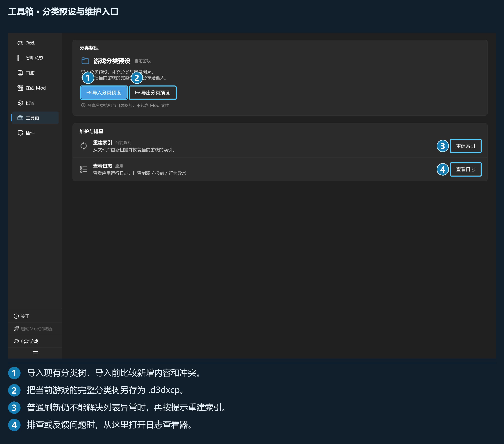

## 第 7 章 · 工具箱、插件与关于

### 7.1 工具箱

工具箱分为分类整理、维护与排查，以及启用插件提供的工具。

| 入口 | 用途 |
| --- | --- |
| 导入分类预设 | 为目标游戏补充分类与目录图片 |
| 导出分类预设 | 分享当前游戏完整分类树，可附带图片 |
| 重建索引 | 从文件库重新扫描和恢复索引 |
| 查看日志 | 按启动会话查看运行记录 |
| 插件工具 | 执行启用插件提供的功能 |

清理缓存位于「设置 → 常规 → 图片与缓存」，下载源包清理位于「常规 → 下载数据」。导出 Mod 从总览选择项目操作。

