# Complete user manual

To get your first Mod working, begin with the 5-minute quick start.
This manual provides detailed steps, settings and data-maintenance guidance by feature.

Screenshots show the English interface with fictional games, categories, Mods and geometric preview placeholders.
Some sample library names, such as 外观 (Appearance), remain in Chinese because they are user-entered data.
Plusa is the project's original mascot.

The shortcut table lists default bindings. If you customize them, follow Settings → Shortcuts instead.
Numbers in the screenshots match the explanations below them.
Click an image, then choose Original size to inspect its details.
For application extensions, continue to the Plugin development guide.

---

## Chapter 1: Interface and navigation

### 1.1 Startup and version

Extract the entire release package before starting the application. No games are preconfigured on first use; add your own on the **Games** page. On later launches, the application restores the last active game if it is still valid.

Local imports, categories, deployment, and preset management work offline. GameBanana and application updates connect to the network when needed.

Find the version number under **Settings → Update → Application updates**. Game names and resources in the illustrations are demonstration data; select your own games and files when following the instructions.

### 1.2 Main window and navigation


*The left navigation switches pages, and the current page appears on the right. In the overview, you can drag the divider between the content area and the details panel.*

| Navigation entry | Purpose |
| --- | --- |
| **Games** | Add, edit, and activate games |
| **Category Overview** | Manage categories, Mods, tags, preview images, and Mod presets |
| **Gallery** | Browse the current game's Mods using large images |
| **Online Mods** | Browse GameBanana and manage downloads |
| **Settings** | General, Personalization, Shortcuts, Import and export, Online Mods, and Update |
| **Tools** | Category presets, index rebuilding, logs, and plugin tools |
| **Plugins** | Install, search for, enable, disable, configure, and uninstall plugins |

Below the list are **About**, **Launch Mod Loader**, **Launch Game**, and the button to collapse the navigation. A **Plugin Commands** entry appears when plugin commands are available; plugins can also add their own navigation pages.

The two launch buttons depend on the current game's path configuration. If they are unavailable, return to **Games** and check **Executable** and **3DMigoto**.

The navigation keeps its icons when collapsed; hover over them to see tooltips. The interface remembers various views, card sizes, and panel layouts. Window sizing and display behavior may vary by page.

### 1.3 Game activation state

**Category Overview**, **Gallery**, and **Online Mods** all depend on the current game. If none is active, these pages show **Activate a game environment first** and a button leading to the Games page.

On the **Games** page:

- Click a card or list row once to select it and view its configuration.
- Double-click a game that is not current to activate it and switch libraries.
- Double-click the current game to deactivate it.
- Click **Activate this game environment** in the details panel to activate the selected game.

You still need to activate a game after adding it. If you have unsaved configuration changes or a deployment task is running when you switch, handle the corresponding prompt first.

### 1.4 Task center and progress

Imports, folder discovery, and library refreshes appear in the task center at the bottom-right. Expand it to see individual item states, completion counts, and reasons for failures.

Imports started inside the application support pausing, resuming, and stopping. When stopping, you may see choices such as **Keep imported Mods**, **Cancel all imports**, and **Resume import**:

| Choice | Result |
| --- | --- |
| Keep completed items | Successfully imported items remain in the library; unfinished items stop |
| Cancel all | Attempts to roll back the completed imports from this operation; check the report for any recovery failures |
| Resume | Returns to the current task |

Tasks that add automatically discovered files to the library do not offer exactly the same controls as manual imports. Use the buttons available in the current task popup. A stop request may need to wait until the current file operation reaches a safe stopping point.

Export, batch deletion, Mod preset switching, and updates each have their own progress interface. Wait for tasks to finish before moving the affected folders to avoid overlapping operations on the same files.

Brief notifications also appear in the top-right, for example when a theme is applied or a variant is saved. To look up a specific error later, open **Tools → View Logs**.

### 1.5 Common shortcuts

Manager shortcuts are handled only within the application window; they are not system-wide hotkeys. Change them in **Settings → Shortcuts → Key bindings**.

| Default key | Action |
| --- | --- |
| `Ctrl+I` | Import into the current category |
| `F5` | Refresh the current game's Mod library |
| `Ctrl+F` | Focus the current page's search box, if the page supports search |
| `Ctrl+K` | Open Settings and search all settings |
| `Ctrl+,` | Open Settings |
| `Ctrl+1` / `Ctrl+2` / `Ctrl+3` / `Ctrl+4` | Games / Category Overview / Gallery / Online Mods |
| `Alt+Left` | Go to the parent category, or close Online Mods details |
| `Ctrl+Shift+N` | Create a category at the current level |
| `F2` | Edit the single selected item in the overview |
| `Space` | Enable or disable the single selected Mod in the overview |
| `Ctrl+Shift+E` | Export the selected items in the overview |
| `F6` / `F7` | Launch the Mod loader / game |

Lists and text fields also support copying, cutting, pasting, selecting all, deleting, and other actions. See Appendix A for the complete table. Text fields, input methods, key recording, and modal dialogs handle their own input first; pressing Space in a text field does not toggle a Mod.

`Esc` handles context-specific actions such as ending key recording, closing some popups, or canceling a cut operation in the overview. 3DMigoto's in-game F10 reload key is configured by the loader, not in the manager's shortcuts.

### 1.6 Navigating Settings

The Settings page has six sections across the top, each with its own subnavigation on the left. This tutorial gives complete paths such as **Settings → General → Images and cache**.


*Use the top row to switch sections and the left side to switch subpages. The search box in the top-right can take you directly to a setting.*

Type a term such as “cache,” “proxy,” “variant,” or a command name in the Settings search box, then click a result to jump to it. Shortcut commands and registered plugin commands also appear in Settings search.

Settings usually save immediately. Text inputs such as proxy addresses are submitted when editing finishes; some sliders preview changes while dragging and save when released. Game configuration still requires clicking **Save**, so keep that distinction in mind.

### 1.7 Theme, language, and background

Open **Settings → Personalization → Appearance** to choose Dark, Light, or Follow System. **Follow System uses the Windows app theme.** The same page lets you choose a font and language and refresh the list of language packs.

**Personalization → Window background** supports Off, Image, Video, and WE scenes. Videos and scenes have options such as frame rate and playback controls; WE scenes require Wallpaper Engine installed locally. See Chapter 6 for full configuration details.

---

## Chapter 2: Games and initial setup

> [](../images/plusa/02-惊讶.webp) **Plusa's tip:** The loader folder and the Mod folder read by the game are different locations. Check d3dx.ini and fill them in separately; keep the library separate from deployment.

### 2.1 Adding a game and the five fields

Click **Games → Add game** to open a draft in the right panel. Fill it in and click **Confirm**. **Exit** discards the draft, with a confirmation if you have entered anything.


| Field | Purpose and requirements |
| --- | --- |
| **Game name** | Required; a name you can recognize, such as `示例游戏` (Sample Game) |
| **English name** | Used for GameBanana matching and to generate the game's resource folder name under `data/`; use the full English name used by the community |
| **Executable** | The game's exe file. Leaving it blank does not affect management, but disables **Launch Game** |
| **3DMigoto** | The loader's folder; used to launch the loader and locate `d3dx_user.ini` for capturing variants |
| **Mod folder** | The deployment folder for enabled Mods. It must match `d3dx.ini`; Mods cannot be deployed if it is blank |

If **English name** is blank, the resource folder name falls back to **Game name**. A different folder name is generated if the name is already taken. The application generates the internal game ID; you do not need to enter it.

The preview area lets you click, drop, or replace a single game image. Preview changes for an already saved game are persisted separately. If writing fails, a message appears and the change remains unsaved. Other fields require **Save**.

### 2.2 Library and deployment folder

| Location | What it stores | Common example |
| --- | --- | --- |
| Game resource folder | The current game's Mod library, preview cache, and runtime preferences | `<data root>/data/Sample Game/` |
| Library root | Category folders and complete Mod containers | `mods/` inside the folder above |
| **Mod folder** | Enabled copies, parked copies, and management markers read by the loader | `D:/ModLoader/Mods/` |
| **3DMigoto** | Loader program, main configuration, and user configuration | `D:/ModLoader/` |

Importing adds a Mod to the library; enabling publishes its contents to the deployment folder. Do not use the library itself as the deployment folder, or treat the game's installation root as a dedicated Mod folder.

The application does not automatically derive the deployment folder from the loader path. Check `d3dx.ini`, then enter **Mod folder** explicitly.

The data root is normally the application's folder. If the release folder is not writable, a Windows user data folder may be used instead. Confirm the actual location before backing up; see Chapter 8.

### 2.3 Activating and switching games


Click once to view the configuration; double-click to activate. The active game's card shows **Current**. You can also click **Activate this game environment** in the details panel.

After activation, the overview, gallery, and Online Mods switch to that game and use its loader and deployment paths. Each game has its own categories, Mods, and Mod presets.

Double-click the current game again to deactivate it. The application only restores a valid previously active game; it does not automatically activate the first newly added game.

### 2.4 Editing and saving

Select a game, edit the fields on the right, and click **Save**. If you switch items or pages with unsaved changes, the application asks whether to save, discard, or cancel leaving.

When you change the English name, the application attempts to migrate the linked resource folder and update related paths. Finish import, update, and deployment tasks first. If the folder cannot move but the settings are saved, a message identifies the retained location. If writing the configuration fails, the application attempts to roll back the move and keeps your edits unsaved. If recovery also fails, check the actual file locations shown in the message before continuing; do not delete the recovery materials yourself.

Game configuration is stored separately in `config/games.json`; application preferences are in `config/settings.json`. **Settings → Reset** preserves the game list and Mod data.

### 2.5 Changing or clearing the deployment path

Before changing a path, make sure both the old and new disks are accessible and deal with any applications holding the affected files open.

| Action | Application behavior |
| --- | --- |
| Change **Mod folder** when the old folder contains files | Asks whether to migrate all files and subfolders in the old folder, including manually added files |
| Choose to migrate | Checks for destination conflicts, then migrates; if it fails, keeps recovery information and reports the failure. Do not delete those records yourself |
| Choose not to migrate | Saves only the new configuration and leaves the old folder's contents in place. You must check which location the game will read afterward |
| Cancel the migration prompt | Exits this save operation |
| Clear **Mod folder** when the old folder still contains files | Asks whether to permanently empty the old folder; declining keeps the original deployment path |

> ⚠️ Emptying the deployment folder affects all files and subfolders inside it, including manually added content, and bypasses the Recycle Bin. Read the full path in the dialog before confirming.

Migration rejects unsafe situations such as nested source and destination folders or content with the same name already at the destination. To move to another disk, use the Games page and confirm afterward that the configuration was saved and enabled states are correct.

Clearing **3DMigoto** also warns that variant state tracking will be affected. The deployment path and loader path are separate fields; clearing either is not a substitute for disabling Mods.

### 2.6 Deleting a game deletes its data

**Deleting a game permanently deletes that game and its data.** The Recycle Bin option under **Mod management → Deletion method** does not apply.

Choose **Delete** in the details panel or context menu. The application scans the resources involved and shows the deletion scope. You can cancel during the scan. Before confirmation, it shows the full resource path and counts of Mods, categories, presets, and deployment copies.


Deletion includes:

- The entire game resource folder and its contents, including the Mod library and other files added manually.
- The game's managed deployment data.
- The game's configuration, Mod presets, key or variant preferences, and update records.

Export or back up anything you want to keep to a location outside the deletion scope first. If you delete the current game, its activation state is also cleared.

If some files are in use, **Game data cleanup results** lists the full paths that could not be cleaned up. Keep this report, release the files, and address the remaining items according to the report. A game card disappearing does not mean that every file has been removed.

### 2.7 Search, views, and ordering

The Games page supports searching by name and switching between card and list views. In card view, you can adjust card size and drag games to reorder them. If search filtering is active, clear it before reordering the complete list.

The default `Ctrl+1` returns to the Games page; the default `Ctrl+F` focuses the current page's search box. If launch paths are missing, fill them in and save before using the navigation buttons or `F6` and `F7`.

---

## Chapter 3: Category Overview and Mod management

### 3.1 Page structure

**Category Overview** handles categories, imports, enabling Mods, editing information, tags, preview images, and exports. The top toolbar provides Mod presets, batch category creation, views, NSFW display options, and update checks. The breadcrumb shows your current level.


*The illustration uses fictional categories; create your own folders when using the application.*

The search row provides searches by name, author, and tag; tag conditions; type and age-rating filters; Disable All; sorting; and card scaling. You can drag the divider between the content area and the details panel on the right. You can also adjust the heights of the image and text areas within the details panel.

Click once to select an item, double-click a category to enter it, and double-click a Mod to toggle its enabled state. Click **All** in the breadcrumb to return to the category root.

### 3.2 Categories and characters/objects


| Type | Enable rule | Suitable uses |
| --- | --- | --- |
| **Category** | Multiple Mods can be enabled at once | Interface Mods, tools, and resources that can be combined |
| **Character/object** | Only one Mod can be enabled across this node and all its subcategories | Mutually exclusive character appearances or object replacements |

Choose **Node type** when creating a category. Character restrictions apply down the hierarchy from parent nodes; creating another subcategory does not bypass them.

The root level is primarily for category navigation. Enter the target category before importing Mods to avoid accumulating uncategorized resources at the root.

### 3.3 Creating, editing, and adding categories in bulk

Right-click a blank part of the content area and choose **New Category**, or use the default `Ctrl+Shift+N`. An empty page also offers **+ New Category** or **+ New subcategory**.


*① Open **Category Overview**. ② Click **+ New Category** in the center of the empty page to open the creation dialog.*

Enter a name, optionally add an English name and cover image, then confirm. The English name is used for online lookups and category matching. Category names must follow Windows filename rules and be unique at the same level. Characters/objects are also checked for name conflicts throughout the current game.


*① Enter a name. ② Choose the node type. ③ Click **Confirm**, then double-click the new category card to enter it.*

**Add multiple** in the toolbar lets you create several categories at once:


*Enter a name, English name, image, and node type separately for each item. Categories are created at the current level.*

Batch creation also uses the node type selected for each item. To change an existing category's information, choose **Edit** from its context menu or details panel.

If you have a category preset, build the category tree using **Start with a category preset** on the empty page or **Tools → Import category preset**. See Chapter 7. Category presets contain different data from Mod presets, which save which Mods are enabled.

### 3.4 Importing an archive or folder

Enter the target category first, then use any of these methods:

| Method | Action |
| --- | --- |
| Drag and drop | Drag a ZIP, 7z, RAR, or folder into the content area |
| Context menu | Right-click a blank area → **Import Mod** |
| Shortcut | Default `Ctrl+I` |
| Empty category button | Click **Import Mod** |


The import dialog offers **Add Files**, **Add Folder**, and **Remove Selected**. Set an age rating and preview image for each source. There is no target category dropdown: the destination is the location you were in before opening the dialog.

The source names in the table identify the current import candidates. You can edit the display name, author, version, source URL, and tags after importing.

Distinguish between not using a preview and deleting it: the former only deselects it, while the latter affects the image file. Check the scope shown in the current confirmation prompt before deleting.

After clicking **Confirm Import**, use the task center at the bottom-right to check progress, duplicates, and failures. Importing normally preserves the source files. When files are discovered directly inside the library, however, adding them to management may organize them in place; these are not identical copying workflows.

### 3.5 Placing files directly in the library

You can also use File Explorer to place archives or folders awaiting organization into an existing category folder, such as `外观` (Appearance):

```text
<data root>/data/Sample Game/mods/外观/
```

Folder monitoring, entering the relevant category, switching games, and manual refreshes discover changes that need processing. The default `F5` requests a refresh of the current game's library, with progress in the task center. Large folders and archives that are still being written may take time.

Discovered content is identified, verified, and brought under management to form complete Mod containers. The application reports duplicates, invalid containers, files in use, and interrupted items. If leftover items are found, inspect the original files first, then choose an available action such as keeping them, moving them to the Recycle Bin, or deleting them.

**Do not edit or remove a container's identity marker.** The application uses these markers to identify Mods and checks the related files. Keep each container complete; see Chapter 4.

### 3.6 Enabling, disabling, and conflicts

Any of these actions can toggle a single Mod:

- Double-click its card or list row.
- Click **Enable** / **Disable** in the details panel on the right.
- Choose **Enable** / **Disable** from its context menu.
- Select a single Mod in the overview list and press the default `Space`.

After a Mod is enabled successfully, its status changes and the card shows a green marker. The first activation may require extraction; wait for that item's progress to finish. A parked copy that meets the requirements can be restored more quickly when enabled again.

If another Mod is already enabled under a character/object, the application asks whether to disable the conflicting item and enable the new one. If you choose not to be prompted again, similar conflicts will follow that preference.

**Disable All** applies to the current folder and its subfolders. At the root level, it covers the current game. An active search does not mean that only search results will be disabled; read the confirmation carefully.

Related write operations may be temporarily unavailable during deployment, preset switching, or file recovery. Let the current task finish before continuing, rather than repeatedly clicking Enable or Delete.

### 3.7 Details panel: information, keys, and variants


*The example Mod uses a geometric placeholder cover. Separate details tabs appear beneath it.*

| Tab | Contents |
| --- | --- |
| **Information** | Available information such as author, version, age rating, tags, description, source, and path |
| **Keys: N** | Bindings detected in INI files, grouped by file; record a key or enter it manually |
| **Variants: N** | The Mod's default configuration and saved named appearances, with controls to switch and manage them |

If there are no keys or variants, the corresponding empty state appears. This does not mean the Mod is unusable. The variant count reflects saved named configurations, and support also depends on whether the Mod declares variables that can be saved.

Selecting a category shows category information and actions. Selecting multiple items shows the selection count instead of combining fields from several Mods for editing.

### 3.8 Editing Mods and tags

Select a single Mod and click **Edit**, or use the default `F2`.


You can edit the display name, author, version, source URL, description, age rating, and tags. Expand **File Info** to see the path, SHA-1, and import time, and to copy the path or hash.

**Also rename the Mod file or folder** controls whether the name on disk changes too. If unchecked, only the display name changes. If checked, the application handles name conflicts and related paths; check the result after saving.

**Click Save changes to commit the information and tag edits from this session.** The dialog also supports `Ctrl+Enter` to save. If you close it with changes, you can choose to continue editing or discard them.

There are three kinds of tag operations:

| Operation | Effect |
| --- | --- |
| Add or remove tags on the current Mod | Changes the association between the current Mod and those tags |
| Edit a shared tag's name or color | After saving, every Mod referencing that tag in the same game displays the change |
| Delete a tag and all its references | Removes it from the current game's tag library and all Mods referencing it; after confirmation, the change still needs to be saved through the main edit dialog |

You can reuse tags, choose preset colors, or enter custom colors. Click tag chips to filter by them. Deleting an entire shared tag is different from removing one tag from the current Mod.

### 3.9 Search, tag filters, and sorting

The search box searches names, authors, and tags. With a search term entered, it finds matches throughout the current category's subtree. Clearing the search returns to browsing the current level.

Click **Tags** to expand the tags used in the current game. Two combination modes are available:

| Mode | Example: selecting both `配色` (Color scheme) and `日常` (Everyday) |
| --- | --- |
| **Match all** | Shows only Mods with both tags |
| **Match any** | Matches Mods with either tag |

Selected conditions appear as chips. Remove them individually, or click **Clear** to clear only the tags. Tag filtering is temporarily unavailable when the type filter is set to categories or characters/objects; switch back to all types or Mods to use it again.

Search text, type, age rating, and tags can all affect results at the same time. If there are no results, check the conditions before rebuilding the index.

Sorting supports name, import time, author, age rating, enabled state, and other criteria. Chinese names are sorted by pinyin.

The NSFW dropdown controls whether local X-rated preview images are shown normally, hidden, or blurred. It does not automatically delete or disable Mods. The local overview and gallery share this display preference; the online page has its own NSFW policy.

### 3.10 Adding, removing, and deleting preview images

Drag in an image, click **Add preview image**, or paste an image from the clipboard into a supported preview area. Mods support multiple images; categories and games each use a single cover image.

Use the arrows to browse multiple images. Changing the displayed image affects the card preview. The image viewer supports zooming in and out and dragging to pan; follow the window's hints for its controls.

- **Remove / do not use**: removes the reference and keeps the corresponding file.
- **Delete**: deletes the corresponding image file. The relevant interface explains the scope before the operation.
- **Delete all preview images**: affects multiple images for this Mod. Check the target before confirming.

Manually added Mod previews are normally copied into the container's `.d3dxmeta/previews/`. Previews inside the archive may be extracted to the cache. When backing up a Mod, keep the complete container, not just cached images.

### 3.11 Moving items and selecting in bulk

| Action | Default method |
| --- | --- |
| Add to / remove from selection | `Ctrl` + click |
| Select a range | `Shift` + click |
| Select the entire current list | `Ctrl+A` |
| Cut selected items | `Ctrl+X` |
| Move to the target category | Enter the target category, then press `Ctrl+V` |
| Cancel cutting | `Esc` |
| Delete | `Delete` or the context menu |
| Export | `Ctrl+Shift+E` or **Export** in the context menu |

Cut items are marked in orange while awaiting a move. Pasting at the original level does not move them, and you cannot paste a parent category into its own subtree. The edit dialog has no category field for moving an item; use the move operations above to change its category.

### 3.12 Deletion and the Recycle Bin

> [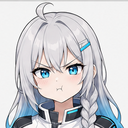](../images/plusa/04-生气鼓脸.webp) **Plusa's tip:** Check the scope before confirming. Disabling removes deployment; deleting removes library files. The Mod Recycle Bin option does not apply to deleting categories or games.

Disabling only withdraws the copy used by the game; the Mod remains in the library. Deleting handles the source container and its associated deployment data.

**Settings → General → Mod management → Deletion method** offers **Recycle Bin (recoverable)** and **Permanent deletion (unrecoverable)**. Permanent deletion is the default. This setting applies to deleting individual Mods or Mods in bulk. **Category deletion and game deletion do not use this Recycle Bin setting.**

Deleting a category affects its subcategories and Mods. With multiple items selected, the confirmation summarizes the scope. A batch task may also ask whether to keep enabled Mods.

If the system Recycle Bin does not support the current location or path, the application asks again whether to delete permanently instead. If you decline, check the interface for which items remain unfinished; do not assume they reached the Recycle Bin.

When files are in use or a disk is offline, deletion may retain cleanup records and retry. Release the files or reconnect the disk, then check the result. Canceling a batch task stops only subsequent processing; it cannot restore files already deleted permanently.

### 3.13 Exporting and sharing

Select Mods or categories, right-click **Export**, and choose a destination folder. Exporting a category includes the Mods in its subtree. Select multiple items to export in bulk.

Under **Settings → Import and export → Export**, choose:

- Whether to package as ZIP, 7z, RAR, or a folder.
- Whether to force conversion to the selected format; when off, archives may keep their original format.
- Whether to preserve the character/category folder structure.
- Whether to include metadata and preview images.
- How many export tasks to process at the same time.

To share named variants, tags, and additional previews, enable **Include metadata and previews**. Named variants are included through supported metadata export workflows. A game-wide Mod preset is different from an exported single Mod.

The export window shows progress and offers pause, resume, and stop actions. After completion, check the success, failure, and missing-source counts, then open the output folder to confirm the files.

### 3.14 Gallery

> [](../images/plusa/08-星星眼.webp) **Plusa's tip:** Use the gallery to choose Mods by their covers. Click to locate the details or double-click to toggle a Mod, keeping the current game in mind.


The gallery displays the current game's Mods through their preview images. Click once to locate the corresponding Mod in the overview; double-click to toggle its enabled state. The same rules apply as in the overview.

Return to **Category Overview** for categories, tags, sorting, editing, or batch operations. A placeholder is used when there is no preview image; this does not affect whether the Mod itself can be enabled.

---

## Chapter 4: Presets, deployment, key bindings, and variants

> [](../images/plusa/06-坏笑.webp) **Plusa's tip:** A preset remembers a combination of Mods; a named variant remembers one Mod's appearance settings. Use each for its own purpose to avoid repeating setup.

### 4.1 Three different ways to save a setup


| Name | What it saves | Where to find it |
| --- | --- | --- |
| Mod preset | A selection of Mods for the current game, plus references to the named variant selected for each Mod | **Presets** in the overview toolbar |
| Individual Mod variant | Appearance values that a Mod supports saving, such as color schemes or accessory options | The **Variants** tab in Mod details |
| Category preset | The category tree, names, node types, and optional folder images; no Mod files | Category preset actions in Tools |

Create categories and import Mods first, then save frequently used combinations as Mod presets. If one Mod has several internal appearances, also save named variants for your presets to reference.

### 4.2 Mod containers and stable identity

Each Mod in the library has a complete container folder. This example uses the `外观` (Appearance) category and `示例 Mod A` (Sample Mod A):

```text
<data root>/data/Sample Game/mods/外观/示例 Mod A/
├── .d3dxmod
├── 示例 Mod A.zip
└── .d3dxmeta/
    ├── info.json
    ├── previews/
    ├── ini_overrides/
    └── variants/
        └── <variant_id>.json
```

| Content | Purpose |
| --- | --- |
| `.d3dxmod` | Records the stable `mod_id`, resource location, and content verification information |
| ZIP / 7z / RAR archive | The original resource archive |
| `info.json` | Metadata such as name, author, tags, age rating, and source |
| `previews/` | Manually added preview images |
| `ini_overrides/` | Editable INI overrides |
| `variants/` | Separately saved named variants |

**A stable `mod_id` identifies the Mod; content hashes are used for verification.** Two folders sharing a name are not necessarily the same Mod, and external changes are not trusted based on filenames alone.

When backing up or moving a Mod out of the library, copy the entire container. Taking only the resource archive leaves behind its accompanying metadata, key changes, and named variants.

Prefer renaming, moving, and exporting through the application. After manually moving a complete container, refresh and check its category. Do not delete markers, forge identities, or replace only the archive to “fix” a verification failure.

### 4.3 Library formats and import rules

Resources are kept in the library as ZIP, 7z, or RAR archives. Importing a folder compresses it into the format selected under **Mod import format**.

When importing an existing archive:

| **Always use the import format** | Behavior |
| --- | --- |
| Off | Keeps the incoming archive's original format to reduce repeated compression |
| On | Extracts archives in other formats and repackages them in the selected format |

Support for reading ZIP, 7z, and RAR is included with the application. **Creating RAR archives requires WinRAR's compression tool.** Without it, the relevant output options are unavailable. Importing an existing RAR archive and saving resources as a new RAR archive are different operations.

Deployment always uses extracted copies. Progress that does not change continuously does not necessarily mean a task has stalled; archive format, file count, and disk performance all affect the processing stages.

### 4.4 Enabling, parking, and disabling

Enabling first checks the source container, metadata, deployment location, and operations in progress. It then prepares resources, applies the effective INI content and configuration, and publishes the finished copy to the deployment folder.

Temporary preparation folders may start with `DISABLED_` and include `.partial`. They are not exposed to the loader as normal enabled copies before completion. After a failure, cancellation, or unexpected application exit, recovery may still need to process these folders.

Disabling first captures the required runtime configuration and synchronizes the INI, then removes the copy currently used by the game:

- A deployment still referenced by other Mod presets may be parked as `DISABLED_...` for faster restoration next time.
- Copies that no longer need to be retained may be cleaned up.
- The source container remains in the library.

3DMigoto normally excludes parked folders using `exclude_recursive = DISABLED*`. If you changed the loader configuration yourself, make sure these folders are still excluded.

Do not enable a parked copy by renaming its prefix in File Explorer. Use Enable or Apply Preset in the application so that the actual files remain consistent with the records.

### 4.5 Deployment folder and external changes

**Mod folder** must match the location read by the loader. It is configured separately from **3DMigoto**; actual Mod deployment is unavailable if it is not set.

The application monitors managed source files and deployment folders for changes. If a deployment folder is moved externally, a source container changes, a disk goes offline, or identity markers conflict, address the report in the interface before resuming operations.

Use the migration workflow on the Games page to change the deployment location. If the application reports changed files, uncertain ownership, or unfinished recovery, do not delete the database, transaction records, or markers to force it to continue. They may contain information needed for rollback and recovery.

### 4.6 Creating and using Mod presets

Click the current preset name in the overview toolbar to open the preset list:


*Click once to select a preset for management. Only **Apply** on the right switches the setup. The preset in use has a status marker.*

| Action | How to use it |
| --- | --- |
| Create | Click **New Preset** to create an empty setup, then name it |
| Apply | Click **Apply** on the target row and wait for deployment to finish |
| Rename | Select a preset and click **Rename**, or double-click its name |
| Copy | Select a preset and click **Copy**, or use the default `Ctrl+C` and `Ctrl+V` |
| Select multiple | Use `Ctrl` to add selections or `Shift` to select a range; you can also select all within the list |
| Delete | Select presets and click **Delete**, then confirm the scope |

Each game has its own default preset, which is retained and cannot be deleted. When deleting a user preset that is currently in use, the application switches to the default preset before completing deletion. Check the dialog and task results.

**A new preset starts empty.** To keep an existing setup and make small changes, copy that preset before applying it. Applying an empty preset means that Mods from other presets will no longer be enabled.

The current preset updates its selections as you enable or disable Mods. When you save or switch a named variant for an individual Mod, the current preset also records the selected variant reference.

### 4.7 How switching presets affects files

Switching is based on the differences between the two presets:

| Difference | Handling |
| --- | --- |
| A Mod is no longer used by the target preset | Parks or removes its deployment |
| The target needs a Mod with a usable parked copy | Verifies and restores the copy |
| The target needs a Mod with no usable copy | Extracts and deploys it for the first time |
| Both presets use the same Mod | Keeps reusable deployment files and handles configuration according to the target preset |
| The same Mod references different variants | Applies the target variant's configuration; INI and user configuration files may still be written |

Sharing a Mod therefore does not guarantee that no file operations will occur. It also depends on the variants, overrides, and whether the deployment is still valid.

Switching shows progress and a cancel action, while restricting conflicting operations such as enabling/disabling, deletion, and switching games. Cancellation or failure attempts to roll back completed steps; unfinished rollbacks retain records for recovery. Wait for the task to finish handling its result before modifying resources again.

### 4.8 Editing a Mod's in-game keys

Select the Mod and open the **Keys** tab in the details panel:


Keys are grouped by INI file. Some bindings provide both a forward and a backward key. Names come from the Mod's own section definitions.

There are two editing methods:

- Click a key field and press the key or Ctrl / Alt / Shift combination you want to use. `Esc` cancels recording.
- Open **Manual input** and enter 3DMigoto key tokens as instructed. Special keys and controller tokens depend on loader support.

**Key changes save directly; no additional overall Save button is needed.** Changes are written to the container's INI override layer. For an enabled Mod, they are also synchronized to its deployed copy. If the game is running, reload as required by the loader for the changes to take effect.

An option to open the source INI appears where supported. If saving is rejected because the file changed externally, reselect the Mod, check the latest contents, and then edit again.

These settings change the Mod's in-game keys. **Settings → Shortcuts** changes the manager's controls; the two are saved separately.

### 4.9 Saving an appearance variant for a Mod

Variants record numerical options that the Mod author declares as persistent, such as color schemes or accessory toggles. They cannot add appearances to a Mod that has no such variables.

Basic workflow:

1. Enable the target Mod and switch to the appearance you want in the game.
2. Use the loader's action for saving configuration. Common 3DMigoto setups write `d3dx_user.ini` on an F10 reload or a normal game exit.
3. Return to the manager, select the Mod, and open **Variants**.
4. Click **Save current state as a new variant**, enter a name, and confirm with **Save and use**.
5. The new configuration appears in the list, and the current preset references it.

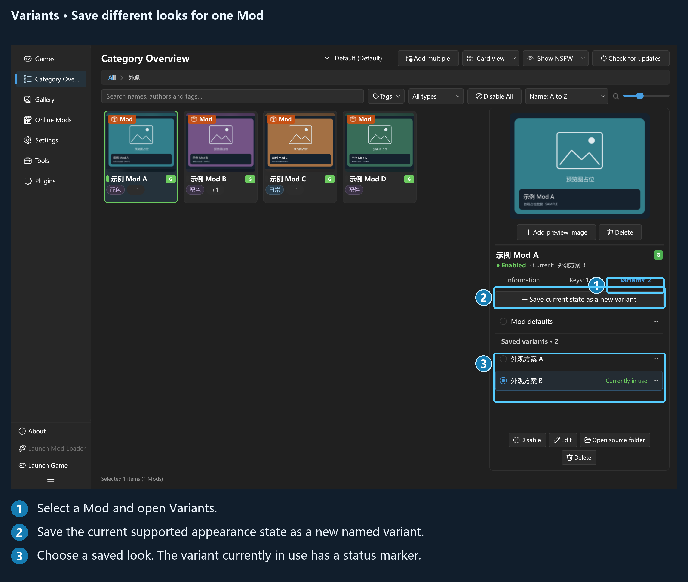

***Mod defaults** and named configurations are listed separately. The selected option is marked **Currently in use** when the Mod is enabled, or **Use next time** when it is disabled.*

Names must be unique within the same Mod and contain no more than 40 characters. Saving requires the Mod to be enabled and valid configuration to be readable.

If the configuration is reported as incomplete, return to the game, save it, and read it again. Choose **Fill with defaults and save** only when you intend to do so. This fills any unread values with defaults, which may not exactly match the appearance currently shown in the game.

**No variants can be saved** usually means that no appearance variables suitable for saving were found. The Mod can still be enabled and disabled normally.

### 4.10 Switching, updating, copying, and deleting variants

| Action | Result |
| --- | --- |
| Click **Mod defaults** | Uses the Mod's default configuration |
| Click a named configuration | Applies it if the Mod is enabled, or selects it for next time if disabled |
| Save current state as a new variant | Creates a separate configuration and switches the current preset to use it |
| Update an existing variant | Writes the captured current state into that configuration. Other presets referencing it use the new contents the next time they are applied |
| Rename | Keeps the variant's identity and references; changes only its display name |
| Create copy | Creates a new variant that can be adjusted independently |
| Delete | Changes all preset references to that variant to Mod defaults; also restores defaults if the variant is currently in use |

Management actions are in the more menu on each configuration row. Before updating a shared configuration, the application lists the presets referencing it. If you want to change only one setup, create a copy first.

**Temporary in-game changes do not automatically overwrite named configurations.** When **Unsaved appearance changes** appears, save a new configuration or update the existing one as needed.

Multiple presets can reference the same named variant. Copying a preset preserves these references; it does not automatically create separate variant files for each preset. Copy the variant separately when you need independent settings.

After restoring a variant, reload through the loader if the game is running. A successful save in the application means the configuration has been written; it does not mean the running game has already refreshed its appearance.

### 4.11 Sharing variants with others

Named configurations are stored in the Mod container's `.d3dxmeta/variants/`. For sharing, use **Export** with **Include metadata and previews** enabled. You can also back up the entire container.

Import checks the variant format and whether its variables can be matched to the Mod. Mismatched content, duplicate identities, damaged files, and similar issues may be rejected. You cannot apply an arbitrary variant JSON from another Mod directly.

A game's private working state records serve a different purpose from named variants. For a full backup on your machine, retain `config/`, `data/`, and external resources. An export package is sufficient for sharing a single Mod.

---

## Chapter 5: Online mods and updates

### 5.1 Connecting to GameBanana

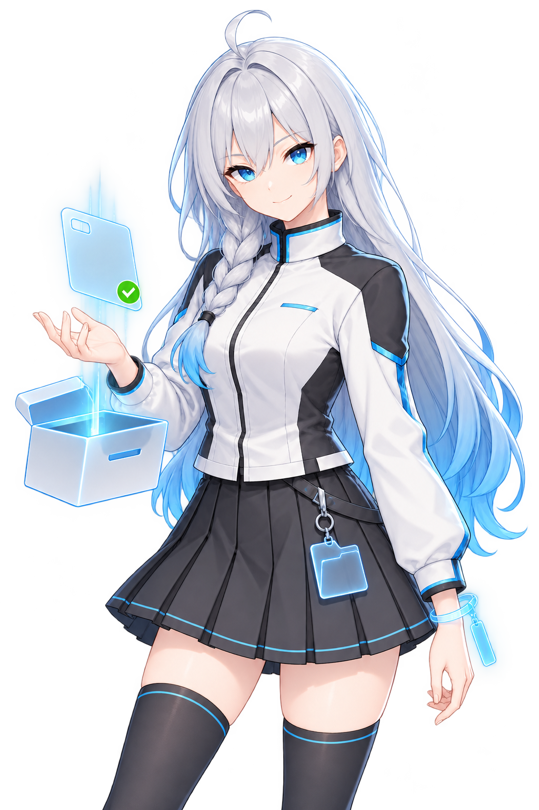

Activate a game, then open **Online Mods**. The app uses the English name in the game's configuration to find a match on GameBanana and saves the result for that game. Changing the English name triggers a new match.

If you see **GameBanana has no entry for this game**, first check the English name on the Games page. You can also use the website search link provided on the page. A network failure and a game that is not listed have different causes: check the connection for the former, and check the game name and the site's listings for the latter.

Configure the proxy in two steps:

1. Under **Settings → General → Network proxy**, turn on the main switch, then use the system proxy or enter a manual address and port.
2. Under **Settings → Online Mods → Online Mod proxy**, turn on **Enable proxy**.

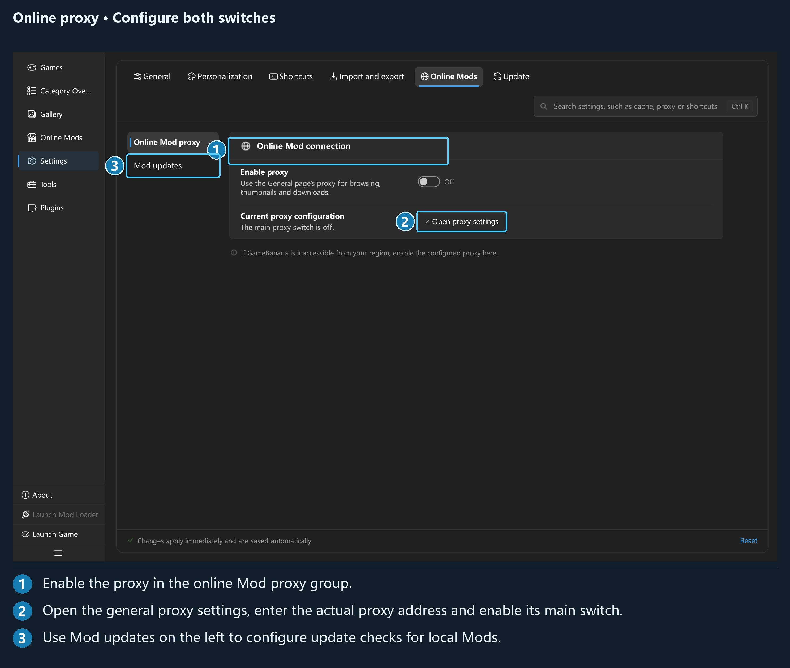

*Online browsing, images, downloads, and mod updates all use the Online Mods proxy policy.*

Local categories, importing, and deployment do not require a connection to GameBanana.

### 5.2 Browsing, searching, and details

The online page lets you browse by category, search for mods, change the sort order, and refresh the list. Sort options include **Default**, **Newest**, **Recently updated**, **Most liked**, **Most downloaded**, and **Most viewed**.

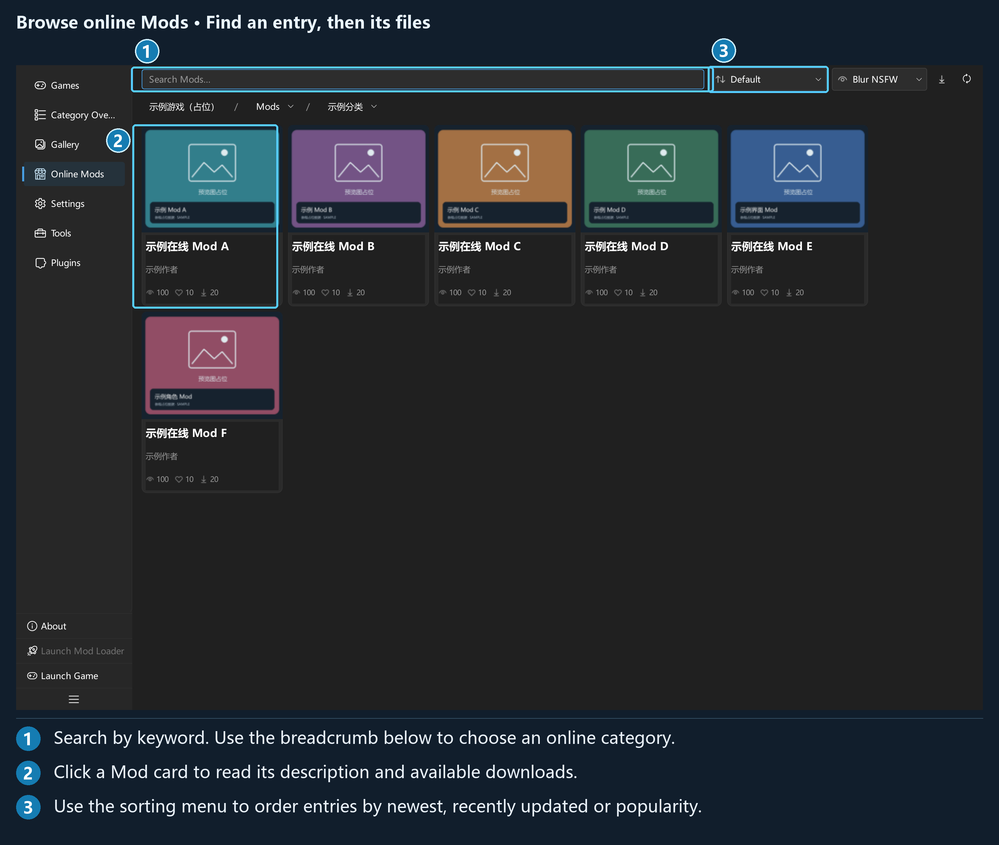

*The names, covers, authors, and statistics are tutorial placeholders used to show the browsing controls in the real interface.*

**Hide NSFW**, **Blur NSFW**, and **Show NSFW** control online content previews; the default is to blur them. This preference is saved separately from the display preference for local X-rated mods.

Click a card to open its details, where you can view images, **Overview**, **Description**, **Update**, and **Available files**. An entry with multiple files often offers different versions, optional content, or attachments. Read the author's instructions before choosing a file.

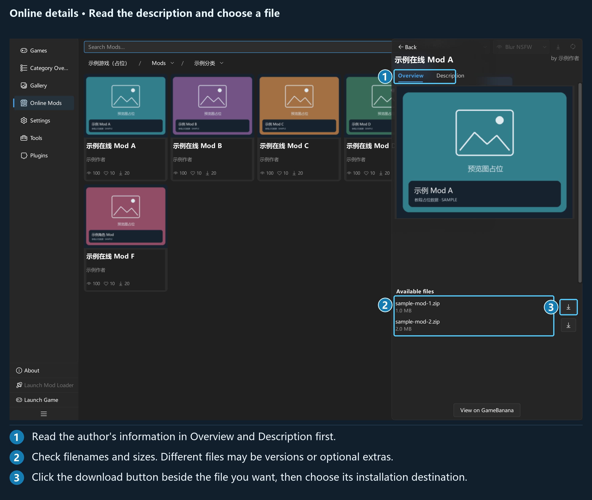

*The filenames and sizes shown here are also placeholders. Read each file's description when using real entries.*

Author descriptions and downloadable files come from an external site. This tutorial uses placeholder content to explain the controls; actual entries depend on the site's content.

### 5.3 Downloading and choosing an installation destination

Select an available file in the details view and click **Download**. When the download finishes, the app prepares to import it into a destination category.

Installation can proceed when there is one unambiguous category match. Otherwise, **Choose installation destination** appears:

- Select an existing category in the tree. You can search by category name.
- Check the destination game and category to avoid installing into another game.
- If the interface offers to save the site's category name as the English name, you can do so to help future matching.
- If the destination folder already has an English name, follow the overwrite confirmation prompt.

Online installation still checks the archive, metadata, and destination path. A finished download does not necessarily mean the mod has been added to the library; wait for the installation result.

If you switch to another game during a download, the task still belongs to the original game. Once downloaded, it may wait for you to switch back before installing. If the new mod is missing from the current page, do not immediately import it again into a different game.

### 5.4 Managing downloads

> [](../images/plusa/07-困倦.webp) **Plusa's tip:** Large files can take time. Check the status, speed, and error details in download management, and use its pause or cancel controls when you need to stop.

Open **Downloads** from the online page to see queued, downloading, paused, completed, and failed tasks, along with their progress, speed, and size.

| Control or menu item | Purpose |
| --- | --- |
| Pause / Resume | Control downloads that support pausing |
| Cancel | Stop the current task |
| Retry | Retry a failed download |
| Open Mod category | Locate an installed mod |
| Show in File Explorer | Locate a retained download file |
| Remove from list | Remove the record |
| Delete, including local files | Also handle that download's local files; follow the confirmation prompt |
| Clear completed / Clear all | Process download list entries in bulk; check the scope in the prompt before proceeding |

Downloaded source packages are stored in `<data-root>/data/downloads/`. They are not disposable image caches.

**Delete installer packages automatically**, under **Settings → General → Download data**, is on by default. **The corresponding source package is deleted only after the mod has been successfully added to the library.** Turn this off to retain packages for an offline archive.

**Clean up installed** removes source packages that have been confirmed as added to the library, while keeping downloads that have not yet been installed. Deleting a source package does not delete the imported mod from the library, but retaining source packages is not a substitute for a complete backup.

### 5.5 Checking installed mods for updates

Click **Check for updates** in **Category Overview** to open the mod updates window. Checks depend on saved GameBanana source information. Mods installed from the online page have the relevant records; other local packages may not.

The update window separates check progress from the update list. You can search mod names and view local and new version information, update notes, file dates, and estimated download sizes.

If a check fails or covers only some items, the interface reports that the check is incomplete. This does not mean that all mods are up to date. Use **Check again** once the network connection is restored.

Automatic checks are configured under **Settings → Online Mods → Mod updates**:

| Setting | Default and behavior |
| --- | --- |
| Check Mod updates automatically | On |
| Check on startup | On, with a minimum interval between checks |
| Scheduled check frequency | Off by default; also offers Every 6 hours, Every 12 hours, and Daily |
| Notification style | Badge only by default; a status bar notice can also be added |
| Check concurrency | Auto recommend by default; lets you adjust concurrency in the update workflow |

Manual and automatic checks have different triggers. For everyday use, refer to the latest check results shown in the update window.

### 5.6 Updating one or more mods

Click **Update** for an individual item or **Update all** for a batch. If an entry offers multiple files, **Choose update files** appears first. You must select one file for each relevant mod before starting.

Tasks may pass through preparation, download, verification, extraction, and installation stages. Use the **Updated** status or the results summary to confirm completion.

| Action | Behavior |
| --- | --- |
| Pause / Resume for one item | Controls the task at stages that currently allow pausing |
| Pause all / Resume all / Stop all | Applies to all unfinished updates for the current game, including tasks hidden by the search filter |
| Close update window | If tasks are running, you can return to them, stop unfinished updates, or continue in the background |
| Stop | Unfinished items keep their old versions; completed updates are not undone. You may need to wait during installation commit or final cleanup |

If preparing the new content fails, check the specific file or verification error. The app retains the materials needed for recovery. Do not manually delete source containers, working folders, or transaction records during an update.

Export or back up important custom changes beforehand. Updating a mod and **Back up the previous version** for application updates are separate features; the latter does not replace a mod backup.

### 5.7 Ignoring updates and restoring notifications

An item's More menu offers:

- **View on GameBanana**: open the source page in a browser.
- **Ignore this version**: skip notifications for this version.
- **Ignore this Mod**: stop notifications for future updates to this mod as well.

After ignoring an update, you can use **Undo** in the window's current notification. Undo requires the mod and game to remain valid. After closing the window, do not assume this temporary Undo control will still be available.

### 5.8 Updating the application

Application version updates are under **Settings → Update → Application updates**. Use **Check application updates**.

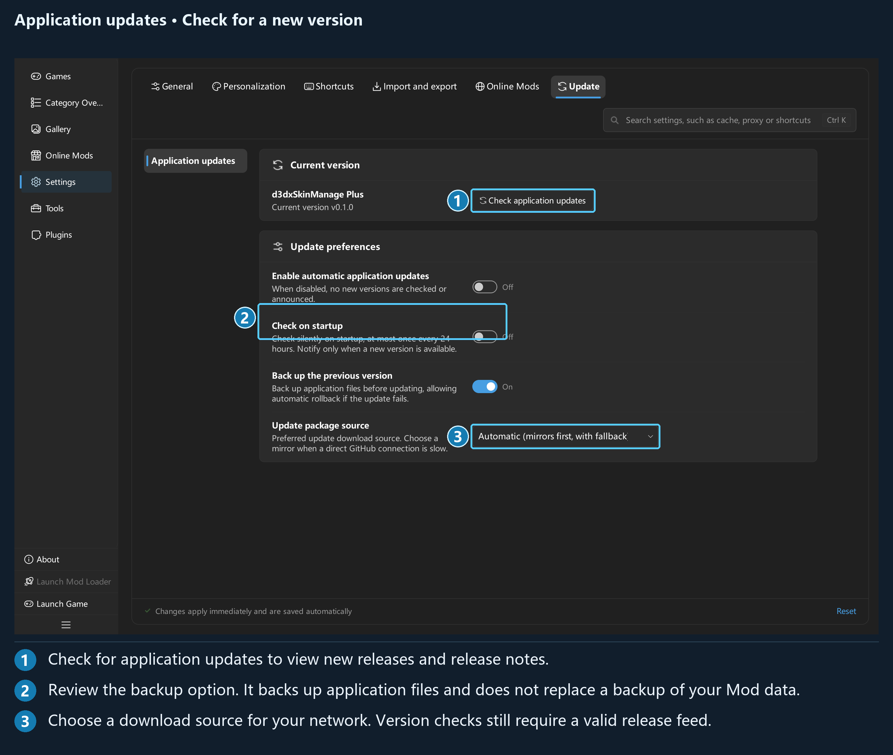

Update availability depends on whether the distribution channel provides a valid update source and a matching package. If the app reports that no update source is configured, obtain the new version through the software publisher's download channel.

When a new version is found, you can read its release notes and release history, then update, ask to be reminded later, or skip that version.

The one-click update process downloads, checks, and extracts the package, then makes a backup according to your settings. A separate updater replaces the application and restarts it. Keep the `Updater/` folder supplied with the distribution; you do not need to launch the updater directly.

- Finish active tasks before installing an update, then close the application when prompted.
- Updates preserve your mods, settings, and plugins. Regular backups of personal data are still recommended.
- The download source can be automatic or a specific mirror. Automatic mode falls back through the candidate sources.
- If the updater reports an error, retain both application and updater logs, check paths and files in use, then retry.

Application updates and GameBanana mod updates serve different purposes. The former upgrades the manager; the latter replaces resources in the library.

---

## Chapter 6: Settings

> [](../images/plusa/09-思考.webp) **Plusa's tip:** Search settings when you are unsure where an option lives. Your saved configuration determines the current shortcuts and paths.

### 6.1 Sections, search, and saving

The Settings page has six sections across the top: **General**, **Personalization**, **Shortcuts**, **Import and export**, **Online Mods**, and **Update**. Each section also has subpages on the left.

Use the default `Ctrl+K` shortcut to open settings search, or type a setting name in the upper-right corner. Search results can take you across sections and locate the relevant control.

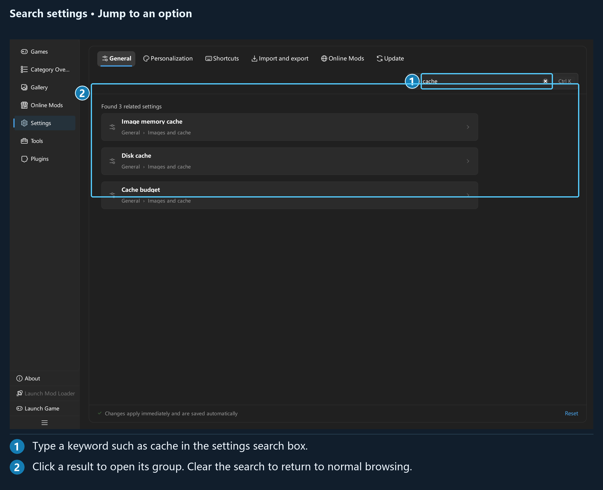

*Enter “cache” to find settings for image memory and disk caches.*

The page states **Changes apply immediately and are saved automatically**. Switches and selections usually save immediately, while text fields submit changes when editing finishes. Some sliders preview changes as you drag and save when you release them.

This chapter lists the default settings. Screenshots use example settings; check the values and switch positions shown on your device.

### 6.2 General → Mod management

| Setting | Default | Description |
| --- | --- | --- |
| Deletion method | Permanent deletion (unrecoverable) | You can also choose the Recycle Bin; this applies only to deleting individual mods or batches of mods |
| Concurrency | Auto recommend | The number of deployment tasks that can run at once; manually adjustable from 1–16 |

Deleting a category, deleting a game, and clearing a deployment folder each have their own scope confirmations. Selecting the Recycle Bin for mod deletion does not make these other operations recoverable.

**Auto recommend** saves automatic mode, allowing the app to recalculate for a different device. Manually changing the number switches to a fixed limit. Higher concurrency is not always faster; lower it for mechanical hard drives, large archives, or limited memory.

### 6.3 General → Network proxy

| Setting | Default | Usage |
| --- | --- | --- |
| Enable proxy | Off | When enabled, application updates can use this proxy configuration |
| Use system proxy | On | Reads the proxy from Windows |
| Protocol | HTTP | Manual mode supports HTTP, HTTPS, and SOCKS5 |
| Proxy address / Port | 127.0.0.1 / 7890 | Example defaults; these must match your proxy software |
| Test connection | Manual action | Checks external network connectivity and latency through the proxy |

Online Mods also requires **Enable proxy** in its own section. If Online Mods is using the proxy when you turn off the main switch, the app asks whether to disable that use as well.

If no configuration is detected in system proxy mode, check Windows settings first. In manual mode, check the address, port, and whether the proxy application is running.

### 6.4 General → Download data

This page shows total package storage, split into installed and uninstalled packages, and provides:

| Control | Purpose |
| --- | --- |
| Delete installer packages automatically | On by default; removes the corresponding source package after the mod is successfully added to the library |
| Clean up installed | Removes downloaded source packages already added to the library, after confirmation |
| Open folder | Opens the actual downloads folder |

Keep downloads that have not yet been installed until you install them or decide how to handle them. These source packages are stored separately from the managed mod contents in the library, so cleaning up installed packages reduces duplicate storage.

### 6.5 General → Images and cache

This page separates the image memory cache from the disk cache, each with its own limit and cleanup controls.

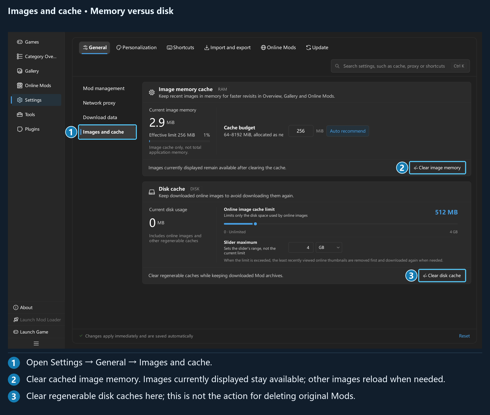

| Item | Default or range | Description |
| --- | --- | --- |
| Image memory cache | Auto recommend; manual range 64–8192 MiB | Keeps recently decoded images so returning to them is faster |
| Current image memory | Live statistics | Measures only the image cache, not the whole application's memory use |
| Clear image memory | Button | Releases cache entries that can be freed; images currently on screen remain in memory |
| Disk cache limit | 512 MB by default; 0 means unlimited | Manages online images and other caches that can be regenerated |
| Disk slider range | Maximum 4096 MB by default | Controls how far the slider can go, rather than the effective cache limit |
| Clear disk cache | Requires confirmation | Clears regenerable caches while retaining downloaded mod source packages |

The automatic memory allowance varies with your device and display. Use the recommendation shown on your device. Lowering the allowance may require images to be decoded again when revisited, but does not delete mods or their metadata.

The disk cache is not a backup folder. Do not manually clear `data/`, operation recovery records, or `.d3dxmeta/` as though they were caches.

### 6.6 Personalization → Appearance

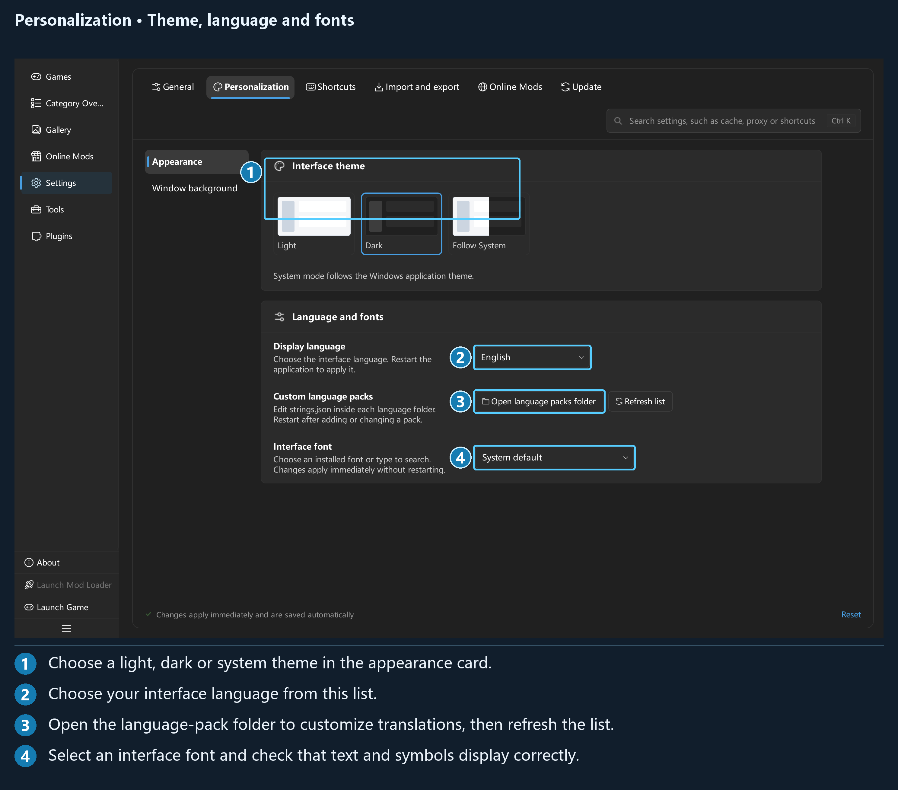

| Option | Default | Description |
| --- | --- | --- |
| Theme | Dark | Also offers Light and Follow System; the latter follows the Windows app theme |
| Font | System default | Choose and preview a font installed on this computer |
| Language | Simplified Chinese | Options come from language packs in the configuration folder |

Restart the app after switching languages or editing a language pack to refresh the entire interface.

To create another language pack:

1. Click **Open language packs folder**.
2. Copy an existing language folder and name it with a language code, such as `ja-JP`.
3. Edit the UTF-8 `strings.json` file, preserving the source-text keys and dynamic placeholders.
4. Return to Settings, click **Refresh list**, select the language, and restart.

Languages are identified by their folder names. Game names, mod names, author descriptions, and custom tags are user content and are not automatically rewritten when the interface language changes.

For the file format, placeholders, fallback languages, and developer tools, see the [language pack guide](LanguagePackGuide.en.md).

### 6.7 Personalization → Window background

You can turn the background off or use an image, video, or WE scene.

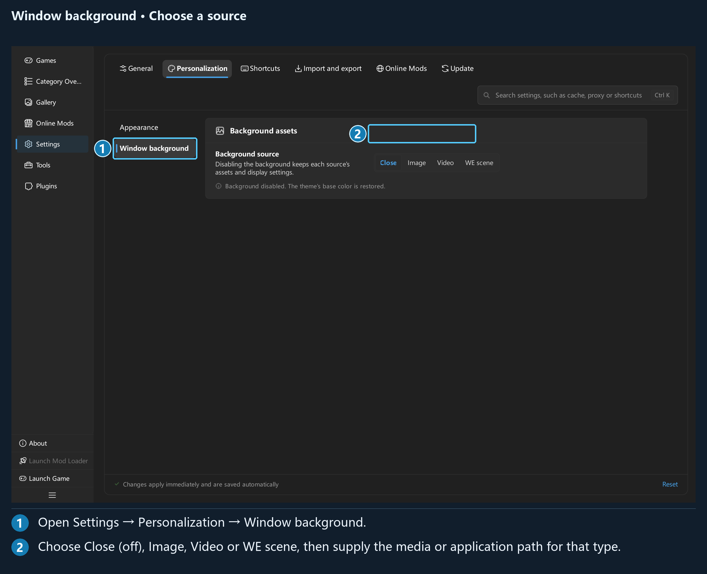

| Source | What to select |
| --- | --- |
| Close (off) | Uses the theme's background color |
| Image | A supported local image such as PNG, JPG, JPEG, BMP, or WebP |
| Video | A supported local video such as MP4, WebM, MKV, AVI, or MOV |
| WE scene | The `project.json` from a Wallpaper Engine scene project, together with the local Wallpaper Engine application configuration |

For WE scenes, use **Find automatically** or manually specify an application path such as `wallpaper64.exe`. Keep the complete scene project and its resource files; copying only the JSON file is not enough to play it.

Display settings:

| Setting | Default | Purpose |
| --- | --- | --- |
| Image fit | Fill (crop to cover) | Can be changed to fit; images also support Tile |
| Background overlay | 45 for Dark, 30 for Light | Saved separately for each theme; darkens in Dark mode and softens and brightens in Light mode |
| Background blur | 60 | Range 0–100; 0 turns it off |
| Background frame rate | 30 FPS | Used for animated backgrounds; adjustable through the available options |
| Scene quality | 2× | WE scenes can use 1× to reduce resource use |
| Background volume | Muted | Adjust sound for supported animated backgrounds as needed |

Animated backgrounds provide pause, resume, and retry controls. They pause automatically when the window is minimized and resume when it is restored. Restoring the window does not override a manual pause.

If playback fails, check that the file still exists, its encoding is supported, and the WE path and project are complete. Image backgrounds do not require Wallpaper Engine, nor do ordinary local videos.

### 6.8 Shortcuts → Key bindings

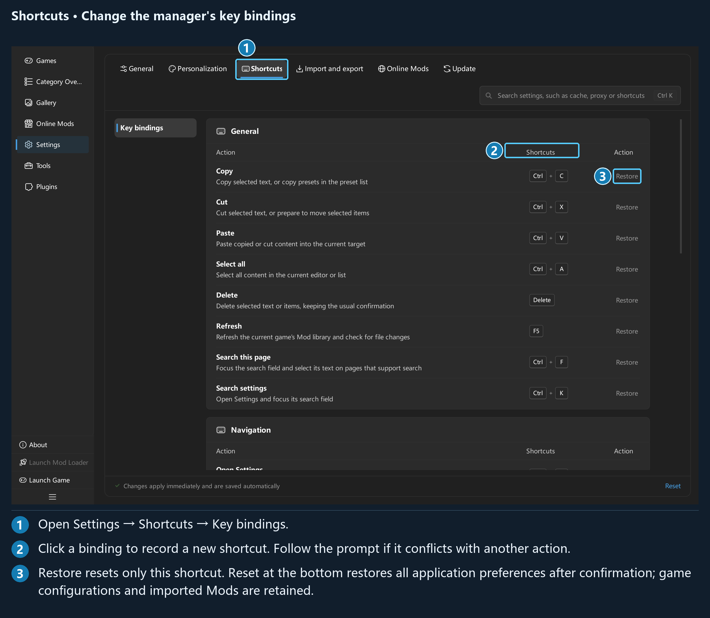

Commands are grouped by where they are used. Click the corresponding key binding to record a shortcut, then save it. Combinations of Ctrl / Alt / Shift with one primary key are supported.

When a conflict is found, the app identifies the conflicting command. Confirming replacement may leave the previously assigned command unbound; canceling keeps the original binding. System-reserved combinations cannot be assigned to ordinary commands.

Shortcuts depend on focus: editing in a text box, working with items in Category Overview, and copying in the presets list each have their own context. The manager does not provide global hotkeys that work in other applications.

Commands registered by plugins can also appear in the relevant groups. See Appendix A for the complete default shortcut table.

### 6.9 Import and export

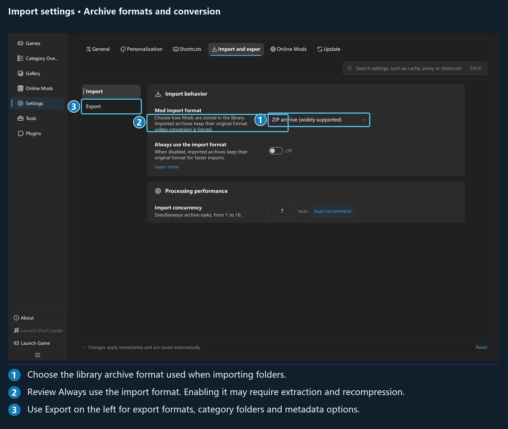

The **Import** subpage:

| Option | Default | Description |
| --- | --- | --- |
| Mod import format | 7z | Folder inputs are compressed to this format; archives keep their original format when conversion is not forced |
| Always use the import format | Off | Extracts and recompresses when needed |
| Import concurrency | Auto recommend | Manually adjustable from 1–16 tasks |

The **Export** subpage:

| Option | Default | Description |
| --- | --- | --- |
| Mod export format | ZIP | Also offers 7z, RAR, or a folder |
| Always use the export format | Off | When off, the source archive format may be retained; this option is unnecessary for folder exports |
| Preserve the category folder structure | On | Organizes output by category path |
| Include metadata and previews | Off | Enable to share tags, additional previews, and named variants |
| Export concurrency | Auto recommend | Manually adjustable from 1–16 tasks |

Creating RAR archives requires WinRAR. Reading RAR archives does not require a separate archiver installation. Read the explanations for unavailable options before choosing an output format.

The current category determines the destination for a local import. For online installation, check the category in the installation destination selection flow.

### 6.10 Online Mods

The **Online Mod proxy** subpage provides a switch and **Open proxy settings**. It uses the proxy configured in General. You cannot enable the online proxy separately while the main switch is off.

The **Mod updates** subpage provides automatic checks, startup checks, scheduled frequency, notification style, and check concurrency. Automatic and startup checks are on by default, scheduled checks are off, and notifications use **Badge only**. Concurrency uses **Auto recommend**, with a manual range of 1–16.

See Chapter 5 for pausing, resuming, background tasks, and file selection in the update window.

### 6.11 Update → Application updates

| Option | Default | Description |
| --- | --- | --- |
| Check application updates | Manual control | Displays the current version and checks the update source configured by the publisher |
| Enable automatic application updates | On | Controls automatic checks and notifications |
| Check on startup | On | Checks in the background, with a 24-hour minimum interval |
| Back up the previous version | On | Backs up application files before updating the manager itself |
| Update package source | Automatic | Tries mirrors first and falls back on failure; you can also choose a specific source |

The supplied updater installs application updates. If no update source is configured, obtain the new version through the software publisher's download channel.

### 6.12 Restoring defaults

**Reset**, in the lower-right corner, first opens a confirmation dialog with Cancel selected by default. Confirming resets all application preferences, including:

- Appearance, language, font, and background.
- Customized shortcuts.
- Import, export, deletion, network, and update preferences.
- Settings that support automatic recommendations, which return to recommendations based on the device.
- Options such as interface layout stored in application preferences.

**Game configurations and imported mods are retained.** The game list, active game, and current preset selection are saved separately in `config/games.json`.

If the reset fails, the app keeps the original settings and displays a message. To revert just one option, adjust it directly without resetting all preferences.

---

## Chapter 7: Tools, plugins and About

### 7.1 Tools

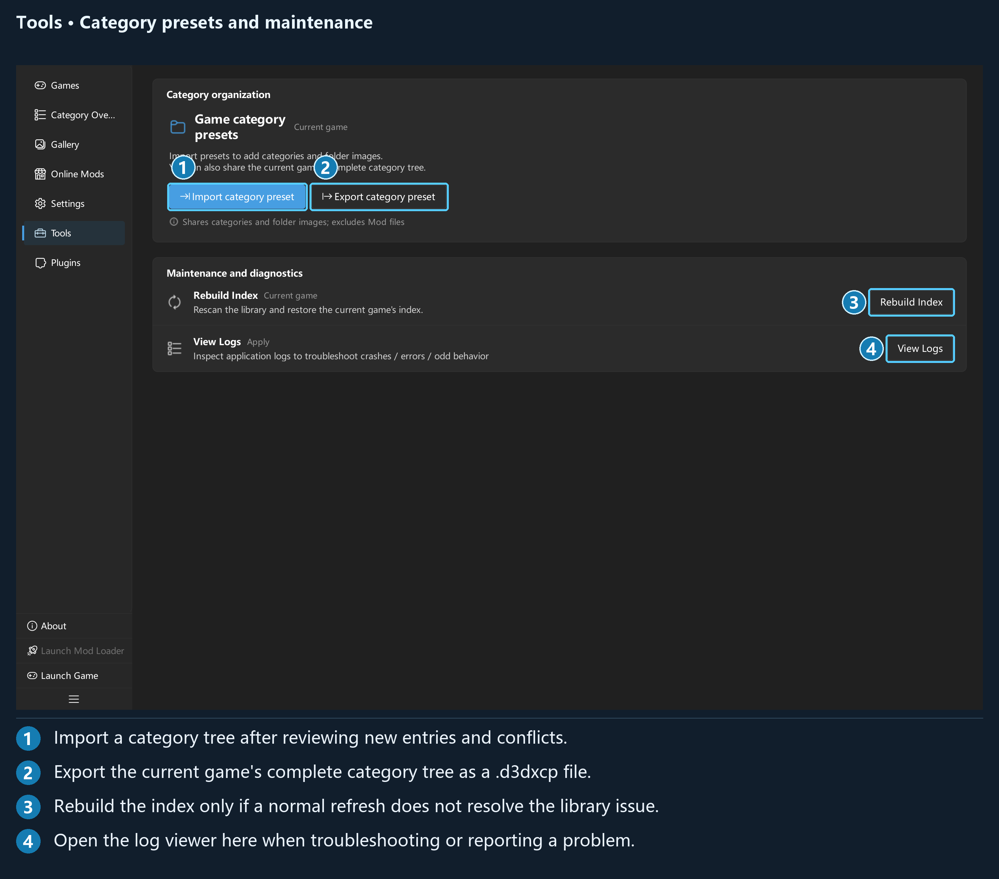

Tools is divided into category organization, maintenance and troubleshooting, and tools contributed by enabled plugins.

| Entry | Purpose |
| --- | --- |
| Import category preset | Adds categories and category images to the destination game |
| Export category preset | Shares the current game's complete category tree, optionally with images |
| Rebuild Index | Rescans the file library to restore the index |
| View Logs | Shows runtime records by startup session |
| Plugin tools | Runs features provided by enabled plugins |

Cache cleanup is under **Settings → General → Images and cache**. Downloaded source package cleanup is under **General → Download data**. To export mods, select the items in Category Overview.

### 7.2 Importing a category preset

A category preset uses the **`.d3dxcp`** extension. It contains a category structure and optional category images, without mod contents or a complete preset of enabled mods.

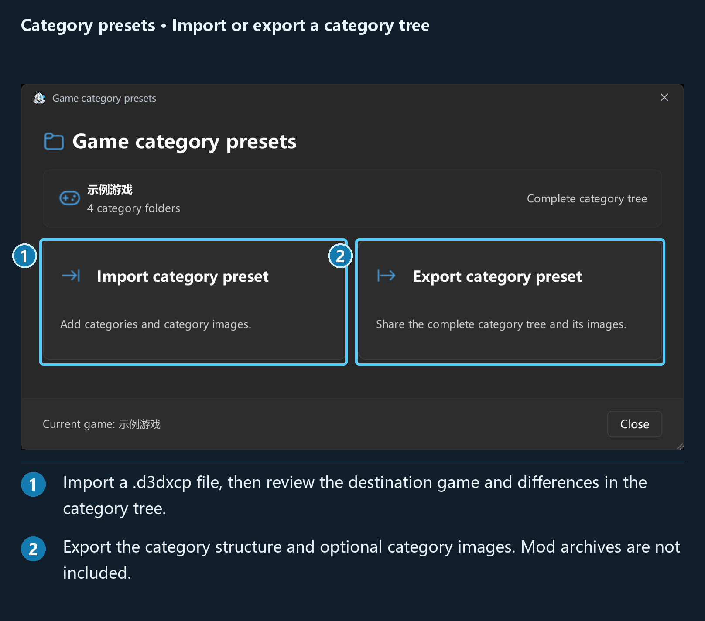

Choose **Import category preset** in Tools, or **Start with a category preset** on an empty Category Overview page:

1. Select a `.d3dxcp` file.
2. Check the destination game and review the complete category tree.
3. Review the counts for new folders, existing folders, images to add, and path conflicts.
4. Locate and resolve any conflicts, then click **Compare again**.
5. After checking the result, click **Start import**, then **View categories** when it finishes.

If the game suggested by the file differs from the current game, the interface prompts you to check the destination. If every folder already exists and no images need adding, it explains that no import is needed.

Existing categories and category images are handled according to the comparison results. Importing a preset does not mean replacing the entire existing tree. Resolve path or type conflicts before importing.

Cancellation takes effect at a safe boundary. If the app reports that categories have been imported but cleanup is pending, keep the recovery records. Follow the prompt to retry, or restart and wait for cleanup to finish.

### 7.3 Exporting a category preset

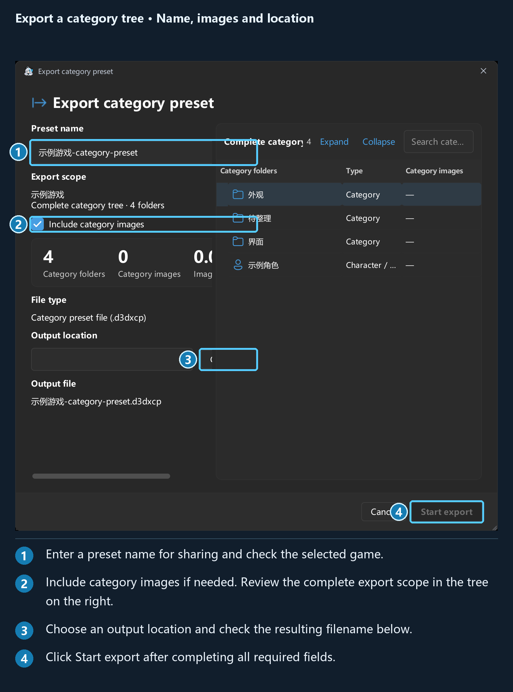

Activate a game, then click **Export category preset** in Tools:

- Enter a preset name.
- Review the current game's complete category tree and counts.
- Select **Include category images** if needed.
- Repair unreadable images, or deselect those images using the available controls.
- Choose an output location, confirm the output file, and click **Start export**.

The export covers the current game's complete category tree, rather than a single selected mod. Recipients of this file still need to import their own mods.

### 7.4 Rebuilding the index

Use this when source files still exist but the categories or mod list no longer match the disk. First try refreshing with the default `F5` shortcut. Rebuild only when the index needs restoring.

Before starting, check that the resource drive is accessible and the correct game is selected, and finish related file tasks. After confirmation, the app scans the library, reads category and mod markers, and restores the index entries and associations it can recognize.

A normal rebuild mainly handles the current game. **If the app detects corruption of the entire index database at startup, recovery involves all configured games.** Connect each game's resource drive and follow the prompts.

The completion report lists registered entries, classification results, and problems such as invalid metadata. Unreadable files or files with conflicting identities may not be recoverable; keep the report and address the affected items. Rebuilding cannot recover permanently deleted archives and does not replace a backup.

### 7.5 Log Viewer

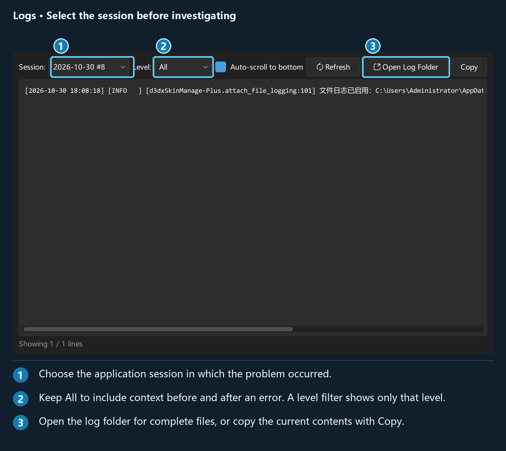

Click **View Logs** in Tools to access:

| Control | Purpose |
| --- | --- |
| Session | Selects a startup session by date and sequence, such as “2026-10-30 #1” |
| Level | All, or one of DEBUG, INFO, WARNING, ERROR, and CRITICAL |
| Auto-scroll to bottom | Moves to the newest entries after a refresh |
| Refresh | Rereads the selected file |
| Open Log Folder | Locates the actual log files |
| Copy | Copies the currently displayed content |

The level filter matches exactly: selecting WARNING does not also include ERROR. Use **All** when you need the context before and after an error.

The window reads only approximately the final 1 MiB of a log. Open the full file from the log folder if you need earlier content. Logs are saved by date and startup sequence and retained for 14 days by default, so save the relevant session promptly when reporting a problem.

Updater logs are also part of the logging system. Keep them alongside the application logs if an application update fails. Remove unrelated personal paths or sensitive information before submitting a report.

### 7.6 Installing and managing plugins

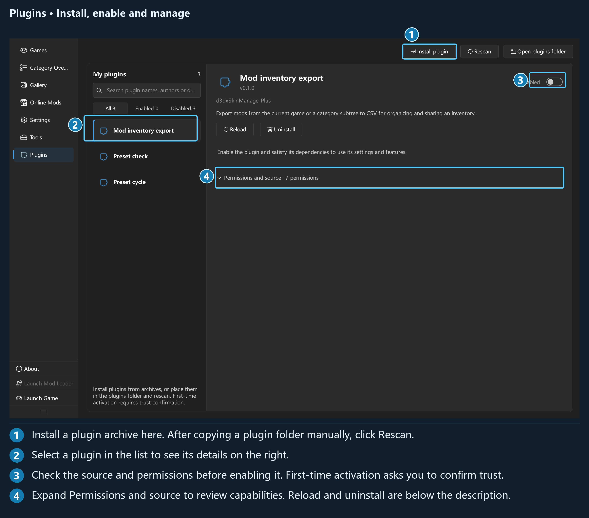

The Plugins page lists plugins on the left and shows details for the selected plugin on the right. Search by name, author, or description, or filter by **All**, **Enabled**, or **Disabled**.

There are two installation methods:

| Method | Steps |
| --- | --- |
| Install an archive | Click **Install plugin**, choose a ZIP, 7z, or RAR file, and follow the result message |
| Add a folder manually | Click **Open plugins folder**, add the complete plugin folder containing `plugin.json`, then click **Rescan** |

Plugins are discovered in `plugins/` under the application root by default. If that folder is not writable, the app uses its data-folder fallback; use the actual location shown by **Open plugins folder**. Bundled examples and plugins you install use the same folder and management rules.

After installation, check the plugin's status in the list. Select it to review its author, description, permissions, and source, then enable it as needed. The first trust prompt explains that the plugin runs code inside the app and lists its requested capabilities. Confirm only for sources you trust. New permissions discovered after an update or rescan require confirmation again.

**Ready** means the plugin is already available: its tool buttons, menus, and shortcuts are registered, and it starts automatically when you first run a command or open the corresponding view. Declared settings in its details can also be edited and reset to defaults immediately.

If the status is **Dependency blocked**, expand the details and follow the instructions to install and enable dependency plugins with compatible versions. Confirm trust separately for each dependency. Dependencies are not installed or authorized automatically. After resolving the requirements, reload or enable the original plugin again.

Installing a new archive for the same plugin replaces its code folder and preserves private settings data. Before replacement, the installer checks the archive, manifest, version requirements, and code; a failed check keeps the original plugin. Check its status after updating, and confirm any additional permissions.

### 7.7 Plugin permissions, settings, and uninstallation

Expand **Permissions and source** in the details pane to review capabilities such as reading or modifying mods, storing settings, network access, files, processes, background tasks, views, and shortcuts, along with dependencies and activation information.

An enabled, trusted plugin whose dependencies are satisfied displays editable controls for any declared settings, including while its status is **Ready**. Settings are saved, and each can be reset to its default. Some plugins also provide dedicated options on their own pages.

Disabling removes the plugin's commands, pages, menus, shortcuts, and callbacks and cancels its tasks. Plugins that depend on it also stop, while retaining their enabled-state preference. Cancellation takes effect at safe boundaries and does not undo every completed operation; check the final task result.

Use **Reload** after editing plugin code. The app removes old commands and interfaces and cancels tasks, then reads the current code and restarts previously active plugins that depend on it, without restarting the whole app. Use **Rescan** when adding plugins or changing the folder layout.

**Uninstall** first disables the plugin and plugins that depend on it, then deletes its code folder. Check the name before confirming. The plugin's settings and private data are preserved for reuse when you reinstall the same plugin. Keep a separate backup of your own plugin source files.

If the status is **Error**, read the error description and logs. Parsing failures, permission mismatches, code checks, and runtime errors can all prevent activation. Permission declarations and checks do not determine whether a plugin's source is trustworthy for you.

Three optional plugins are bundled; enable each one before first use. Their contributions add the corresponding controls to Tools, Category Overview context menus, navigation pages, and shortcut settings:

- **Mod inventory export** exports a CSV inventory of the current game from Tools. From a category's context menu, it includes that category and its subcategories. Select **Export enabled mods only** in plugin details to limit the output. The inventory is generated in the background, with a notification on completion. It contains text metadata only, without mod files, and is not a restorable preset file.
- **Preset check** adds a navigation page with the same name for checking missing mod and appearance variant references. Return to the main interface to edit affected presets. Choose whether to include the default preset and click **Check again** to refresh. Results reflect references that can currently be resolved; a missing reference does not prove a resource is permanently lost.
- **Preset cycle** switches to the previous or next combination from Tools or **Plugin Commands**. The default shortcuts are `Ctrl+Alt+PgUp` and `Ctrl+Alt+PgDown`, effective only inside the app and adjustable in **Settings → Shortcuts**. The default preset is skipped unless you change the option in plugin details. The host task interface shows progress and failure reasons. Repeated clicks during an unfinished switch do not queue multiple switches.

These plugins' source code and usage instructions are in `plugins/`. To write your own plugin, read this tutorial's [Plugin development guide](PluginGuide.en.md). Start with the first working example, learn the current SDK's commands, settings, pages, background tasks, and dependencies, then complete testing and packaging.

### 7.8 About and the project film

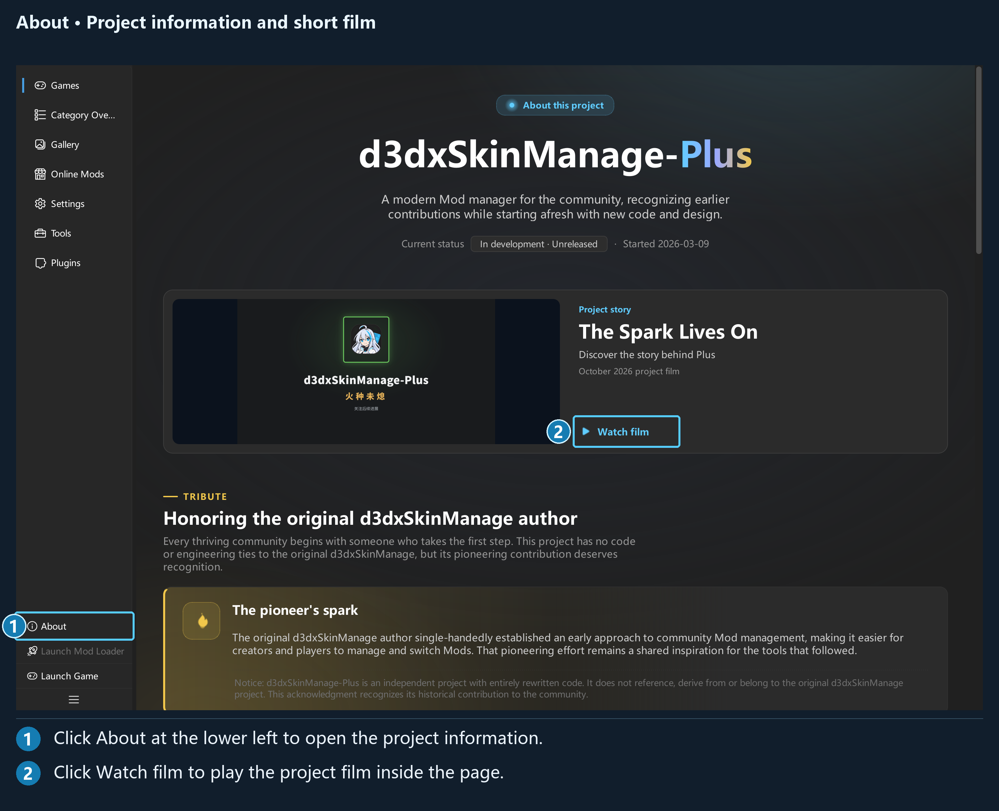

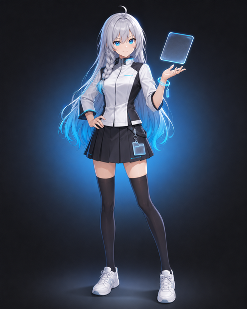

*Plusa is the project's original mascot and your companion throughout this guide.*

Open **About** near the bottom of the navigation to read the project introduction, tribute to the original author, project timeline, team and contributor information, and license details.

Watch the project film on the About page using its playback controls. Keep the supplied media folders when moving the application.

The project uses PolyForm Noncommercial 1.0.0 with additional attribution integrity terms. The bundled LICENSE defines the exact rights and conditions. Preserve the required attribution and third-party notices when modifying or distributing the project.

The manager's version and update controls are under **Settings → Update → Application updates**.

---

## Chapter 8: Data, backups and troubleshooting

### 8.1 Finding the actual data root


The application first tries to store personal data beside the application. If that folder is not writable, it uses the Windows user data directory, usually:

```text
%LOCALAPPDATA%/d3dxSkinManage-Plus/
```

Use **Open language packs folder**, **Open plugins folder**, or **Open Log Folder** to check the location currently in use, then identify `config/` and `data/` under the same data root.

A single-file release also includes folders for languages, plugins, tutorials, and media. Move the complete distribution instead of keeping only the executable.

### 8.2 Files to keep

| Location | Contents | Backup recommendation |
| --- | --- | --- |
| `config/settings.json` | Application preferences and shortcut overrides | Keep |
| `config/games.json` | Game list, paths, active game, current preset, and community site matches | Keep |
| `config/plugin_state.json` | Plugin activation, trust, and related state | Keep |
| `config/languages/` | Default and custom language files | Keep, especially your own changes |
| `data/mod_index.db` | Current resource and deployment index | Back up after closing the app |
| `data/presets.json` | Presets for all games | Keep |
| `data/<game-resource-folder>/mods/` | Category folders and complete mod containers | Essential |
| Preferences and other records in `data/<game-resource-folder>/` | State specific to the game, variant working state, previews, and other records | Back up the entire folder together |
| `data/downloads/` | Downloaded source packages and queue information | Keep if packages are awaiting installation or needed for an archive |
| `plugins/` and plugins' personal storage | Installed plugins and their data | Keep if you intend to continue using them |
| `cache/` | Caches that can be regenerated | Do not use as your only backup source |
| `logs/` | Troubleshooting logs | Keep relevant sessions when a problem occurs |
| External loaders and deployment folders | Loader configuration, managed deployments, and manually added resources | Back up separately if they contain custom or manual content |

The `.d3dxmod` and `.d3dxmeta/` entries inside a complete container are essential data. Keep the `.d3dxcategory` markers in category folders as well.

Named variants are stored in `.d3dxmeta/variants/`. Back up the complete mod containers together with `presets.json` to restore both presets and the appearance configurations they reference.

### 8.3 Recommended full backup procedure

1. Wait for import, export, deployment, update, and recovery tasks to finish.
2. Exit the application normally. If the game or loader is still writing configuration, finish those operations too.
3. Copy `config/`, `data/`, and `plugins/` from the actual data root, along with any external assets you need.
4. Save custom loader configuration and manually added resources in deployment folders separately.
5. Store the backup in a different location from the source data, and spot-check containers, metadata, and preset files.

While the application is running, the database may also use `-wal` and `-shm` files. Close the app normally before copying to avoid an inconsistent snapshot. Do not copy just one database file while it is being written.

To share an individual mod, export it from Category Overview and include metadata. To share a category structure, use `.d3dxcp`. Neither replaces a full backup of your data.

### 8.4 Moving to another folder, disk, or computer

To move the entire manager, first back up as described above and exit the app, then copy the complete distribution and personal data. After starting from the new location, check each of the following:

- Game executable and loader paths.
- The actual deployment location specified by **Mod folder**.
- External background images, videos, or WE scenes, and the WE application path.
- Availability of fonts you installed, language packs, and plugins.
- Whether the games' resource drives are connected.

Some paths managed by the app can be stored relative to the data root. Paths to external games, loaders, and media may still need to be entered again.

When changing the deployment location, prefer the migration confirmation provided on the **Games** page. Do not reimport an incomplete deployment folder as a new mod library, especially after discarding identity markers and while still using the old index.

### 8.5 File identity, verification, and recovery messages

> [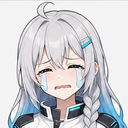](../images/plusa/05-哭泣.webp) **Plusa's tip:** Keep the complete original package and records when verification or recovery needs attention. Do not remove identity markers or the database to dismiss a warning; check the causes below.

The app checks managed source files, metadata, and deployment records before an operation. The following changes can block writes:

| Message type | First action |
| --- | --- |
| File missing or disk offline | Reconnect the disk and check the actual path |
| File in use | Close the relevant editor or preview, or finish related game operations, then retry |
| Source file or metadata changed | Select the item again, refresh, and check where the change came from |
| Identity mismatch or ownership cannot be determined | Keep the complete container and records; check whether only some files were copied or replaced |
| Verification mismatch | Keep the original package and error details; check whether the file is damaged or was modified |
| Unfinished transaction, rollback, or cleanup | Wait for recovery, or restart and retry as instructed |

These messages prevent operations from continuing on the wrong item. **Do not delete markers, the database, or transaction records to dismiss the message.** Those records may contain the file contents and path information needed for recovery.

### 8.6 Common problems

> [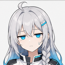](../images/plusa/03-无语滴汗.webp) **Plusa's tip:** Start with the current game, actual paths, and task results. Change one thing at a time and keep the original error text so you can identify which step went wrong.

| Symptom | What to check |
| --- | --- |
| The game list is empty after startup | Check that the correct data root is in use; the list is expected to be empty on a first installation |
| An activation prompt covers the page | Double-click the target game on the **Games** page |
| Cannot import at the root level | Open a category first |
| Cannot find an imported mod | Check the current game, category, search text, type, rating, and tag filters |
| Enabling a mod has no effect in the game | Check the deployment location, whether the loader is running, mod compatibility with the game version, and whether you have reloaded |
| Space, F2, or another shortcut does nothing | Select a single item in Category Overview and move focus out of text boxes, then check custom bindings |
| The key bindings page has no bindings | The mod's INI may not contain recognizable bindings, or loading may not have finished |
| A variant cannot be saved | Enable the mod, confirm that it supports persistent variables, and let the loader write the current configuration first |
| A variant's state is shown as unconfirmed | Save the configuration in the game and read it again, or explicitly choose to fill missing values with defaults |
| The game still shows the old appearance after changing a variant | Reload as configured in the loader, and avoid letting unwritten game state overwrite the saved selection |
| The online page says the game is not listed | Check the game's English name and the site's listings |
| A download fails or is slow | Test the network and proxy, check free disk space, then retry |
| A download is complete but not installed | Check the pending installation destination, switch back to the game it belongs to, and review the task result |
| An update check is incomplete | Resolve network or source-information errors, then check again |
| No application update is available | Check whether an update source is configured and whether the publisher has released a new package |
| RAR can be read but cannot be exported | Creating RAR archives requires WinRAR |
| Image memory use is high | Adjust the image memory allowance or clear the image cache; do not clear resource data |
| A video or WE scene does not play | Check the asset path, format, complete scene folder, and local WE application |
| Items are still missing after rebuilding | Review the report for invalid metadata, identity conflicts, or missing source files, and address each item |

### 8.7 Reporting a problem

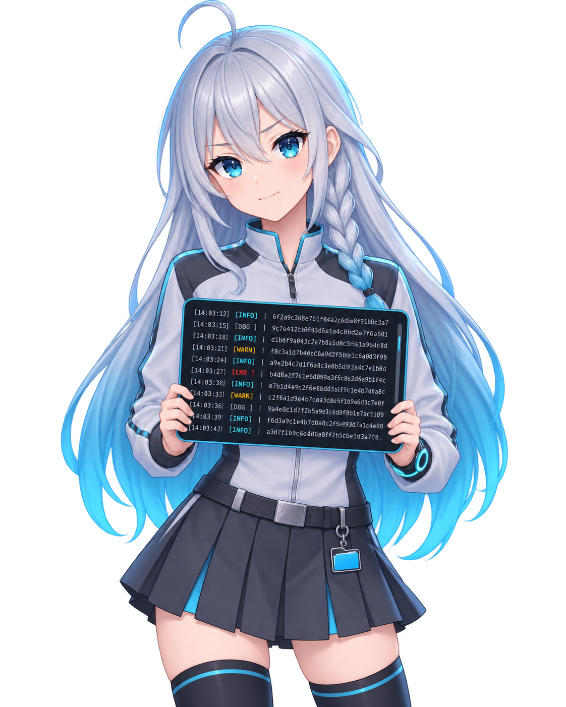

*Keep the steps, error text, and logs from the same time period together to help reproduce and locate the problem.*

Use **Tools → View Logs** to find the startup session in which the problem occurred, and retain the records before and after the operation. Include:

- Application and Windows versions.
- The page you started on and the sequence of actions.
- The expected result, actual result, and complete error text.
- Logs for the relevant period; include updater logs for updater problems.
- Whether files were moved or renamed outside the app, disks were disconnected, or custom plugins were involved.

You can replace or obscure game names, mod names, and personal paths in screenshots while keeping buttons, statuses, and error messages visible. Check logs for personal paths or credentials before sharing them too.

---

## Appendix A: Default keyboard shortcuts

These are the application's default bindings. If you have customized them, or plugin conflict resolution has changed them, refer to **Settings → Shortcuts**.

| Default shortcut | Action | Where it works |
| --- | --- | --- |
| `Ctrl+C` | Copy | Text areas; copies a preset in the presets list |
| `Ctrl+X` | Cut | Text areas; prepares to move selected items in Category Overview |
| `Ctrl+V` | Paste | Text areas, Category Overview, or the presets list |
| `Ctrl+A` | Select all | The current text area, Category Overview, or presets list |
| `Delete` | Delete | Text or selected items in Category Overview; deleting items still requires the applicable confirmation |
| `F5` | Refresh the current game library | Main window |
| `Ctrl+I` | Import mods | A game is active and the destination category is open |
| `Ctrl+F` | Search this page | The current page, if it supports search |
| `Ctrl+K` | Search all settings | Main window |
| `Ctrl+,` | Open Settings | Main window |
| `Ctrl+1` | Games | Main window |
| `Ctrl+2` | Category Overview | Main window |
| `Ctrl+3` | Gallery | Main window |
| `Ctrl+4` | Online Mods | Main window |
| `Alt+Left` | Go up one level / close online details | The corresponding page |
| `Ctrl+Shift+N` | New Category | Category Overview |
| `F2` | Edit the selected item | A single mod or category selected in Category Overview |
| `Space` | Enable or disable | A single mod selected in Category Overview |
| `Ctrl+Shift+E` | Export selected items | Category Overview |
| `F6` | Launch Mod loader | A valid loader is configured |
| `F7` | Launch Game | A game executable is configured |

`Esc`, `Ctrl+Enter` in edit windows, and similar keys are contextual actions outside the customizable command set listed above. In-game F10 is configured by 3DMigoto.

---

## Appendix B: Operation scope reference

| What you want to do | Where to do it | Key point |
| --- | --- | --- |
| Stop using a mod temporarily | Disable | Keeps the source container in the library |
| Delete a mod | Delete in Category Overview | Check whether it uses the Recycle Bin or permanent deletion |
| Delete all data for a game | Delete on the Games page | Permanently removes resources, configuration, and managed deployments; back up first |
| Switch to another set of enabled mods | Presets | Includes both mod selections and variant references |
| Change the appearance within one mod | Variants | Requires the mod to support the corresponding variables |
| Share an empty category structure | Export category preset | Produces a `.d3dxcp` file without mods |
| Share a mod and its named variants | Export the mod with metadata | Check the output package and keep all associated content |
| Clear regenerable images | Images and cache | Distinguish memory cleanup from disk cleanup |
| Remove duplicate downloaded source packages | Download data → Clean up installed | Keeps downloads that have not yet been installed |
| Reset application preferences | Reset | Requires confirmation; preserves game configurations and imported mods |
| Repair the index | Tools → Rebuild Index | Requires intact source files; cannot restore deleted resources |
