# Complete user manual

To get your first Mod working, begin with the 5-minute quick start.
This manual provides detailed steps, settings and data-maintenance guidance by feature.

Screenshots show the English interface with fictional games, categories, Mods and geometric preview placeholders.
Some sample library names, such as 外观 (Appearance), remain in Chinese because they are user-entered data.
Plusa is the project's original mascot.

The shortcut table lists default bindings. If you customize them, follow Settings → Shortcuts instead.
Numbers in the screenshots match the explanations below them.
Click an image, then choose Original size to inspect its details.
For application extensions, continue to the Plugin development guide.

---

## Chapter 1: Interface and navigation

### 1.1 Startup and version

Extract the entire release package before starting the application. No games are preconfigured on first use; add your own on the **Games** page. On later launches, the application restores the last active game if it is still valid.

Local imports, categories, deployment, and preset management work offline. GameBanana and application updates connect to the network when needed.

Find the version number under **Settings → Update → Application updates**. Game names and resources in the illustrations are demonstration data; select your own games and files when following the instructions.

### 1.2 Main window and navigation

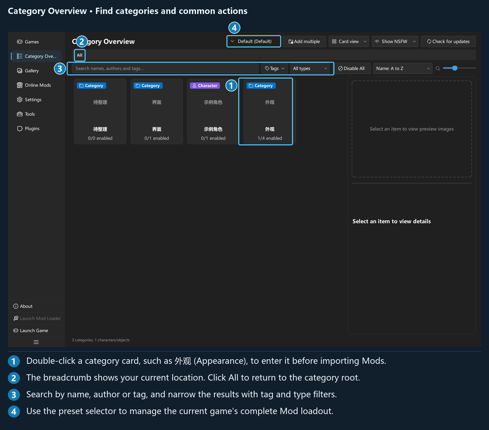

*The left navigation switches pages, and the current page appears on the right. In the overview, you can drag the divider between the content area and the details panel.*

| Navigation entry | Purpose |
| --- | --- |
| **Games** | Add, edit, and activate games |
| **Category Overview** | Manage categories, Mods, tags, preview images, and Mod presets |
| **Gallery** | Browse the current game's Mods using large images |
| **Online Mods** | Browse GameBanana and manage downloads |
| **Settings** | General, Personalization, Shortcuts, Import and export, Online Mods, and Update |
| **Tools** | Category presets, index rebuilding, logs, and plugin tools |
| **Plugins** | Install, search for, enable, disable, configure, and uninstall plugins |

Below the list are **About**, **Launch Mod Loader**, **Launch Game**, and the button to collapse the navigation. A **Plugin Commands** entry appears when plugin commands are available; plugins can also add their own navigation pages.

The two launch buttons depend on the current game's path configuration. If they are unavailable, return to **Games** and check **Executable** and **3DMigoto**.

The navigation keeps its icons when collapsed; hover over them to see tooltips. The interface remembers various views, card sizes, and panel layouts. Window sizing and display behavior may vary by page.

### 1.3 Game activation state

**Category Overview**, **Gallery**, and **Online Mods** all depend on the current game. If none is active, these pages show **Activate a game environment first** and a button leading to the Games page.

On the **Games** page:

- Click a card or list row once to select it and view its configuration.
- Double-click a game that is not current to activate it and switch libraries.
- Double-click the current game to deactivate it.
- Click **Activate this game environment** in the details panel to activate the selected game.

You still need to activate a game after adding it. If you have unsaved configuration changes or a deployment task is running when you switch, handle the corresponding prompt first.

### 1.4 Task center and progress

Imports, folder discovery, and library refreshes appear in the task center at the bottom-right. Expand it to see individual item states, completion counts, and reasons for failures.

Imports started inside the application support pausing, resuming, and stopping. When stopping, you may see choices such as **Keep imported Mods**, **Cancel all imports**, and **Resume import**:

| Choice | Result |
| --- | --- |
| Keep completed items | Successfully imported items remain in the library; unfinished items stop |
| Cancel all | Attempts to roll back the completed imports from this operation; check the report for any recovery failures |
| Resume | Returns to the current task |

Tasks that add automatically discovered files to the library do not offer exactly the same controls as manual imports. Use the buttons available in the current task popup. A stop request may need to wait until the current file operation reaches a safe stopping point.

Export, batch deletion, Mod preset switching, and updates each have their own progress interface. Wait for tasks to finish before moving the affected folders to avoid overlapping operations on the same files.

Brief notifications also appear in the top-right, for example when a theme is applied or a variant is saved. To look up a specific error later, open **Tools → View Logs**.

### 1.5 Common shortcuts

Manager shortcuts are handled only within the application window; they are not system-wide hotkeys. Change them in **Settings → Shortcuts → Key bindings**.

| Default key | Action |
| --- | --- |
| `Ctrl+I` | Import into the current category |
| `F5` | Refresh the current game's Mod library |
| `Ctrl+F` | Focus the current page's search box, if the page supports search |
| `Ctrl+K` | Open Settings and search all settings |
| `Ctrl+,` | Open Settings |
| `Ctrl+1` / `Ctrl+2` / `Ctrl+3` / `Ctrl+4` | Games / Category Overview / Gallery / Online Mods |
| `Alt+Left` | Go to the parent category, or close Online Mods details |
| `Ctrl+Shift+N` | Create a category at the current level |
| `F2` | Edit the single selected item in the overview |
| `Space` | Enable or disable the single selected Mod in the overview |
| `Ctrl+Shift+E` | Export the selected items in the overview |
| `F6` / `F7` | Launch the Mod loader / game |

Lists and text fields also support copying, cutting, pasting, selecting all, deleting, and other actions. See Appendix A for the complete table. Text fields, input methods, key recording, and modal dialogs handle their own input first; pressing Space in a text field does not toggle a Mod.

`Esc` handles context-specific actions such as ending key recording, closing some popups, or canceling a cut operation in the overview. 3DMigoto's in-game F10 reload key is configured by the loader, not in the manager's shortcuts.

### 1.6 Navigating Settings

The Settings page has six sections across the top, each with its own subnavigation on the left. This tutorial gives complete paths such as **Settings → General → Images and cache**.

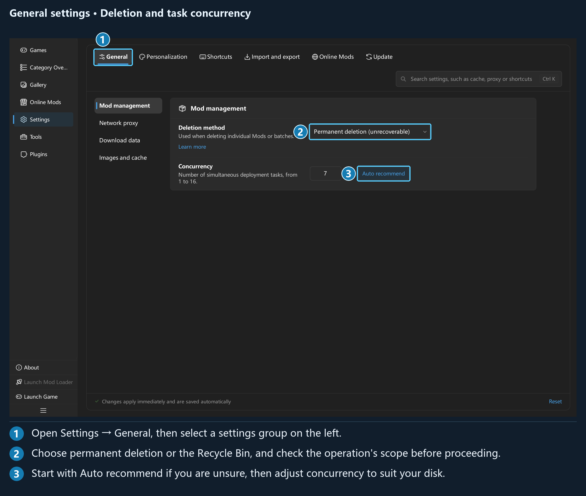

*Use the top row to switch sections and the left side to switch subpages. The search box in the top-right can take you directly to a setting.*

Type a term such as “cache,” “proxy,” “variant,” or a command name in the Settings search box, then click a result to jump to it. Shortcut commands and registered plugin commands also appear in Settings search.

Settings usually save immediately. Text inputs such as proxy addresses are submitted when editing finishes; some sliders preview changes while dragging and save when released. Game configuration still requires clicking **Save**, so keep that distinction in mind.

### 1.7 Theme, language, and background

Open **Settings → Personalization → Appearance** to choose Dark, Light, or Follow System. **Follow System uses the Windows app theme.** The same page lets you choose a font and language and refresh the list of language packs.

**Personalization → Window background** supports Off, Image, Video, and WE scenes. Videos and scenes have options such as frame rate and playback controls; WE scenes require Wallpaper Engine installed locally. See Chapter 6 for full configuration details.

---

## Chapter 2: Games and initial setup

### 2.1 Adding a game and the five fields

Click **Games → Add game** to open a draft in the right panel. Fill it in and click **Confirm**. **Exit** discards the draft, with a confirmation if you have entered anything.

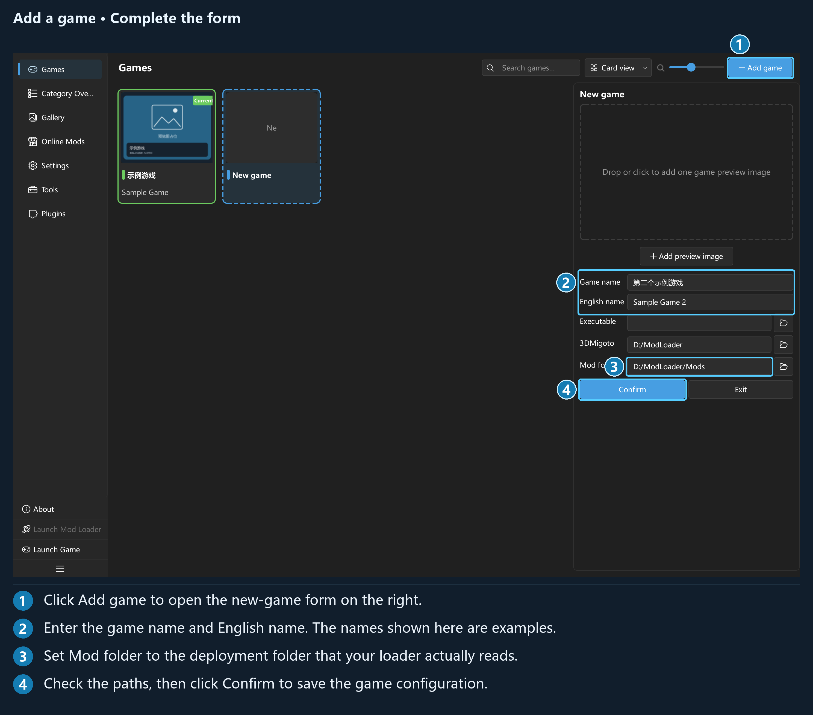

| Field | Purpose and requirements |
| --- | --- |
| **Game name** | Required; a name you can recognize, such as `示例游戏` (Sample Game) |
| **English name** | Used for GameBanana matching and to generate the game's resource folder name under `data/`; use the full English name used by the community |
| **Executable** | The game's exe file. Leaving it blank does not affect management, but disables **Launch Game** |
| **3DMigoto** | The loader's folder; used to launch the loader and locate `d3dx_user.ini` for capturing variants |
| **Mod folder** | The deployment folder for enabled Mods. It must match `d3dx.ini`; Mods cannot be deployed if it is blank |

If **English name** is blank, the resource folder name falls back to **Game name**. A different folder name is generated if the name is already taken. The application generates the internal game ID; you do not need to enter it.

The preview area lets you click, drop, or replace a single game image. Preview changes for an already saved game are persisted separately. If writing fails, a message appears and the change remains unsaved. Other fields require **Save**.

### 2.2 Library and deployment folder

| Location | What it stores | Common example |
| --- | --- | --- |
| Game resource folder | The current game's Mod library, preview cache, and runtime preferences | `<data root>/data/Sample Game/` |
| Library root | Category folders and complete Mod containers | `mods/` inside the folder above |
| **Mod folder** | Enabled copies, parked copies, and management markers read by the loader | `D:/ModLoader/Mods/` |
| **3DMigoto** | Loader program, main configuration, and user configuration | `D:/ModLoader/` |

Importing adds a Mod to the library; enabling publishes its contents to the deployment folder. Do not use the library itself as the deployment folder, or treat the game's installation root as a dedicated Mod folder.

The application does not automatically derive the deployment folder from the loader path. Check `d3dx.ini`, then enter **Mod folder** explicitly.

The data root is normally the application's folder. If the release folder is not writable, a Windows user data folder may be used instead. Confirm the actual location before backing up; see Chapter 8.

### 2.3 Activating and switching games

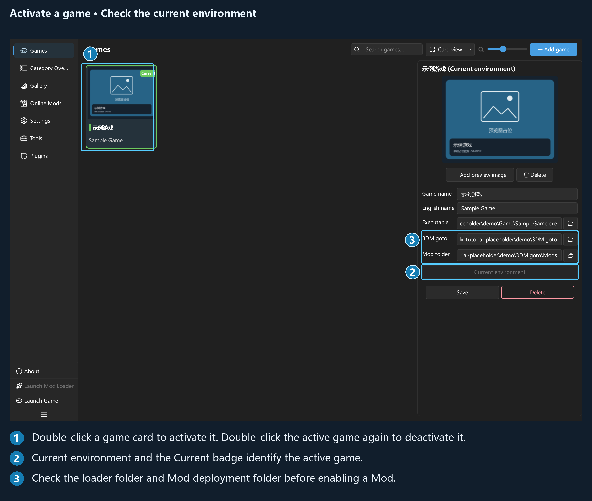

Click once to view the configuration; double-click to activate. The active game's card shows **Current**. You can also click **Activate this game environment** in the details panel.

After activation, the overview, gallery, and Online Mods switch to that game and use its loader and deployment paths. Each game has its own categories, Mods, and Mod presets.

Double-click the current game again to deactivate it. The application only restores a valid previously active game; it does not automatically activate the first newly added game.

### 2.4 Editing and saving

Select a game, edit the fields on the right, and click **Save**. If you switch items or pages with unsaved changes, the application asks whether to save, discard, or cancel leaving.

When you change the English name, the application attempts to migrate the linked resource folder and update related paths. Finish import, update, and deployment tasks first. If the folder cannot move but the settings are saved, a message identifies the retained location. If writing the configuration fails, the application attempts to roll back the move and keeps your edits unsaved. If recovery also fails, check the actual file locations shown in the message before continuing; do not delete the recovery materials yourself.

Game configuration is stored separately in `config/games.json`; application preferences are in `config/settings.json`. **Settings → Reset** preserves the game list and Mod data.

### 2.5 Changing or clearing the deployment path

Before changing a path, make sure both the old and new disks are accessible and deal with any applications holding the affected files open.

| Action | Application behavior |
| --- | --- |
| Change **Mod folder** when the old folder contains files | Asks whether to migrate all files and subfolders in the old folder, including manually added files |
| Choose to migrate | Checks for destination conflicts, then migrates; if it fails, keeps recovery information and reports the failure. Do not delete those records yourself |
| Choose not to migrate | Saves only the new configuration and leaves the old folder's contents in place. You must check which location the game will read afterward |
| Cancel the migration prompt | Exits this save operation |
| Clear **Mod folder** when the old folder still contains files | Asks whether to permanently empty the old folder; declining keeps the original deployment path |

> ⚠️ Emptying the deployment folder affects all files and subfolders inside it, including manually added content, and bypasses the Recycle Bin. Read the full path in the dialog before confirming.

Migration rejects unsafe situations such as nested source and destination folders or content with the same name already at the destination. To move to another disk, use the Games page and confirm afterward that the configuration was saved and enabled states are correct.

Clearing **3DMigoto** also warns that variant state tracking will be affected. The deployment path and loader path are separate fields; clearing either is not a substitute for disabling Mods.

### 2.6 Deleting a game deletes its data

**Deleting a game permanently deletes that game and its data.** The Recycle Bin option under **Mod management → Deletion method** does not apply.

Choose **Delete** in the details panel or context menu. The application scans the resources involved and shows the deletion scope. You can cancel during the scan. Before confirmation, it shows the full resource path and counts of Mods, categories, presets, and deployment copies.

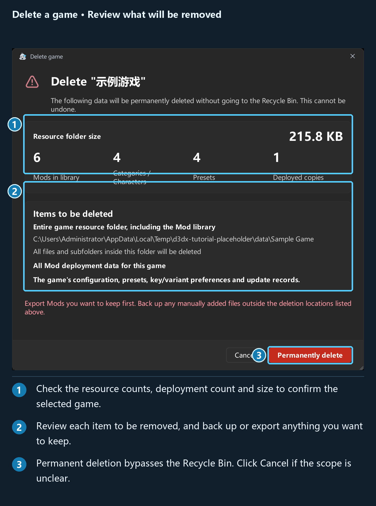

Deletion includes:

- The entire game resource folder and its contents, including the Mod library and other files added manually.
- The game's managed deployment data.
- The game's configuration, Mod presets, key or variant preferences, and update records.

Export or back up anything you want to keep to a location outside the deletion scope first. If you delete the current game, its activation state is also cleared.

If some files are in use, **Game data cleanup results** lists the full paths that could not be cleaned up. Keep this report, release the files, and address the remaining items according to the report. A game card disappearing does not mean that every file has been removed.

### 2.7 Search, views, and ordering

The Games page supports searching by name and switching between card and list views. In card view, you can adjust card size and drag games to reorder them. If search filtering is active, clear it before reordering the complete list.

The default `Ctrl+1` returns to the Games page; the default `Ctrl+F` focuses the current page's search box. If launch paths are missing, fill them in and save before using the navigation buttons or `F6` and `F7`.

---

## Chapter 3: Category Overview and Mod management

### 3.1 Page structure

**Category Overview** handles categories, imports, enabling Mods, editing information, tags, preview images, and exports. The top toolbar provides Mod presets, batch category creation, views, NSFW display options, and update checks. The breadcrumb shows your current level.


*The illustration uses fictional categories; create your own folders when using the application.*

The search row provides searches by name, author, and tag; tag conditions; type and age-rating filters; Disable All; sorting; and card scaling. You can drag the divider between the content area and the details panel on the right. You can also adjust the heights of the image and text areas within the details panel.

Click once to select an item, double-click a category to enter it, and double-click a Mod to toggle its enabled state. Click **All** in the breadcrumb to return to the category root.

### 3.2 Categories and characters/objects


| Type | Enable rule | Suitable uses |
| --- | --- | --- |
| **Category** | Multiple Mods can be enabled at once | Interface Mods, tools, and resources that can be combined |
| **Character/object** | Only one Mod can be enabled across this node and all its subcategories | Mutually exclusive character appearances or object replacements |

Choose **Node type** when creating a category. Character restrictions apply down the hierarchy from parent nodes; creating another subcategory does not bypass them.

The root level is primarily for category navigation. Enter the target category before importing Mods to avoid accumulating uncategorized resources at the root.

### 3.3 Creating, editing, and adding categories in bulk

Right-click a blank part of the content area and choose **New Category**, or use the default `Ctrl+Shift+N`. An empty page also offers **+ New Category** or **+ New subcategory**.

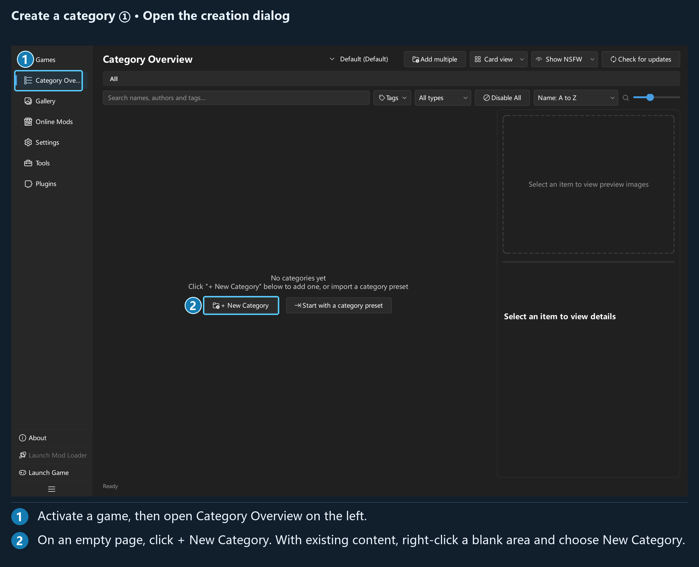

*① Open **Category Overview**. ② Click **+ New Category** in the center of the empty page to open the creation dialog.*

Enter a name, optionally add an English name and cover image, then confirm. The English name is used for online lookups and category matching. Category names must follow Windows filename rules and be unique at the same level. Characters/objects are also checked for name conflicts throughout the current game.

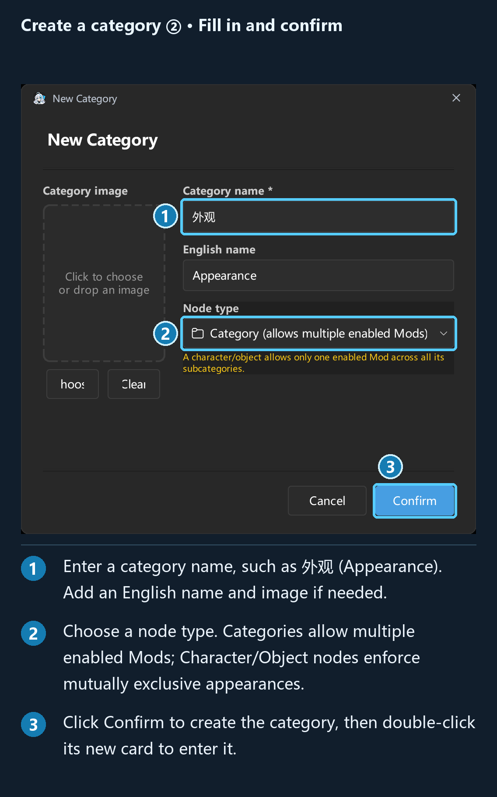

*① Enter a name. ② Choose the node type. ③ Click **Confirm**, then double-click the new category card to enter it.*

**Add multiple** in the toolbar lets you create several categories at once:

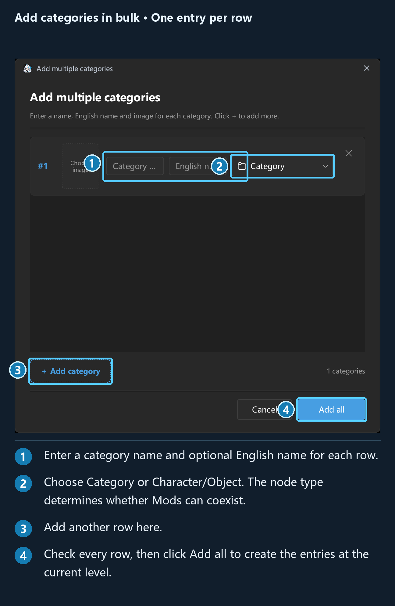

*Enter a name, English name, image, and node type separately for each item. Categories are created at the current level.*

Batch creation also uses the node type selected for each item. To change an existing category's information, choose **Edit** from its context menu or details panel.

If you have a category preset, build the category tree using **Start with a category preset** on the empty page or **Tools → Import category preset**. See Chapter 7. Category presets contain different data from Mod presets, which save which Mods are enabled.

### 3.4 Importing an archive or folder

Enter the target category first, then use any of these methods:

| Method | Action |
| --- | --- |
| Drag and drop | Drag a ZIP, 7z, RAR, or folder into the content area |
| Context menu | Right-click a blank area → **Import Mod** |
| Shortcut | Default `Ctrl+I` |
| Empty category button | Click **Import Mod** |

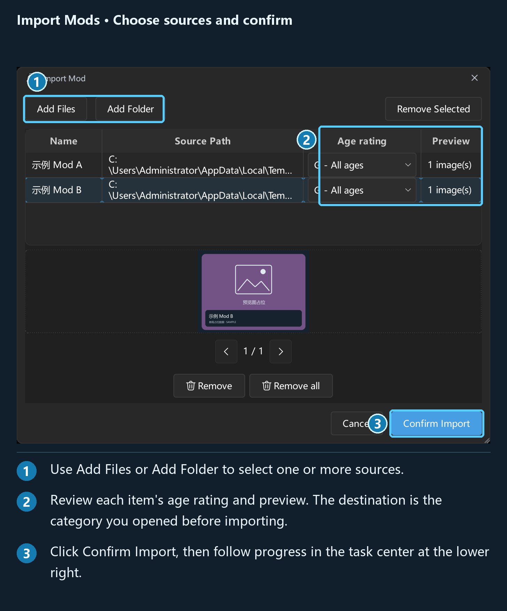

The import dialog offers **Add Files**, **Add Folder**, and **Remove Selected**. Set an age rating and preview image for each source. There is no target category dropdown: the destination is the location you were in before opening the dialog.

The source names in the table identify the current import candidates. You can edit the display name, author, version, source URL, and tags after importing.

Distinguish between not using a preview and deleting it: the former only deselects it, while the latter affects the image file. Check the scope shown in the current confirmation prompt before deleting.

After clicking **Confirm Import**, use the task center at the bottom-right to check progress, duplicates, and failures. Importing normally preserves the source files. When files are discovered directly inside the library, however, adding them to management may organize them in place; these are not identical copying workflows.

### 3.5 Placing files directly in the library

You can also use File Explorer to place archives or folders awaiting organization into an existing category folder, such as `外观` (Appearance):

```text
<data root>/data/Sample Game/mods/外观/
```

Folder monitoring, entering the relevant category, switching games, and manual refreshes discover changes that need processing. The default `F5` requests a refresh of the current game's library, with progress in the task center. Large folders and archives that are still being written may take time.

Discovered content is identified, verified, and brought under management to form complete Mod containers. The application reports duplicates, invalid containers, files in use, and interrupted items. If leftover items are found, inspect the original files first, then choose an available action such as keeping them, moving them to the Recycle Bin, or deleting them.

**Do not edit or remove a container's identity marker.** The application uses these markers to identify Mods and checks the related files. Keep each container complete; see Chapter 4.

### 3.6 Enabling, disabling, and conflicts

Any of these actions can toggle a single Mod:

- Double-click its card or list row.
- Click **Enable** / **Disable** in the details panel on the right.
- Choose **Enable** / **Disable** from its context menu.
- Select a single Mod in the overview list and press the default `Space`.

After a Mod is enabled successfully, its status changes and the card shows a green marker. The first activation may require extraction; wait for that item's progress to finish. A parked copy that meets the requirements can be restored more quickly when enabled again.

If another Mod is already enabled under a character/object, the application asks whether to disable the conflicting item and enable the new one. If you choose not to be prompted again, similar conflicts will follow that preference.

**Disable All** applies to the current folder and its subfolders. At the root level, it covers the current game. An active search does not mean that only search results will be disabled; read the confirmation carefully.

Related write operations may be temporarily unavailable during deployment, preset switching, or file recovery. Let the current task finish before continuing, rather than repeatedly clicking Enable or Delete.

### 3.7 Details panel: information, keys, and variants

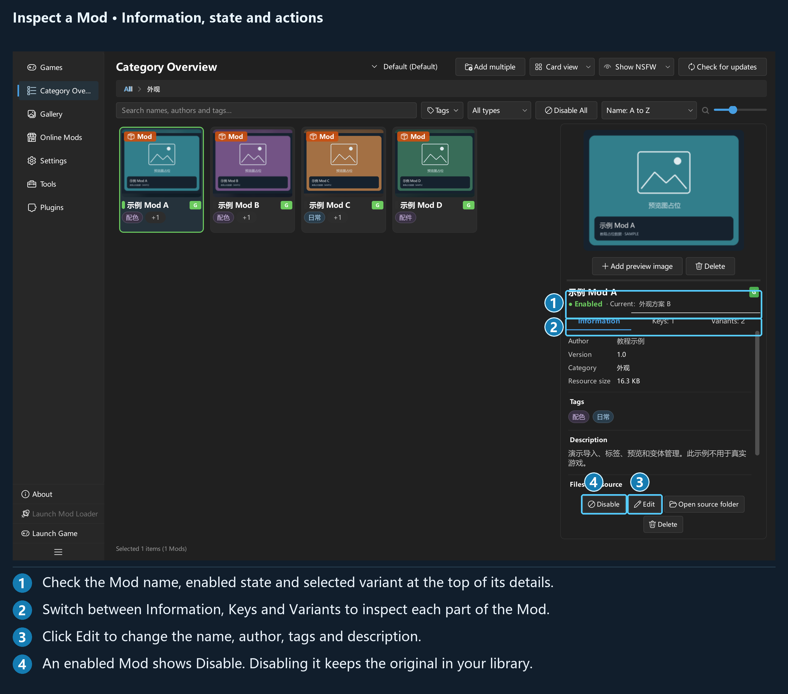

*The example Mod uses a geometric placeholder cover. Separate details tabs appear beneath it.*

| Tab | Contents |
| --- | --- |
| **Information** | Available information such as author, version, age rating, tags, description, source, and path |
| **Keys: N** | Bindings detected in INI files, grouped by file; record a key or enter it manually |
| **Variants: N** | The Mod's default configuration and saved named appearances, with controls to switch and manage them |

If there are no keys or variants, the corresponding empty state appears. This does not mean the Mod is unusable. The variant count reflects saved named configurations, and support also depends on whether the Mod declares variables that can be saved.

Selecting a category shows category information and actions. Selecting multiple items shows the selection count instead of combining fields from several Mods for editing.

### 3.8 Editing Mods and tags

Select a single Mod and click **Edit**, or use the default `F2`.

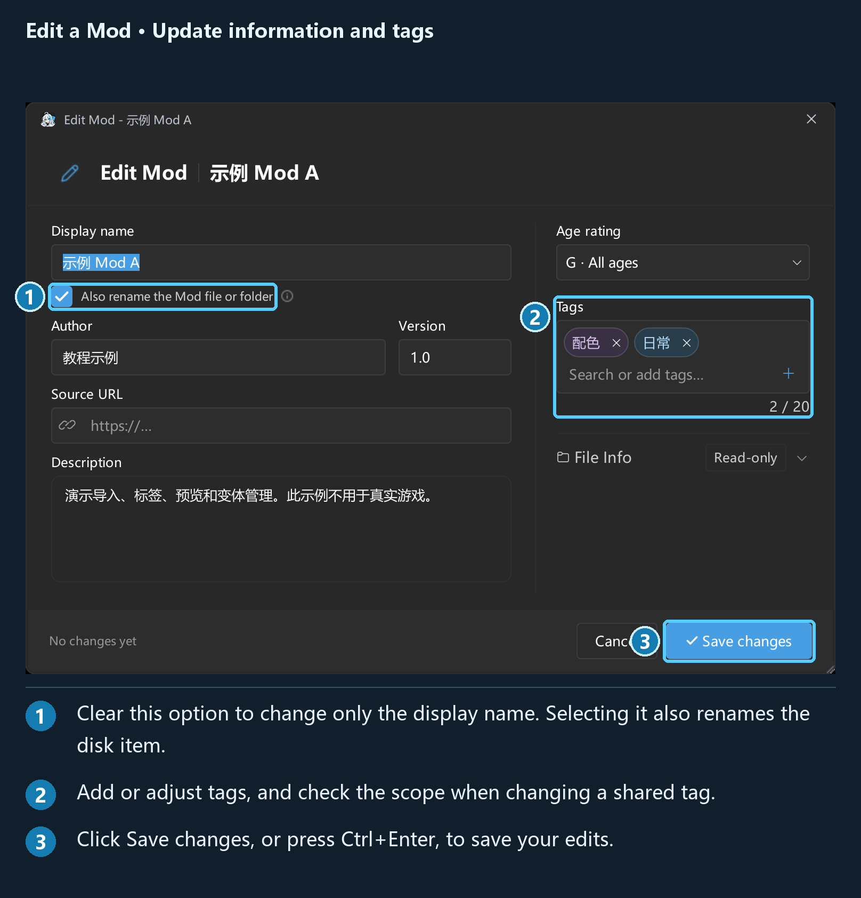

You can edit the display name, author, version, source URL, description, age rating, and tags. Expand **File Info** to see the path, SHA-1, and import time, and to copy the path or hash.

**Also rename the Mod file or folder** controls whether the name on disk changes too. If unchecked, only the display name changes. If checked, the application handles name conflicts and related paths; check the result after saving.

**Click Save changes to commit the information and tag edits from this session.** The dialog also supports `Ctrl+Enter` to save. If you close it with changes, you can choose to continue editing or discard them.

There are three kinds of tag operations:

| Operation | Effect |
| --- | --- |
| Add or remove tags on the current Mod | Changes the association between the current Mod and those tags |
| Edit a shared tag's name or color | After saving, every Mod referencing that tag in the same game displays the change |
| Delete a tag and all its references | Removes it from the current game's tag library and all Mods referencing it; after confirmation, the change still needs to be saved through the main edit dialog |

You can reuse tags, choose preset colors, or enter custom colors. Click tag chips to filter by them. Deleting an entire shared tag is different from removing one tag from the current Mod.

### 3.9 Search, tag filters, and sorting

The search box searches names, authors, and tags. With a search term entered, it finds matches throughout the current category's subtree. Clearing the search returns to browsing the current level.

Click **Tags** to expand the tags used in the current game. Two combination modes are available:

| Mode | Example: selecting both `配色` (Color scheme) and `日常` (Everyday) |
| --- | --- |
| **Match all** | Shows only Mods with both tags |
| **Match any** | Matches Mods with either tag |

Selected conditions appear as chips. Remove them individually, or click **Clear** to clear only the tags. Tag filtering is temporarily unavailable when the type filter is set to categories or characters/objects; switch back to all types or Mods to use it again.

Search text, type, age rating, and tags can all affect results at the same time. If there are no results, check the conditions before rebuilding the index.

Sorting supports name, import time, author, age rating, enabled state, and other criteria. Chinese names are sorted by pinyin.

The NSFW dropdown controls whether local X-rated preview images are shown normally, hidden, or blurred. It does not automatically delete or disable Mods. The local overview and gallery share this display preference; the online page has its own NSFW policy.

### 3.10 Adding, removing, and deleting preview images

Drag in an image, click **Add preview image**, or paste an image from the clipboard into a supported preview area. Mods support multiple images; categories and games each use a single cover image.

Use the arrows to browse multiple images. Changing the displayed image affects the card preview. The image viewer supports zooming in and out and dragging to pan; follow the window's hints for its controls.

- **Remove / do not use**: removes the reference and keeps the corresponding file.
- **Delete**: deletes the corresponding image file. The relevant interface explains the scope before the operation.
- **Delete all preview images**: affects multiple images for this Mod. Check the target before confirming.

Manually added Mod previews are normally copied into the container's `.d3dxmeta/previews/`. Previews inside the archive may be extracted to the cache. When backing up a Mod, keep the complete container, not just cached images.

### 3.11 Moving items and selecting in bulk

| Action | Default method |
| --- | --- |
| Add to / remove from selection | `Ctrl` + click |
| Select a range | `Shift` + click |
| Select the entire current list | `Ctrl+A` |
| Cut selected items | `Ctrl+X` |
| Move to the target category | Enter the target category, then press `Ctrl+V` |
| Cancel cutting | `Esc` |
| Delete | `Delete` or the context menu |
| Export | `Ctrl+Shift+E` or **Export** in the context menu |

Cut items are marked in orange while awaiting a move. Pasting at the original level does not move them, and you cannot paste a parent category into its own subtree. The edit dialog has no category field for moving an item; use the move operations above to change its category.

### 3.12 Deletion and the Recycle Bin

Disabling only withdraws the copy used by the game; the Mod remains in the library. Deleting handles the source container and its associated deployment data.

**Settings → General → Mod management → Deletion method** offers **Recycle Bin (recoverable)** and **Permanent deletion (unrecoverable)**. Permanent deletion is the default. This setting applies to deleting individual Mods or Mods in bulk. **Category deletion and game deletion do not use this Recycle Bin setting.**

Deleting a category affects its subcategories and Mods. With multiple items selected, the confirmation summarizes the scope. A batch task may also ask whether to keep enabled Mods.

If the system Recycle Bin does not support the current location or path, the application asks again whether to delete permanently instead. If you decline, check the interface for which items remain unfinished; do not assume they reached the Recycle Bin.

When files are in use or a disk is offline, deletion may retain cleanup records and retry. Release the files or reconnect the disk, then check the result. Canceling a batch task stops only subsequent processing; it cannot restore files already deleted permanently.

### 3.13 Exporting and sharing

Select Mods or categories, right-click **Export**, and choose a destination folder. Exporting a category includes the Mods in its subtree. Select multiple items to export in bulk.

Under **Settings → Import and export → Export**, choose:

- Whether to package as ZIP, 7z, RAR, or a folder.
- Whether to force conversion to the selected format; when off, archives may keep their original format.
- Whether to preserve the character/category folder structure.
- Whether to include metadata and preview images.
- How many export tasks to process at the same time.

To share named variants, tags, and additional previews, enable **Include metadata and previews**. Named variants are included through supported metadata export workflows. A game-wide Mod preset is different from an exported single Mod.

The export window shows progress and offers pause, resume, and stop actions. After completion, check the success, failure, and missing-source counts, then open the output folder to confirm the files.

### 3.14 Gallery

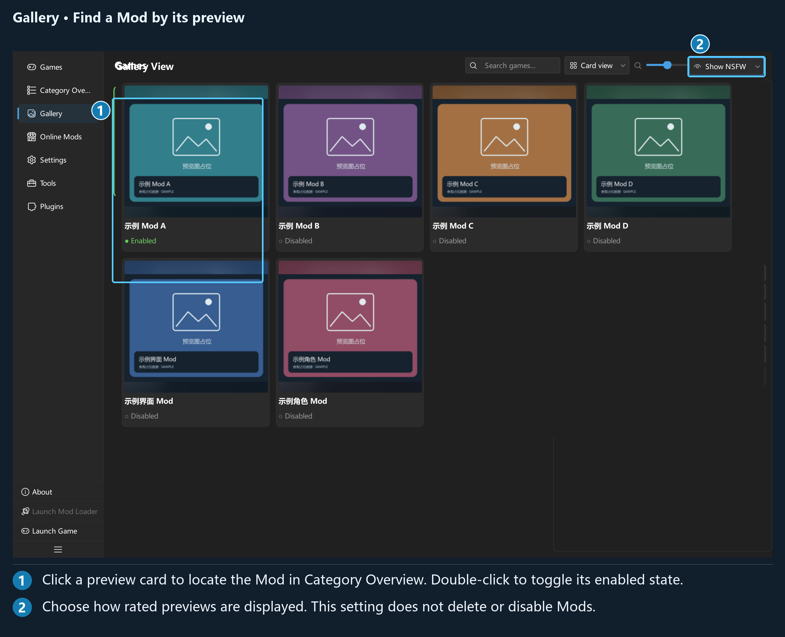

The gallery displays the current game's Mods through their preview images. Click once to locate the corresponding Mod in the overview; double-click to toggle its enabled state. The same rules apply as in the overview.

Return to **Category Overview** for categories, tags, sorting, editing, or batch operations. A placeholder is used when there is no preview image; this does not affect whether the Mod itself can be enabled.

---

## Chapter 4: Presets, deployment, key bindings, and variants

### 4.1 Three different ways to save a setup


| Name | What it saves | Where to find it |
| --- | --- | --- |
| Mod preset | A selection of Mods for the current game, plus references to the named variant selected for each Mod | **Presets** in the overview toolbar |
| Individual Mod variant | Appearance values that a Mod supports saving, such as color schemes or accessory options | The **Variants** tab in Mod details |
| Category preset | The category tree, names, node types, and optional folder images; no Mod files | Category preset actions in Tools |

Create categories and import Mods first, then save frequently used combinations as Mod presets. If one Mod has several internal appearances, also save named variants for your presets to reference.

### 4.2 Mod containers and stable identity

Each Mod in the library has a complete container folder. This example uses the `外观` (Appearance) category and `示例 Mod A` (Sample Mod A):

```text
<data root>/data/Sample Game/mods/外观/示例 Mod A/
├── .d3dxmod
├── 示例 Mod A.zip
└── .d3dxmeta/
    ├── info.json
    ├── previews/
    ├── ini_overrides/
    └── variants/
        └── <variant_id>.json
```

| Content | Purpose |
| --- | --- |
| `.d3dxmod` | Records the stable `mod_id`, resource location, and content verification information |
| ZIP / 7z / RAR archive | The original resource archive |
| `info.json` | Metadata such as name, author, tags, age rating, and source |
| `previews/` | Manually added preview images |
| `ini_overrides/` | Editable INI overrides |
| `variants/` | Separately saved named variants |

**A stable `mod_id` identifies the Mod; content hashes are used for verification.** Two folders sharing a name are not necessarily the same Mod, and external changes are not trusted based on filenames alone.

When backing up or moving a Mod out of the library, copy the entire container. Taking only the resource archive leaves behind its accompanying metadata, key changes, and named variants.

Prefer renaming, moving, and exporting through the application. After manually moving a complete container, refresh and check its category. Do not delete markers, forge identities, or replace only the archive to “fix” a verification failure.

### 4.3 Library formats and import rules

Resources are kept in the library as ZIP, 7z, or RAR archives. Importing a folder compresses it into the format selected under **Mod import format**.

When importing an existing archive:

| **Always use the import format** | Behavior |
| --- | --- |
| Off | Keeps the incoming archive's original format to reduce repeated compression |
| On | Extracts archives in other formats and repackages them in the selected format |

Support for reading ZIP, 7z, and RAR is included with the application. **Creating RAR archives requires WinRAR's compression tool.** Without it, the relevant output options are unavailable. Importing an existing RAR archive and saving resources as a new RAR archive are different operations.

Deployment always uses extracted copies. Progress that does not change continuously does not necessarily mean a task has stalled; archive format, file count, and disk performance all affect the processing stages.

### 4.4 Enabling, parking, and disabling

Enabling first checks the source container, metadata, deployment location, and operations in progress. It then prepares resources, applies the effective INI content and configuration, and publishes the finished copy to the deployment folder.

Temporary preparation folders may start with `DISABLED_` and include `.partial`. They are not exposed to the loader as normal enabled copies before completion. After a failure, cancellation, or unexpected application exit, recovery may still need to process these folders.

Disabling first captures the required runtime configuration and synchronizes the INI, then removes the copy currently used by the game:

- A deployment still referenced by other Mod presets may be parked as `DISABLED_...` for faster restoration next time.
- Copies that no longer need to be retained may be cleaned up.
- The source container remains in the library.

3DMigoto normally excludes parked folders using `exclude_recursive = DISABLED*`. If you changed the loader configuration yourself, make sure these folders are still excluded.

Do not enable a parked copy by renaming its prefix in File Explorer. Use Enable or Apply Preset in the application so that the actual files remain consistent with the records.

### 4.5 Deployment folder and external changes

**Mod folder** must match the location read by the loader. It is configured separately from **3DMigoto**; actual Mod deployment is unavailable if it is not set.

The application monitors managed source files and deployment folders for changes. If a deployment folder is moved externally, a source container changes, a disk goes offline, or identity markers conflict, address the report in the interface before resuming operations.

Use the migration workflow on the Games page to change the deployment location. If the application reports changed files, uncertain ownership, or unfinished recovery, do not delete the database, transaction records, or markers to force it to continue. They may contain information needed for rollback and recovery.

### 4.6 Creating and using Mod presets

Click the current preset name in the overview toolbar to open the preset list:

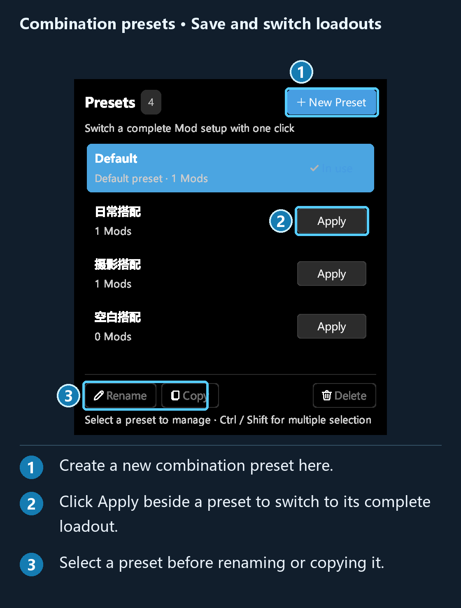

*Click once to select a preset for management. Only **Apply** on the right switches the setup. The preset in use has a status marker.*

| Action | How to use it |
| --- | --- |
| Create | Click **New Preset** to create an empty setup, then name it |
| Apply | Click **Apply** on the target row and wait for deployment to finish |
| Rename | Select a preset and click **Rename**, or double-click its name |
| Copy | Select a preset and click **Copy**, or use the default `Ctrl+C` and `Ctrl+V` |
| Select multiple | Use `Ctrl` to add selections or `Shift` to select a range; you can also select all within the list |
| Delete | Select presets and click **Delete**, then confirm the scope |

Each game has its own default preset, which is retained and cannot be deleted. When deleting a user preset that is currently in use, the application switches to the default preset before completing deletion. Check the dialog and task results.

**A new preset starts empty.** To keep an existing setup and make small changes, copy that preset before applying it. Applying an empty preset means that Mods from other presets will no longer be enabled.

The current preset updates its selections as you enable or disable Mods. When you save or switch a named variant for an individual Mod, the current preset also records the selected variant reference.

### 4.7 How switching presets affects files

Switching is based on the differences between the two presets:

| Difference | Handling |
| --- | --- |
| A Mod is no longer used by the target preset | Parks or removes its deployment |
| The target needs a Mod with a usable parked copy | Verifies and restores the copy |
| The target needs a Mod with no usable copy | Extracts and deploys it for the first time |
| Both presets use the same Mod | Keeps reusable deployment files and handles configuration according to the target preset |
| The same Mod references different variants | Applies the target variant's configuration; INI and user configuration files may still be written |

Sharing a Mod therefore does not guarantee that no file operations will occur. It also depends on the variants, overrides, and whether the deployment is still valid.

Switching shows progress and a cancel action, while restricting conflicting operations such as enabling/disabling, deletion, and switching games. Cancellation or failure attempts to roll back completed steps; unfinished rollbacks retain records for recovery. Wait for the task to finish handling its result before modifying resources again.

### 4.8 Editing a Mod's in-game keys

Select the Mod and open the **Keys** tab in the details panel:

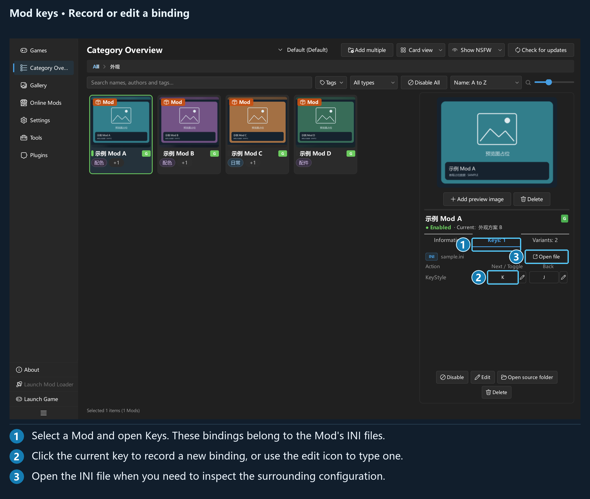

Keys are grouped by INI file. Some bindings provide both a forward and a backward key. Names come from the Mod's own section definitions.

There are two editing methods:

- Click a key field and press the key or Ctrl / Alt / Shift combination you want to use. `Esc` cancels recording.
- Open **Manual input** and enter 3DMigoto key tokens as instructed. Special keys and controller tokens depend on loader support.

**Key changes save directly; no additional overall Save button is needed.** Changes are written to the container's INI override layer. For an enabled Mod, they are also synchronized to its deployed copy. If the game is running, reload as required by the loader for the changes to take effect.

An option to open the source INI appears where supported. If saving is rejected because the file changed externally, reselect the Mod, check the latest contents, and then edit again.

These settings change the Mod's in-game keys. **Settings → Shortcuts** changes the manager's controls; the two are saved separately.

