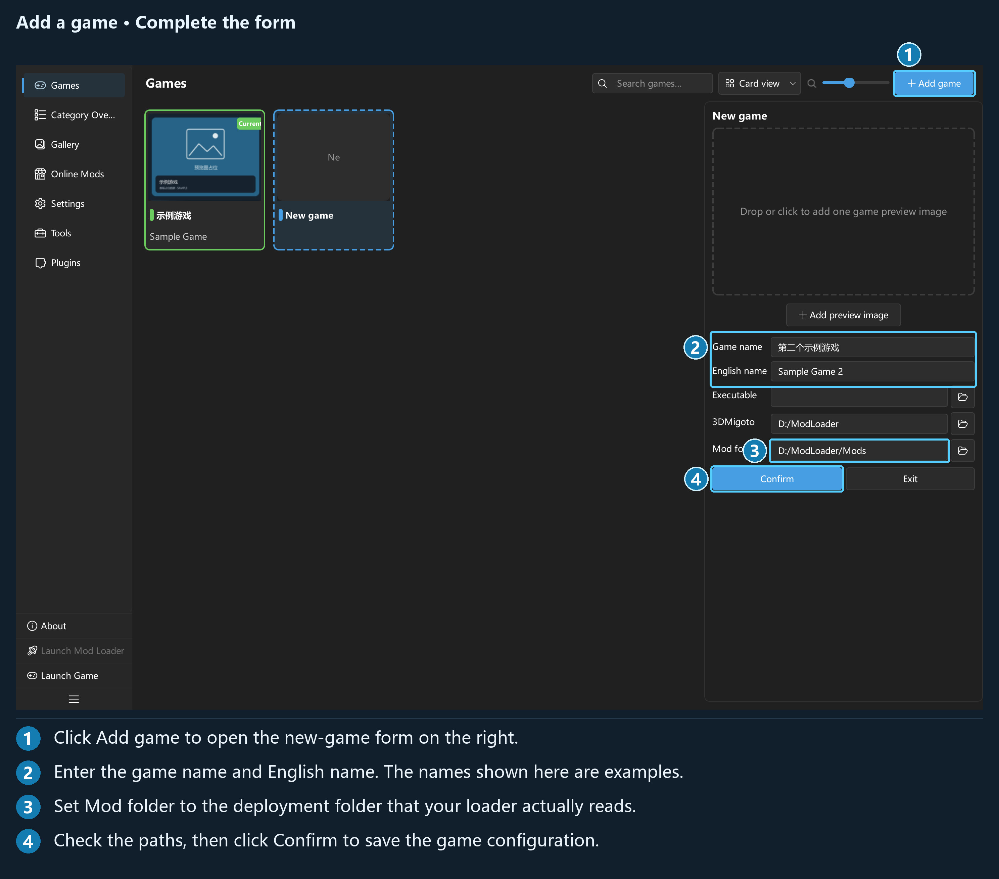
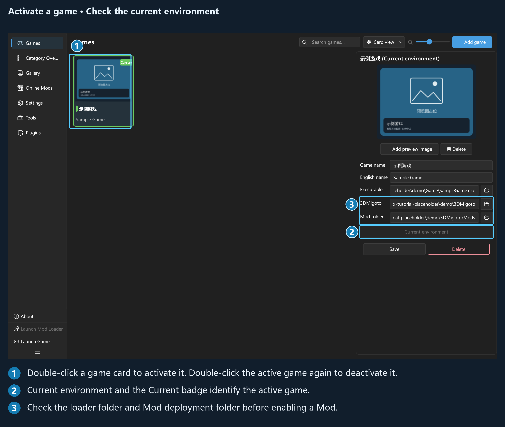
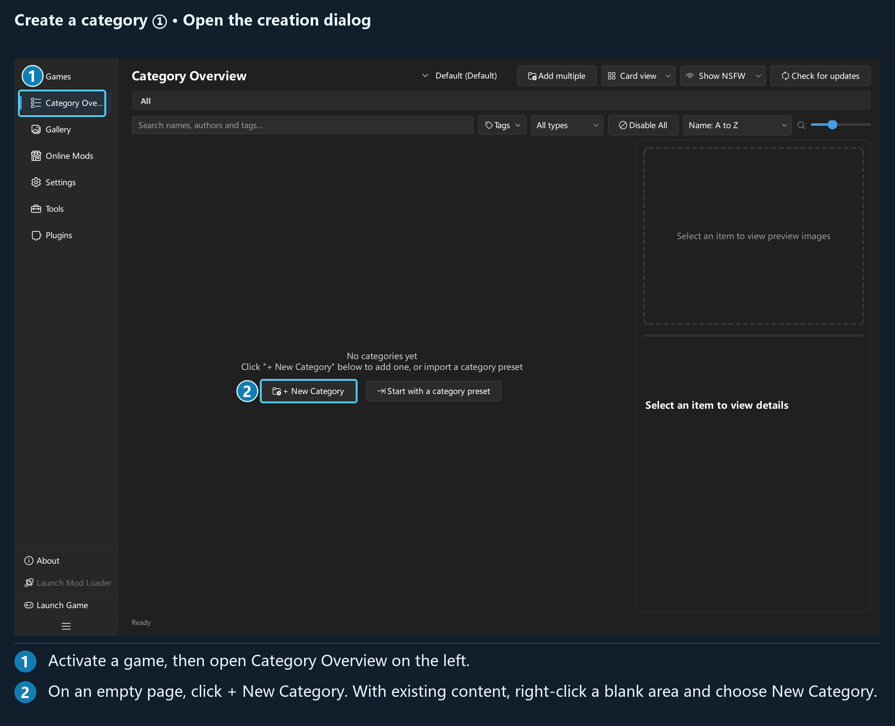
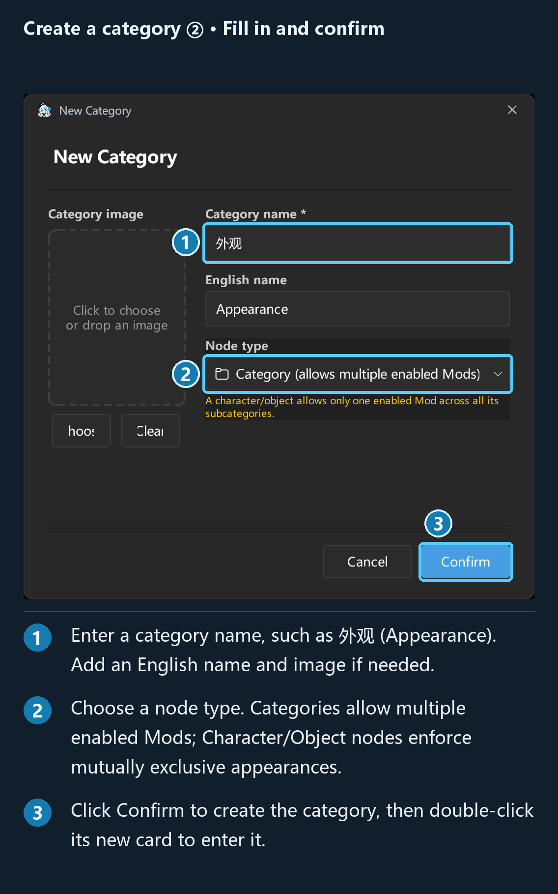
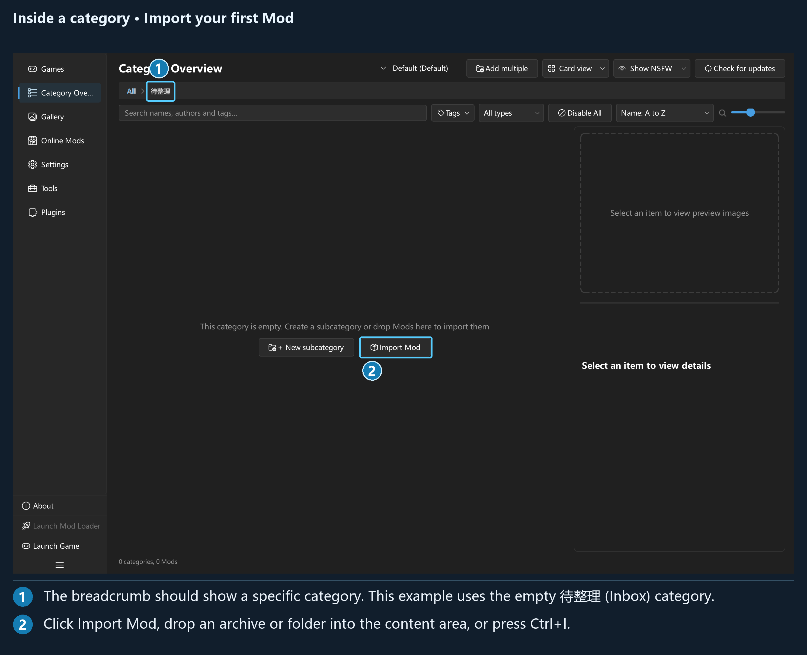
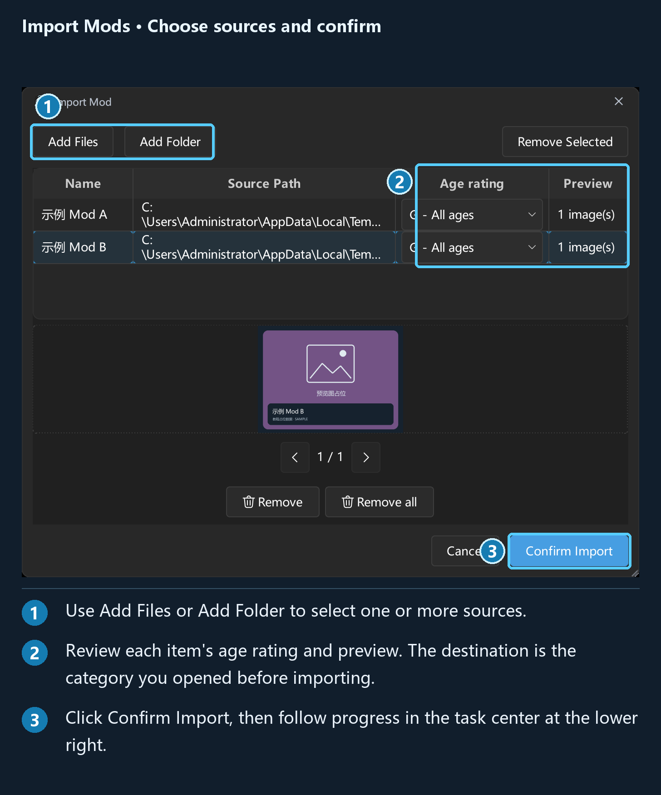
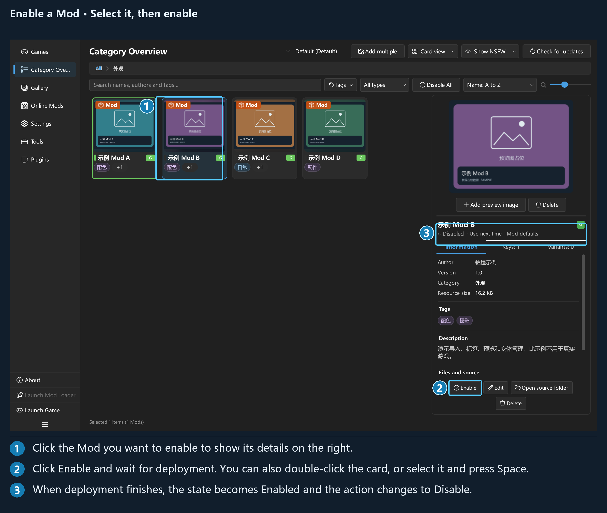

# 5-minute quick start

Start by adding a game, then follow these six steps to import and enable your first Mod and check it in the game. The time required depends on the Mod's size and your disk speed.

The numbers in the illustrations correspond to the instructions below each image. Click an image to enlarge it. All example names and preview images are placeholders; enter your own game details and paths.

## Before you start

You need Windows 10/11 x64, a working 3DMigoto setup for your target game, and a Mod archive or folder. ZIP, 7z, and RAR archives can all be imported; you only need to install WinRAR separately to create RAR archives.

Extract the entire release package and run `d3dxSkinManage-Plus.exe`. Keep the folders included with the package. This application manages and deploys Mods; 3DMigoto still loads them in the game.

**Local management works offline.** A network connection is only needed when browsing GameBanana, downloading files, or checking for updates.

First, locate these two folders:

| Location | Purpose |
| --- | --- |
| 3DMigoto folder | Contains the loader and `d3dx.ini` |
| Mod folder specified in `d3dx.ini` | The deployment folder the game actually reads, commonly `Mods` inside the 3DMigoto folder |

> ⚠️ The application's **Mod folder** must point to the second location above. The library stores the original Mods, while the deployment folder supplies the files the game reads. Keep these locations separate.

## Step 1: Add a game

The application opens on the **Games** page on first launch. Click **Add game** and fill in the configuration on the right. New games are configured in the persistent details panel.

*Click **Confirm** after filling in the fields. The game name and paths in the screenshot are demonstration data.*

| Field | What to enter |
| --- | --- |
| **Game name** | Required; for example, `示例游戏` (Sample Game) |
| **English name** | The game's English name on GameBanana; also used to generate its resource folder name. The example uses `Sample Game` |
| **Executable** | The game's exe file; if left blank, you cannot launch the game from the application |
| **3DMigoto** | The folder containing the loader |
| **Mod folder** | The deployment folder specified in `d3dx.ini`; configure it before enabling Mods |

You can add a preview image later. The application does not automatically derive **Mod folder** from **3DMigoto**.

## Step 2: Activate the game

**Double-click the game card**, or select it and click **Activate this game environment**. The **Current** badge on the card confirms that the game is active.

*Click once to view the configuration; double-click to activate. Double-clicking the current game again deactivates it.*

If no game is active, **Category Overview**, **Gallery**, and **Online Mods** display an introductory overlay. Each game has its own categories, Mods, and Mod presets.

## Step 3: Create a category

Open **Category Overview** from the left navigation. On an empty page, click **+ New Category** in the center to open the creation dialog. If categories already exist, right-click a blank part of the content area and select **New Category**, or use the default shortcut `Ctrl+Shift+N`.

*① Open **Category Overview**. ② Click **+ New Category**.*

In the **New Category** dialog:

1. Enter a recognizable **Category name**, such as `外观` (Appearance).
2. Under **Node type**, choose a regular category or a character/object, using the enable rules below.
3. Add an English name and category image if needed, then click **Confirm** in the bottom-right corner.

*① Enter a name. ② Choose the node type. ③ Click **Confirm**.*

- A regular **Category** allows multiple Mods to be enabled at once, making it suitable for groups such as interface Mods and tools.
- A **Character/object** allows only one enabled Mod across its entire subtree, making it suitable for mutually exclusive appearance replacements.
- If you already have a `.d3dxcp` category preset, you can also click **Start with a category preset** to import a category tree. Category presets do not contain Mod files.

The new category card appears in the overview after creation. **Double-click this card to enter it**. The breadcrumb at the top should show the name you just entered; the Mod you import in the next step will go into this category.

## Step 4: Import a Mod

After entering your new category, drag an archive or folder into the content area, or use the default shortcut `Ctrl+I`. In an empty category, you can also click **Import Mod**.

*① Check the breadcrumb to confirm your category. ② Click **Import Mod**. This screenshot uses the empty `待整理` (To organize) category as an example; enter the category you actually created.*

*You can add multiple sources and choose an age rating and cover image for each. The target category is the location you were in when you opened the import dialog.*

Click **Confirm Import**. Progress appears in the task center at the bottom-right of the main window; expand it to inspect each item. When pausing or stopping, follow the prompts to keep completed items or roll back this import.

After import, use **Edit Mod** to adjust the name, author, tags, and other information.

## Step 5: Enable the Mod

Double-click the Mod card, or select it and click **Enable** in the details panel. You can also use the default shortcut: keep focus in the overview list, **select a single Mod, and press Space**.

*① Select the Mod you want to use. ② Click **Enable**. ③ Wait for completion, then check the **Enabled** status. The action button changes to **Disable**.*

Enabling a Mod for the first time extracts its library archive into the deployment folder. Wait for the operation to finish. If another Mod is already enabled for the same character, use the conflict prompt to decide whether to replace it.

> ⚠️ If you see **Mod folder not configured**, return to **Games**, enter and save the deployment folder, then try again.

