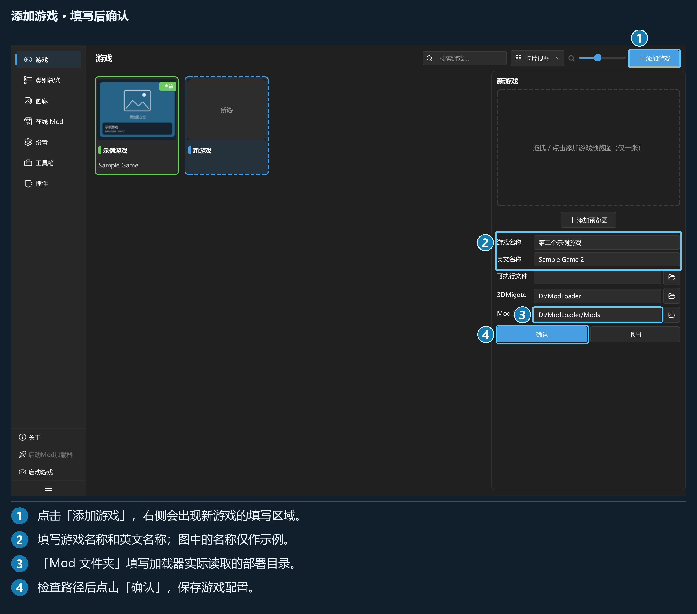
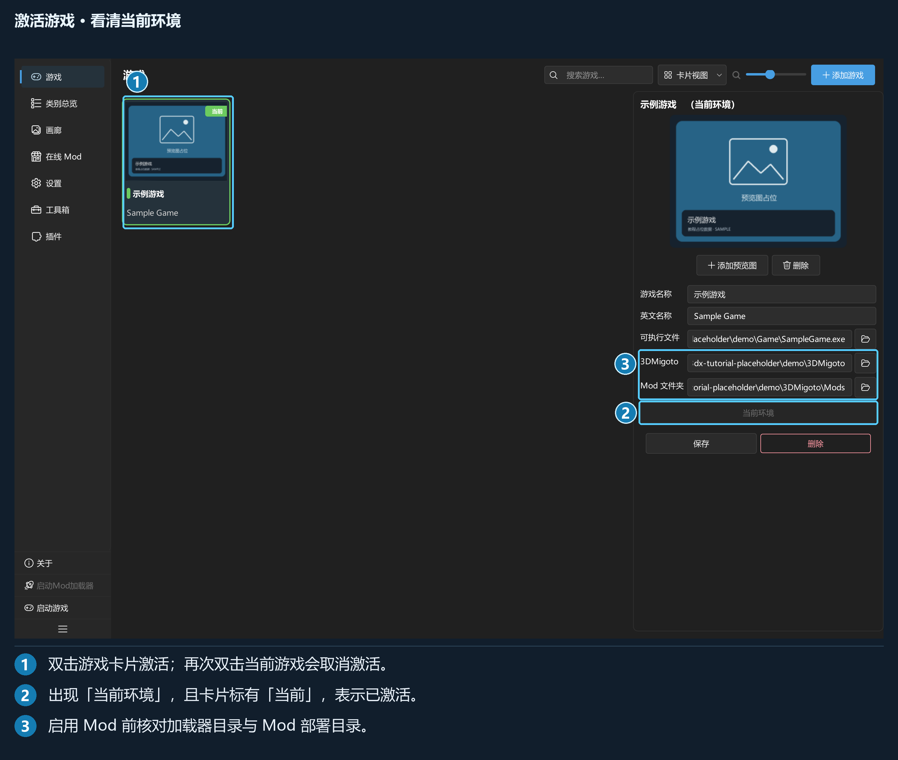
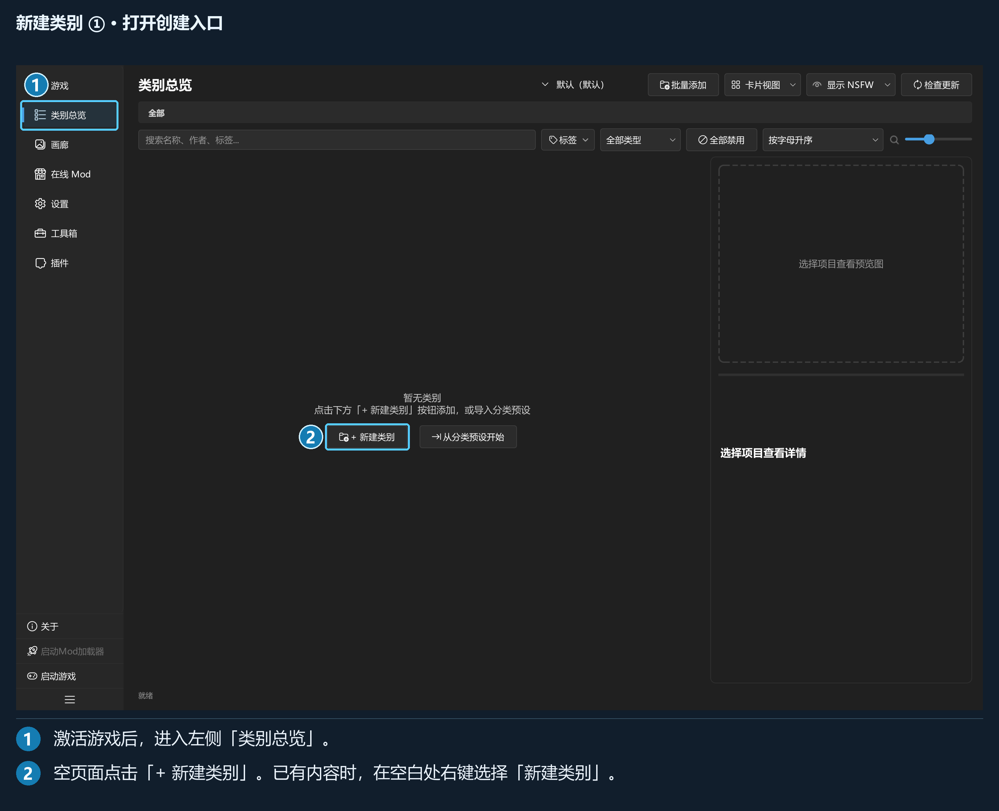
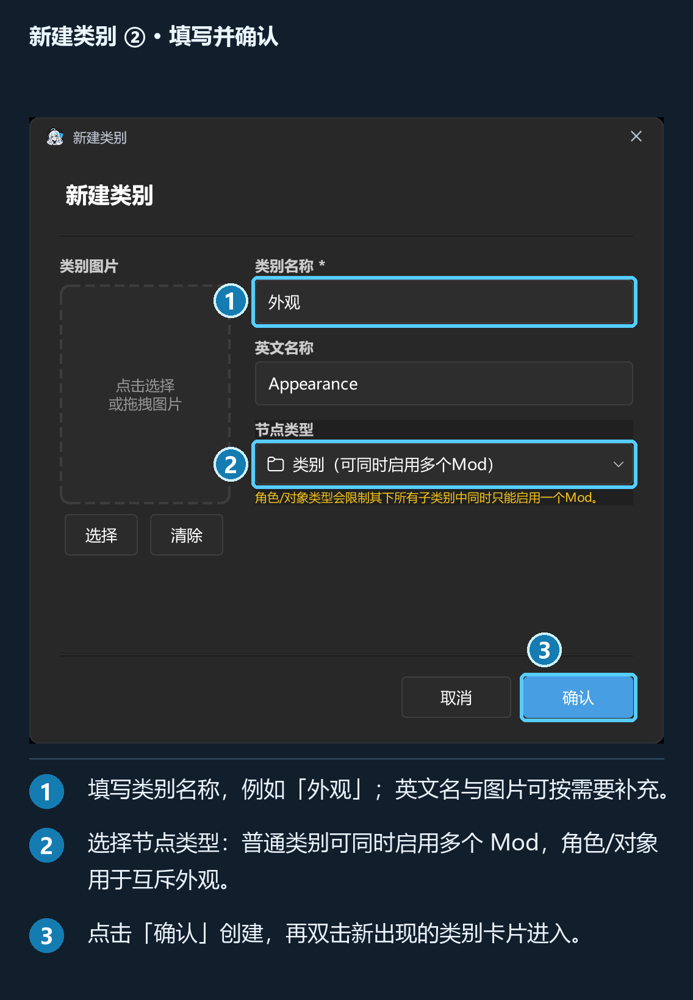
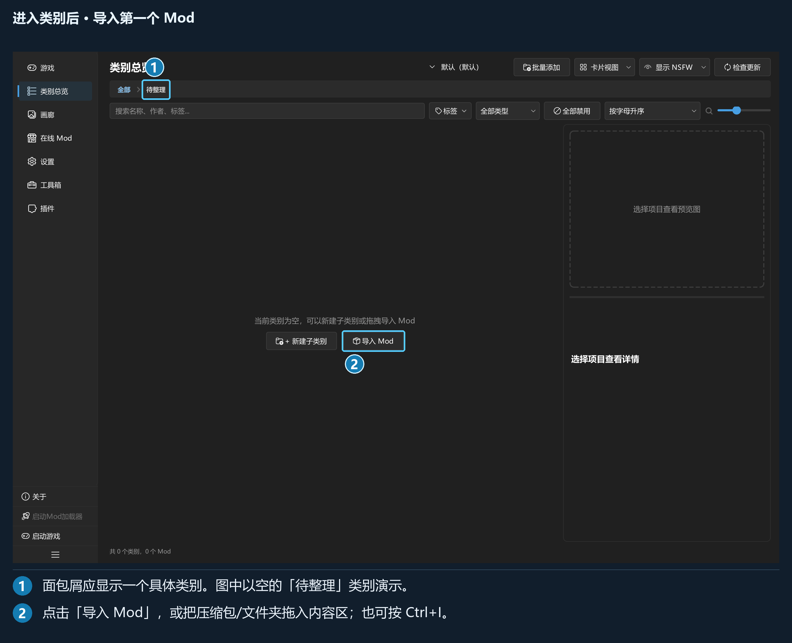
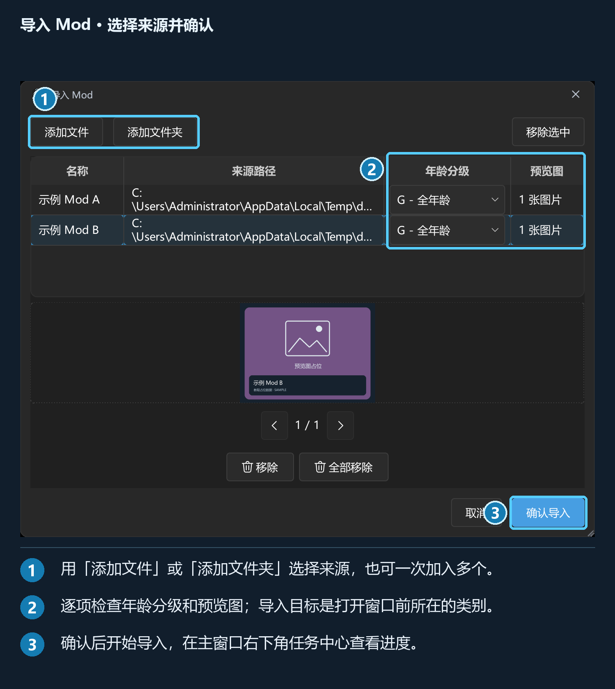
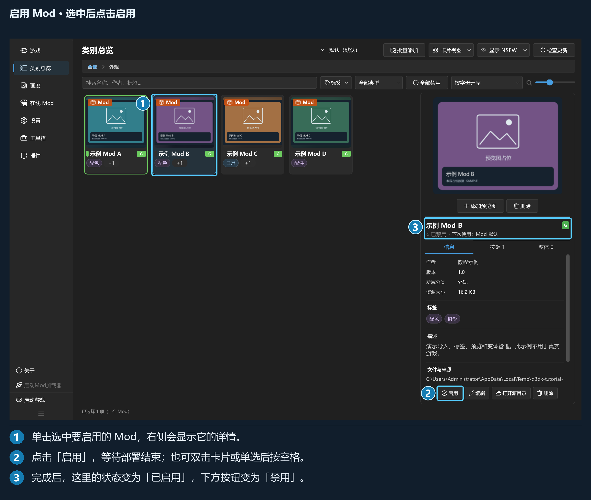
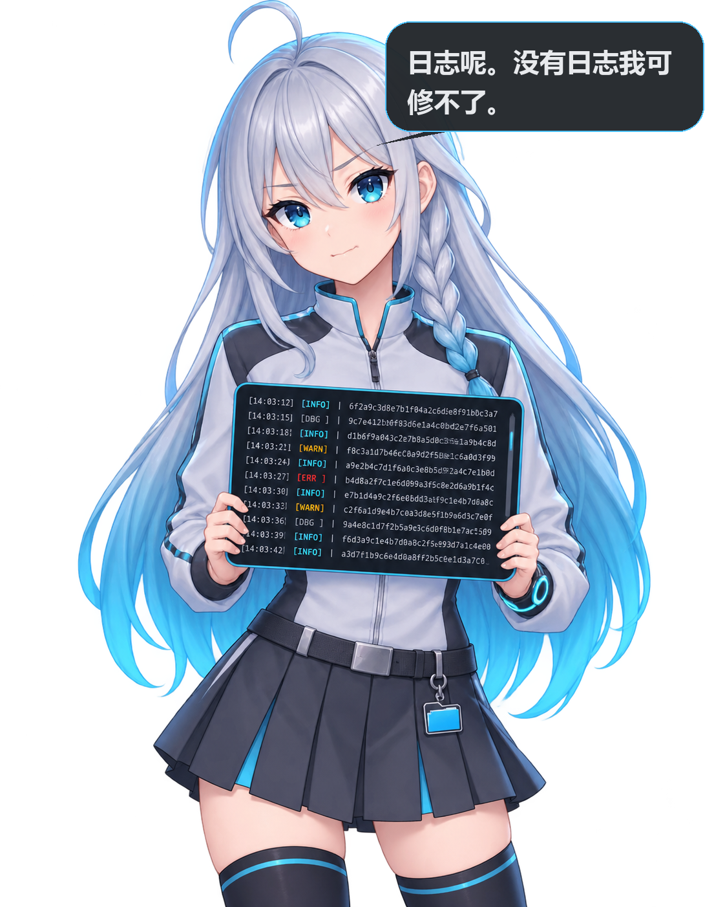

# 5 分钟快速上手

>  **普拉莎提醒：** 先完成下面六步，确认第一个 Mod 在游戏里生效，再按需要查阅后面的功能手册。

从添加游戏开始，跟着下面六步导入并启用第一个 Mod，再进游戏查看效果。所需时间取决于 Mod 大小和磁盘速度。

配图中的编号对应图下的操作说明，点击图片可放大查看。示例名称和预览图均为占位数据，请填写你自己的游戏和路径。

## 开始之前

准备好 Windows 10/11 x64、适用于目标游戏且能正常工作的 3DMigoto，以及一个 Mod 压缩包或文件夹。ZIP、7z、RAR 均可导入；创建 RAR 压缩包才需要另装 WinRAR。

完整解压发行包后运行 `d3dxSkinManage-Plus.exe`，随包的目录也要保留。本程序负责管理和部署，游戏内加载仍由 3DMigoto 完成。

**本地管理可以离线使用。** 浏览 GameBanana、下载和检查更新时才需要相应网络连接。

先找清两处位置：

| 位置 | 用途 |
| --- | --- |
| 3DMigoto 目录 | 放置加载器和 `d3dx.ini` 的位置 |
| `d3dx.ini` 指定的 Mod 目录 | 游戏实际读取的部署目录，常见为 3DMigoto 下的 `Mods` |

> ⚠️ 程序中的「Mod 文件夹」必须指向上表第二项。资源库用于保存原始 Mod，部署目录用于供游戏读取，两者要分开。

## 第 1 步 · 添加游戏

首次启动进入「游戏」页。点「添加游戏」，在右侧填写配置；新增游戏使用常驻详情栏。

*填写后点「确认」。截图中的游戏名称和路径是演示数据。*

| 字段 | 怎么填 |
| --- | --- |
| 「游戏名称」 | 必填，例如「示例游戏」 |
| 「英文名称」 | 游戏在 GameBanana 使用的英文名称；同时用于生成资源目录名。示例为 `Sample Game` |
| 「可执行文件」 | 游戏 exe；留空时不能从程序中启动游戏 |
| 「3DMigoto」 | 加载器所在目录 |
| 「Mod 文件夹」 | `d3dx.ini` 指定的部署目录；启用 Mod 前必须配置 |

预览图可稍后添加。程序不会自动用「3DMigoto」推算「Mod 文件夹」。

## 第 2 步 · 激活游戏

**双击游戏卡片**，或选中后点「启用此游戏环境」。卡片出现「当前」标记即表示激活成功。

*单击查看配置，双击激活；再次双击当前游戏会取消激活。*

没有激活游戏时，「类别总览」「画廊」「在线 Mod」会显示引导遮罩。各游戏的分类、Mod 和组合预设分别管理。

## 第 3 步 · 建一个类别

>  **普拉莎提醒：** 类别建好后要双击进入。看一眼上方的面包屑，确认下一步会把 Mod 导入你想要的位置。

先从左侧进入「类别总览」。空页面中央有「+ 新建类别」，点击它打开创建窗口。已有类别时，在内容区空白处右键选「新建类别」，或按默认快捷键 `Ctrl+Shift+N`。

*① 进入「类别总览」。② 点击「+ 新建类别」。*

在弹出的「新建类别」窗口中填写：

1. 「类别名称」填一个易识别的名字，例如「外观」。
2. 在「节点类型」选择普通类别或角色/对象，按下面的启用规则决定。
3. 英文名称与类别图片按需要补充；点右下角「确认」完成创建。

*① 填名称。② 选节点类型。③ 点「确认」。*

- 普通「类别」允许同时启用多个 Mod，适合「界面」「工具」等分类。
- 「角色/对象」限制其整个子树同时启用一个 Mod，适合互斥的外观替换。
- 已有 `.d3dxcp` 分类预设时，也可点「从分类预设开始」导入分类树；分类预设本身不含 Mod。

创建后，总览中会出现新类别卡片。**双击这张卡片进入**，上方面包屑应显示你刚填的名称；下一步导入的 Mod 会放在这个类别中。

## 第 4 步 · 导入 Mod

进入刚建立的类别后，把压缩包或文件夹拖进内容区，或按默认快捷键 `Ctrl+I`。空类别也可直接点「导入 Mod」。

*① 用面包屑确认所在类别。② 点击「导入 Mod」。这张图用空的「待整理」类别演示，请进入你实际新建的类别。*

*可添加多个来源，分别选择年龄分级与封面。目标类别就是打开导入窗口时所在的位置。*

点「确认导入」。进度显示在主窗口右下角的任务中心，可展开查看每一项；暂停或停止时按提示选择保留已完成项，或撤回本次导入。

名称、作者、标签等信息可在导入后通过「编辑 Mod」调整。

## 第 5 步 · 启用 Mod

双击 Mod 卡片，或选中后点详情栏的「启用」。默认快捷键也支持：让焦点留在总览列表中，**单选一个 Mod 后按空格**。

*① 选中要使用的 Mod。② 点击「启用」。③ 等待完成后核对「已启用」状态，操作按钮会变成「禁用」。*

首次启用需要把库内压缩包解压到部署目录，请等进度结束。同一角色已有其他 Mod 时，按冲突提示选择是否替换。

> ⚠️ 如果提示「未配置 Mod 文件夹」，回到「游戏」页填写并保存部署目录，再重试。

## 第 6 步 · 启动加载器和游戏

>  **普拉莎提醒：** 等启用任务完成，再启动加载器和游戏。游戏已经运行时，记得按加载器的配置重载。

使用左侧的「启动Mod加载器」「启动游戏」，或默认快捷键 `F6`、`F7`。这两个入口需要事先填写对应路径，也可以按加载器要求自行启动。

游戏已经运行时，执行加载器的重载操作。使用默认配置的 3DMigoto 通常按 **F10**；如自行改过按键，以加载器配置为准。该按键在游戏中使用，与管理器快捷键分开。

## 没生效？按这个顺序查

*“日志呢。没有日志我可修不了。”先保留错误文字，再按下表逐项检查。*

| 现象 | 处理 |
| --- | --- |
| 页面显示「请先激活一个游戏环境」 | 回「游戏」页双击目标卡片 |
| 根级无法导入 | 先双击进入一个类别 |
| 无法启用 | 检查「Mod 文件夹」、目标磁盘是否在线及当前任务提示 |
| 软件显示已启用，游戏没有变化 | 核对部署目录、加载器是否运行、Mod 适配版本，再执行加载器重载 |
| 解压或文件校验失败 | 保留原包，检查下载完整性和文件占用；按具体错误重试 |
| 快捷键无反应 | 检查「设置 → 快捷键」的当前绑定，并让焦点离开输入框 |
| 分类或 Mod 没及时出现 | 按默认 `F5` 刷新；仍不一致时到「工具箱 → 重建索引」 |
| 需要反馈问题 | 「工具箱 → 查看日志」，提供版本、操作步骤和对应时间段日志 |

## 接下来看什么

| 你想做什么 | 手册位置 |
| --- | --- |
| 编辑标签、管理预览图、批量移动或导出 | 第 3 章 |
| 保存整套 Mod 组合、管理一个 Mod 的多种外观 | 第 4 章 |
| 在线查找、安装及更新 Mod | 第 5 章 |
| 设置背景、语言、缓存与快捷键 | 第 6 章 |
| 分享分类树、使用插件、查看日志 | 第 7 章 |
| 备份、迁移、排查故障 | 第 8 章 |
| 编写自己的插件、接入菜单或工具页 | [插件开发指南](插件开发指南.md) |

> 💡 本教程列出的快捷键均为默认绑定。可在「设置 → 快捷键」修改，实际绑定以界面为准。
