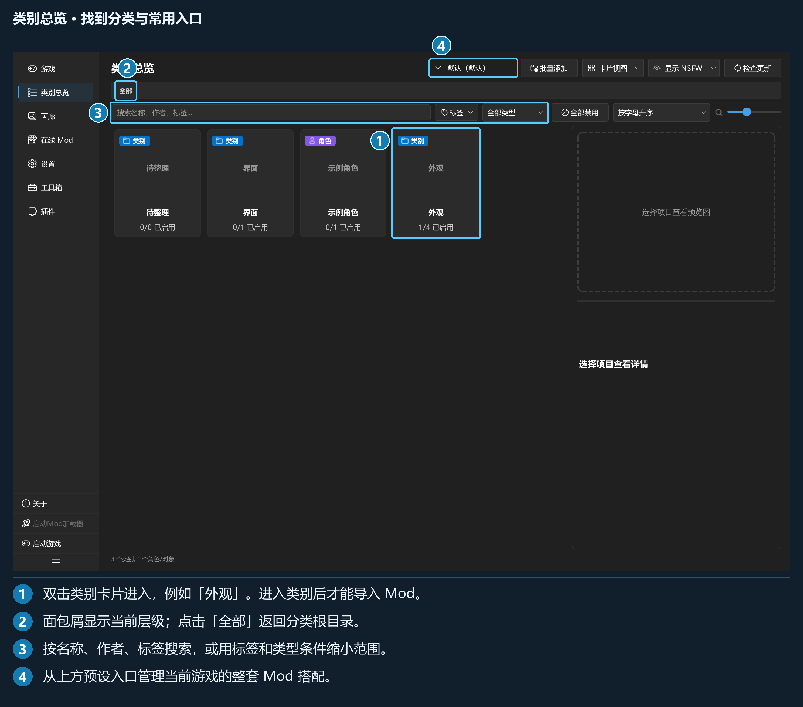
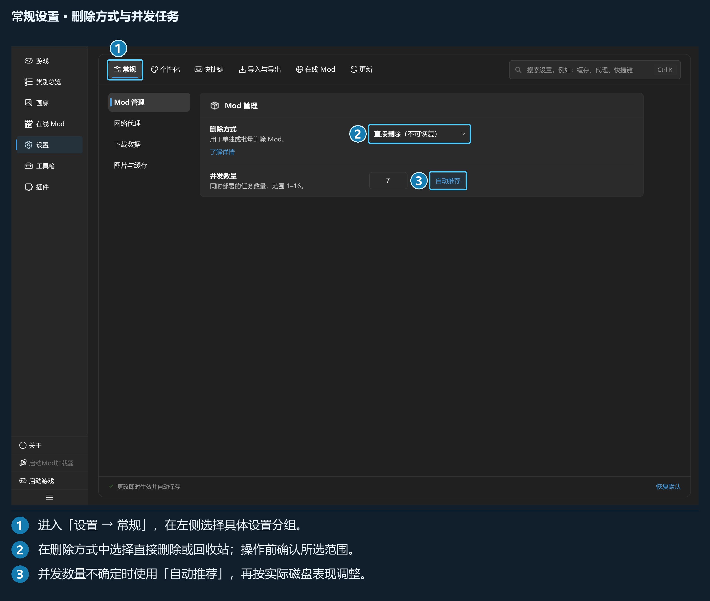
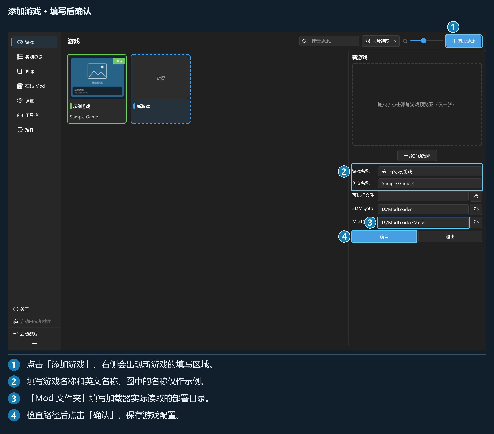
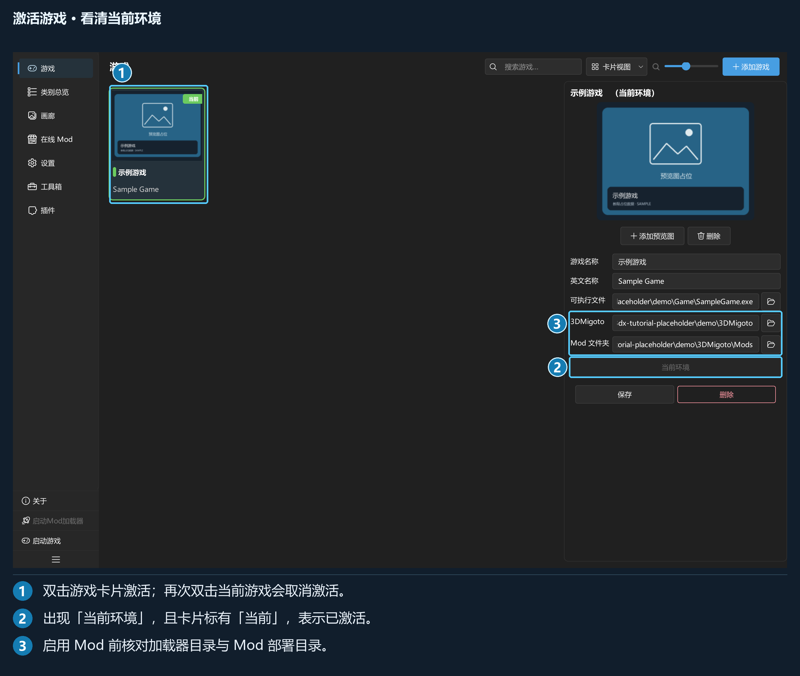
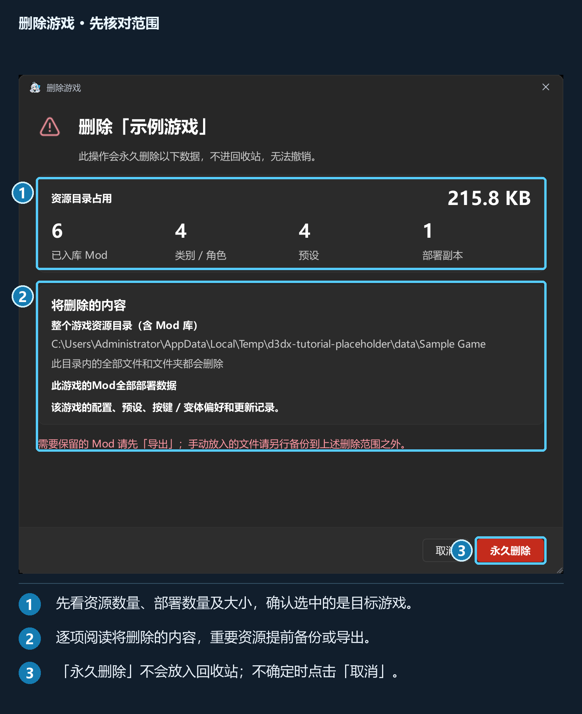

# 完整功能手册

只想先装好一个 Mod，请从《5 分钟快速上手》开始；
本手册按功能提供详细步骤、设置说明和数据维护方法。

界面入口以简体中文标注。所有软件截图中的游戏、分类、Mod 与预览图均为占位数据，
不包含任何具体游戏的资源；正文外的普拉莎插画为本项目原创看板娘。

快捷键表列出默认绑定，自定义后的操作以「设置 → 快捷键」为准。
配图中的编号对应图下的操作说明，可点击图片放大查看。希望扩展程序功能时，继续阅读《插件开发指南》。

---

## 第 1 章 · 界面与导航

### 1.1 启动与版本

完整解压发行包后启动程序。首次使用时没有预置游戏，需要在「游戏」页自行添加；后续启动会恢复仍然有效的上次激活游戏。

本地导入、分类、部署和预设管理可离线使用；GameBanana 和程序更新功能分别在需要时联网。

版本号可在「设置 → 更新 → 程序更新」查看。配图中的游戏名称和资源均为演示数据，实际操作时请选择自己的游戏和文件。

### 1.2 主窗口与导航

*左侧导航切换页面，右侧为当前页面。总览页详情栏与内容区之间的分隔线可以拖动。*

| 导航入口 | 用途 |
| --- | --- |
| 「游戏」 | 添加、编辑、激活游戏 |
| 「类别总览」 | 管理分类、Mod、标签、预览图与组合预设 |
| 「画廊」 | 用大图浏览当前游戏的 Mod |
| 「在线 Mod」 | 浏览 GameBanana 和管理下载 |
| 「设置」 | 常规、个性化、快捷键、导入与导出、在线 Mod、更新 |
| 「工具箱」 | 分类预设、重建索引、查看日志及插件工具 |
| 「插件」 | 安装、搜索、启停、配置和卸载插件 |

列表下方还提供「关于」「启动Mod加载器」「启动游戏」及折叠导航按钮。有插件命令时会出现「插件命令」入口；插件也可增加自己的导航页。

两颗启动按钮依赖当前游戏的路径配置。按钮不可用时，回「游戏」页检查「可执行文件」和「3DMigoto」。

导航折叠后保留图标；鼠标悬停可查看提示。界面会记忆多种视图、卡片大小及分栏布局，个别窗口的尺寸和显示行为以对应页面为准。

### 1.3 游戏激活状态

「类别总览」「画廊」「在线 Mod」都依赖当前游戏。未激活时，页面会出现「请先激活一个游戏环境」和前往游戏页的按钮。

在「游戏」页：

- 单击卡片或列表行：选中并查看配置。
- 双击非当前游戏：激活并切换资源库。
- 双击当前游戏：取消激活。
- 详情栏「启用此游戏环境」：激活选中的游戏。

添加游戏后仍需激活。切换过程中若有未保存配置或正在执行的部署任务，先处理对应提示。

### 1.4 任务中心与操作进度

导入、目录发现和库刷新等任务显示在右下角任务中心。它可展开显示单项状态、完成数量与失败原因。

程序内导入支持暂停、继续和停止。停止时可能提供「保留已导入的Mod」「取消全部导入」「继续导入」等选择：

| 选择 | 结果 |
| --- | --- |
| 保留已完成项 | 已成功导入的留在库中，未完成项停止 |
| 取消全部 | 尝试撤回本次已完成的导入；如有恢复失败，以报告为准 |
| 继续 | 回到当前任务 |

自动发现的纳管任务与手动导入的控制能力不完全相同；只使用当前浮层提供的按钮。停止请求可能要等当前文件操作到达安全位置后才能结束。

导出、批量删除、切换组合预设和更新使用各自的进度界面。等待任务结束后再移动相关目录，避免对同一份文件交叉操作。

右上角还会出现短暂提示，例如主题已应用、变体已保存。需要回查具体错误时，到「工具箱 → 查看日志」。

### 1.5 常用快捷键

管理器快捷键只在应用窗口内分派，不是系统全局热键。它们可在「设置 → 快捷键 → 按键绑定」修改。

| 默认键 | 动作 |
| --- | --- |
| `Ctrl+I` | 导入到当前类别 |
| `F5` | 刷新当前游戏的 Mod 库 |
| `Ctrl+F` | 聚焦当前页面的搜索框（页面须支持搜索） |
| `Ctrl+K` | 打开设置并搜索全部设置 |
| `Ctrl+,` | 打开设置 |
| `Ctrl+1` / `Ctrl+2` / `Ctrl+3` / `Ctrl+4` | 游戏 / 类别总览 / 画廊 / 在线 Mod |
| `Alt+Left` | 返回上级类别，或关闭在线 Mod 详情 |
| `Ctrl+Shift+N` | 在当前层新建类别 |
| `F2` | 编辑总览中单个选中项目 |
| `Space` | 启用或禁用总览中单个选中的 Mod |
| `Ctrl+Shift+E` | 导出总览中选中的项目 |
| `F6` / `F7` | 启动 Mod 加载器 / 游戏 |

列表和输入框还有复制、剪切、粘贴、全选、删除等操作，完整表见附录 A。输入框、输入法、按键录制和模态窗口会优先处理自己的输入；在文本框内按空格不会切换 Mod。

`Esc` 用于退出录制、关闭部分浮层或取消总览中的剪切等上下文操作。3DMigoto 的游戏内 F10 重载键由加载器配置，不在管理器快捷键中设置。

### 1.6 设置的导航方式

设置页顶部有六个分区，每个分区内还有左侧子导航。教程按「设置 → 常规 → 图片与缓存」这样的完整路径指路。

*顶部切分区，左侧切子页。右上角搜索框可以直接定位具体设置。*

在设置搜索框输入「缓存」「代理」「变体」或某个命令名称，点击搜索结果即可跳转；快捷键命令和已注册插件命令也会参与设置搜索。

设置通常即时保存。代理地址等输入项在编辑完成时提交；部分滑块拖动时预览，松手后保存。游戏配置编辑仍需点「保存」，不要与设置页混淆。

### 1.7 主题、语言与背景

进入「设置 → 个性化 → 外观」选择深色、浅色或跟随系统。**跟随系统会按 Windows 应用主题切换。** 同页可选择字体和语言、刷新语言包列表。

「个性化 → 整窗背景」支持关闭、图片、视频和 WE 场景。视频与场景有帧率、播放控制等选项；WE 场景需要本机的 Wallpaper Engine。完整配置见第 6 章。

---

## 第 2 章 · 游戏与首次配置

### 2.1 添加游戏与五个字段

点「游戏 → 添加游戏」，右侧进入草稿状态。填写后点「确认」；「退出」会放弃草稿，有输入时会先确认。

| 字段 | 用途与要求 |
| --- | --- |
| 「游戏名称」 | 必填，供你识别，例如「示例游戏」 |
| 「英文名称」 | 用于 GameBanana 匹配，并生成 `data/` 下的游戏资源目录名；建议填写社区使用的完整英文名 |
| 「可执行文件」 | 游戏 exe。留空不影响管理，但不能使用「启动游戏」 |
| 「3DMigoto」 | 加载器所在目录；用于启动加载器，并定位变体采集所需的 `d3dx_user.ini` |
| 「Mod 文件夹」 | 已启用 Mod 的部署目录，须与 `d3dx.ini` 一致；留空时无法部署 Mod |

英文名称未填时，资源目录名会回落到游戏名称；重名时会生成不同目录。内部游戏标识由程序生成，无需手动填写。

预览图区支持点击、拖入或更换单张游戏图片。已保存游戏的预览图变更会单独持久化；若写入失败，会显示提示并保留未保存状态。其他字段以「保存」为准。

### 2.2 资源库与部署目录

| 位置 | 保存的内容 | 常见例子 |
| --- | --- | --- |
| 游戏资源目录 | 当前游戏的 Mod 库、预览缓存和运行偏好 | `<数据根目录>/data/Sample Game/` |
| 库根目录 | 分类目录和完整 Mod 容器 | 上述目录下的 `mods/` |
| 「Mod 文件夹」 | 供加载器读取的启用副本、停放副本及受管标记 | `D:/ModLoader/Mods/` |
| 「3DMigoto」 | 加载器程序、主配置和用户配置 | `D:/ModLoader/` |

导入把 Mod 收进资源库；启用才把内容发布到部署目录。不要把资源库直接填作部署目录，也不要把游戏安装根目录当作专用 Mod 目录。

程序不会从加载器路径自动推算部署目录。核对 `d3dx.ini` 后显式填写「Mod 文件夹」。

数据根目录通常是程序所在目录；发行包所在目录不可写时可能使用 Windows 用户数据目录。备份前先确认实际位置，详见第 8 章。

### 2.3 激活与切换游戏

单击查看配置，双击激活；已激活游戏的卡片显示「当前」。详情栏也可点「启用此游戏环境」。

激活后，总览、画廊、在线 Mod 都切到该游戏，并使用对应加载器及部署路径。每个游戏的分类、Mod 和组合预设分别管理。

再次双击当前游戏会取消激活。程序只恢复有效的上次激活项，不自动激活新添加的第一个游戏。

### 2.4 修改与保存

选中游戏后修改右侧字段，点「保存」。有未保存改动时切换项目或页面，程序会询问保存、放弃或取消离开。

修改英文名称后，程序会尝试同步迁移已绑定的资源目录，并更新相关路径。请先结束导入、更新、部署任务。目录迁移失败但设置成功保存时，界面会说明资源仍在旧位置；配置写入失败时会尝试回滚搬迁，并保留未保存的修改。若恢复也失败，按提示核对实际文件位置后再继续，不要自行删除恢复材料。

游戏配置单独保存在 `config/games.json`，程序偏好在 `config/settings.json`。「设置 → 恢复默认」会保留游戏列表和 Mod 数据。

### 2.5 更改或清空部署路径

改路径前，先确认旧磁盘、新磁盘均可访问，并处理占用相关文件的程序。

| 操作 | 程序的处理 |
| --- | --- |
| 更改「Mod 文件夹」，旧目录中已有内容 | 询问是否迁移旧目录内全部文件和子文件夹，包括手动放入的文件 |
| 选择迁移 | 检查目标冲突后迁移；失败时保留恢复信息并提示，不应自行删除记录 |
| 选择不迁移 | 只保存新配置，旧目录内容保留，需要自行确认游戏之后读取哪里 |
| 取消迁移询问 | 退出本次保存流程 |
| 清空「Mod 文件夹」，原目录仍有内容 | 询问是否永久清空旧目录；拒绝时保留原部署路径 |

> ⚠️ 清空部署目录会涉及该目录内的全部文件和子文件夹，包括手动放入的内容，不走回收站。确认前看清弹窗中的完整路径。

迁移会拒绝目录互相嵌套、目标存在同名内容等不安全情况。需要迁移到其他磁盘时使用游戏页操作，并在完成后确认配置已保存及启用状态正常。

清空「3DMigoto」路径还会提示变体状态记录受到影响。部署路径和加载器路径是两个字段，不能用清空其中一个代替禁用 Mod。

### 2.6 删除游戏会删除数据

**删除游戏是永久删除该游戏及其数据。** 它不受「Mod 管理 → 删除方式」的回收站选项控制。

在详情栏或右键菜单选择「删除」后，程序会扫描资源占用，展示删除范围。扫描期间可取消；确认前会显示完整资源路径及 Mod、分类、预设、部署副本数量。

删除范围包括：

- 整个游戏资源目录及其内部文件，包括 Mod 库和手动放入的其他文件。
- 该游戏的受管部署数据。
- 该游戏的配置、组合预设、按键或变体偏好及更新记录。

需要保留的内容先导出或备份到删除范围之外。删的是当前游戏时，激活状态也会清空。

若部分文件被占用，程序会显示「游戏数据清理结果」，列出未清理的完整路径。保留这份报告，解除占用后按报告处理，不能仅凭游戏卡片消失就认为所有文件都已清理。

### 2.7 搜索、视图和顺序

游戏页支持按名称搜索，以及卡片 / 列表视图切换。卡片视图可调整卡片大小，并通过拖动改变游戏顺序；使用搜索筛选时先清空搜索，再调整完整列表的顺序。

默认 `Ctrl+1` 可回到游戏页；默认 `Ctrl+F` 聚焦当前页的搜索。游戏启动路径缺失时，补全并保存后再使用导航栏按钮或 `F6`、`F7`。

---

## 第 3 章 · 类别总览与 Mod 管理

