# 完整功能手册

只想先装好一个 Mod，请从《5 分钟快速上手》开始；
本手册按功能提供详细步骤、设置说明和数据维护方法。

界面入口以简体中文标注。所有软件截图中的游戏、分类、Mod 与预览图均为占位数据，
不包含任何具体游戏的资源；正文外的普拉莎插画为本项目原创看板娘。

快捷键表列出默认绑定，自定义后的操作以「设置 → 快捷键」为准。
配图中的编号对应图下的操作说明，可点击图片放大查看。希望扩展程序功能时，继续阅读《插件开发指南》。

---

## 第 1 章 · 界面与导航

### 1.1 启动与版本

完整解压发行包后启动程序。首次使用时没有预置游戏，需要在「游戏」页自行添加；后续启动会恢复仍然有效的上次激活游戏。

本地导入、分类、部署和预设管理可离线使用；GameBanana 和程序更新功能分别在需要时联网。

版本号可在「设置 → 更新 → 程序更新」查看。配图中的游戏名称和资源均为演示数据，实际操作时请选择自己的游戏和文件。

### 1.2 主窗口与导航


*左侧导航切换页面，右侧为当前页面。总览页详情栏与内容区之间的分隔线可以拖动。*

| 导航入口 | 用途 |
| --- | --- |
| 「游戏」 | 添加、编辑、激活游戏 |
| 「类别总览」 | 管理分类、Mod、标签、预览图与组合预设 |
| 「画廊」 | 用大图浏览当前游戏的 Mod |
| 「在线 Mod」 | 浏览 GameBanana 和管理下载 |
| 「设置」 | 常规、个性化、快捷键、导入与导出、在线 Mod、更新 |
| 「工具箱」 | 分类预设、重建索引、查看日志及插件工具 |
| 「插件」 | 安装、搜索、启停、配置和卸载插件 |

列表下方还提供「关于」「启动Mod加载器」「启动游戏」及折叠导航按钮。有插件命令时会出现「插件命令」入口；插件也可增加自己的导航页。

两颗启动按钮依赖当前游戏的路径配置。按钮不可用时，回「游戏」页检查「可执行文件」和「3DMigoto」。

导航折叠后保留图标；鼠标悬停可查看提示。界面会记忆多种视图、卡片大小及分栏布局，个别窗口的尺寸和显示行为以对应页面为准。

### 1.3 游戏激活状态

「类别总览」「画廊」「在线 Mod」都依赖当前游戏。未激活时，页面会出现「请先激活一个游戏环境」和前往游戏页的按钮。

在「游戏」页：

- 单击卡片或列表行：选中并查看配置。
- 双击非当前游戏：激活并切换资源库。
- 双击当前游戏：取消激活。
- 详情栏「启用此游戏环境」：激活选中的游戏。

添加游戏后仍需激活。切换过程中若有未保存配置或正在执行的部署任务，先处理对应提示。

### 1.4 任务中心与操作进度

导入、目录发现和库刷新等任务显示在右下角任务中心。它可展开显示单项状态、完成数量与失败原因。

程序内导入支持暂停、继续和停止。停止时可能提供「保留已导入的Mod」「取消全部导入」「继续导入」等选择：

| 选择 | 结果 |
| --- | --- |
| 保留已完成项 | 已成功导入的留在库中，未完成项停止 |
| 取消全部 | 尝试撤回本次已完成的导入；如有恢复失败，以报告为准 |
| 继续 | 回到当前任务 |

自动发现的纳管任务与手动导入的控制能力不完全相同；只使用当前浮层提供的按钮。停止请求可能要等当前文件操作到达安全位置后才能结束。

导出、批量删除、切换组合预设和更新使用各自的进度界面。等待任务结束后再移动相关目录，避免对同一份文件交叉操作。

右上角还会出现短暂提示，例如主题已应用、变体已保存。需要回查具体错误时，到「工具箱 → 查看日志」。

### 1.5 常用快捷键

管理器快捷键只在应用窗口内分派，不是系统全局热键。它们可在「设置 → 快捷键 → 按键绑定」修改。

| 默认键 | 动作 |
| --- | --- |
| `Ctrl+I` | 导入到当前类别 |
| `F5` | 刷新当前游戏的 Mod 库 |
| `Ctrl+F` | 聚焦当前页面的搜索框（页面须支持搜索） |
| `Ctrl+K` | 打开设置并搜索全部设置 |
| `Ctrl+,` | 打开设置 |
| `Ctrl+1` / `Ctrl+2` / `Ctrl+3` / `Ctrl+4` | 游戏 / 类别总览 / 画廊 / 在线 Mod |
| `Alt+Left` | 返回上级类别，或关闭在线 Mod 详情 |
| `Ctrl+Shift+N` | 在当前层新建类别 |
| `F2` | 编辑总览中单个选中项目 |
| `Space` | 启用或禁用总览中单个选中的 Mod |
| `Ctrl+Shift+E` | 导出总览中选中的项目 |
| `F6` / `F7` | 启动 Mod 加载器 / 游戏 |

列表和输入框还有复制、剪切、粘贴、全选、删除等操作，完整表见附录 A。输入框、输入法、按键录制和模态窗口会优先处理自己的输入；在文本框内按空格不会切换 Mod。

`Esc` 用于退出录制、关闭部分浮层或取消总览中的剪切等上下文操作。3DMigoto 的游戏内 F10 重载键由加载器配置，不在管理器快捷键中设置。

### 1.6 设置的导航方式

设置页顶部有六个分区，每个分区内还有左侧子导航。教程按「设置 → 常规 → 图片与缓存」这样的完整路径指路。


*顶部切分区，左侧切子页。右上角搜索框可以直接定位具体设置。*

在设置搜索框输入「缓存」「代理」「变体」或某个命令名称，点击搜索结果即可跳转；快捷键命令和已注册插件命令也会参与设置搜索。

设置通常即时保存。代理地址等输入项在编辑完成时提交；部分滑块拖动时预览，松手后保存。游戏配置编辑仍需点「保存」，不要与设置页混淆。

### 1.7 主题、语言与背景

进入「设置 → 个性化 → 外观」选择深色、浅色或跟随系统。**跟随系统会按 Windows 应用主题切换。** 同页可选择字体和语言、刷新语言包列表。

「个性化 → 整窗背景」支持关闭、图片、视频和 WE 场景。视频与场景有帧率、播放控制等选项；WE 场景需要本机的 Wallpaper Engine。完整配置见第 6 章。

---

## 第 2 章 · 游戏与首次配置

> [](../images/plusa/02-惊讶.webp) **普拉莎提醒：** 加载器目录和游戏实际读取的 Mod 目录是两个位置。先确认 d3dx.ini 的配置，再分别填写，避免把资源库当成部署目录。

### 2.1 添加游戏与五个字段

点「游戏 → 添加游戏」，右侧进入草稿状态。填写后点「确认」；「退出」会放弃草稿，有输入时会先确认。


| 字段 | 用途与要求 |
| --- | --- |
| 「游戏名称」 | 必填，供你识别，例如「示例游戏」 |
| 「英文名称」 | 用于 GameBanana 匹配，并生成 `data/` 下的游戏资源目录名；建议填写社区使用的完整英文名 |
| 「可执行文件」 | 游戏 exe 路径，可附加启动参数。留空不影响管理，但不能使用「启动游戏」 |
| 「3DMigoto」 | 加载器所在目录；用于启动加载器，并定位变体采集所需的 `d3dx_user.ini` |
| 「Mod 文件夹」 | 已启用 Mod 的部署目录，须与 `d3dx.ini` 一致；留空时无法部署 Mod |

英文名称未填时，资源目录名会回落到游戏名称；重名时会生成不同目录。内部游戏标识由程序生成，无需手动填写。

「可执行文件」支持在程序路径后填写启动参数，例如：

```text
"D:\Games\Sample Game\Game.exe" --windowed --profile "Profile A"
```

路径含空格时建议加双引号，具体参数以游戏或启动器的说明为准。原有只填路径的配置仍可使用；启动时以程序所在目录作为工作目录。

预览图区支持点击、拖入或更换单张游戏图片。已保存游戏的预览图变更会单独持久化；若写入失败，会显示提示并保留未保存状态。其他字段以「保存」为准。

### 2.2 资源库与部署目录

| 位置 | 保存的内容 | 常见例子 |
| --- | --- | --- |
| 游戏资源目录 | 当前游戏的 Mod 库、预览缓存和运行偏好 | `<数据根目录>/data/Sample Game/` |
| 库根目录 | 分类目录和完整 Mod 容器 | 上述目录下的 `mods/` |
| 「Mod 文件夹」 | 供加载器读取的启用副本、停放副本及受管标记 | `D:/ModLoader/Mods/` |
| 「3DMigoto」 | 加载器程序、主配置和用户配置 | `D:/ModLoader/` |

导入把 Mod 收进资源库；启用才把内容发布到部署目录。不要把资源库直接填作部署目录，也不要把游戏安装根目录当作专用 Mod 目录。

程序不会从加载器路径自动推算部署目录。核对 `d3dx.ini` 后显式填写「Mod 文件夹」。

数据根目录通常是程序所在目录；发行包所在目录不可写时可能使用 Windows 用户数据目录。备份前先确认实际位置，详见第 8 章。

### 2.3 激活与切换游戏


单击查看配置，双击激活；已激活游戏的卡片显示「当前」。详情栏也可点「启用此游戏环境」。

激活后，总览、画廊、在线 Mod 都切到该游戏，并使用对应加载器及部署路径。每个游戏的分类、Mod 和组合预设分别管理。

再次双击当前游戏会取消激活。程序只恢复有效的上次激活项，不自动激活新添加的第一个游戏。

### 2.4 修改与保存

选中游戏后修改右侧字段，点「保存」。有未保存改动时切换项目或页面，程序会询问保存、放弃或取消离开。

修改英文名称后，程序会尝试同步迁移已绑定的资源目录，并更新相关路径。请先结束导入、更新、部署任务。目录迁移失败但设置成功保存时，界面会说明资源仍在旧位置；配置写入失败时会尝试回滚搬迁，并保留未保存的修改。若恢复也失败，按提示核对实际文件位置后再继续，不要自行删除恢复材料。

游戏配置单独保存在 `config/games.json`，程序偏好在 `config/settings.json`。「设置 → 恢复默认」会保留游戏列表和 Mod 数据。

### 2.5 更改或清空部署路径

改路径前，先确认旧磁盘、新磁盘均可访问，并处理占用相关文件的程序。

| 操作 | 程序的处理 |
| --- | --- |
| 更改「Mod 文件夹」，旧目录中已有内容 | 询问是否迁移旧目录内全部文件和子文件夹，包括手动放入的文件 |
| 选择迁移 | 检查目标冲突后迁移；失败时保留恢复信息并提示，不应自行删除记录 |
| 选择不迁移 | 只保存新配置，旧目录内容保留，需要自行确认游戏之后读取哪里 |
| 取消迁移询问 | 退出本次保存流程 |
| 清空「Mod 文件夹」，原目录仍有内容 | 询问是否永久清空旧目录；拒绝时保留原部署路径 |

> ⚠️ 清空部署目录会涉及该目录内的全部文件和子文件夹，包括手动放入的内容，不走回收站。确认前看清弹窗中的完整路径。

迁移会拒绝目录互相嵌套、目标存在同名内容等不安全情况。需要迁移到其他磁盘时使用游戏页操作，并在完成后确认配置已保存及启用状态正常。

清空「3DMigoto」路径还会提示变体状态记录受到影响。部署路径和加载器路径是两个字段，不能用清空其中一个代替禁用 Mod。

### 2.6 删除游戏会删除数据

**删除游戏是永久删除该游戏及其数据。** 它不受「Mod 管理 → 删除方式」的回收站选项控制。

在详情栏或右键菜单选择「删除」后，程序会扫描资源占用，展示删除范围。扫描期间可取消；确认前会显示完整资源路径及 Mod、分类、预设、部署副本数量。


删除范围包括：

- 整个游戏资源目录及其内部文件，包括 Mod 库和手动放入的其他文件。
- 该游戏的受管部署数据。
- 该游戏的配置、组合预设、按键或变体偏好及更新记录。

需要保留的内容先导出或备份到删除范围之外。删的是当前游戏时，激活状态也会清空。

若部分文件被占用，程序会显示「游戏数据清理结果」，列出未清理的完整路径。保留这份报告，解除占用后按报告处理，不能仅凭游戏卡片消失就认为所有文件都已清理。

### 2.7 搜索、视图和顺序

游戏页支持按名称搜索，以及卡片 / 列表视图切换。卡片视图可调整卡片大小，并通过拖动改变游戏顺序；使用搜索筛选时先清空搜索，再调整完整列表的顺序。

默认 `Ctrl+1` 可回到游戏页；默认 `Ctrl+F` 聚焦当前页的搜索。游戏启动路径缺失时，补全并保存后再使用导航栏按钮或 `F6`、`F7`。

---

## 第 3 章 · 类别总览与 Mod 管理

### 3.1 页面结构

「类别总览」负责分类、导入、启用、信息编辑、标签、预览图和导出。上方工具栏提供组合预设、批量添加、视图、NSFW 显示方式和检查更新；面包屑显示所在层级。


*图中使用虚构分类；真实使用时由你自行建立目录。*

搜索行提供名称、作者、标签搜索，标签条件、类型与分级筛选、全部禁用、排序和卡片缩放。右侧详情栏与内容区之间可以拖动分隔线；详情栏内部的图片区与文字区也可调整高度。

单击选中，双击类别进入，双击 Mod 切换启用状态。点面包屑「全部」返回分类根级。

搜索范围包括当前类别及其子类别。进入类别、返回上级或通过面包屑切换目录时，搜索词会自动清空，方便浏览新目录中的内容；刷新当前目录时保留搜索词。

### 3.2 类别与角色/对象


| 类型 | 启用规则 | 适合的用途 |
| --- | --- | --- |
| 「类别」 | 可以同时启用多个 Mod | 界面、工具、可叠加的资源 |
| 「角色/对象」 | 该节点及全部子类别中，同时只允许启用一个 Mod | 互斥的角色外观或对象替换 |

新建或编辑时均可选择「节点类型」。角色/对象约束覆盖节点下全部层级，包括嵌套的角色/对象。

根级主要用于分类导航。导入 Mod 前先进入目标类别，避免把未归类资源堆在根目录。

### 3.3 新建、编辑与批量添加类别

在内容区空白处右键选「新建类别」，或使用默认 `Ctrl+Shift+N`。空页面还有「+ 新建类别」或「+ 新建子类别」。

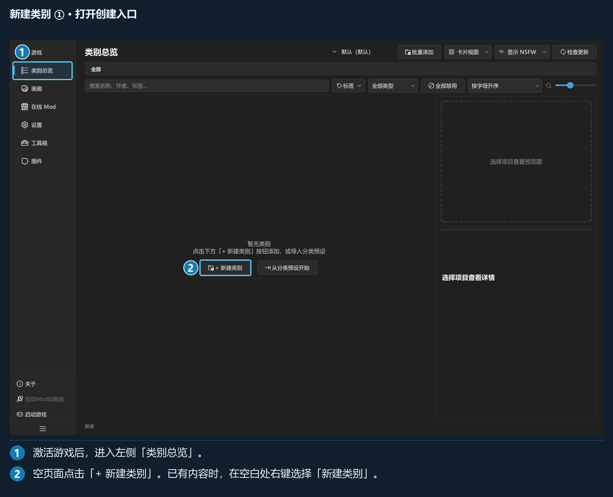

*① 进入「类别总览」。② 空页面中央的「+ 新建类别」会打开创建窗口。*

填写名称，可选英文名称与封面，再确认。英文名称用于在线查找和分类匹配。类别名称须符合 Windows 文件名规则，同级不能重名；角色/对象还会检查当前游戏内的名称冲突。

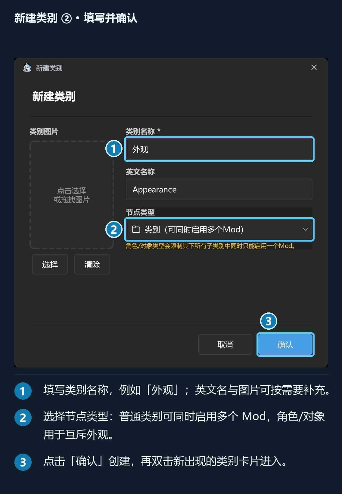

*① 填写名称。② 选择节点类型。③ 点「确认」，随后双击新类别卡片进入。*

工具栏「批量添加」支持一次建立多个类别：

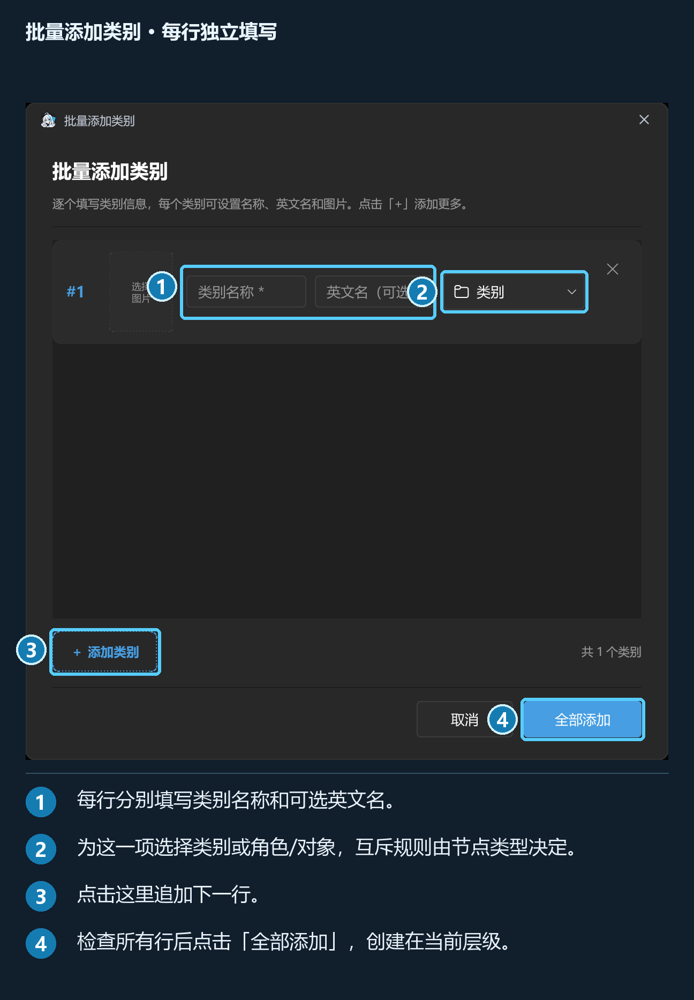

*每一项分别填写名称、英文名、图片和节点类型，创建位置是当前所在层。*

批量创建也会使用各项选择的节点类型。已有分类可从右键「编辑」或详情栏「编辑」调整信息。

在编辑框中可将「类别」与「角色/对象」互相转换。类别转为角色/对象时，如果该节点及子层级中已启用多个 Mod，程序会阻止保存，并显示「全部禁用并重试」和「确认」。前者在全部禁用成功后继续保存；后者关闭提示，保留原类型。禁用取消或失败时也保留原类型。正在部署时，请等待该节点下的任务完成后再转换类型。

已有分类预设时，可从空页面的「从分类预设开始」或「工具箱 → 导入分类预设」建立分类树，详见第 7 章。分类预设与保存 Mod 开关的组合预设是两种文件内容。

### 3.4 导入压缩包或文件夹

先进入目标类别，然后任选一种入口：

| 入口 | 操作 |
| --- | --- |
| 拖放 | 把 ZIP、7z、RAR 或文件夹拖到内容区 |
| 右键菜单 | 空白处右键 →「导入 Mod」 |
| 快捷键 | 默认 `Ctrl+I` |
| 空类别按钮 | 点「导入 Mod」 |

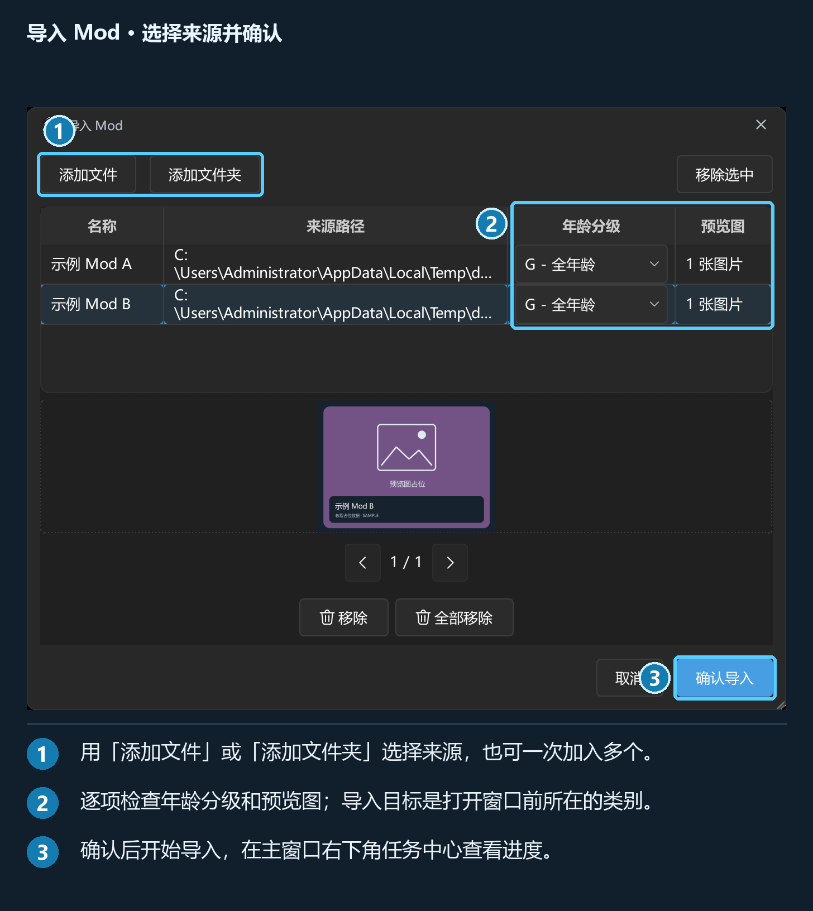

导入窗口可以「添加文件」「添加文件夹」或「移除选中」，每个来源分别设置年龄分级、预览图。没有目标类别下拉框：目标由打开窗口前所在的位置确定。

表格中的来源名称用于识别本次候选；显示名称、作者、版本、来源网址和标签可在导入后编辑。

预览区提供「移除预览」和「移除全部预览」，只取消预览用途，图片资源仍完整导入。移除后需要通过「重建索引」恢复自动识别。

点「确认导入」后，通过右下角任务中心查看进度、重复项和失败项。导入通常会保留来源文件；从库目录直接发现的纳管则可能在原位置整理文件，不能把两种方式当成完全相同的复制流程。

### 3.5 直接向库目录放入文件

也可通过资源管理器向已存在的类别目录放入归档或待整理文件夹：

```text
<数据根目录>/data/Sample Game/mods/外观/
```

程序的目录监控、进入相关分类、切换游戏和手动刷新会发现需要处理的变化。默认 `F5` 请求刷新当前游戏的库，进度在任务中心显示；大目录或正在写入的归档需要等待。

发现的内容会经过识别、校验和纳管，最终形成完整 Mod 容器。重复内容、无效容器、文件占用和中断项会有相应提示。遇到遗留项时先查看原文件，再根据界面选择保留、回收站或删除等可用动作。

**不要编辑或移除容器的身份标记。** 程序通过身份标记识别 Mod，并校验相关文件；请保留完整容器，详见第 4 章。

### 3.6 启用、禁用与冲突

以下入口都可以切换单个 Mod：

- 双击卡片或列表行。
- 右侧详情栏的「启用」/「禁用」。
- 右键菜单的「启用」/「禁用」。
- 在总览列表中单选一个 Mod，按默认 `Space`。

启用成功后显示启用状态，卡片有绿色标记。首次启用可能需要解压，等待该项进度完成；再次启用符合条件的停放副本可较快恢复。

有部署副本时，可使用右侧预览栏或 Mod 卡片、列表右键菜单的「查看部署」，在资源管理器中定位副本。没有可查看副本时，右键菜单中的此项置灰；禁用后保留的副本也可查看。

角色/对象下已有其他 Mod 时，会询问是否禁用冲突项并启用新项。若选择不再提示，之后将按该偏好处理同类冲突。

「全部禁用」的范围为当前目录及其子目录。在根级使用时范围覆盖当前游戏；有搜索条件时不要把它误认为“只禁用搜索结果”，确认时看清说明。

部署、预设切换或文件恢复期间，相关写入操作可能暂不可用。先结束当前任务，不要反复点击启用或删除。

### 3.7 右侧详情：信息、按键与变体

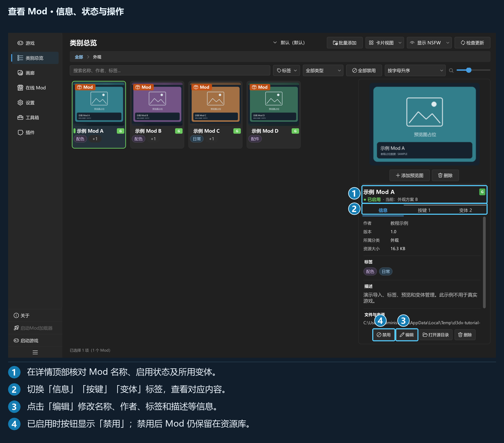

*示例 Mod 的封面是几何占位图；下面是独立的详情标签页。*

| 标签页 | 内容 |
| --- | --- |
| 「信息」 | 作者、版本、分级、标签、描述、来源与路径等已有信息 |
| 「按键 N」 | 从 INI 识别到的绑定，按文件分组，可录制或手动输入 |
| 「变体 N」 | Mod 默认配置及保存的命名外观，可切换和管理 |

按键或变体为零时会显示相应的空状态，不能据此认定 Mod 无法使用。变体数量取决于已保存的命名方案，能力还取决于 Mod 自身是否声明可保存变量。

选中类别时显示类别信息与分类操作；多选时显示选择数量，不会把多个 Mod 的字段混在一起编辑。

### 3.8 编辑 Mod 与标签

选中单个 Mod 后点「编辑」，或使用默认 `F2`。

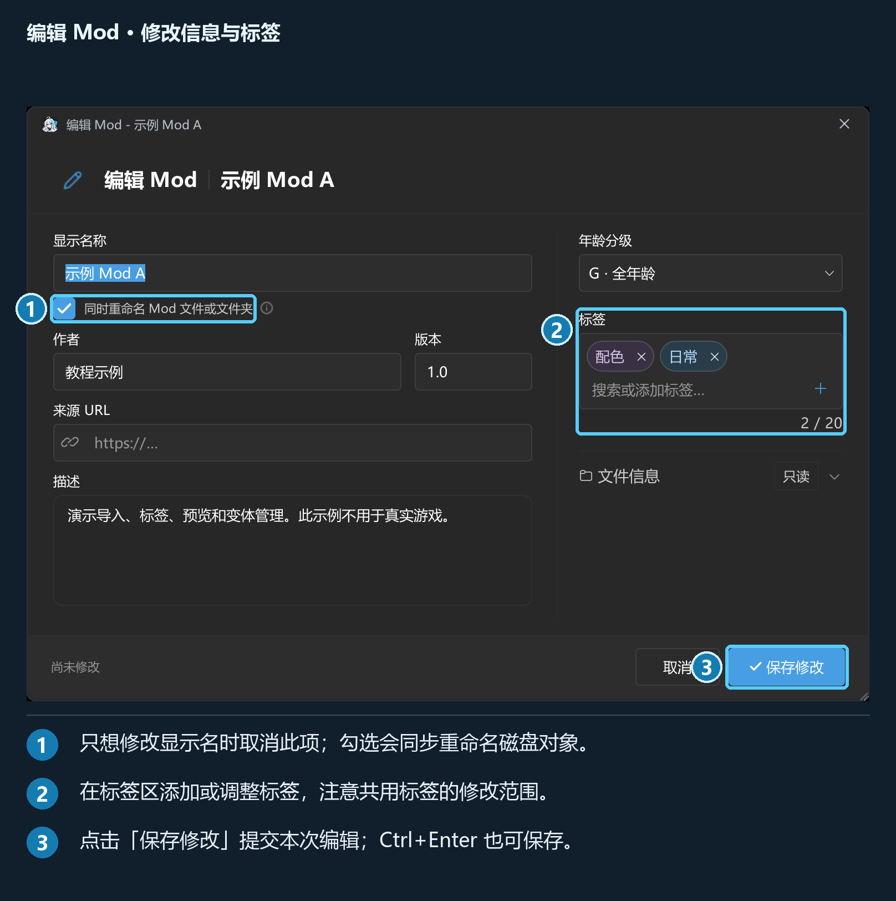

可编辑显示名称、作者、版本、来源 URL、描述、年龄分级和标签。展开「文件信息」可查看路径、SHA-1 和导入时间，并复制路径或哈希。

「同时重命名 Mod 文件或文件夹」决定是否同步调整磁盘名称。不勾选只改显示名；勾选后通过程序处理重名和关联路径，完成后检查保存结果。

**点「保存修改」才提交本次信息和标签修改。** 对话框也支持 `Ctrl+Enter` 保存；关闭有改动的窗口时可选择继续编辑或放弃修改。

标签操作分三种：

| 操作 | 影响 |
| --- | --- |
| 给当前 Mod 添加或移除标签 | 调整当前 Mod 与标签的关联 |
| 编辑共用标签名称、颜色 | 保存后，同游戏中引用该标签的 Mod 会同步显示变化 |
| 删除标签及所有引用 | 会从当前游戏的标签库及所有引用它的 Mod 中移除，确认后仍随主编辑窗口保存 |

标签可以复用、选择预置颜色或填写自定义颜色。标签气泡点击后可用于筛选；不要把删除整个共用标签当作仅移除当前 Mod 的一个标签。

### 3.9 搜索、标签筛选与排序

搜索框可以查名称、作者和标签。有搜索词时，会在当前分类子树中寻找匹配内容；清空后恢复当前层级浏览。

点「标签」展开当前游戏使用中的标签，支持两种组合方式：

| 模式 | 示例：同时选「配色」「日常」 |
| --- | --- |
| 「满足全部」 | 只显示同时具有两个标签的 Mod |
| 「满足任一」 | 具有任意一个标签即可匹配 |

所选条件会显示为气泡；可单独取消，或点「清除」仅清空标签。类别/角色类型筛选下，标签筛选暂不可用；切回全部类型或 Mod 后可继续使用。

搜索文字、类型、分级与标签可同时影响结果。零结果时先检查条件，而不是立即重建索引。

排序支持名称、导入时间、作者、年龄分级、启用状态等维度；中文名称按拼音排序。

NSFW 下拉控制本地 X 级预览图的正常显示、隐藏或模糊，不会自动删除或禁用 Mod。本地总览与画廊使用同一显示偏好，在线页面有自己的 NSFW 策略。

### 3.10 预览图的添加与移除

可拖入图片、点击「添加预览图」，或在支持的预览位置粘贴剪贴板图片。Mod 支持多张图，类别和游戏封面为单图。

多图时用箭头翻页；切换显示图会影响卡片预览。图片查看器支持放大、缩小和拖动浏览，具体按键以窗口提示为准。

- **移除预览 / 移除全部预览**：取消预览用途，只清理程序生成的预览缓存；Mod 压缩包、本体资源和手动补充的原图均保留。导入窗口中的移除也不会从导入后的 Mod 中剔除图片资源。

调整后以已保存的预览列表为准，F5 刷新、重启和完成导入不会自动补图。只有成功「重建索引」才恢复自动识别；取消或失败的重建保留原选择。旧 Mod 无需手动迁移。

手动添加的 Mod 预览通常复制到容器的 `.d3dxmeta/previews/`；包内预览可在缓存中提取。备份 Mod 时保留完整容器，不只保留缓存图片。

### 3.11 移动与批量选择

| 操作 | 默认方式 |
| --- | --- |
| 加选 / 减选 | `Ctrl` + 单击 |
| 范围选择 | `Shift` + 单击 |
| 全选当前列表 | `Ctrl+A` |
| 剪切选中项 | `Ctrl+X` |
| 移到目标类别 | 进入目标类别后 `Ctrl+V` |
| 取消剪切 | `Esc` |
| 删除 | `Delete` 或右键菜单 |
| 导出 | `Ctrl+Shift+E` 或右键「导出」 |

剪切后用橙色标记提示待移动项。粘贴到原来的层级不产生移动，不能把父类别粘进自身子树。编辑窗口没有用来移动归属的类别字段，换分类请使用上述移动操作。

### 3.12 删除与回收站

> [](../images/plusa/04-生气鼓脸.webp) **普拉莎提醒：** 确认删除范围后再继续。禁用只撤回部署，删除会移除库内文件；Mod 的回收站选项不覆盖删除类别或游戏。

禁用只撤回游戏使用的副本，Mod 仍在库中。删除则会处理源容器以及关联部署数据。

「设置 → 常规 → Mod 管理 → 删除方式」支持「放入回收站（可恢复）」和「直接删除（不可恢复）」，默认是直接删除。该选项用于单独或批量删除 Mod；**删除类别和删除游戏不按此选项回收**。

删除类别会涉及其子类别及 Mod。多选时确认框会汇总范围；批量任务可能再询问已启用的 Mod 是否保留。

如果系统回收站不支持当前位置或路径，会再次询问是否改为永久删除。拒绝后按界面结果保留未完成项，不要假定已经进入回收站。

删除遇到文件占用或磁盘离线时可能保留清理记录并重试。解除占用、接回磁盘后查看结果；取消批量任务只会停止后续处理，不能恢复已永久删除的文件。

### 3.13 导出与分享

选中 Mod 或类别后右键「导出」，选择目标目录。导出类别会包含其子树内的 Mod；多选可批量导出。

在「设置 → 导入与导出 → 导出」决定：

- 打包为 ZIP、7z、RAR 或文件夹。
- 是否强制转换为选定格式；关闭时归档可能沿用原格式。
- 是否保留角色分类目录结构。
- 是否附带元数据与预览图。
- 同时处理的导出任务数量。

要分享命名变体、标签和补充预览，开启「附带元数据与预览图」。命名变体会随支持的元数据导出流程携带；整套游戏组合预设不等于单 Mod 的导出文件。

导出窗口提供进度和暂停、继续、终止操作。完成后检查成功、失败和源缺失统计，再打开输出目录确认文件。

### 3.14 画廊

> [](../images/plusa/08-星星眼.webp) **普拉莎提醒：** 想按封面挑选 Mod 时就来画廊。单击定位详情，双击切换启用状态，操作前留意当前游戏。

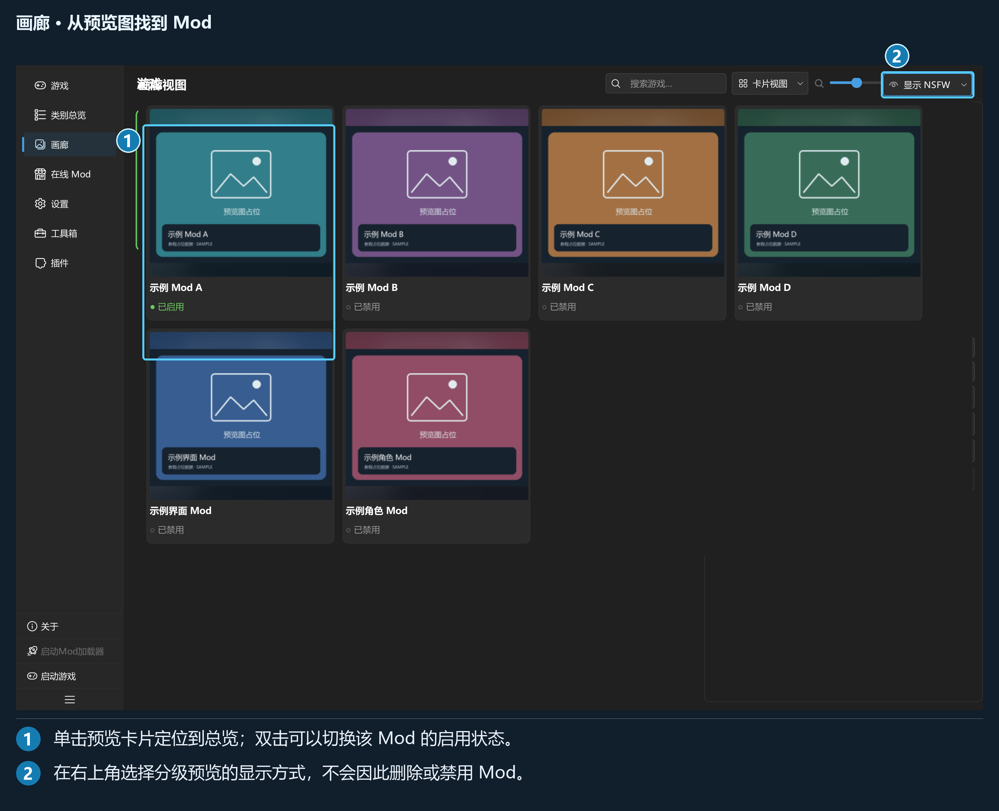

画廊以预览图展示当前游戏的 Mod。单击可以定位到总览中的对应 Mod，双击可切换启用状态；规则与总览一致。

需要分类、标签、排序、编辑或批量操作时回到「类别总览」。没有预览图时使用占位，不影响 Mod 本体能否启用。

---

## 第 4 章 · 预设、部署、按键与变体

> [](../images/plusa/06-坏笑.webp) **普拉莎提醒：** 组合预设记住整套 Mod 搭配，命名变体记住单个 Mod 的外观配置。分清两者，就能少做重复设置。

### 4.1 先分清三种“保存方案”


| 名称 | 保存什么 | 入口 |
| --- | --- | --- |
| 组合预设 | 当前游戏的一组 Mod 选择，以及各 Mod 使用的命名变体引用 | 总览工具栏的「预设」 |
| 单 Mod 变体 | 一个 Mod 内可保存的外观数值配置，例如配色或配件选项 | Mod 详情的「变体」标签页 |
| 分类预设 | 分类树、名称、节点类型和可选目录图片，不含 Mod 本体 | 工具箱的分类预设入口 |

先建立分类、导入 Mod，再把常用搭配保存到组合预设。若同一个 Mod 有多种内部造型，额外保存命名变体供组合引用。

### 4.2 Mod 容器与稳定身份

库内每个 Mod 使用一个完整的容器目录：

```text
<数据根目录>/data/Sample Game/mods/外观/示例 Mod A/
├── .d3dxmod
├── 示例 Mod A.zip
└── .d3dxmeta/
    ├── info.json
    ├── previews/
    ├── ini_overrides/
    └── variants/
        └── <变体标识>.json
```

| 内容 | 用途 |
| --- | --- |
| `.d3dxmod` | 记录稳定的 `mod_id`、本体位置及内容校验信息 |
| ZIP / 7z / RAR 本体 | 原始资源归档 |
| `info.json` | 名称、作者、标签、分级、来源等元数据 |
| `previews/` | 手动补充的预览图 |
| `ini_overrides/` | 可编辑的 INI 覆盖内容 |
| `variants/` | 已保存的独立命名变体 |

**Mod 身份由稳定的 `mod_id` 标识，内容哈希用于校验。** 两个名字相同的目录不能因此认定为同一个 Mod，外部改动也不会仅凭文件名得到信任。

备份或搬走一个 Mod 时复制整个容器。只拿走本体压缩包会遗漏旁置的元数据、改键和命名变体。

请优先在程序内重命名、移动和导出。手动移动完整容器后可刷新并核对分类；不应删除标记、伪造身份或只替换压缩包来“修复”校验失败。

### 4.3 库内格式与导入规则

库内常驻本体为 ZIP、7z 或 RAR。导入文件夹时会压缩成「Mod 导入格式」指定的格式。

导入已有归档时：

| 「强制统一为导入格式」 | 处理 |
| --- | --- |
| 关闭 | 保留外来归档的原格式，减少重复压缩 |
| 开启 | 不同格式会解压后重新打包成指定格式 |

ZIP、7z、RAR 的读取支持随程序提供。**创建 RAR 需要 WinRAR 的压缩工具**；未安装时相关输出选项不可用。导入一个现成的 RAR 与“把资源保存成新的 RAR”是不同操作。

部署始终使用解压后的副本。进度不连续变化不一定是停滞，压缩格式、文件数量和磁盘性能都会影响处理阶段。

### 4.4 启用、停放与禁用

启用会先检查源容器、元数据、部署位置及正在执行的操作，再准备资源、应用有效 INI 和配置，完成后发布到部署目录。

临时准备目录可能以 `DISABLED_` 开头并带 `.partial`。完成前不会把它当成正常启用副本交给加载器。失败、取消或程序意外退出后，恢复流程可能还需要继续处理这些目录。

禁用时会先采集必要的运行配置和同步 INI，再移除游戏正在使用的副本：

- 仍被其他组合预设引用的部署可停放为 `DISABLED_...`，供下次快速恢复。
- 没有保留需要的副本可被清理。
- 库内的源容器继续保留。

3DMigoto 通常通过 `exclude_recursive = DISABLED*` 排除停放目录。若自行修改过加载器配置，确认仍会排除这些目录。

不要在资源管理器中给停放副本改名前缀来启用它。使用程序的启用或应用预设操作，让实际文件与记录一致。

### 4.5 部署目录与外部变化

「Mod 文件夹」必须与加载器读取路径一致。它与「3DMigoto」路径分别配置；未设置时不能实际部署 Mod。

程序会监控受管源文件和部署目录变化。部署目录被外部移动、源容器被改动、磁盘离线或身份标记冲突时，先处理界面报告，再恢复操作。

更改部署位置请使用游戏页的迁移流程。遇到“文件已变化”“无法确认归属”或未完成恢复，不要删除数据库、事务记录或标记来强行继续；它们可能保存着撤回与恢复所需的信息。

### 4.6 创建与使用组合预设

点总览工具栏中的当前预设名称，打开组合列表：

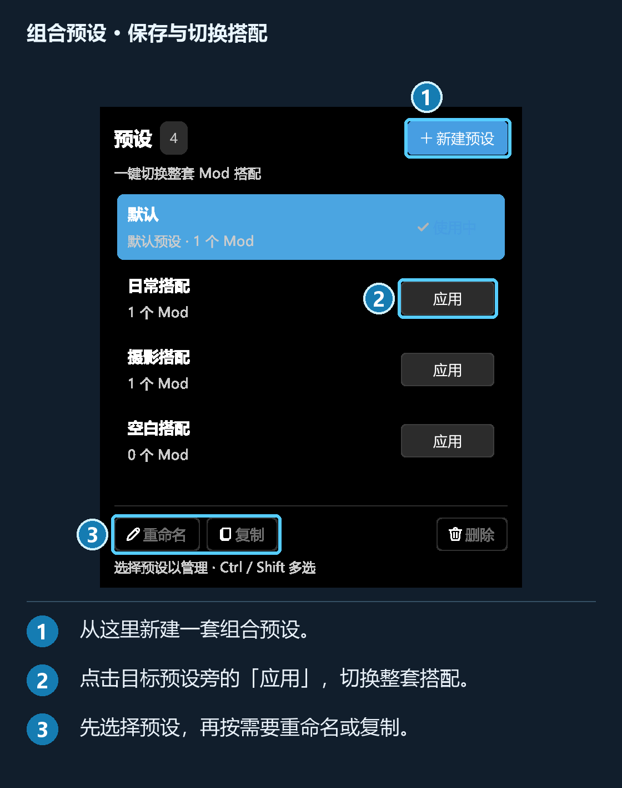

*单击选择管理对象，右侧「应用」才会切换搭配；正在使用的项目会有状态标记。*

| 操作 | 用法 |
| --- | --- |
| 新建 | 点「新建预设」，创建空组合，再命名 |
| 应用 | 点目标行「应用」，等待部署完成 |
| 重命名 | 选择后点「重命名」，或双击名称 |
| 复制 | 选择后点「复制」，或使用默认 `Ctrl+C`、`Ctrl+V` |
| 多选 | `Ctrl` 加选、`Shift` 连选，也可在列表内全选 |
| 删除 | 选择后点「删除」，确认处理范围 |

每个游戏有自己的默认预设，默认预设保留，不能删除。删除当前使用的用户预设时，会先处理切换到默认预设，再完成删除；按弹窗及任务结果确认。

**新建的是空组合。** 想保留已有搭配并稍作修改，应复制现有组合后再应用。应用空组合意味着不再启用其他组合中的 Mod。

当前组合会随启停 Mod 更新选择。单个 Mod 保存或切换命名变体时，当前组合也会记录所选变体引用。

### 4.7 切换组合如何处理文件

切换以两套组合的差异为依据：

| 差异 | 处理方式 |
| --- | --- |
| 目标不再使用的 Mod | 停放或清理其部署 |
| 目标需要且已有可用停放副本 | 校验后恢复 |
| 目标需要但尚无可用副本 | 解压并首次部署 |
| 两套组合都使用的 Mod | 保留可复用部署，并按目标需要处理配置 |
| 同一 Mod 引用不同变体 | 应用目标变体配置，仍可能发生 INI 和用户配置写入 |

因此，共有 Mod 并不意味着“一定零文件操作”，还要看变体、覆盖内容和部署是否仍有效。

切换时显示进度和取消入口，并限制会冲突的启停、删除、切换游戏等操作。取消或失败会尝试回退已执行步骤；未完成的回退会保留记录供恢复。等待任务收尾后再继续修改资源。

### 4.8 编辑 Mod 的游戏内按键

选中 Mod，打开详情栏「按键」标签页：

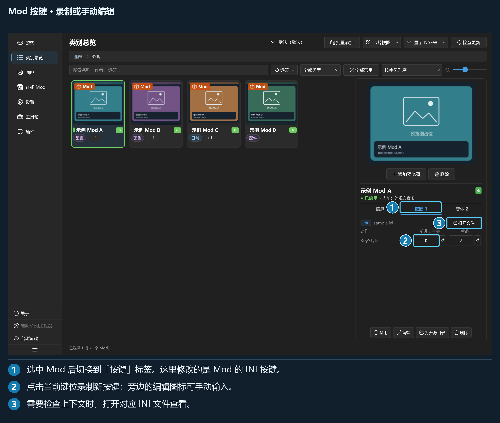

按键按 INI 文件分组显示，有些绑定同时提供前进键和后退键。名称来自 Mod 自身的小节定义。

有两种编辑方式：

- 点按键框，按要使用的键或 Ctrl / Alt / Shift 组合；`Esc` 取消录制。
- 点手动输入入口，按提示填写 3DMigoto 按键 token。特殊键或手柄 token 以加载器支持情况为准。

**改键会直接保存，不需要再找总保存按钮。** 修改写入容器的 INI 覆盖层；已启用的 Mod 会同步到部署副本。游戏运行中按加载器要求重载后生效。

支持打开源 INI 时会显示相应入口。文件被外部修改后若保存遭拒，重新选中 Mod，核对最新内容再改。

此处修改的是游戏内 Mod 的按键。「设置 → 快捷键」修改的是管理器的操作键，两者分开保存。

### 4.9 保存一个 Mod 的外观变体

变体用于记录 Mod 作者声明的可持久化数值选项，例如配色、附件开关等，不会凭空给没有这些变量的 Mod 增加造型。

基本流程：

1. 启用目标 Mod，在游戏中切到想要的外观。
2. 执行加载器保存配置的操作；常见 3DMigoto 在 F10 重载或正常退出游戏时写入 `d3dx_user.ini`。
3. 回管理器，选中 Mod，进入「变体」。
4. 点「保存当前状态为新变体」，填写名称，确认「保存并使用」。
5. 新方案出现在列表，当前组合引用该方案。

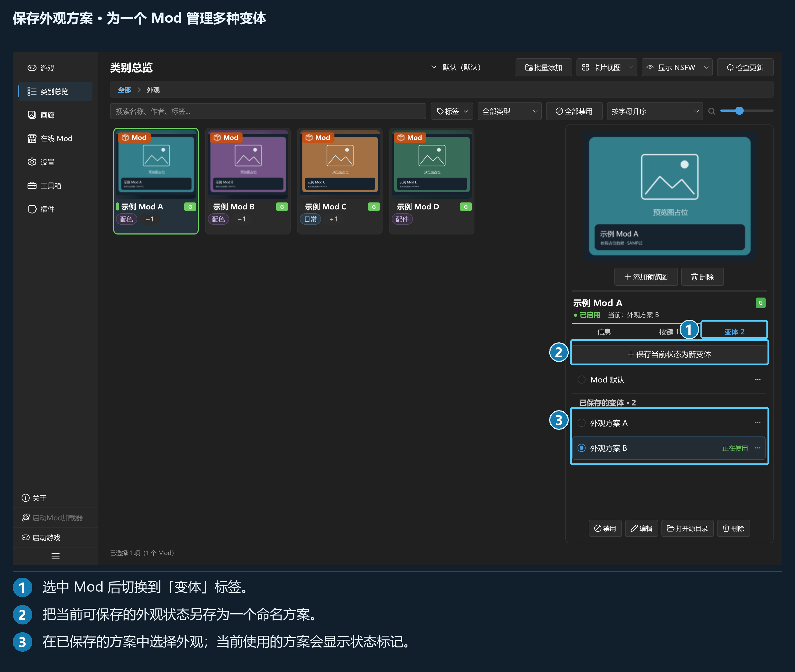

*「Mod 默认」和命名方案分别列出。已启用时标识「正在使用」，未启用时标识「下次使用」。*

名称在同一个 Mod 内不能重复，最多 40 个字符。保存需要 Mod 处于启用状态并且能够读取有效配置。

如果提示配置不完整，可回游戏保存后重新读取；只有确认需要时才选择「使用默认值补齐并保存」。这会把未读到的部分按默认值补齐，未必与游戏当前画面完全相同。

“暂无可保存的变体”通常表示没有发现可保存的外观变量，这个 Mod 仍可正常启用和禁用。

### 4.10 切换、更新、复制和删除变体

| 操作 | 结果 |
| --- | --- |
| 点击「Mod 默认」 | 使用 Mod 默认配置 |
| 点击命名方案 | 已启用时应用该方案；未启用时设置为下次使用 |
| 保存当前状态为新变体 | 新建独立方案，当前组合改为使用它 |
| 更新已有变体 | 将读到的当前状态写入该方案；引用它的其他组合下次应用时使用新内容 |
| 重命名 | 保留变体身份与引用，仅改显示名 |
| 创建副本 | 生成可独立调整的新变体 |
| 删除 | 所有组合中对该变体的引用改为 Mod 默认；当前正在使用时也恢复默认 |

管理操作位于方案行的更多菜单。更新共享方案前会列出引用它的组合；如果只想改变其中一套搭配，应先创建副本。

**游戏内临时调整不会自动覆盖已命名方案。** 出现“有尚未保存的外观调整”时，按需保存新方案或更新原方案。

多个组合可以引用同一个命名变体。复制组合保留这些引用，不会为每个组合自动复制一套变体文件；需要独立配置时，另外复制变体。

恢复变体后，游戏若正在运行，仍需执行加载器重载。软件保存成功表示配置已写入，不代表正在运行的游戏已经刷新画面。

### 4.11 变体能否带给别人

命名方案保存在 Mod 容器的 `.d3dxmeta/variants/`。分享时优先使用「导出」，并打开「附带元数据与预览图」；也可完整备份容器。

导入时会检查变体格式和变量能否对应到 Mod。内容不匹配、重复身份、损坏文件等情况可能被拒绝，不能把任意其他 Mod 的变体 JSON 直接套过来。

游戏私有的工作状态记录与已命名变体用途不同。整机备份时保留 `config/`、`data/` 及外部资源；分享单个 Mod 时使用导出包即可。

---

## 第 5 章 · 在线 Mod 与更新

### 5.1 连接 GameBanana


激活游戏后进入「在线 Mod」。程序使用游戏配置中的英文名称匹配 GameBanana，匹配结果按游戏保存。英文名称改变后会重新匹配。

出现「GameBanana 未收录此游戏」时，先到游戏页核对英文名称，也可使用页面提供的网站搜索入口。网络失败与未收录是不同原因：前者先检查连接，后者核对游戏名称和站点收录情况。

代理分两步配置：

1. 「设置 → 常规 → 网络代理」打开总开关，选择系统代理或填写手动地址、端口。
2. 「设置 → 在线 Mod → 在线 Mod 代理」打开「启用代理」。

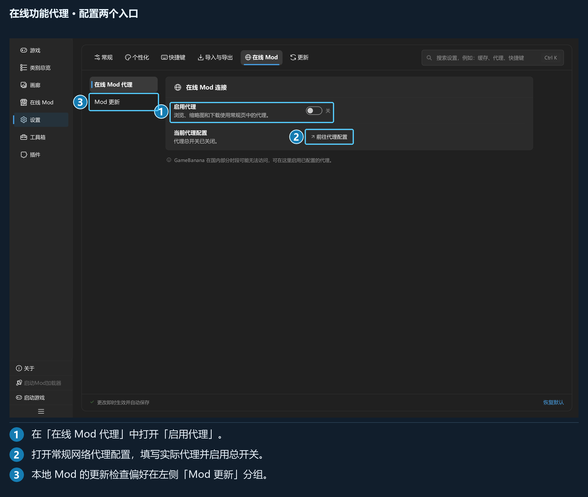

*在线浏览、图片、下载和 Mod 更新共用在线 Mod 的代理策略。*

本地分类、导入和部署无需连接 GameBanana。

### 5.2 浏览、搜索与详情

在线页可按分类浏览、搜索 Mod、改变排序并刷新列表。排序包括默认、最新、最近更新、最多喜欢、下载最多、浏览最多。

分类下拉列表中的筛选框支持中文等输入法，同时匹配分类原名和当前语言映射后的名称。分类加载完成后会沿用等待期间输入的筛选词；重新打开下拉列表时可重新筛选。

类别下拉列表首项为「全部」，选择后直接查看当前大类，不必逐个进入子分类。「Mod」层级的「全部」显示当前游戏下的全部 Mod。

Mod 卡片预览图右下角显示日期，不附加文字或图标；优先使用最新更新时间，没有更新记录时使用发布日期。日期按本机时区显示为 `YYYY-MM-DD`，悬停可查看时分。卡片高度和左下角的安装标记不变。

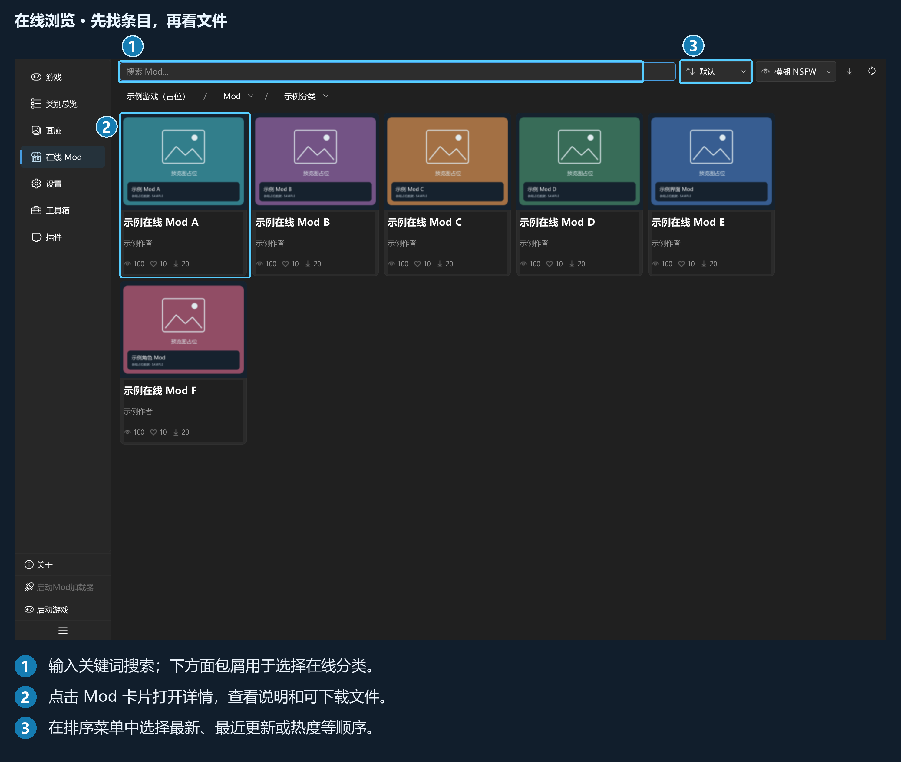

*名称、封面、作者和统计均为教程占位数据，展示真实界面的浏览入口。*

「隐藏 NSFW」「模糊 NSFW」「显示 NSFW」控制在线内容预览，默认模糊。它与本地 X 级 Mod 的显示偏好分别保存。

点卡片进入详情，可查看图片、「概览」「描述」「更新」，以及「可下载文件」。多文件条目往往对应不同版本、可选内容或附件，应阅读作者说明后选择。

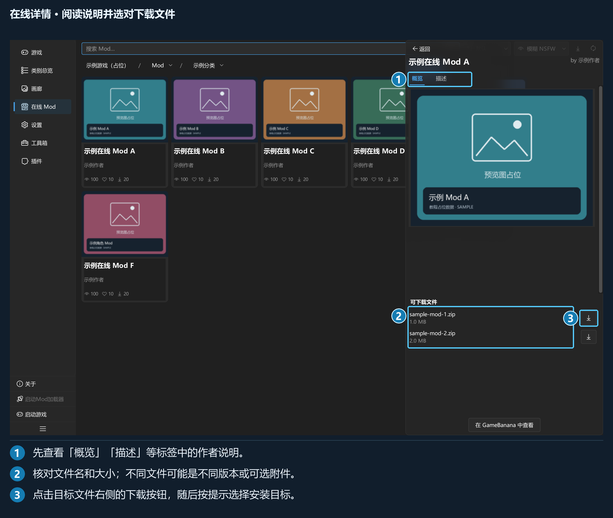

*此处文件名与大小也是占位示例。实际使用时逐个阅读文件说明。*

页面中的作者描述和下载文件来自外部站点；本教程统一用占位数据说明入口，实际条目以站点内容为准。

### 5.3 下载与安装目标

在详情中选择一个可下载文件，点「下载」。下载完成后程序会准备导入目标类别。

能唯一匹配分类时可继续安装；匹配不明确时显示「选择安装目标」：

- 在分类树中选择已有类别，可搜索分类名称。
- 核对目标游戏和类别，避免安装到其他游戏。
- 如界面提供“把站点分类记为英文名”的选项，可按需保存，方便下次匹配。
- 目标目录已有英文名时，按覆盖确认提示处理。

在线安装仍会经过归档、元数据和目标路径检查。下载完成不一定已经入库，应等安装结果出现。

下载期间切换到另一个游戏时，任务仍属于原来的游戏；完成后可能等待切回该游戏再安装。不要因为当前页面看不到新 Mod，就直接在另一游戏中重复导入。

### 5.4 下载管理

> [](../images/plusa/07-困倦.webp) **普拉莎提醒：** 大文件需要一些时间。先在下载管理中看状态、速度和错误原因，需要中断时使用对应的暂停或取消入口。

在线页的下载管理入口可查看排队、下载、暂停、完成或失败任务，以及进度、速度和大小。

| 控件或菜单 | 用途 |
| --- | --- |
| 暂停 / 继续 | 控制可暂停的下载 |
| 取消 | 停止当前任务 |
| 重试 | 重试失败的下载 |
| 打开（进入 Mod 类别） | 定位已安装 Mod |
| 在文件资源管理器中显示 | 定位保留的下载文件 |
| 从列表中删除 | 移除记录 |
| 删除（含本地文件） | 同时处理该下载的本地文件，按确认提示操作 |
| 清除已完成 / 全部清除 | 批量处理下载列表，执行前核对提示范围 |

下载源包在 `<数据根目录>/data/downloads/`，不属于可丢弃的图片缓存。

「设置 → 常规 → 下载数据」中的「安装后自动删除安装包」默认开启。**只有成功入库后才清理对应源安装包**；关闭后可保留用于离线留档。

「清理已安装」用于清理已确认入库的源包，尚未安装的下载保留。删除源安装包不会因此删除库内已导入的 Mod，但也不能用它替代完整备份。

### 5.5 检查已安装 Mod 的更新

在「类别总览」点「检查更新」，打开 Mod 更新窗口。检查依赖保存的 GameBanana 来源信息：从在线页安装的 Mod 会保存相应记录，其他本地包未必具备。

更新窗口区分检测进度和更新列表。可搜索 Mod 名称，查看本地与新版本信息、更新说明、文件日期及预计下载量。

检查失败或只完成部分项目时，界面会提示未完成检查；不能把这类结果理解为“所有 Mod 都已是最新版”。网络恢复后使用「重新检查」。

自动策略在「设置 → 在线 Mod → Mod 更新」：

| 设置 | 默认与作用 |
| --- | --- |
| 自动检查 Mod 更新 | 开启 |
| 启动时检查 | 开启，带检查节流 |
| 定时检查频率 | 默认关闭，也可选每 6 小时、每 12 小时、每天 |
| 通知方式 | 默认仅角标，也可加状态栏提示 |
| 检查并发 | 默认自动推荐，可调整更新流程的并发配置 |

手动检查和自动检查的触发时机不同，日常以更新窗口显示的最新检测结果为准。

### 5.6 更新一个或多个 Mod

单项点「更新」，批量可点「全部更新」。若条目提供多个文件，会先出现「选择更新文件」，需要为每个相关 Mod 明确选择一个文件，再开始更新。

任务可能依次显示准备、下载、校验、解压、安装等阶段。完成后以「已更新」或结果汇总为准。

| 操作 | 行为 |
| --- | --- |
| 单项暂停 / 继续 | 控制该任务当前允许暂停的阶段 |
| 全部暂停 / 全部继续 / 全部终止 | 作用于当前游戏所有未结束更新，包括被搜索条件隐藏的任务 |
| 关闭更新窗口 | 有任务时可返回、终止未完成更新，或转到后台继续 |
| 终止 | 未完成项保留旧版，已完成更新不撤销；安装提交或收尾阶段可能需要先等待 |

新内容准备失败时，应查看具体文件或校验原因。程序会保留必要的恢复材料；不要在更新过程中手动删源容器、工作目录或事务记录。

对重要的自定义改动，可先导出或备份。Mod 本体更新与“程序更新前备份旧版本”不是同一个开关，不能用后者代替 Mod 备份。

### 5.7 忽略更新与恢复提醒

条目的更多菜单提供：

- 「在 GameBanana 查看」：用浏览器查看来源。
- 「忽略此版本」：跳过这一版本的提醒。
- 「忽略此 Mod」：后续也不再提示该 Mod 的更新。

执行忽略后可在窗口当前提示中使用「撤销」。撤销依赖对象和游戏仍有效；关闭窗口后，不应假定这条临时撤销入口仍存在。

### 5.8 程序自身的更新

程序版本更新位于「设置 → 更新 → 程序更新」，按钮为「检查程序更新」。

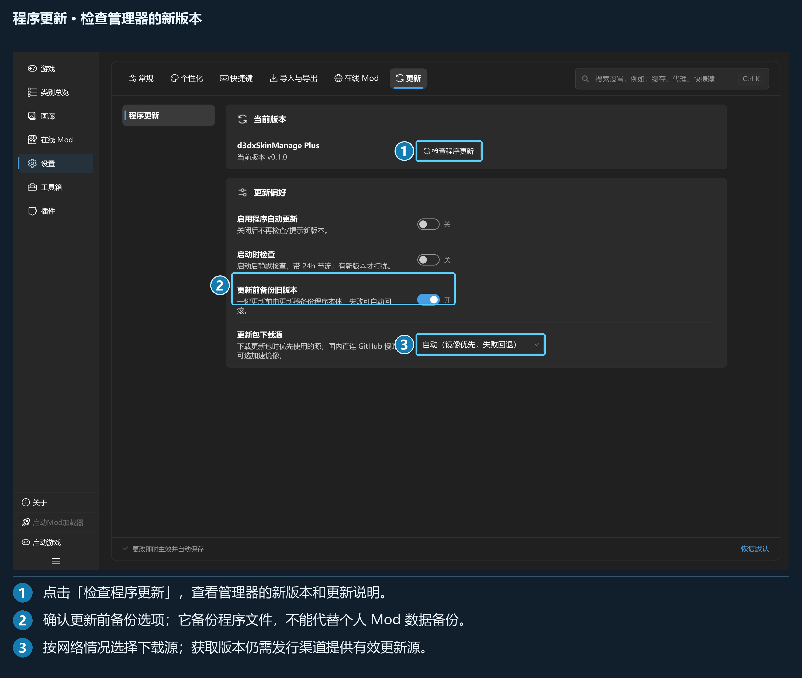

能否获取更新，取决于发行渠道是否提供了有效更新源和匹配的更新包。出现「未配置更新源」时，请从软件发布者提供的下载渠道获取版本。

检查到新版本后，可查看更新说明、版本记录，并选择更新、稍后提醒或跳过此版本。

一键更新的流程为下载、检查与解压、按设置备份，再由独立更新器替换程序并重新启动。应保留随发行包提供的 `Updater/` 目录；不需要直接双击更新器。

- 安装更新前结束正在执行的任务，并按提示关闭主程序。
- 更新会保留 Mod、设置和插件；个人数据仍建议定期备份。
- 下载源可选自动或指定来源。自动模式通过少量实际下载比较线路，持续低速或连接失败时自动切换；窗口显示当前来源及代理状态。
- 当前任务因连接中断或低速换源时可续传；新来源不支持续传时从头下载。取消、退出程序或下载最终失败会清理未完成数据，再次更新从头下载。
- 更新包必须通过完整大小和 SHA-256 校验才会安装；校验信息缺失或不一致时停止更新。
- 更新器报错时保留程序和更新器日志，检查路径与文件占用后重试。

程序更新与 GameBanana 的 Mod 更新互不替代。前者升级管理器，后者更换库中的资源。

---

## 第 6 章 · 设置详解

> [](../images/plusa/09-思考.webp) **普拉莎提醒：** 不确定选项在哪一页时，先搜索设置。快捷键和路径都以你当前保存的配置为准。

### 6.1 分区、搜索与保存

设置页顶部为「常规」「个性化」「快捷键」「导入与导出」「在线 Mod」「更新」六个分区，各分区内部还有左侧子页。

用默认 `Ctrl+K` 打开设置搜索，或在右上角输入设置名称。搜索结果可以跨分区跳转并定位控件。

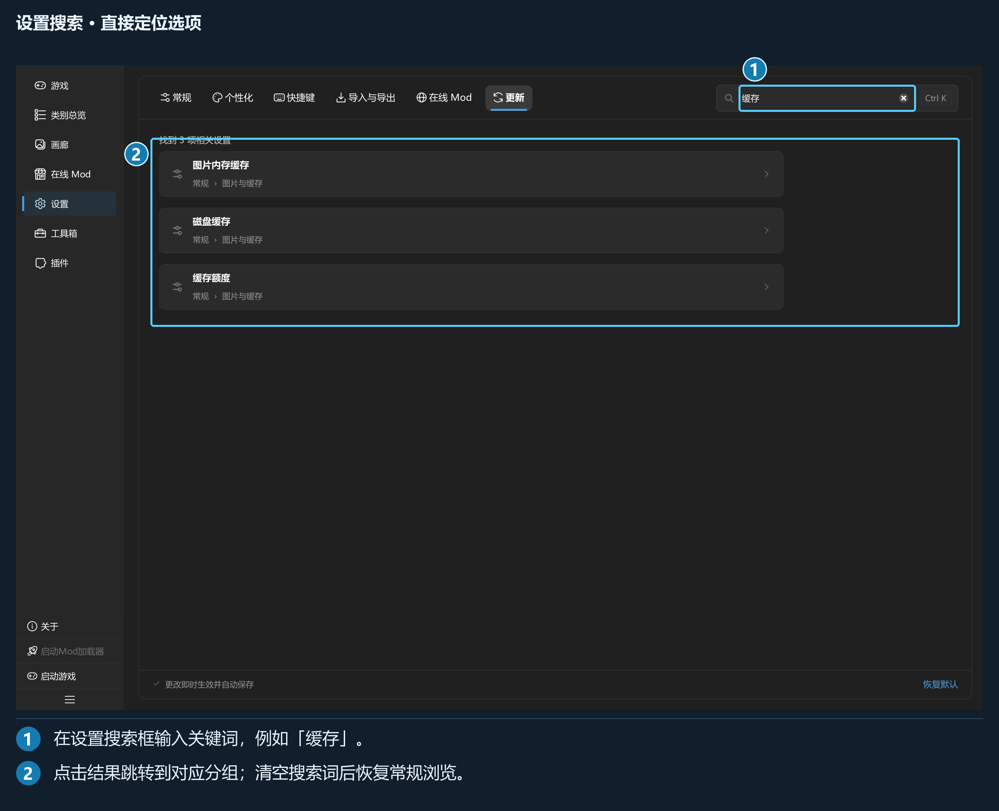

*输入「缓存」即可找到图片内存与磁盘缓存相关项。*

设置页显示「更改即时生效并自动保存」。开关和选择通常立即保存，文本框在编辑完成时提交；部分滑块先实时预览、松手后保存。

本章列出各项设置的默认值。截图使用示例设置，具体数值及开关状态请以本机显示为准。

「常规 → 窗口行为」提供关闭行为下拉框，默认为「关闭程序」。改为「隐藏到托盘」后，点击窗口关闭按钮只隐藏主窗口，后台任务继续运行；点击托盘图标或右键选择「显示主窗口」可恢复窗口。托盘菜单的「退出程序」仍会执行未保存内容和后台任务确认。系统托盘不可用时按正常关闭处理，避免窗口隐藏后无法找回。

### 6.2 常规 → Mod 管理

| 设置 | 默认 | 说明 |
| --- | --- | --- |
| 删除方式 | 直接删除（不可恢复） | 也可选放入回收站；只用于单独或批量删除 Mod |
| 并发数量 | 自动推荐 | 同时部署的任务数量，可手动设置 1–16 |

删除类别、删除游戏和清空部署目录有各自的范围确认，不会因选择 Mod 回收站模式而变为可恢复。

「自动推荐」保存的是自动模式，换设备后可重新按设备计算。手动修改数字则改用指定数量。并发越高不一定越快，机械硬盘、大型归档或内存紧张时可调低。

### 6.3 常规 → 网络代理

| 设置 | 默认 | 用法 |
| --- | --- | --- |
| 代理总开关 | 关闭 | 开启后，程序更新可使用这套代理 |
| 使用系统代理 | 开启 | 从 Windows 读取代理 |
| 协议 | HTTP | 手动模式可选 HTTP、HTTPS、SOCKS5 |
| 代理地址 / 端口 | 127.0.0.1 / 7890 | 示例默认值，须与实际代理软件一致 |
| 测试连接 | 手动操作 | 检查经代理访问外网的连通性与延迟 |

在线 Mod 还需在其分区单独打开「启用代理」。关闭总开关时，如在线 Mod 正在用代理，程序会询问是否一并停用。

使用系统代理但未检测到配置时，先检查 Windows 设置；手动模式则检查地址、端口以及代理程序是否运行。

### 6.4 常规 → 下载数据

此处显示安装包总占用、已安装及未安装部分，并提供：

| 控件 | 作用 |
| --- | --- |
| 安装后自动删除安装包 | 默认开启，成功入库后删除对应源安装包 |
| 清理已安装 | 确认后清理已入库的下载源包 |
| 打开目录 | 打开实际下载目录 |

尚未安装的下载应保留到安装或另行处理后。这里的源包与库中的受管本体分别存储，清理已安装源包可减少重复占用。

### 6.5 常规 → 图片与缓存

这里分为图片内存缓存和磁盘缓存，两者的额度与清理入口独立。

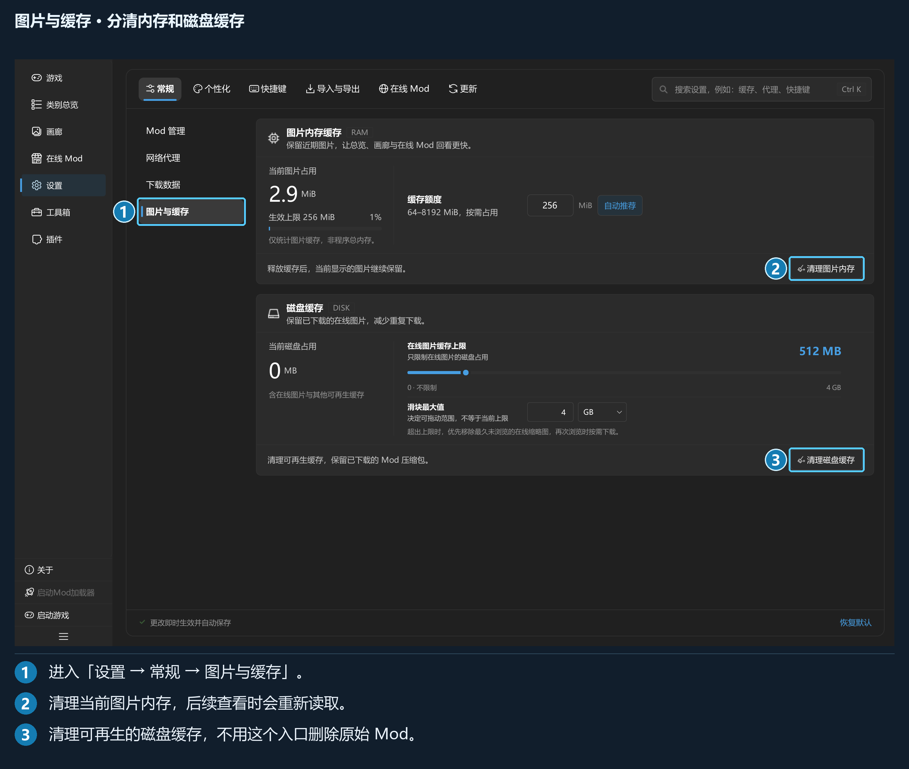

| 项目 | 默认或范围 | 说明 |
| --- | --- | --- |
| 图片内存缓存 | 自动推荐；手动 64–8192 MiB | 保留近期解码图片，改善返回浏览速度 |
| 当前图片占用 | 实时统计 | 仅统计图片缓存，不是整个程序的内存 |
| 清理图片内存 | 按钮 | 释放可释放的缓存，当前正在显示的图片继续保留 |
| 磁盘缓存上限 | 默认 512 MB；0 表示不限制 | 管理在线图片和其他可再生缓存 |
| 磁盘滑块量程 | 默认最大 4096 MB | 只决定滑块可选到多大，不等于实际生效上限 |
| 清理磁盘缓存 | 先确认 | 清理可再生缓存，保留已下载的 Mod 源包 |

自动推荐额度因设备和显示条件而异，请以本机显示为准。减少额度可能导致回看图片时重新解码，但不会删除 Mod 或其元数据。

程序新建的临时目录和预览缓存继承父目录的正常访问权限。启动流程不扫描或修复历史目录权限。

已有 Plus 用户若遇到旧预览缓存或临时目录无法访问，可在插件页安装单独分发的 **目录权限修复** ZIP 并启用，在工具箱打开同名窗口后点击 **开始修复**，不需要运行工具脚本。插件后台检查应用数据目录并显示修复数量及失败路径；不删除文件，不修改自定义访问限制，也不扫描整个磁盘或其他软件的临时目录。只有手动点击才会执行，失败项可手动重试；成功后可停用或卸载插件，后续启动和软件更新均不会自动重复修复。

磁盘缓存不是备份目录。不要手动把 `data/`、运行恢复记录或 `.d3dxmeta/` 当作缓存清空。

### 6.6 个性化 → 外观

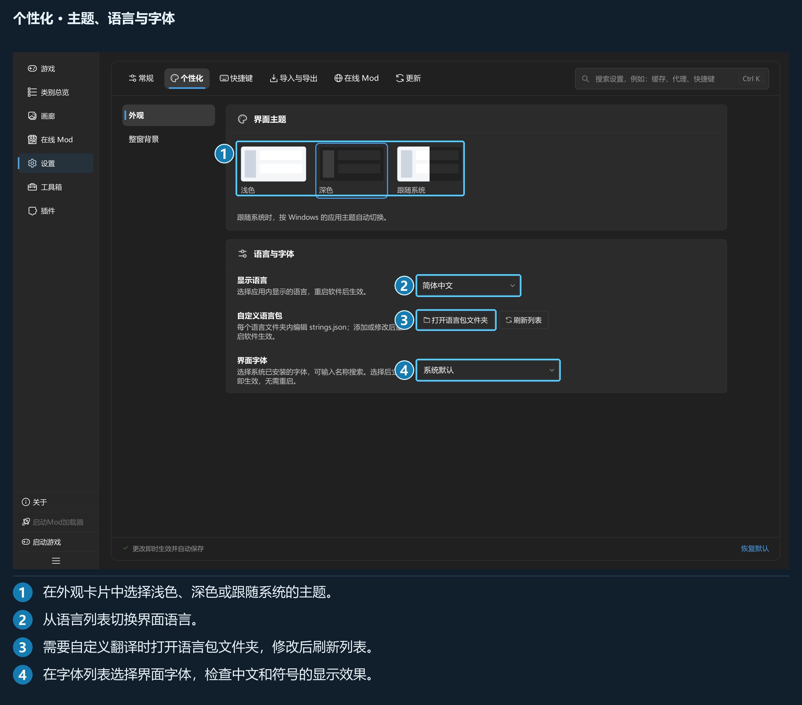

| 选项 | 默认 | 说明 |
| --- | --- | --- |
| 主题 | 深色 | 可选浅色或跟随系统；跟随系统按 Windows 应用主题切换 |
| 字体 | 系统默认 | 可选择本机可用字体并预览 |
| 语言 | 简体中文 | 根据配置目录中的语言包列出选项 |

语言切换或修改语言包后重启程序，以完整刷新界面。

制作额外语言包：

1. 点「打开语言包文件夹」。
2. 复制一种现有语言文件夹，按语言代码命名，例如 `ja-JP`。
3. 修改 UTF-8 编码的 `strings.json`，保留原文键和动态占位符。
4. 回到设置点「刷新列表」，选择语言并重启。

语言由文件夹名称识别。游戏名、Mod 名、作者描述和自定义标签属于用户内容，不会随界面语言自动改写。

完整文件格式、占位符、后备语言和开发者工具见[语言包指南](语言包指南.md)。

### 6.7 个性化 → 整窗背景

背景支持关闭、图片、视频和 WE 场景四种来源。

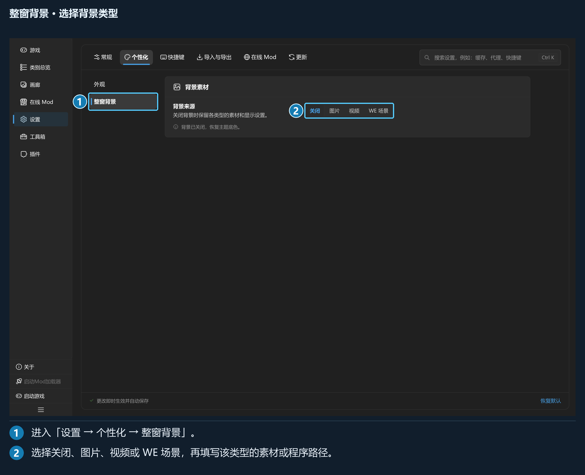

| 来源 | 需要选择的内容 |
| --- | --- |
| 关闭 | 使用主题底色 |
| 图片 | 本地 PNG、JPG、JPEG、BMP、WebP 等受支持图片 |
| 视频 | 受支持的本地视频，如 MP4、WebM、MKV、AVI、MOV |
| WE 场景 | Wallpaper Engine 场景项目的 `project.json`，并配置本机 Wallpaper Engine 程序 |

WE 场景可「自动查找」或手动指定 `wallpaper64.exe` 等程序路径。选择场景时保留完整项目及其资源文件，只复制一个 JSON 不足以播放。

显示效果：

| 设置 | 默认 | 作用 |
| --- | --- | --- |
| 填充方式 | 填充（裁剪铺满） | 可改为适应；图片还支持平铺 |
| 背景遮罩 | 深色 45、浅色 30 | 两种主题分别记忆；深色压暗，浅色柔化提亮 |
| 背景模糊 | 60 | 范围 0–100，0 为关闭 |
| 背景帧率 | 30 FPS | 动态背景使用，可按界面选项调整 |
| 场景质量 | 2 倍 | WE 场景可降低为 1 倍以减少开销 |
| 背景音量 | 静音 | 按需调整受支持动态背景的声音 |

动态背景提供暂停、继续和重试。最小化时自动暂停，恢复窗口后继续；手动暂停不会被恢复窗口覆盖。

播放失败时检查文件是否仍在、编码是否支持、WE 路径与项目是否完整。图片背景不需要 Wallpaper Engine，普通本地视频也不需要它。

### 6.8 快捷键 → 按键绑定

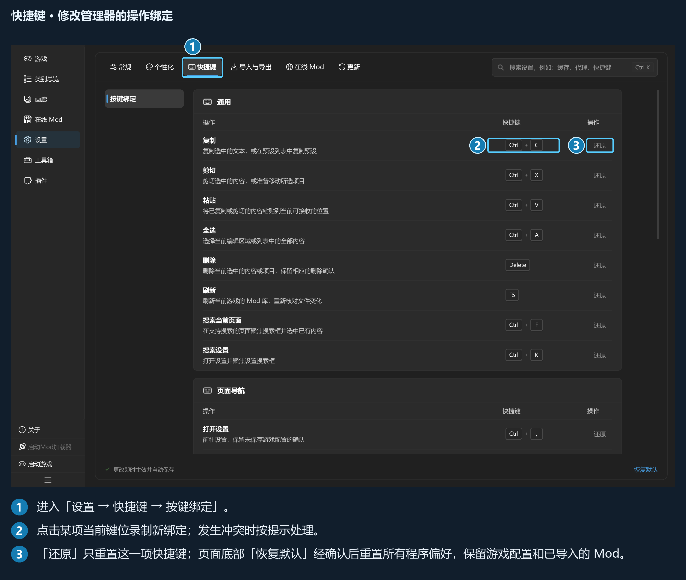

按使用场景分组显示命令。点击对应按键进行录制，然后保存；支持 Ctrl / Alt / Shift 与单个主键组合。

鼠标侧键 1（BackButton / XButton1）和侧键 2（ForwardButton / XButton2）也可以录入，既可单独使用，也可配合 Ctrl / Alt / Shift。冲突校验与普通快捷键一致，只在管理器内、符合当前焦点的场景中执行。

发现冲突时，程序会说明冲突命令。确认替换后，被占用的旧命令可能变为未绑定；取消则保留原绑定。系统保留组合不能用于普通命令。

快捷键按焦点处理：输入框中的编辑操作、总览列表中的项目操作，以及组合列表中的复制操作各有上下文。管理器没有在其他应用中生效的全局热键。

插件注册的命令也可出现在相应分组。完整默认键表见附录 A。

### 6.9 导入与导出

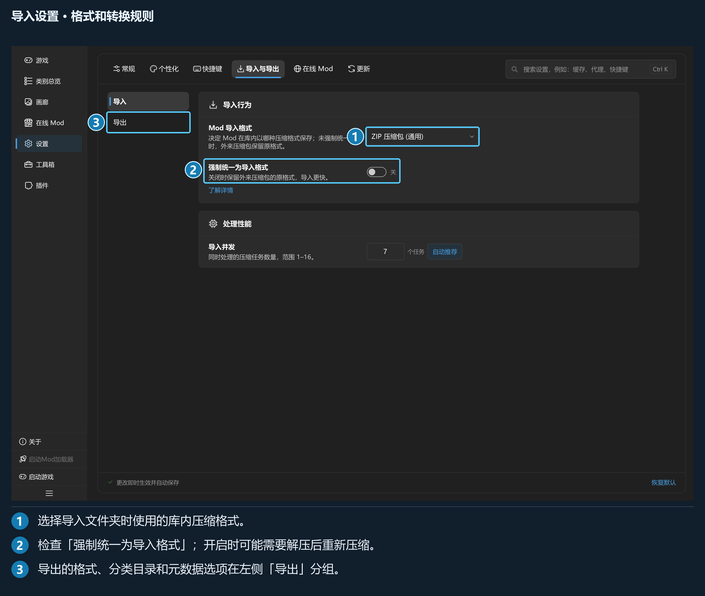

「导入」子页：

| 选项 | 默认 | 说明 |
| --- | --- | --- |
| Mod 导入格式 | 7z | 文件夹输入按此压缩；非强制模式下归档保持原格式 |
| 强制统一为导入格式 | 关闭 | 开启后按需要解压并重新压缩 |
| 导入并发 | 自动推荐 | 可手动设 1–16 个任务 |

「导出」子页：

| 选项 | 默认 | 说明 |
| --- | --- | --- |
| Mod 导出格式 | ZIP | 也可选 7z、RAR 或文件夹 |
| 强制统一为导出格式 | 关闭 | 关闭时可保留源归档格式；导出文件夹时无需此项 |
| 保留角色分类目录结构 | 开启 | 按分类路径组织输出 |
| 附带元数据与预览图 | 关闭 | 需要分享标签、补充预览及命名变体时开启 |
| 导出并发 | 自动推荐 | 可手动设 1–16 个任务 |

创建 RAR 需要 WinRAR；读取 RAR 不需要额外安装压缩器。选择目标格式前看清不可用项的提示。

本地导入目标由当前类别确定；在线安装时，通过安装目标选择流程核对分类。

### 6.10 在线 Mod

「在线 Mod 代理」子页提供开关及「前往代理配置」。它使用常规分区已经配置的代理；总开关关闭时无法单独启用在线代理。

「Mod 更新」子页提供自动检查、启动检查、定时频率、通知方式和检查并发。默认开启自动及启动检查，关闭定时，通知仅角标；并发使用自动推荐，可手动调整到 1–16。

更新窗口的暂停、继续、后台任务和文件选择见第 5 章。

### 6.11 更新 → 程序更新

| 选项 | 默认 | 说明 |
| --- | --- | --- |
| 检查程序更新 | 手动入口 | 显示当前版本，并检查发行者配置的更新源 |
| 启动时检查 | 开启 | 后台检查，两次启动检查至少间隔 24 小时 |
| 更新前备份旧版本 | 开启 | 在更新管理器本体前备份程序文件 |
| 更新包下载源 | 自动 | 测速选源，持续低速或失败时切换；也可指定来源 |

手动「检查程序更新」不受「启动时检查」开关或 24 小时间隔限制。程序更新由随包独立更新器安装。若提示未配置更新源，请通过软件发布者提供的下载渠道获取新版本。

### 6.12 恢复默认

右下角「恢复默认」会先显示确认框，默认停在取消。确认后重置所有程序偏好，包括：

- 外观、语言、字体和背景。
- 快捷键修改。
- 导入、导出、删除、网络和更新偏好。
- 支持自动推荐的设置，恢复为按设备推荐。
- 保存在程序偏好中的界面布局等选项。

**游戏配置和已经导入的 Mod 保留。** 游戏列表、激活游戏及当前组合选择独立保存在 `config/games.json`。

恢复失败时会保留原设置并给出提示。只想改回一个选项时，可直接调整该项，无需重置全部偏好。

---

## 第 7 章 · 工具箱、插件与关于

### 7.1 工具箱

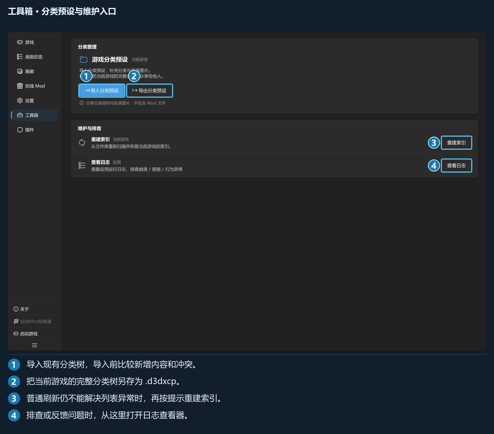

工具箱主要提供分类整理、维护与排查；只有插件显式声明的通用工具才会追加到这里。

| 入口 | 用途 |
| --- | --- |
| 导入分类预设 | 为目标游戏补充分类与目录图片 |
| 导出分类预设 | 分享当前游戏完整分类树，可附带图片 |
| 重建索引 | 从文件库重新扫描和恢复索引 |
| 查看日志 | 按启动会话查看运行记录 |
| 插件工具（按需出现） | 执行启用插件显式提供的通用工具 |

清理缓存位于「设置 → 常规 → 图片与缓存」，下载源包清理位于「常规 → 下载数据」。导出 Mod 从总览选择项目操作。
数据迁移、目录权限修复、Mod 清单导出和预设轮换等插件功能，在「插件」页选中对应插件后，从详情的「操作」区进入。

### 7.2 导入分类预设

分类预设扩展名为 **`.d3dxcp`**，包含分类结构和可选目录图片，不含 Mod 本体或整套启用组合。

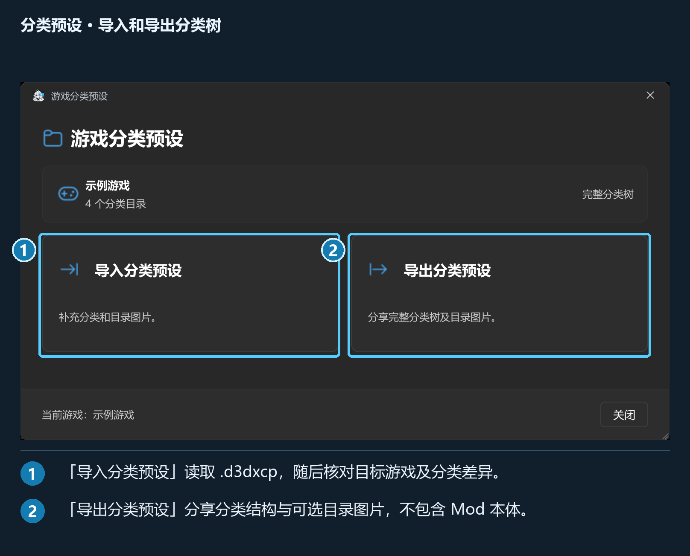

从工具箱「导入分类预设」，或总览空页面的「从分类预设开始」进入：

1. 选择一个 `.d3dxcp` 文件。
2. 核对目标游戏，查看完整分类树。
3. 查看新增目录、已存在、补充图片、路径冲突统计。
4. 有冲突时先定位并处理，再点「重新比较」。
5. 确认后「开始导入」，完成后「查看分类」。

文件建议的游戏与当前游戏不同时，界面会提醒核对目标。全部目录已经存在且没有图片需要补充时，会说明无需导入。

已有分类与目录图片会按比较结果处理，不应理解为“用预设覆盖整棵现有树”。存在路径或类型冲突时，先解决冲突再导入。

取消发生在安全边界。若显示分类已导入但清理待完成，保留恢复记录，按提示重试或在重启后等待收尾。

### 7.3 导出分类预设

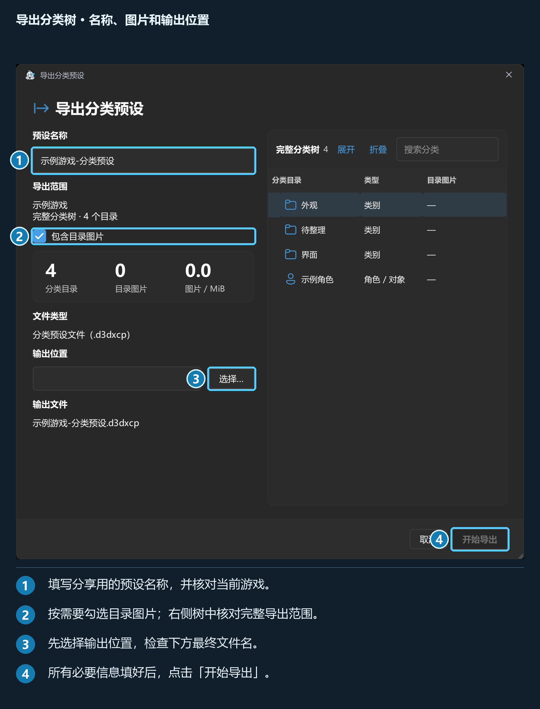

先激活游戏，再从工具箱点「导出分类预设」：

- 填写预设名称。
- 查看当前游戏的完整分类树和数量。
- 按需选择「包含目录图片」。
- 无法读取的图片可修复，或按界面选项取消该图片。
- 选择输出位置，确认输出文件，点「开始导出」。

导出范围是当前游戏的完整分类树，不是当前选中的一个 Mod。分享这份文件后，对方仍需自行导入 Mod。

### 7.4 重建索引

用于源文件仍在、但分类或 Mod 列表与磁盘不一致的情况。先使用默认 `F5` 刷新；只有需要恢复索引时再运行重建。

操作前确认资源盘可访问、游戏选择正确，并结束相关文件任务。确认后会扫描库，读取分类和 Mod 标记，恢复可识别的索引及关联。

常规重建主要处理当前游戏。**如果启动时检测到整个索引数据库损坏，恢复流程会涉及所有已配置游戏**，请将各游戏的资源盘接入后按提示处理。

完成报告会列出登记数、归类情况以及异常元数据等结果。无法读取或身份冲突的文件可能无法恢复；保留报告，处理具体对象。重建不是恢复被永久删除的压缩包，也不能替代备份。

### 7.5 日志查看器

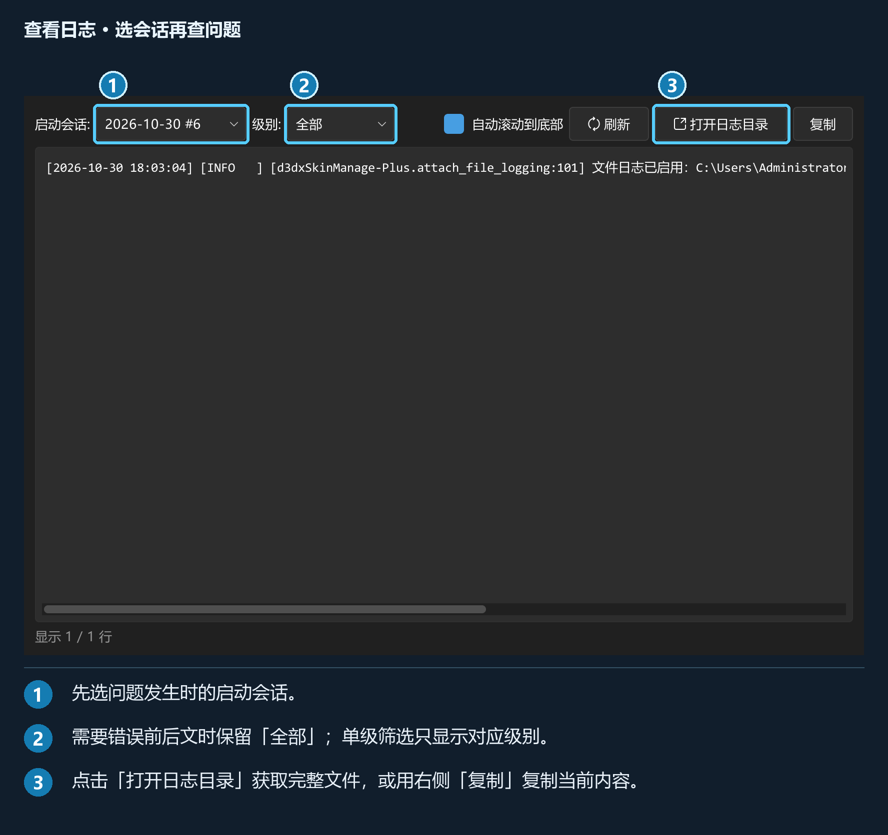

从工具箱点「查看日志」，可使用：

| 控件 | 用途 |
| --- | --- |
| 启动会话 | 选择某天某次启动，如「2026-10-30 #1」 |
| 级别 | 全部或单个 DEBUG、INFO、WARNING、ERROR、CRITICAL |
| 自动滚动到底部 | 刷新后定位到最新部分 |
| 刷新 | 重新读取所选文件 |
| 打开日志目录 | 找到实际日志文件 |
| 复制 | 复制当前显示内容 |

级别筛选为精确匹配，选择 WARNING 不会同时包含 ERROR。希望保留错误前因后果时，使用「全部」。

窗口只读取日志末尾约 1 MiB。需要更早内容时通过日志目录读取完整文件。日志按日期和启动序号保存，默认保留 14 天，反馈时及时保留对应会话。

程序更新器的日志也在日志体系中，程序更新失败时一起保留；反馈前去除无关的个人路径或敏感信息。

### 7.6 安装与管理插件

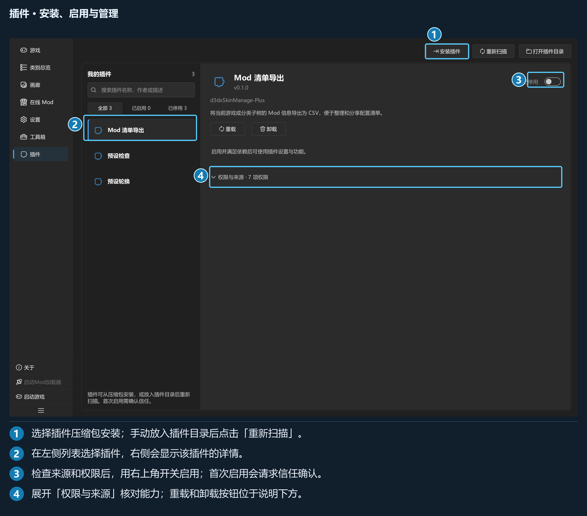

插件页左侧列出插件，右侧显示所选插件详情。可搜索名称、作者或描述，也可按全部、已启用、已停用筛选。

两种安装方式：

| 方式 | 步骤 |
| --- | --- |
| 安装压缩包 | 点「安装插件」，选择 ZIP、7z 或 RAR，按结果提示处理 |
| 手动放目录 | 点「打开插件目录」，放入含 `plugin.json` 的完整插件目录，再「重新扫描」 |

插件默认从应用根目录的 `plugins/` 发现；程序目录不可写时，沿用应用的数据目录回退，以「打开插件目录」显示的实际位置为准。随包示例与自行安装的插件使用同一目录和管理规则。

安装后在列表检查状态，选中查看作者、说明、权限与来源，按需启用。首次信任时会说明插件在程序内执行代码及申请能力，只对可信来源确认。更新或重新扫描后发现新增权限时，需要再次确认。

显示「待命」表示插件已经可以使用：详情中的「操作」、菜单和快捷键已登记，首次执行命令或打开对应视图时自动启动；详情中的声明设置也可以直接修改和恢复默认。

如果显示「依赖受阻」，展开详情，按提示安装并启用符合版本要求的依赖插件，每个依赖都需要单独确认信任。依赖不会自动安装或授权；处理后重载或重新启用原插件。

安装同一插件的新压缩包会替换其代码目录并保留私有设置数据。安装器会在替换前检查压缩包、清单、版本要求和代码；检查失败时保留原插件。更新后核对状态，新增权限需要重新确认。

### 7.7 插件权限、设置与卸载

详情页可展开「权限与来源」，查看读取或修改 Mod、存储设置、网络、文件、进程、后台任务、视图或快捷键等能力，以及依赖和激活信息。

已启用、已受信任且依赖满足的插件，只要提供声明设置，详情中就会出现可编辑控件；处于「待命」时也可使用。设置会保存，每项都可以恢复默认。部分插件还在自己的页面中提供专用选项。

停用会撤销插件的命令、页面、菜单、快捷键和回调，并取消所属任务；依赖它的插件也会停止，但保留其启用选择。任务取消在安全边界处理，已经完成的操作不会因此全部撤销，应查看最终任务结果。

修改插件代码后使用「重载」。程序会清理旧命令、界面和任务，再读取当前代码，并恢复此前运行且依赖它的插件；无需重启整个应用。添加新插件或调整目录结构时使用「重新扫描」。

「卸载」会先停用插件及依赖它的插件，再删除对应插件代码目录，确认前核对名称。插件自己的设置和私有数据会保留，重新安装同一插件时可继续使用；自己的插件源码仍需另外备份。

发现状态为「出错」时，查看错误说明和日志；解析失败、权限不符、代码检查或运行异常均可能阻止启用。权限声明与检查不能替你判断插件来源是否可信。

随包提供四个可选插件，首次使用时分别启用。工具箱、总览右键菜单、导航页和快捷键设置会按插件贡献显示相应入口：

- **Mod 清单导出**：在工具箱导出当前游戏的 CSV 清单；从分类右键菜单进入时，包含该分类及子分类。插件详情中可选择「仅导出已启用的 Mod」。清单在后台生成，完成后显示通知；只包含文字元数据，不包含 Mod 本体，也不是可恢复的预设文件。
- **预设检查**：在新增的同名导航页检查失效的 Mod 和外观变体引用，再回到主界面整理对应预设。可选择是否包含默认预设，并点击「重新检查」更新结果；检查结果反映当前可解析的引用，不表示资源一定永久丢失。
- **预设轮换**：从工具箱或「插件命令」切换前后组合，默认快捷键为 `Ctrl+Alt+PgUp`、`Ctrl+Alt+PgDown`，只在应用内生效，可到「设置 → 快捷键」调整。默认跳过默认预设，可在插件详情中调整。切换进度和失败原因由宿主任务界面显示；切换尚未完成时重复点击不会排入多次切换。

这些插件的源码和使用说明位于 `plugins/`。想编写自己的插件，请阅读本教程中的[插件开发指南](插件开发指南.md)：从第一个可运行示例开始，学习当前 SDK 的命令、设置、页面、后台任务与依赖，再完成测试和打包。

### 7.7.1 从 d3dxSkinManage 迁移

在插件页启用随包的「d3dxSkinManage数据迁移」插件，再到工具箱打开同名入口。先在「游戏」页添加并激活目标游戏，向导会显示本次导入目标。

1. **选择文件夹**：选择旧版程序所在的文件夹（包含 `home/` 和 `resources/`），自动识别后选择要迁移的旧版游戏数据，点击「检查迁移内容」。也可粘贴路径后直接点击该按钮。
2. **确认内容**：在同一页查看分类树中的 Mod、类型、状态、数量和大小，以及条目详情。无法导入和需留意的条目也显示在树中，选中后在详情查看扫描或复制阶段的诊断。宽窗口左右排列，窄窗口上下排列；搜索和选中条目仅用于查看，不改变迁移范围。只有文件可能有修改或需要恢复时，选中 Mod 才会显示「原始文件（推荐）」和「修改后的文件」选项。
3. 点击「开始迁移」。向导保留名称、作者、描述、分级、标签和可识别预览图，逐项导入资源库；点击「停止迁移」可中断后续操作，已完成项保留。
4. **迁移结果**：查看已导入、已存在和未完成数量，按需「查看迁移详情」或「重试未完成」。修复源数据后点击「重新选择」，再「检查迁移内容」会重新扫描。每个批次结束后仍自动打开 TXT 报告，也可点击「打开报告」。

扫描包括启用索引，以及有本地原包的停用索引。相同 SHA 的启用信息优先于停用信息，并显示提示；同一启停状态的元数据冲突和多分类歧义仍拒绝迁移。旧版没有扩展名的 SHA 原包会按实际格式识别，导入前校验原文件 SHA-1。

向导检查旧版环境的 `work/Mods/<SHA>` 和 `work/Mods/disabled-<SHA>` 缓存。缓存与原包不同或无法确认一致时显示警告，由用户选择是否恢复修改；多个缓存无法确定唯一来源时不自动选择。启用索引没有原包、但有有效缓存时可恢复，并明确提示缓存可能不完整；停用索引只有缓存或远程地址时不导入。缓存使用独立目录 SHA-256 指纹，在文件准备前后重新校验，并与原包迁移历史区分；来源变化需重新扫描。只有索引或远程地址的条目不会导入，也不会自动下载。

预览读取共享 `resources/preview`、`resources/preview_screen` 的 SHA 图片及专用 SHA 目录；递归读取启用／停用缓存中名称以 `preview` 开头的图片，以及显式 `preview`、`preview_screen` 子目录内的图片。支持 PNG、JPG、JPEG、BMP、GIF、WebP，按图片字节去重，不扫描任意纹理。分类缩略图先精确匹配，再按旧版配置使用 `key-in only`、`similarity only`、`similarity threshold` 或 `similarity/key-in` 近似模式；近似结果提示检查，未知模式仅精确匹配并显示警告。

迁移只复制本地资源，保留旧版文件；新导入的 Mod 保持停用，部署目录、加载器快捷键和旧版程序设置不会迁移。没有独立的快捷键或加载器配置迁移，但选择缓存时，缓存内 Mod 文件（包括已修改的 INI）会自然保留。重复内容保留 Plus 中已有条目的元数据和预览图，复用分类也不覆盖其缩略图。停止或关闭窗口会取消后续操作，已经成功导入的条目保留。

报告由宿主在系统临时目录创建唯一的 UTF-8 BOM `.txt` 文件，包含重复跳过原因、各项结果、目标身份、来源选择及扫描／复制诊断，完成后可通过「打开报告」再次生成并打开。默认应用无法打开时，文件仍保留，通知显示完整路径；报告生成失败不撤销已成功的导入。关闭向导或停用插件不会删除已生成报告；系统可能自行清理临时文件，需要长期保留时另存副本。

旧版分类存在多个匹配、索引元数据冲突或不支持的路径配置时，选中目录树中的相关条目，查看详情中的诊断，核对旧版数据后重新检查，避免误归类。具体兼容范围见[插件说明](../../../plugins/official.legacy-migration/README.md)。

如果取消时文件被其他程序占用，宿主会重试清理；仍被占用的副本及恢复记录会保留，并显示具体路径。重启或重建索引不会把这些残留当作普通 Mod，之后再次导入会重试。若提示提交结果无法确认或文件身份已变化，请保留文件和 `data/recovery/import-cleanup/` 中的记录供检查。

### 7.8 关于页与项目短片

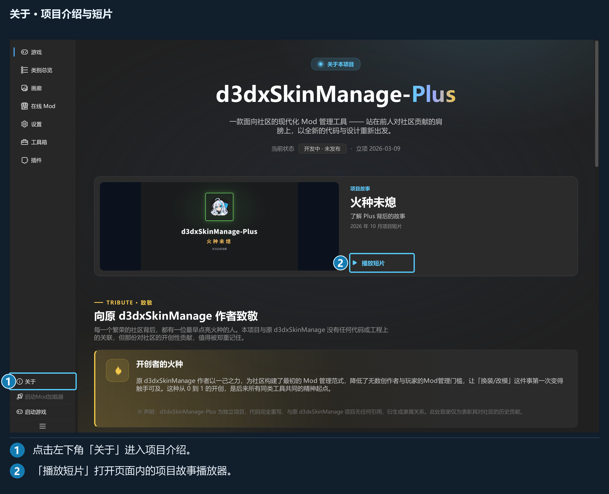


*普拉莎是本项目的原创看板娘，在教程中陪你熟悉各项操作。*

从导航下方「关于」进入，可查看项目介绍、原作者致敬、项目时间线、团队与贡献者，以及许可说明。

可在关于页播放项目短片，并使用页面内的播放控件。移动程序时请保留随包媒体目录。

项目采用 PolyForm Noncommercial 1.0.0 与署名完整性附加条款，具体权利与条件以随包 LICENSE 为准。修改或分发时保留所需署名和第三方声明。

管理器自身的版本和更新操作在「设置 → 更新 → 程序更新」。

---

## 第 8 章 · 数据、备份与排障

### 8.1 先找到实际数据根目录


程序优先把个人数据保存在程序所在目录。程序目录不可写时，会使用 Windows 用户数据目录，通常为：

```text
%LOCALAPPDATA%/d3dxSkinManage-Plus/
```

可通过「打开语言包文件夹」「打开插件目录」「打开日志目录」核对当前使用的位置，再确认同一数据根下的 `config/`、`data/`。

单文件发行包也附带语言、插件、教程和媒体资源目录。迁移时保留完整发行包，不要只留下 exe。

### 8.2 需要保留哪些文件

| 位置 | 内容 | 备份建议 |
| --- | --- | --- |
| `config/settings.json` | 程序偏好与快捷键覆盖 | 保留 |
| `config/games.json` | 游戏列表、路径、激活游戏、当前组合、社区匹配 | 保留 |
| `config/plugin_state.json` | 插件启用、信任等状态 | 保留 |
| `config/languages/` | 默认及自定义语言文件 | 保留，特别是自行修改的内容 |
| `data/mod_index.db` | 当前资源和部署索引 | 关闭程序后备份 |
| `data/presets.json` | 所有游戏的组合预设 | 保留 |
| `data/<游戏资源目录>/mods/` | 分类目录、完整 Mod 容器 | 必须保留 |
| `data/<游戏资源目录>/` 中的偏好与其他记录 | 游戏私有状态、变体工作状态、预览等 | 整个目录一起备份 |
| `data/downloads/` | 下载源包及队列信息 | 有未安装或需要留档的包时保留 |
| `plugins/` 与插件个人存储 | 已安装插件及其数据 | 需要继续使用时保留 |
| `cache/` | 可再生缓存 | 不作为唯一备份来源 |
| `logs/` | 排障日志 | 出问题时保留相关会话 |
| 外部加载器和部署目录 | 加载器配置、受管部署及手动资源 | 有自定义或手动内容时单独备份 |

完整容器内的 `.d3dxmod`、`.d3dxmeta/` 都属于必要数据。类别目录中的 `.d3dxcategory` 也要保留。

命名变体保存在 `.d3dxmeta/variants/`。备份时需同时保留完整 Mod 容器和 `presets.json`，才能恢复组合及其引用的外观方案。

### 8.3 推荐的完整备份流程

1. 等导入、导出、部署、更新和恢复任务结束。
2. 正常退出程序；若游戏或加载器仍在写配置，也先结束相关操作。
3. 复制实际数据根中的 `config/`、`data/`、`plugins/` 及需要的外部素材。
4. 另存自定义加载器配置与部署目录中的手动资源。
5. 将备份放在与源数据不同的位置，并抽查容器、元数据和预设文件。

程序运行时数据库可能同时使用 `-wal`、`-shm` 等文件。正常关闭后再复制，避免拿到时点不一致的数据。不要只挑一个正在写入的数据库文件拷走。

单独分享某个 Mod，使用总览的导出并选择附带元数据；分享分类结构则使用 `.d3dxcp`。两者都不能代替整机数据备份。

### 8.4 换目录、换磁盘或换电脑

迁移整个管理器时，先按上节备份并退出，再复制完整发行包和个人数据。新位置启动后逐个检查：

- 游戏可执行文件和加载器路径。
- 「Mod 文件夹」指向的实际部署位置。
- 外部背景图片、视频或 WE 场景及程序路径。
- 自装字体、语言包和插件是否仍可用。
- 游戏资源盘是否已连接。

程序内受管的部分路径可相对数据根保存；外部游戏、加载器和媒体路径仍可能需要重新填写。

改变部署位置优先使用「游戏」页提供的迁移确认。不要把一份不完整部署目录当成新的 Mod 库重新导入，尤其不能丢弃身份标记后再混用旧索引。

### 8.5 文件身份、校验与恢复提示

> [](../images/plusa/05-哭泣.webp) **普拉莎提醒：** 遇到校验或恢复提示，先保留完整原包和记录。不要删除身份标记或数据库来消除提示，按下表核对原因。

程序会在操作前核对受管源文件、元数据和部署记录。以下变化可能导致写入被阻止：

| 提示类型 | 优先处理 |
| --- | --- |
| 文件不存在或磁盘离线 | 接回磁盘，检查实际路径 |
| 文件正在被占用 | 关闭对应编辑器、预览或游戏相关操作后重试 |
| 源文件或元数据已变化 | 重新选择对象、刷新并核对修改来源 |
| 身份不一致或无法确认归属 | 保留完整容器与记录，检查是否只复制或替换了部分文件 |
| 校验不一致 | 保留原包和错误信息，确认文件是否损坏或被改动 |
| 有未完成事务 / 回退 / 清理 | 等待恢复，或按提示重新启动并重试 |

这类提示用于避免对错误对象继续操作。**不要删除标记、数据库或事务记录来消除提示。** 需要恢复的文件内容和路径信息可能就在这些记录里。

### 8.6 常见问题

> [](../images/plusa/03-无语滴汗.webp) **普拉莎提醒：** 先从当前游戏、实际路径和任务结果查起。每次只调整一处，保留原始错误文字，方便判断是哪一步出了问题。

| 现象 | 排查方法 |
| --- | --- |
| 启动后游戏列表为空 | 确认使用了正确的数据根；首次安装本来就是空列表 |
| 页面被激活提示遮住 | 在「游戏」页双击目标游戏 |
| 无法导入到根级 | 先进入类别 |
| 已导入却找不到 | 检查当前游戏、类别、搜索词、类型、分级和标签条件 |
| 启用后游戏无变化 | 检查部署位置、加载器是否运行、Mod 适配版本，以及是否已重载 |
| 空格、F2 等没有执行 | 先单选总览中的项目并移出文本框，再核对自定义绑定 |
| 按键页没有绑定 | Mod 的 INI 未提供可识别绑定，或读取尚未完成 |
| 变体无法保存 | 启用 Mod，确认支持持久化变量，并让加载器先写入当前配置 |
| 变体显示状态未确认 | 回游戏保存配置后重新读取，或明确选择使用默认值补齐 |
| 改了变体，游戏仍是旧外观 | 按加载器配置重载，避免未写入的游戏状态覆盖已保存选择 |
| 在线页提示未收录 | 核对游戏英文名和站点收录情况 |
| 下载失败或速度慢 | 测试网络与代理，检查磁盘空间，再重试 |
| 下载完成但未安装 | 核对待安装目标，切回所属游戏，再查看任务结果 |
| 更新检测不完整 | 处理联网或来源读取错误后重新检查 |
| 程序没有可用更新 | 检查是否配置更新源，以及发行者是否发布新包 |
| RAR 可读却不能导出 RAR | 创建 RAR 需要安装 WinRAR |
| 图片占用较高 | 调整图片内存额度或清理图片缓存，不要清空资源数据 |
| 视频或 WE 场景不播放 | 检查素材路径、格式、完整场景目录和本机 WE 程序 |
| 重建后仍有缺项 | 查看报告中的无效元数据、身份冲突或源文件缺失，逐项处理 |

### 8.7 提交问题反馈


*把操作步骤、错误文字和同一时段的日志放在一起，便于复现和定位。*

从「工具箱 → 查看日志」找到本次问题的启动会话，保留操作前后记录。建议提供：

- 程序版本和 Windows 版本。
- 从哪个页面开始，依次点了什么。
- 预期结果、实际结果及完整错误文字。
- 对应时间段日志；更新器问题附更新器日志。
- 是否涉及外部移动、改名、断开的磁盘或自定义插件。

截图反馈可把游戏、Mod 名称与个人路径替换或遮挡，保留按钮、状态和错误文字。日志也应先检查是否含个人路径或凭据。

---

## 附录 A · 默认快捷键速查

以下为程序默认绑定。已自定义或被插件冲突处理改变的键，以「设置 → 快捷键」为准。

| 默认键 | 动作 | 生效位置 |
| --- | --- | --- |
| `Ctrl+C` | 复制 | 文本区域；组合预设列表复制预设 |
| `Ctrl+X` | 剪切 | 文本区域；总览准备移动选中项 |
| `Ctrl+V` | 粘贴 | 文本、总览或组合预设列表 |
| `Ctrl+A` | 全选 | 当前文本区域、总览或组合列表 |
| `Delete` | 删除 | 文本或总览选中项，项目删除仍需相应确认 |
| `F5` | 刷新当前游戏库 | 主窗口 |
| `Ctrl+I` | 导入 Mod | 已激活游戏且已经进入目标类别 |
| `Ctrl+F` | 搜索当前页面 | 支持搜索的当前页 |
| `Ctrl+K` | 搜索全部设置 | 主窗口 |
| `Ctrl+,` | 打开设置 | 主窗口 |
| `Ctrl+1` | 游戏 | 主窗口 |
| `Ctrl+2` | 类别总览 | 主窗口 |
| `Ctrl+3` | 画廊 | 主窗口 |
| `Ctrl+4` | 在线 Mod | 主窗口 |
| `Alt+Left` | 返回上一级 / 关闭在线详情 | 对应页面 |
| `Ctrl+Shift+N` | 新建类别 | 类别总览 |
| `F2` | 编辑选中项目 | 总览中单选一个 Mod 或类别 |
| `Space` | 启用或禁用 | 总览中单选一个 Mod |
| `Ctrl+Shift+E` | 导出选中项目 | 类别总览 |
| `F6` | 启动 Mod 加载器 | 已配置有效加载器 |
| `F7` | 启动游戏 | 已配置游戏可执行文件 |

`Esc`、编辑窗口的 `Ctrl+Enter` 等是上下文操作，不属于上表可自定义命令全集。游戏内 F10 则由 3DMigoto 配置。

---

## 附录 B · 操作范围速查

| 你要做的事 | 使用的入口 | 重点 |
| --- | --- | --- |
| 暂时不用一个 Mod | 禁用 | 保留库内源容器 |
| 删除一个 Mod | 总览删除 | 看清回收站或永久删除方式 |
| 删除整个游戏的数据 | 游戏页删除 | 永久清理资源、配置及受管部署，先备份 |
| 换一套启用搭配 | 组合预设 | 同时包含 Mod 选择与变体引用 |
| 换单个 Mod 的内部造型 | 变体 | 需要 Mod 自身支持对应变量 |
| 分享空的分类结构 | 导出分类预设 | 输出 `.d3dxcp`，不含 Mod |
| 分享 Mod 及其命名方案 | 导出 Mod并附带元数据 | 检查输出包，保留完整关联内容 |
| 清理可再生图片 | 图片与缓存 | 分清内存清理与磁盘清理 |
| 清理重复下载源包 | 下载数据 → 清理已安装 | 尚未安装的下载继续保留 |
| 重置程序偏好 | 恢复默认 | 有确认，游戏配置与已导入 Mod 保留 |
| 修复索引 | 工具箱 → 重建索引 | 源文件须仍完整，不能恢复已删除资源 |
